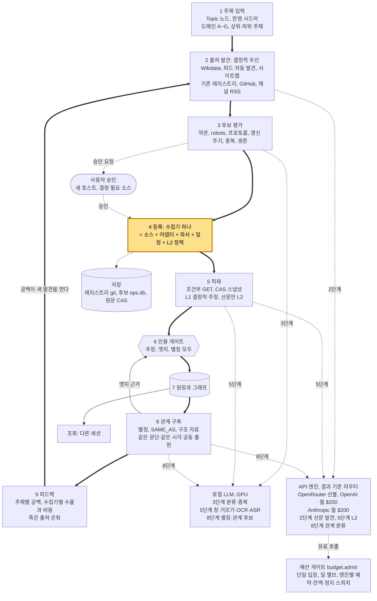
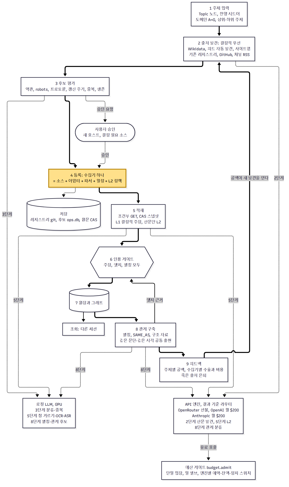
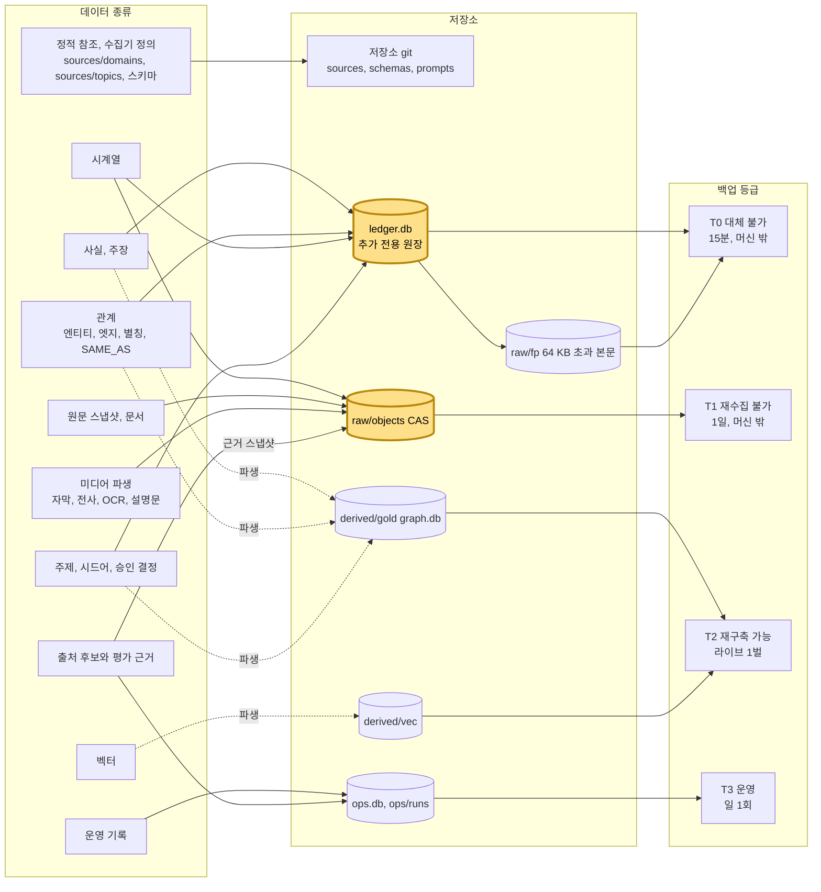
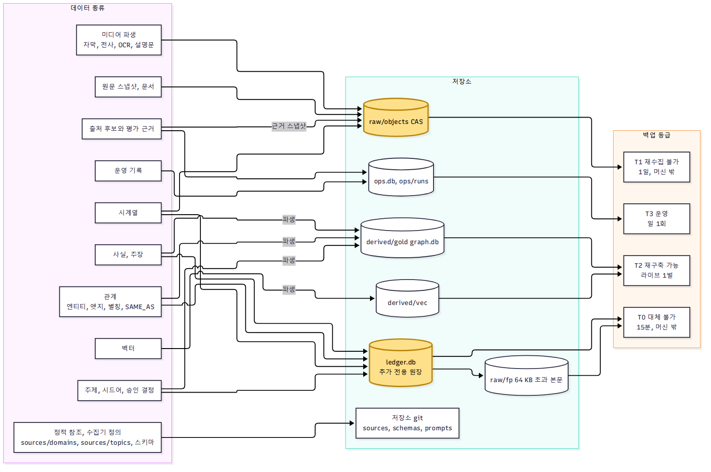
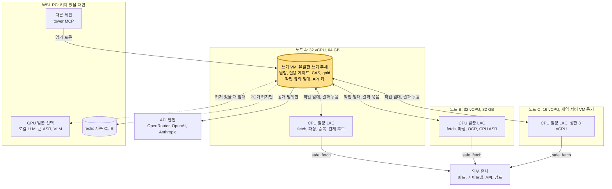
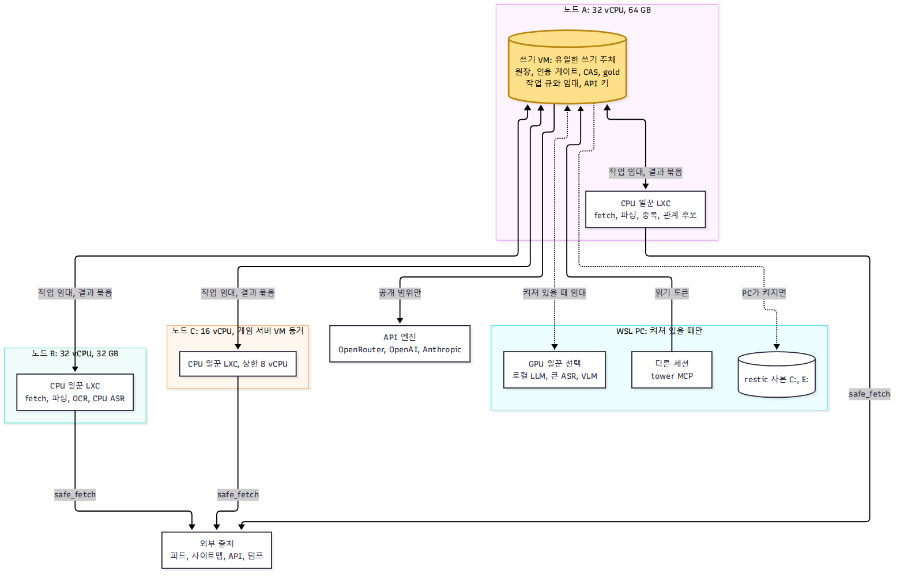

# ADR-0004: 결정적 수집 우선의 연구 백엔드

- 날짜: 2026-11-04
- 상태: 승인(2026-11-04, 사용자 "승인하고 구현 (Recommended)"). 구현 단계다. 이 문서 작성 시점에는 코드, 설정, 타이머, Proxmox를 바꾸지 않았다. VM과 LXC 생성은 이전 시점에 사용자가 다시 확인한다.
- 개정: 2026-11-04 2판. 사용자 지적에 따라 주제 기반 수집 생애 주기(T장)를 중심으로 다시 썼고, 관계 구축(R장), Proxmox 독립 실행(P장)을 더했다. 크레딧 금액, 미디어 정책, 로컬 LLM 배치를 고쳤다.
- 입력: ADR-0001(쓰기 경로, 적재 계약, 인용 게이트, 에이전트), ADR-0002(사용자 결정), ADR-0003(라우팅, 밸브, 전환 규칙), `docs/runbooks/first-collection.md`, 2026-11-04 진단(`diag-1104`, 리드 전달), 큐 사본 측정(부록 B).
- 사용자 지시(2026-11-04, 리드 경유, 최신 지시가 앞선 지시를 대체한다):
  - 엔진: "openrouter 성격들의 플랫폼 토큰들은, $200 플랜에 포함되어 있어서 그걸 잘 사용하는 방향".
    - 자동 작업은 API 키만 쓴다. 대상은 OpenRouter 선불, OpenAI API 크레딧, Anthropic API 크레딧, 로컬 LLM이다.
    - 금액(사용자, 2026-11-04): Claude 플랜과 GPT 플랜이 둘 다 $200이고, 각각 월 $200의 플랫폼 API 크레딧을 준다. Anthropic API 월 $200, OpenAI API 월 $200이고 둘 다 매월 다 쓴다. OpenRouter는 2026-11-30까지의 일회성 잔액이다.
    - 소비자 구독은 대화형 세션 전용이다. 자동 작업에서 뺀다.
    - 기존 Codex 경로는 OpenAI API 과금과 별개다.
  - 라우팅: "결과만 잘 나온다면야, gpt를 쓰든, claude를 쓰든, openrouter를 쓰든 관심이 없어, 또한 openrouter를 제외하곤 월마다 각 서비스별로 플랫폼 토큰은 다써야 해."
  - 로컬: "단순한 결정론적의 경우엔, 로컬 llm 사용 계획도 하나 잡자."
  - 번역: "원천 소스를 추출하는 데 집중하고, 번역은 현재 고려하지 말자. 번역은 가시화하는 곳에서 고려해야하는 정보... 원천 데이터들의 관계가, 동음이의어로, 관계가 표현되면 됨."
  - "기반을 고도화하자. 굳이 llm이 필요 없는 것들은 없애고, rss나 정보수집 프로토콜들 있잖아. 그걸 적극적으로 활용하는게 나아보임."
  - "토큰 히트 시킬 방법도 고려해줘."
  - "종합적인 결론으로 시스템 설계도가 나왔으면 좋겠어."
  - 설계 전에는 추출을 재개하지 않는다. 사고 1, `llm:stop`, Sol 정지 상태는 그대로 둔다.
  - 지출 속도는 엔진별 플래그다. 기한 소진 전략을 박아 넣지 않고, 기한 계산은 정보로만 싣는다.
  - 수집의 본질(2026-11-04): "아직도 설계도에 본질인 어떻게 정보를 수집할지가 안보임. 내가 생각하는 것은 주제를 던졌을 때, 해당 주제에 포함되는 원천정보 수집기들을 어떻게 등록하고 어떻게 정보를 적제하고 관계를 세팅할지를 모르겠어." → T장.
  - 미디어(2026-11-04): 사용자 질문으로 남기지 말고 정책을 제안한다. 관계 구축이 목적이고 미디어의 의미가 중심이다 → 11.3.
  - 로컬 LLM(2026-11-04): 곁가지가 아니라 생애 주기 각 단계에 넣는다 → T.10.
  - 관계(2026-11-04): 관계 구축을 독립 장으로 다룬다 → R장.
  - Proxmox(2026-11-04): "sagae-cpu farm(proxmox)를 더 잘 사용할 방법을 고민해봤으면 좋겠어. kb는 proxmox에서 독립적으로 동작하고, 넘치는 cpu 자원을 가지고 정보를 방대하게 수집 및 정적 가공해주는게 핵심이라고 생각해." → P장.
  - 이미 정한 것(2026-11-04): YouTube 채널 RSS는 결정 1의 예외로 허용한다. Wikidata는 User-Agent 이름 `sagae-agent`, 연락처 `user@example.com`(사용자가 지정한 프로젝트 연락처)로 허용한다. 사고 1은 이 설계가 배포될 때 닫는다.
  - 결정(2026-11-04, 사용자 AskUserQuestion 직접 답변):
    - ADR-0004 구현 승인: "승인하고 구현 (Recommended)".
    - 백업(P.5): "A". 라이브는 Proxmox, restic은 쓰기 VM에서 PC의 C:와 E:로(PC가 켜져 있을 때). Proxmox 안 사본은 없다. 결정 2는 그대로다.
    - 자동 등록 경계(T.3): "이 기준이면 자동 (Recommended)".
    - Proxmox 배치(P.1): "승인 (Recommended)". VM과 LXC 생성은 이전 시점에 사용자가 다시 확인한다.
- 표기:
  - **[실측]** 저장소 데이터나 사본에서 잰 값이다.
  - **[추론]** 측정값으로 계산하거나 해석한 값이다.
  - **[설정값]** 이 문서가 제안하는 값이고 측정이 아니다.
  - **[S#]** 부록 A의 외부 출처다. 전부 2026-11-04에 가져왔고, 버전이나 날짜가 있으면 함께 적었다.
  - **[미확인]** 공식 문서로 확인하지 못한 항목이다.
  - 저장소 사실은 `파일:줄`로 적는다.

## 1. 결정 요약

0. **수집의 본체는 주제 생애 주기다(T장).**
   - 주제(`Topic` 노드)를 던지면 결정적 발견 → 후보 평가 → 수집기 등록 → 적재 → 인용 게이트 → 그래프 → 관계 → 공백 피드백이 돈다.
   - 수집기 하나는 소스 + 프로토콜 어댑터 + 파서 + 일정 + L2 정책이다. 레지스트리 항목으로 등록한다(T.4).
   - 사람은 새 호스트와 결정이 필요한 소스만 승인한다. 나머지는 자동이다(T.3).
   - 관계는 독립 단계다. 구조 자료와 Wikidata가 먼저이고, 로컬 후보 뒤에 필요한 것만 API가 분류하며, 모든 엣지는 끝점 근거를 들고 게이트를 지난다(R장).
1. **결정적 수집을 기본으로 한다.**
   - 구조 자료(패키지 메타데이터 JSON, 차트 표, 변경 로그, 릴리스, 상태 피드)는 L1 결정적 파서가 맡고 L2 큐에 넣지 않는다. 큐 사본에서 살아 있는 L2 행 294,708개 중 34.1%(100,459개)가 이 범주였다. [실측, 부록 B]
   - 번역본 문서(12.5%, 36,750개)는 L2에서 뺀다. 번역은 가시화 쪽(sagae-tools)의 일이다. 한영 표기는 출처가 있는 별칭과 동일 대상 관계로만 잇는다(3.3).
2. **LLM은 판단이 필요한 곳에만 쓴다.**
   - 원천 산문 추출, 새 출처와 엔티티 발견, 관계 분류, 생존 근거 읽기, 티켓 조사가 대상이다.
   - 분류, 반정형 필드 대응, 중복과 별칭 후보처럼 결정적에 가까운 일은 로컬 LLM이 맡는다(7.8).
3. **모든 쓰기는 지금의 인용 게이트를 지난다.** 결정적 파서, 로컬 LLM, L2, 에이전트 모두 같다(ADR-0001 10.6, `docs/adr/0001-architecture.md:943-963`). 엔진별 예외나 문턱은 없다.
4. **엔진은 API 키 셋과 로컬 하나다.**
   - API 키 엔진: OpenRouter 선불(일회성 잔액, 2026-11-30까지), OpenAI API 크레딧(월 $200), Anthropic API 크레딧(월 $200, 결제 주기마다 만료[S14]). 두 월 크레딧은 매월 다 쓴다(사용자, 2026-11-04).
   - 로컬: llama.cpp sLLM. 생애 주기 각 단계의 분류, 중복, 별칭, 관계 후보, 창 거르기, OCR, ASR을 맡는다(T.10). 운영 설치는 아직 없다.
   - 소비자 구독(`/login`)은 자동 작업에서 쓰지 않는다. 그래서 초과 사용 신호는 API 엔진을 멈추지 않는다(7.5).
5. **라우팅은 결과 기준이다.**
   - 과제 종류마다 (엔진, 모델) 후보를 두고, 측정된 품질 조건 아래에서 달러당 수락 단위가 큰 쪽을 고른다.
   - 탐색 몫을 두어 측정을 계속한다(7.4).
   - 벤더는 기준이 아니다. 민감 범위는 로컬만 고를 수 있다.
6. **지출 속도는 엔진별 플래그다(7.3).**
   - 월 플랫폼 크레딧(OpenAI, Anthropic)의 기본 모드는 `monthly_full`이다. 쓸모 있는 일을 주기 앞쪽에 몰고, 주기 끝에 따라잡기를 하며, 여전히 상한 안이다.
   - OpenRouter의 기본 모드는 `fixed_daily`다. 기한 계산은 정보다.
   - 상한 없는 지출은 어디에도 없다.
   - 엔진은 작업 시작 전에 고정하고, 실행 중 다른 엔진으로 넘기지 않는다.
7. **에이전트 실행 환경은 새로 만들지 않는다.** 지금의 Claude Code 워크플로우(`kb-agent-run`, `kb-collect` MCP, `.claude/agents/kb-*.md`)를 쓴다.
   - 과금은 Anthropic API 키(`--bare`, 격리 설정 디렉터리)나 OpenRouter의 Anthropic 호환 엔드포인트로 간다(7.2).
   - 단발 작업과 L2는 Python 어댑터로 OpenRouter, OpenAI API(Responses, Batch), Anthropic API(Messages, Batches), 로컬을 쓴다.
   - Claude Code 경유가 실패하면 대체 후보는 PydanticAI다(6.4).
8. **캐시 적중을 설계로 올린다(8장).**
   - 고정 부분이 앞에 오는 프롬프트 순서를 쓴다.
   - 문서 단위로 꺼내고, 적중률을 지표와 파일럿 합격선에 넣는다.
   - 아낀 돈은 같은 목표 안에서 더 많은 일로 바뀐다.
9. **월 크레딧을 다 쓰는 것은 일의 양에 달려 있다.** [추론, 7.7]
   - Anthropic Haiku 5.5 단가로는 월 $200이 산문 적체 전체(약 $37)보다 훨씬 크다. OpenAI 월 $200도 Sol 배치로 약 45,000창이다.
   - 그래서 적체가 빈 뒤의 월 크레딧은 에이전트(출처 발견, 티켓), 교차 확인, 관계로 간다.
   - 그래도 남으면 미달을 보고한다. 쓸모없는 호출로 채우지 않는다.
10. **재개 순서.** 이 설계가 승인되고 D1, E1, C1이 끝나기 전에는 추출을 재개하지 않는다. 사고 1, `llm:stop`, Sol 정지는 그대로다. 종결 절차는 7.5다.
11. **소규모 파일럿을 먼저 돌린다.** OpenRouter, OpenAI API, Anthropic API(키가 있을 때), 로컬에서 달러당 수락 단위, 캐시 적중률, 인증 서명을 잰 뒤에만 확대한다(13장).
12. **미디어는 의미와 시각을 남기고 바이트를 남기지 않는다(11.3).** YouTube는 채널 RSS 메타데이터부터 시작한다. 공식 자막, 공식 전사가 먼저이고, 없을 때만 로컬 ASR, OCR이 돈다. API 엔진은 바이트를 받지 않는다.
13. **KB는 Proxmox에서 독립 실행한다(P장).** 쓰기 VM 하나가 원장과 게이트를 갖고, CPU 일꾼이 임대한 정적 가공을 맡으며, PC의 GPU는 선택 일꾼이다. 백업은 결정 2를 지키는 A안으로 정했다(P.5). 설치형 프로그램(K1)이 이전 수단이 된다.

## T. 주제 기반 수집 생애 주기(이 설계의 중심)

사용자 지적(2026-11-04, 원문): "아직도 설계도에 본질인 어떻게 정보를 수집할지가 안보임. 내가 생각하는 것은 주제를 던졌을 때, 해당 주제에 포함되는 원천정보 수집기들을 어떻게 등록하고 어떻게 정보를 적제하고 관계를 세팅할지를 모르겠어."

이 장이 그 답이다. 나머지 장(엔진, 캐시, 저장, 미디어)은 이 고리에 붙는 부품이다.

### T.0 한 장 요약과 설계도

**핵심 문장.** 주제 하나를 던지면, 결정적 발견이 출처 후보를 내고, 평가를 통과한 후보가 수집기(소스 + 어댑터 + 파서 + 일정 + L2 정책)로 등록되고, 수집기가 적재한 주장과 엣지가 인용 게이트를 지나 그래프에 들어가며, 주제별 공백이 다시 발견을 연다. 엔진, 로컬 LLM, 저장소는 이 고리에 붙는다.

**요소.**

| id | 요소 | 이 문서 위치 |
|---|---|---|
| T1 | 주제 입력: Topic 노드, 한영 시드어, 도메인 A~G, 상위·하위 주제 | T.1 |
| T2 | 출처 발견: Wikidata, 피드 자동 발견, 사이트맵, 기존 레지스트리, GitHub, 채널 RSS | T.2 |
| T3 | 후보 평가: 약관, robots, 프로토콜, 갱신 주기, 중복, 생존 | T.3 |
| T4 | 등록: 수집기 하나 = 소스 + 어댑터 + 파서 + 일정 + L2 정책(강조 대상 하나) | T.4 |
| T5 | 적재: 조건부 GET, CAS 스냅샷, L1 결정적 주장, 산문만 L2 | T.5 |
| T6 | 인용 게이트: 주장, 엣지, 별칭 모두 | T.5, R.4 |
| T7 | 원장과 그래프 | 11.2 |
| T8 | 관계 구축: 별칭, `SAME_AS`, 구조 자료, 같은 문단·같은 시각 공동 출현 | T.6, R장 |
| T9 | 피드백: 주제별 공백, 수집기별 수율과 비용, 죽은 출처 은퇴 | T.7 |
| U | 사용자 승인: 새 호스트, 결정이 필요한 소스 | T.3 |
| LOC | 로컬 LLM, GPU: 3단계 분류·중복, 5단계 창 거르기·OCR·ASR, 8단계 별칭·관계 후보 | T.10, 7.8 |
| ENG | API 엔진과 결과 기준 라우터: OpenRouter 선불, OpenAI 월 $200, Anthropic 월 $200. 2단계 산문 발견, 5단계 L2, 8단계 관계 분류 | T.8, 7장 |
| STO | 저장: 레지스트리 git, 후보 `ops.db`, 원문 CAS | T.9, 11.2 |
| USE | 조회: 다른 세션 | ADR-0001 15장 |

**관계.**

- 등뼈(굵은 선): T1 → T2 → T3 → T4 → T5 → T6 → T7 → T8 → T9, 그리고 T9 → T2(공백이 새 발견을 연다).
- T8 → T6: 관계도 엣지 근거를 들고 게이트를 지난다.
- T3 → U(승인 요청), U → T4(승인).
- T4 → STO(레지스트리 git과 후보 기록).
- T3·T5·T8 → LOC(각각 3·5·8단계 과제), T2·T5·T8 → ENG(각각 2·5·8단계 공개 범위 과제), ENG → GATE(유료 호출의 유일한 입장).
- T7 → USE.





렌더링:

- `mmdc`(mermaid-cli, `/home/user/.nvm/versions/node/v26.13.0/bin/mmdc`)로 `-s 2`, `wrappingWidth` 320으로 다시 렌더링했다. 좌표는 쓰지 않았다. 결과는 1568 × 2636 px다.
- 이번 패스는 수정 없이 1회에 끝났다. 단계별 과제 선을 3단계(T3), 5단계(T5), 8단계(T8)와 2단계(T2)에서 각각 내고, 엔진 아래에 예산 게이트(`budget.admit`)를 더했다.
- 요소 15개와 관계 21개를 그림과 대조했다. 빠진 것이 없고 라벨이 출발 단계와 맞는다.
- 강조는 T4 등록 하나다. 사용자가 보이지 않는다고 한 곳이 여기다.
- 남은 문제: 5단계에서 엔진으로 가는 점선이 9 → 2 등뼈 선과 한 곳에서 교차한다(선 건너뛰기로 표시됨).

### T.1 주제 입력

**주제는 그래프의 노드다.** 새 타입 `Topic`이다. 묶음은 `user`이고, 사용자가 만든 정보이므로 `origin=first_party`, 작성자는 `user:sagae`다(ADR-0001 7.8, `docs/adr/0001-architecture.md:551-563`). 지금 타입 목록에는 없다(`schemas/types/*.json`에 `Topic.json`이 없음). 운영 그래프에도 없다. [실측, `~/sagae-kb-data/derived/gold/current/graph.db`를 `mode=ro`로 읽음, 2026-11-04]

| 필드 | 뜻 | 예(T.11) |
|---|---|---|
| `key` | `topic:<slug>`. 엔티티 ID 규칙(`e:<type>:<slug>`, ADR-0001 7.5)을 그대로 쓴다 | `e:topic:youtube-shorts` |
| `label` | 사용자 표기 | `유튜브 쇼츠` |
| `aliases` | 한영 시드어. 첫 등록 때는 사용자 입력이고, 근거가 붙은 별칭(Wikidata 라벨 등)은 R.2 경로로 더한다 | `YouTube Shorts`, `쇼츠`, `Shorts` |
| `props.scope` | 범위 설명 문장(사용자 판단, 작성자 표시) | "쇼츠 형식의 정책, 수익화, 추천, 제작 관행" |
| `props.exclude` | 범위 밖 표현 | `["쇼츠 광고 집행"]` |
| `domain` | A~G 목록. 기존 `node_domain`(ADR-0001 7.2)에 들어간다 | `[A, B, D]` |
| `props.anchors` | 외부 식별자 앵커. 발견이 채운다 | `{wikidata: Q99438379}` |
| 엣지 `PART_OF` | 상위 주제(기존 타입) | `e:topic:youtube-shorts -PART_OF-> e:topic:youtube` |
| `props.budget_usd_month` | 주제별 월 유료 상한 [설정값, 기본 $10] | 10 |
| `props.status` | `active`, `paused`, `retired` | `active` |

- 시드어는 별칭 표(`alias`, ADR-0001 7.2)에 들어간다. 그래서 `kb_search`가 한국어와 영어 어느 쪽으로도 주제를 찾는다.
- 사용자의 범위 문장은 사실이 아니다. `Topic` 노드의 속성이고, 주장으로 투영하지 않는다.

**명령과 MCP.**

```sh
kb topic add --label "유튜브 쇼츠" --alias "YouTube Shorts" --alias "쇼츠" --alias "Shorts" \
  --domain A,B,D --parent topic:youtube --scope "쇼츠 형식의 정책, 수익화, 추천, 제작 관행" --json
kb topic show topic:youtube-shorts --json      # 시드어, 앵커, 수집기, 공백, 비용
kb topic list --json
kb topic pause|retire topic:youtube-shorts     # 수집기는 지우지 않는다. 주제 연결만 닫는다
```

- `kb topic add`는 `entity.put`(`Topic`)과 `edge.put`(`PART_OF`)을 쓴다. TTY에서는 작성자가 `user:sagae`다(ADR-0001 7.8). [설정값]
- 다른 세션은 MCP `kb_request(topic, reason, url)`(`src/kb/serve/mcp.py:606`)에 `kind="topic"`을 더해 요청한다. 이 경로는 티켓만 열고 `Topic`을 만들지 않는다. 사용자 승인 뒤 `kb topic add --from-ticket <t-id>`가 만든다. `kb_request`는 호출마다 사용자 확인을 받는다(ADR-0001 15.4, `docs/adr/0001-architecture.md:1226-1232`).
- 기존 `kb-first-collect`는 도메인별 시드 문자열을 인자로 받는다(`.claude/workflows/kb-first-collect.js:56,66`). 그 자리를 `Topic` 노드가 대신한다.

**외부 작성자가 보낸 주제(예: sagae-tools 편집기).** ADR-0005 3.6, 4.1–4.2, 5.7, 6.6의 사용자 결정(2026-11-04)에 맞춘 입력 형태다. 편집기 자체는 설계하지 않는다.

- 형태: first_party `record`의 타입은 `TopicSpec`이고, 수집의 닻인 `Topic` 엔티티 `e:topic:<slug>`를 `DEFINES` 엣지로 정의한다. `title`은 라벨, `body`는 범위 설명이며 사실 주장으로 투영하지 않는다. `props`는 `slug`, `aliases`, `domain`, `parent`, `exclude`, `export_llm`, `export_query`만 받는다. 생략 slug는 새 spec ID로 ADR-0005 4.2의 결정적 해시를 계산하며 PUT 생략은 기존 slug 유지다. 엔진·수집 방식·예산은 편집기 입력이 아니다. 적재 묶음의 `producer`는 `user:*`이어야 하며 에이전트 묶음의 `record`는 `E_POLICY`로 거부된다(ADR-0001 7.8, 9.2).
- 작성자: 서버가 전송 계층에서 정한다. MCP `kb_put`으로 오면 `agent:<세션>` + `on_behalf_of=user:sagae`이고, tower 뒤에서는 `agent:tower`다(ADR-0001 7.8). `kb_put`은 호출마다 사용자 확인을 받는다(ADR-0001 15.4). 그래서 확인을 거친 기록만 `Topic.status=active`가 된다. 확인 없이 들어온 에이전트 기록은 `proposed`로 두고 수집을 돌리지 않는다. 주제는 유료 수집을 여는 스위치이기 때문이다. [설정값]
- 메모에서 승격: 메모는 first_party `Note`다. 새 `TopicSpec`에서 원본 메모로 `PROMOTED_FROM`을 연결하고 `DEFINES`로 `Topic` 엔티티를 정의한다. 메모는 지우지 않는다. 승격은 원본 민감도를 상속하며 생략으로 낮추지 않는다(ADR-0005 5.7).
- KB 운영 설정의 수집 방식 `collect_mode`(편집기 `TopicSpec.props`에는 받지 않는다):
  - `kb`: 이 장의 생애 주기(T.2~T.9)가 돈다. 기존 경로로는 `kb_request(kind="topic")` 티켓이 같은 결과를 낸다.
  - `workspace`: 외부 연구 작업 공간(agent-run)이 조사한다. KB는 발견(T.2)과 등록(T.4)을 돌리지 않는다. 결과는 `kb-ingest/1` 묶음으로 돌아오고, 머리의 새 선택 필드 `topic`(`ticket`과 같은 방식, ADR-0001 9.1)이 있으면 수락된 주장과 엔티티마다 서버가 `IN_TOPIC` 엣지를 단다. 같은 인용 게이트를 지난다. 작업 공간이 찾은 출처 URL은 `source_candidate`로 들어와 T.3 평가를 받는다.
  - `both`: 둘 다. 비용 귀속(T.8)은 KB 쪽 호출만 센다.
- first_party 게이트: 원장 `meta.fp_open`이 열려 있어야 쓰인다. 닫혀 있으면 `H_FP_CLOSED`로 보류된다(`src/kb/ingest/process.py:432-435`). 2026-11-04 원장 `meta`에 `fp_open`이 있다. [실측, `mode=ro`]
- 민감도: 새 `TopicSpec`은 기본 `private`이며 주제 엔티티·연구 티켓·실행 기록은 spec 민감도를 상속한다(ADR-0005 3.6, 6.1). `export_llm` 기본은 `false`이며 허가 없이 제목·별칭·제외 표현·slug를 외부 LLM이나 수집 프로필에 싣지 않는다. `export_query`는 public/internal에서 기본 `true`이고 private에서는 두 export 플래그 모두 생략 시 `false`, 명시한 `true`는 `schema_invalid`다. private spec은 외부 검색·외부 LLM을 호출하지 않는다. 쓰기 시 비밀 탐지를 지나고 외부 전송 허가가 있어도 비밀 탐지·내부 주소 제거를 적용한다. private 메모의 publish 예외는 ADR-0005 5.10의 전송 전 WebAuthn 동의에 묶인다. 비밀 값은 외부 KMS에 있고 KB는 그 값을 받지 않으며 KMS 참조 문자열을 지식으로 투영하지 않는다.

### T.2 주제의 출처 발견(결정적 우선)

**입력.** 주제의 시드어, 앵커, 도메인이다.
**출력.** 출처 후보 목록이다. 후보마다 근거 스냅샷이 붙는다.
**명령.** `kb topic discover topic:youtube-shorts [--only wikidata,feeds,registry,github,ytrss] --json`이다. 기본은 시험 실행이고 후보만 쓴다. [설정값]

결정적 발견기. 위에서부터 돈다. 모두 `capture` 층(거부 호스트, robots, 서킷, 간격)을 지난다(`src/kb/collect/capturer.py:136-150`).

| 순서 | 발견기 | 입력 → 출력 | 근거 스냅샷 | 저장소 상태 |
|---|---|---|---|---|
| D-1 | 기존 레지스트리 대조 | 시드어와 앵커 → 이미 등록된 소스. 소스 이름, `domain`, 그 소스가 낸 엔티티의 별칭을 `kb_search`로 찾는다 | 기존 스냅샷 | 레지스트리와 검색은 있음(`src/kb/collect/registry.py:192-210`). 대조 명령은 없음 |
| D-2 | Wikidata | 시드어 → `wbsearchentities`로 Q-id 후보 → `wbgetentities`로 ko/en 라벨, 별칭, 속성. 출처가 되는 속성: P856(공식 웹사이트), P2397(YouTube 채널 ID), P1324(소스 저장소), P361(일부), P527(구성 요소), P127(소유자). User-Agent는 `sagae-agent (user@example.com)`(사용자 지정) | `Special:EntityData/<Q>.json` 스냅샷. 근거 선택자는 `json_pointer` | 없음(4.2 순위 2) |
| D-3 | 공식 사이트의 피드 자동 발견 | P856 등 공식 URL → `<link rel="alternate" type="application/rss+xml\|atom+xml\|feed+json">`[S41][S40] | 그 HTML 스냅샷 | 없음(4.1) |
| D-4 | robots.txt `Sitemap:`, 사이트맵, llms.txt | 공식 호스트 → 사이트맵 색인과 URL 패턴. 주제 시드어가 경로나 `<loc>`에 있는 하위 묶음만 후보로 낸다 | robots, 사이트맵 스냅샷 | 사이트맵과 llms.txt 발견기는 있음(`src/kb/parse/discover.py:43-88`) |
| D-5 | 패키지 레지스트리 | 시드어 → npm 검색, PyPI 프로젝트 JSON(이름을 알 때만)[S51][S52] | JSON 스냅샷 | 메타 파서는 있음(`src/kb/parse/adapters/github.py:94-136`). 검색은 없음 |
| D-6 | GitHub 토픽, 저장소 검색 | 시드어의 슬러그 → `GET /search/topics`, 저장소 검색. 인증 30회/분, 검색당 최대 1,000개[S101] | JSON 스냅샷 | 없음 |
| D-7 | YouTube 채널 RSS | Wikidata P2397과 문서 안 채널 링크 → `https://www.youtube.com/feeds/videos.xml?channel_id=<id>`. 사용자 결정 1의 예외로 허용(2026-11-04) | 피드 스냅샷 | 없음(지금 `src:yt-channel-rss`는 꺼짐, `sources/domains/platform.yaml:128-147`) |
| D-8 | 큐레이션 목록 | 이미 등록된 문서 안의 링크 목록(공식 "resources" 페이지, awesome 목록 저장소) → 외부 링크. 같은 호스트만 받는 지금 발견기 규칙(`src/kb/parse/discover.py:20-36`)과 달리 다른 호스트를 후보로만 낸다 | 원 문서 스냅샷 | 없음 |

**LLM이 맡는 부분.** 결정적 발견기가 후보를 3개 미만으로 내거나, 시드어가 고유 이름이 아닐 때(예: "쇼츠 편집 관행")만 돈다.

- 산문 검색: `kb-researcher`(URL 후보만, 본문 인용 금지, `.claude/agents/kb-researcher.md:1-12`)가 웹 검색으로 URL과 이유를 낸다. 엔진 팔은 7.4의 `agent`다.
- 판단: 후보 페이지가 주제에 해당하는지를 읽는 일이다. 로컬 분류(T.10)가 먼저 하고, 로컬이 불합격이거나 애매하다고 내면 API 단발 판단이 한다.
- LLM이 낸 후보도 같은 평가(T.3)를 지난다. LLM은 등록을 결정하지 않는다.

**후보 기록.** `ops.db`의 새 표 `source_candidate`다. `ops.db`에는 어휘 후보용 `candidate` 표가 이미 있어 이름을 나눈다(`src/kb/core/opsdb.py:33-34`).

```sql
CREATE TABLE source_candidate(id TEXT PRIMARY KEY,           -- cand-<blake2b(topic, canonical_url)>[:12]
  topic TEXT NOT NULL, url TEXT NOT NULL, canonical_url TEXT NOT NULL, host TEXT NOT NULL,
  protocol TEXT,                                       -- feed|sitemap|api|jsonld|html|llms_txt
  proposed_parser TEXT, found_by TEXT NOT NULL,        -- wikidata:Q866#P2397, autodiscovery:<snapshot>, agent:kb-researcher
  evidence_snapshot TEXT, evidence_pointer TEXT,       -- 근거 스냅샷과 json_pointer 또는 인용 위치
  checks BLOB, verdict TEXT NOT NULL,                  -- auto_attach|auto_register|needs_user|rejected
  reason TEXT, decided_by TEXT, decided_at INT, created_at INT NOT NULL);
```

- 후보는 운영 자료다. 잃어도 발견을 다시 돌려 만들 수 있다. 근거 스냅샷은 CAS에 있으므로 진실은 남는다.
- 사용자의 승인과 거부는 원장에 `source.approved`, `source.rejected` 이벤트로 남긴다. 새 이벤트 종류다(ADR-0001 7.1의 `source.*` 묶음에 더한다).

### T.3 후보 평가

| 검사 | 방법 | 자동 판정 |
|---|---|---|
| 호스트 정책 | `sources/host-policy.yaml` 거부 목록(`sources/host-policy.yaml:3-15`) | 거부 호스트면 `rejected`. 예외 경로(채널 RSS)는 T.4의 경로 허용으로만 풀린다 |
| robots | RFC 9309, 24시간 캐시(`src/kb/collect/robots.py:8`) | Disallow면 `rejected`. 사용자가 예외를 준 경로만 `robots: user_exception`(새 값) |
| 약관 등급 | 같은 호스트의 기존 소스 `policy.tos`를 물려받는다. 새 호스트면 `unverified` | `forbidden`이면 `rejected` |
| 프로토콜 | 응답 `Content-Type`, 본문 첫 바이트, 자동 발견 결과로 `feed`, `sitemap`, `api`, `jsonld`, `html`을 정한다 | 결정적 |
| 갱신 주기 | 피드 항목 날짜 간격 중앙값, `ttl`, 사이트맵 `lastmod`[S38][S43] → `classes.yaml`의 클래스(`sources/classes.yaml:5-86`) | 결정적 |
| 중복 | 정규화 URL 일치, 피드 `id` 집합의 겹침(≥ 0.8이면 같은 출처), 같은 호스트의 기존 `discover` 범위 포함 여부(`src/kb/collect/registry.py:111-117`) | 결정적. 겹치면 `auto_attach`(새 소스를 만들지 않고 기존 소스를 주제에 붙인다) |
| 생존 | 최근 항목 날짜, HTTP 상태, 저장소 보관 여부(`kb live run`이 이미 판정, ADR-0001 13장) | 마지막 갱신이 클래스 `stale_s`의 3배를 넘으면 `rejected`(죽은 데이터 규칙, CLAUDE.md) |
| 1차 출처성 | 앵커 엔티티의 공식 URL(P856)과 같은 호스트, 또는 같은 조직의 등록 소스와 같은 호스트 | `trust: primary`. 아니면 `unknown` |
| 주제 해당성 | 시드어가 피드 제목, 사이트맵 경로, 문서 제목에 나오는 비율 | 비율 ≥ 0.2이면 해당 [설정값]. 아니면 로컬 분류(T.10) |

**자동과 사람의 경계.** [설정값]

| 판정 | 조건 | 처리 |
|---|---|---|
| `auto_attach` | 이미 등록된 소스와 같다 | 사람 없이 `COLLECTS_FOR` 엣지만 더한다(R.1) |
| `auto_register` | 호스트가 이미 레지스트리에 있고 그 `tos`가 `allowed` 또는 `no_clause`, robots 허용, 프로토콜이 `feed`, `sitemap`, `api`, `jsonld` 중 하나, `requires_decision` 없음 | 사람 없이 등록한다. 주간 요약에 목록을 싣는다 |
| `needs_user` | 새 호스트, `unverified`·`signals_conflict` 약관, `requires_decision`, 사용자 예외 경로, LLM만 찾은 후보, 미디어 바이트 받기 | 승인 대기열 |
| `rejected` | 거부 호스트, robots 거부, `forbidden`, 죽은 출처 | 이유를 남기고 끝 |

**승인을 묻는 방법.**

- KB는 사용자에게 직접 묻지 않는다. `kb topic candidates topic:youtube-shorts --pending --json`이 대기 목록을 낸다.
- 리드 세션이 이 목록을 질문 도구로 사용자에게 묶어 묻는다(전역 지침 6). 한 번에 최대 4건, 후보마다 URL, 프로토콜, 약관 등급, 근거를 보인다.
- 답은 `kb topic approve <cand-id>... --by user` 또는 `kb topic reject <cand-id> --note <사유>`로 들어간다. 운영 적용은 `KB_LIVE=1`에서만 돈다(`docs/adr/0003-llm-backends.md:99`).

### T.4 등록: 후보가 수집기가 되는 법

**수집기의 정의.** 수집기 하나는 소스 레코드, 프로토콜 어댑터, 파서, 일정, L2 정책의 묶음이다. 지금의 소스 항목(ADR-0001 10.4, `docs/adr/0001-architecture.md:806-820`)이 이미 앞의 넷을 가진다. 새로 더하는 필드는 `topics`, `l2`, `media`, `provenance`, 그리고 `robots: user_exception`과 경로 단위 허용이다.

**예: 주제 `유튜브 쇼츠`의 YouTube 공식 채널 RSS(도메인 A, D).** 파일은 새 디렉터리 `sources/topics/youtube-shorts.yaml`이다.

```yaml
# sources/topics/youtube-shorts.yaml  (kb topic approve가 쓴다. 사람이 고쳐도 된다)
sources:
- id: src:yt-ch-youtube
  name: YouTube 공식 채널 RSS (YouTube)
  domain: [A, D]
  topics: [e:topic:youtube-shorts]               # 새 필드. COLLECTS_FOR 엣지의 원본
  class: feed                                    # sources/classes.yaml:18-23, 1일
  fetch:
    kind: https
    url: "https://www.youtube.com/feeds/videos.xml?channel_id=UCBR8-60-B28hp2BmDPdntcQ"
    conditional: true
    interval_s: 21600                            # 항목 15개 창이라 6시간으로 당긴다(T.11)
  parser: yt_channel_feed@1                      # 새 어댑터. rss_atom 확장
  l2: none                                       # D1. 제목과 설명은 L1 주장, 산문 L2 없음
  media: {bytes: deny}                           # 11.3. 영상과 썸네일 바이트를 받지 않는다
  expect: {content_type: [application/atom+xml, text/xml], entries_max: 15}
  provenance:
    candidate: cand-3f9k2a7m1xqp                 # 예시 id
    found_by: "wikidata:Q866#/claims/P2397/0"
    evidence_snapshot: n-<Special:EntityData/Q866.json 스냅샷>
    approved_by: user:sagae
  policy:
    enabled: true
    tos: signals_conflict
    tos_ref: null
    robots: user_exception                       # 새 값. robots.txt 12행 Disallow: /feeds/videos.xml
    requires_decision: 1                         # decisions.toml의 결정 1 예외 승인이 있어야 돈다
    trust: primary
    retention: permanent
    pii: false
    needs_contact: false
    reason: "결정 1 예외(사용자, 2026-11-04): 채널 RSS 경로만. 그 밖의 youtube.com 경로는 계속 거부"
```

같은 파일의 경로 단위 호스트 허용(새 형식):

```yaml
# sources/overlays/yt-channel-rss.yaml
host_allow_paths:
  www.youtube.com: ['^/feeds/videos\.xml\?channel_id=UC[0-9A-Za-z_-]{22}$']
```

- 지금 overlay의 `host_allow`는 호스트 하나를 통째로 거부 목록에서 뺀다(`sources/host-policy.yaml:1-2`, `src/kb/collect/registry.py:170-189`). `youtube.com` 전체를 풀면 결정 1을 넘는다. 그래서 경로 정규식 허용을 새로 둔다. 리다이렉트 홉마다 같은 검사를 한다(ADR-0001 10.3).
- `robots: user_exception`은 `ROBOTS_MODES`(`src/kb/collect/registry.py:17`)에 더하는 값이다. `requires_decision`이 승인된 경우에만 유효하고, 그렇지 않으면 레지스트리 검사가 실패한다.
- Wikidata 수집기도 같은 방식으로 등록한다: `src:wikidata`, `parser: wikidata_entity@1`, `policy.needs_contact: true`. 연락처는 `~/.config/sagae-kb/contact`(`src/kb/collect/registry.py:282-288`)에 사용자가 둔다. 내용은 사용자가 지정한 프로젝트 연락처이고, User-Agent에만 실린다.

**등록 경로.**

1. `kb topic approve`가 후보를 위 형식으로 `sources/topics/<topic>.yaml`에 쓰고, 원장에 `source.approved {candidate, topic, by}`를 쓴다.
2. 레지스트리 로더가 `sources/domains/*.yaml`과 함께 `sources/topics/*.yaml`을 읽는다. 지금 로더는 `domains`와 `overlays`만 읽는다(`src/kb/collect/registry.py:192-210`). 소스 id 중복 검사는 그대로다(`src/kb/collect/registry.py:199-200`).
3. 배포(`ops/bin/deploy:1-3`)가 `runtime/share-<id>/sources`로 복사한다(`src/kb/collect/registry.py:25-26`).
4. tick 2단계 `registry`(`src/kb/collect/tick.py:25`)가 `source.registered`를 쓴다(`src/kb/parse/registry_sync.py:45-72`). 소스 노드가 그래프에 생기고, `topics` 필드에서 `COLLECTS_FOR` 엣지가 투영된다.
5. tick 3단계 `fetch`가 다음 회차에 받는다.

- `auto_register`도 같은 경로다. 사람 대신 `decided_by=system:topic-eval@1`이 남는다.
- 진실은 git의 YAML이다(11.2 저장 지도). 사용자가 커밋을 요청할 때 커밋한다(CLAUDE.md 작업 규칙). 커밋 전이어도 배포 사본과 원장 이벤트로 이력이 남는다.

**지금 있는 어댑터.** 파서 어댑터는 `@adapter` 장식자로 등록되고 `ADAPTERS`가 자동 탐색한다(`src/kb/parse/adapters/__init__.py:13-57`).

| 묶음 | 어댑터(`file:line`) |
|---|---|
| 문서 | `changelog_md`(`src/kb/parse/adapters/docs.py:14`), `page_md`(58), `raw_file`(65), `pdf_doc`(72), `llms_txt`(82), `html_index`(91), `sitemap`(108) |
| 피드 | `rss_atom`(`src/kb/parse/adapters/feeds.py:66`), `arxiv`(71), `hn_algolia`(76) |
| 저장소, 패키지 | `github_release`(`src/kb/parse/adapters/github.py:37`), `github_repo_meta`(66), `npm_meta`(94), `pypi_meta`(116) |
| 자료 | `csv`(`src/kb/parse/adapters/data.py:22`), `hf_models`(54), `mcp_registry`(76), `kworb`(106), `codex_features`(135) |
| 다른 패키지 | `google_suggest`(`src/kb/ytpath/adapters.py:33`), `trends_rss`(83) |
| 하위 페이지 발견기 | `llms_txt`, `sitemap`, `html_index`(`src/kb/parse/discover.py:88`) |

**이 설계가 더하는 어댑터.** `yt_channel_feed@1`, `wikidata_entity@1`, `jsonld@1`(I1), `feed_autodiscover`(발견기), `vtt_srt@1`(자막, 11.3), `podcast_feed@1`(`enclosure`, `podcast:transcript`[S100]).

**새 어댑터 종류를 더하는 법.**

1. `src/kb/parse/adapters/<묶음>.py`나 `src/kb/<패키지>/adapters.py`에 `@adapter("<name>", hint=..., version=1)` 순수 함수를 둔다. 입력은 CAS 원본과 표시 본문이고 네트워크에 가지 않는다(`src/kb/parse/adapters/__init__.py:1-5`).
2. 반환은 `Result(entities, claims, edges, series)`다(`src/kb/parse/model.py:12-66`). 근거는 표시 본문의 코드포인트 위치나 `json_pointer`다.
3. 골든 fixture 시험을 `tests/parse`에 둔다. 9장 정지 규칙(L1 통과율 < 0.98이면 적재 보류)이 적용된다.
4. 출력 형태를 바꾸면 `version`을 올린다. `kb reparse`가 옛 스냅샷에 다시 적용한다(`src/kb/commands/reparse.py:57`).

### T.5 적재: 한 항목의 처음부터 끝까지

예시 항목은 T.4 피드의 첫 항목이다. 2026-11-04에 관측했다[S98].

```xml
<id>yt:video:FFK9hSYmEu0</id>
<yt:videoId>FFK9hSYmEu0</yt:videoId>
<yt:channelId>UCBR8-60-B28hp2BmDPdntcQ</yt:channelId>
<title>leaf @dognamedstella alone, she has friends over</title>
<link rel="alternate" href="https://www.youtube.com/shorts/FFK9hSYmEu0"/>
<published>2026-11-03T16:00:21+00:00</published>
<media:statistics views="15774"/>
```

| 단계 | 하는 일 | 결과 | 위치 |
|---|---|---|---|
| 1 fetch | 경로 허용, robots 예외, 간격, 조건부 GET. 304면 끝 | `snapshot.captured`, 원본 18,633바이트를 CAS에 | `src/kb/collect/capturer.py:265-268`, tick 3단계 |
| 2 표시 본문 | 피드는 `hint="text"`라 XML 원문이 그대로 표시 본문이다(`src/kb/parse/adapters/feeds.py:66`) | `snapshot.text` | `src/kb/parse/display.py:209-211,235`(`text_display`, `display_text`) |
| 3 L1 파서 | `yt_channel_feed@1`이 항목마다 엔티티, 주장, 시계열, 엣지를 낸다. 위치는 항목 시작점 뒤에서 찾는다. 지금 `rss_atom`이 `released_on`을 찾는 방식과 같다(`src/kb/parse/adapters/feeds.py:41-60`) | 아래 목록 | tick 4단계 |
| 4 L2 | `l2: none`이라 큐에 넣지 않는다(D1) | 없음 | 3.1 원인 구조 |
| 5 게이트 | L1은 `parser_derived`이고 tick `gate_l1`이 9단계(생존)를 적용한다(ADR-0001 10.6). `Video`, `Channel`은 G 단위가 아니라 생존 보류가 없다. 엣지는 R.4의 끝점 검사를 받는다 | 통과 | tick 4.5단계(`src/kb/collect/tick.py:28`) |
| 6 원장 | 아래 이벤트를 한 트랜잭션으로 쓴다 | 해시 체인 | `src/kb/write/engine.py:200`(`commit`) |
| 7 재확인 | 다음 스냅샷에서 같은 인용을 찾는다. 피드는 창이 움직이는 클래스라 사라져도 철회하지 않는다(ADR-0001 7.6) | `claim.confirm` | tick 5단계 |

3단계 출력(전부 결정적, LLM 0):

- 엔티티 `e:video:yt-ffk9hsymeu0-<h4>`(`Video`). YouTube id는 대소문자를 가리므로 슬러그 규칙(소문자, ADR-0001 7.5)에 원래 id의 sha256 앞 4자를 붙여 충돌을 막는다. 원래 id는 `props.ids.youtube = "FFK9hSYmEu0"`다. `props.format = "short"`는 링크 경로 `/shorts/`에서 정한다.
- 엔티티 `e:channel:yt-ucbr8-60-b28hp2bmdpdntcq-<h4>`(`Channel`, 라벨 `YouTube`, `props.ids.youtube_channel`).
- 주장 `released_on = 2026-11-03`, `kind=event`, 근거는 그 항목의 `<published>2026-11-03T16:00:21+00:00</published>` 인용.
- 시계열 `s:yt-views:<video>` 점 `2026-11-04 = 15774`(단위 `views`). 근거는 `media:statistics` 인용. 같은 값 재관측은 `last_seen_at`만 바꾼다(ADR-0001 7.10).
- 엣지 `Video -PUBLISHED_BY-> Channel`. 근거는 그 항목 안의 `<yt:channelId>UCBR8-60-B28hp2BmDPdntcQ</yt:channelId>`. 이 문자열은 피드에 16번 나오므로 항목 시작점 뒤의 위치로 고정한다.
- 엣지 `Video -IN_TOPIC-> e:topic:youtube-shorts`. 규칙: 수집기의 `topics`에 있고, 항목 링크가 `/shorts/`다. 근거는 링크 줄 인용이다.
- 엣지 후보 `Video -MENTIONS-> @dognamedstella`. 제목의 `@핸들`은 채널 핸들 문법이다. 핸들 엔티티는 `props.provisional=true`로 만들고, 같은 핸들이 다른 피드에서 `yt:channelId`와 함께 나오면 R.2 규칙으로 합친다.

원장 이벤트: `snapshot.captured` 1, `snapshot.text` 1, `entity.put` 3, `claim.assert` 1, `series.define` 1, `series.batch` 1, `edge.put` 3.

**산문이 있는 경우.** 같은 주제의 `src:yt-ypp-help`(이미 등록, `page_md@1`) 문단은 L2로 간다. 순서는 로컬 창 거르기(T.10) → 문서 단위 묶음(8.3) → 결과 기준 라우터(7.4) → 같은 게이트다. 지금 KB에는 이 소스에서 나온 쇼츠 관련 주장이 이미 있다(예: YPP 쇼츠 조회수 기준, `kb_search "YouTube Shorts"` 2026-11-04).

### T.6 관계 설정

자세한 규칙은 R장이다. 예시 주제에서 생기는 관계:

| 관계 | 누가 제안 | 근거 | 확정 |
|---|---|---|---|
| `e:topic:youtube-shorts -SAME_AS-> wd:Q99438379` 대신 `props.anchors.wikidata` | Wikidata 발견기 | `wbsearchentities` 결과와 라벨 일치 | 사용자 승인(앵커는 주제 정의의 일부) |
| 엔티티 `e:feature:youtube-shorts`에 `props.ids.wikidata = Q99438379`, 별칭 `유튜브 쇼츠`, `유튜브 숏츠`, `YT Shorts` | `wikidata_entity@1` | EntityData의 `/entities/Q99438379/labels/ko/value` 등 `json_pointer` | 게이트 |
| `e:feature:youtube-shorts -PART_OF-> e:platform:youtube` | Wikidata P361 = Q866 | `/claims/P361/0/mainsnak/datavalue/value/id` | 게이트. 두 끝의 Q-id가 모두 확인돼야 한다 |
| `e:platform:youtube -OWNED_BY-> e:org:google` | P127 | 같은 방식 | 게이트 |
| `Channel(UCBR8-60-B28hp2BmDPdntcQ) -OFFICIAL_CHANNEL_OF-> e:platform:youtube` | P2397 | `/claims/P2397/0` | 게이트 |
| `Video -IN_TOPIC-> Topic`, `Video -PUBLISHED_BY-> Channel` | `yt_channel_feed@1` | 피드 인용 | `gate_l1` |
| YPP 문서의 주장 주어 ↔ 쇼츠 엔티티 | L2 | 문단 인용 | 게이트 5단계 |
| 같은 문단에 함께 나온 등록 엔티티 쌍(예: Shorts와 YPP) | 공동 출현(결정적) | 그 문단 | 로컬 후보 → API 분류 → 게이트(R.3) |

- 지금 운영 그래프의 `e:feature:youtube-shorts` 라벨은 `YouTube Shorts 광고`다(`kb_search "YouTube Shorts"`, 2026-11-04). 광고 문서에서 처음 만들어진 라벨이 대상 전체 이름이 된 경우다. Wikidata 앵커가 붙으면 라벨 후보가 `YouTube Shorts`(en), `유튜브 쇼츠`(ko)로 바뀐다. 라벨 교체는 `entity.put` 새 버전이고 옛 라벨은 별칭으로 남는다. [추론]

### T.7 피드백

**주제별 공백.** `kb topic coverage topic:youtube-shorts --json`이 낸다. 전부 결정적이다. [설정값]

| 공백 | 계산 | 다음 행동 |
|---|---|---|
| 수집기 없음 | `COLLECTS_FOR` 활성 소스 0 | `research.discover`가 주제를 잡는다 |
| 도메인 칸 공백 | 주제의 `domain` 중 지난 30일 수락 주장 0인 도메인 | 그 도메인 한정 발견 |
| 앵커 이웃 공백 | Wikidata 앵커의 P527, P361 역방향 항목 중 그래프에 엔티티가 없는 것 | 그 Q-id로 D-2 재실행 |
| 시드어 공백 | 시드어 중 `kb_search` 결과가 0인 것 | 산문 검색(LLM) 허용 |
| 관계 공백 | 주제 엔티티의 세계 엣지(구조 묶음) 수 0 | R.3 관계 후보 작업 |
| 죽은 수집기 | `source.status=gone`(404 3회, `src/kb/parse/registry_sync.py:63-67`), 또는 `stale_s` 초과 | 수집기 은퇴(아래), 대체 후보 발견 |

**수집기 은퇴.** 지우지 않는다. `policy.enabled: false`와 `reason`을 남기는 새 판 YAML을 쓰고, `COLLECTS_FOR` 엣지는 `edge.expire`로 닫는다. 그 소스의 `event` 주장은 시점을 붙여 남는다(ADR-0001 9.2 죽은 데이터 규칙).

**수율과 비용.** 수집기마다 `yield:<source>`에 30일 수락 주장, 수락 엣지, 시계열 점, fetch 수, 304 비율, L2 비용을 쌓는다. 주제마다 `topic:<id>`에 같은 값의 합을 쌓는다.

- 수율 0이 30일 이어진 수집기는 클래스 주기를 한 단계 늘린다(`docs` → `weekly`). 기존 회고 제안 경로(`kb retro`)로만 바꾸고 자동으로 레지스트리를 고치지 않는다.
- 팔 점수(7.4)는 과제 종류 단위다. 주제별 비용은 점수에 쓰지 않고 주제 상한(T.8)에만 쓴다.

### T.8 주제별 엔진과 비용

- **비용 귀속.** 모든 LLM 호출의 실행 기록에 `topic`을 단다. `extract.run`에는 이미 `purpose`가 있다(ADR-0001 10.5). 같은 자리에 `topic`을 더한다. 문서가 여러 주제에 걸리면 비용을 주제 수로 나눈다. [설정값]
- **누가 내는가.** 돈은 엔진 장부(7.3)에서 나간다. 주제는 돈을 따로 갖지 않는다. 주제 상한 `budget_usd_month`(기본 $10)는 그 주제의 유료 과제 꺼내기를 멈추는 경계다.
- **팔 선택.** 과제 종류별 결과 기준 라우터(7.4)가 고른다. 결과가 비슷하면 주기 계획보다 뒤처진 월 크레딧 엔진이 먼저다. 그래서 OpenAI 월 $200, Anthropic 월 $200이 OpenRouter 잔액보다 먼저 쓰인다.

예시 주제의 첫 달 추정. 전부 [추론]이고 단가는 5.2, 7.7이다.

| 일 | 양 | 경로 | 비용 |
|---|---|---|---|
| Wikidata, 피드, 사이트맵 발견과 적재 | 수집기 3~6개 | 결정적 | $0 |
| 후보 분류, 중복, 별칭 | 후보 50건, 별칭 쌍 200건 | 로컬 | $0(GPU 수 분) |
| 산문 발견 에이전트 | 2과제 | Haiku 5.5 또는 Sonnet 5.5 | $0.08~$0.42 |
| 산문 L2 | YPP, 고객센터 문서 약 400창 | Haiku 배치 $0.0006/창 ~ Sol 동기 $0.00873/창 | $0.24~$3.5 |
| 관계 분류 | 후보 400쌍 | Sol 1회당 20쌍 약 $0.01 | 약 $0.20 |
| 합계 | | | 약 $0.5~$4.1 |

### T.9 저장 위치

| 대상 | 진실 | 파생, 운영 | 11.2 지도의 칸 |
|---|---|---|---|
| 주제(`Topic`), 시드어, 범위 | 원장 `entity.put`(first_party, `user:sagae`) | `graph.db` `node`, `alias`, `node_domain` | 관계, 사실 칸(원장 T0) |
| 주제 위계 | 원장 `edge.put PART_OF` | `graph.db` `edge` | 같음 |
| 후보와 평가 결과 | 없음(재생성 가능) | `ops.db` `source_candidate`(T3) | 운영 |
| 후보의 근거 | CAS 스냅샷 | `graph.db` `Snapshot` | 원문(T1) |
| 승인, 거부 | 원장 `source.approved`, `source.rejected` | | 원장(T0) |
| 수집기 정의 | git `sources/topics/*.yaml` | 배포 사본, 원장 `source.registered` | 정적 참조 |
| 수집기 상태 | 없음 | `ops.db` `source_state`, `url_state`, `fetch_log`(ADR-0001 7.11) | 운영 |
| 주제와 수집기, 엔티티의 관계 | 원장 `edge.put`(`COLLECTS_FOR`, `IN_TOPIC`) | `graph.db` `edge` | 관계 |
| 주제별 수율과 비용 | 없음 | `ops.db` `yield:*`, `topic:*`, `llm:arm:*` | 운영 |

### T.10 로컬 LLM이 각 단계에서 하는 일

**지금 설치 상태.** 2026-11-04에 읽기만 했다. [실측]

- GPU는 RTX 4080 SUPER 16,376 MiB다. 확인 시점에 다른 프로세스가 4,992 MiB를 쓰고 있었다(`nvidia-smi`).
- 운영 런타임에는 llama.cpp와 Nemotron이 없다. `~/sagae-kb-data/runtime/llama`가 없고, `~/sagae-kb-data/models`에는 `kure-v3`, `kure-reranker-nano`만 있다. 설치 스크립트 `ops/bin/install-sllm`(llama.cpp b12020, Nemotron GGUF, `$KB_TOOLCHAIN/llama`, `$KB_MODELS/nemotron`, `ops/bin/install-sllm:1-21`)은 아직 운영에 돌지 않았다.
- 평가 사본에만 있다: `~/.cache/sagae-kb/llm-eval/bin/llama-b12020`과 모델 `nemotron-bolt-e4b`, `gemma4-12b`(외 `gemma4-12b-mtp`, `gemma4-12b-nvfp4`), `qwen3.8-27b`, `hcx-think-14b`, `kanana-2-3b`.
- 미디어 도구(`ffmpeg`, `tesseract`, `whisper-cli`, `pdftotext`)는 이 머신에 없다(`command -v` 결과 없음).
- 그래서 작업 패키지 L0(운영 설치)이 이 장의 로컬 과제보다 먼저다(13장).

**단계별.** 측정값은 7.8 표다. 합격 기준을 아직 못 넘은 과제는 "힌트"로만 쓰고, 결과를 지식으로 저장하지 않는다.

| 단계 | 로컬 과제 | 모델 | 측정 상태 | 출력의 지위 |
|---|---|---|---|---|
| 1 주제 입력 | 없음. 시드어 언어 태그는 문자 체계 비율 규칙이다 | | | |
| 2 발견 | 후보 페이지의 주제 해당성과 도메인 분류 | Gemma 4 12B(도메인 0.952, n=42), 바쁘면 Nemotron E4B(0.929) | 기준 ≥ 0.95(n ≥ 200) 미측정 | 후보 순서와 `needs_user` 이유 |
| 3 평가 | 후보와 기존 소스의 중복, 같은 출처 판정 | Nemotron E4B(중복 정확도 1.00, 오병합 0, 18,353건/시간, n=40) | 표본 작음 | 결정적 겹침 검사가 먼저. 로컬은 경계 사례만 |
| 3 평가 | 출처 종류 분류(공식 문서, 블로그, 커뮤니티, 채널) | Nemotron E4B(종류 0.786) | 불합격 | 사람 화면의 참고 값 |
| 4 등록 | 반정형 필드 대응 제안(릴리스 표, 상태 항목 → `{version, date, item}`) | Nemotron E4B | 미측정(P0) | 파서 설정 초안. 사람이 확인 |
| 5 적재 | 유료 L2 전 창 사전 거르기: 사실 문장이 없는 창(목차, 탐색, 법적 고지)을 뺀다 | Nemotron E4B | 미측정. 합격선: `extract-2` 844창 중 수락 주장을 낸 창의 재현 ≥ 0.98, 걸러진 비율 보고 [설정값] | 창을 빼기만 한다. 주장을 쓰지 않는다 |
| 5 적재 | 문단 종류 태그(`state`, `event`, `howto`) | Nemotron E4B(종류 0.786) | 불합격 | 큐 경로 힌트 |
| 5 적재 | 미디어 OCR, ASR, 자막 정렬(11.3) | Tesseract 5.5.4, whisper.cpp v1.9.5 large-v3-turbo | 미설치, 미측정 | 표시 본문이 된다. 근거는 그 본문 인용 |
| 8 관계 | 중복, 별칭 후보(한영 포함) | Nemotron E4B | 합격선 오병합 ≤ 0.02, 재현 ≥ 0.90(n ≥ 200) 미측정 | 후보. 확정은 게이트 |
| 8 관계 | 관계 후보 생성: 공동 출현 쌍에 관계 타입 후보를 붙인다 | Nemotron E4B, 모자라면 Gemma 4 12B | 미측정. 골든 200쌍 | API 분류 전 거르기. "관계 없음" 쌍을 뺀다 |
| 9 피드백 | 없음. 공백과 수율은 결정적 집계다 | | | |

**로컬에 맡기지 않는 것.** 함의 판정과 공개 산문 추출이다. 네 모델 모두 불합격이었다: 함의 오승인 0.085~0.223(기준 0.05), 추출 게이트 0.44~0.52(기준 0.668)(7.8 표).

**GPU 예산.** [설정값]

- 한 번에 모델 하나만 올린다. 인스턴스 간 GPU 잠금 하나를 둔다(12장).
- 시작 조건은 VRAM 여유 ≥ 6,144 MiB다(기존 규칙, `docs/adr/0003-llm-backends.md:134`). 모델별 크기: Nemotron E4B 3,886 MiB, Gemma 4 12B 7,735 MiB, Qwen3.8 27B 11,803 MiB, whisper large-v3-turbo 약 2~4 GB [추론].
- 하루 6시간(`local.pace.max_hours_day`, 7.3), 한 회차 40분.
- 처리량 예: 별칭 후보 1만 쌍은 Nemotron으로 약 33분이다(7.8). 주제 하나의 첫 달 로컬 일은 수 분에서 수십 분이다. [추론]

**GPU가 바쁠 때.**

- 그 회차를 건너뛰고 큐에 둔다. `kb status`에 `local.skipped_busy`를 센다.
- 민감 범위 과제는 어떤 경우에도 외부로 보내지 않는다.
- 공개 범위 로컬 과제(분류, 중복, 창 거르기)도 유료 엔진으로 넘기지 않는다. 결정적 규칙이 있으면 그것만 쓰고, 없으면 기다린다. 이유: 로컬 과제는 결과의 지위가 힌트라 기다려도 지식 손실이 없다.
- 창 거르기가 24시간 밀리면 L2는 거르기 없이 돈다. 비용은 늘지만 품질 규칙은 같다. 지표 `local.prefilter_bypassed`로 남긴다.

### T.11 예시 주제 한 바퀴: `유튜브 쇼츠`

9단계를 한 표로 줄인다. 외부 관측은 2026-11-04다.

| 단계 | 명령 | 결과 |
|---|---|---|
| 1 입력 | `kb topic add --label "유튜브 쇼츠" --alias "YouTube Shorts" --alias "쇼츠" --alias "Shorts" --domain A,B,D --parent topic:youtube` | `e:topic:youtube-shorts`, 별칭 4개 |
| 2 발견 | `kb topic discover topic:youtube-shorts --json` | D-2: `wbsearchentities`가 Q99438379(YouTube Shorts, "short video clip sharing service by YouTube")를 낸다. `lastrevid` 2516534727, ko 라벨 `유튜브 쇼츠`, ko 별칭 `유튜브 숏츠`, en 별칭 `YT Shorts`, `Shorts`, P361 = Q866(YouTube), P856 = `https://youtube.com/shorts`[S97]. Q866의 P2397은 채널 id 3개(`UCBR8-60-B28hp2BmDPdntcQ` 등)다[S97]. D-1: 기존 `src:yt-ypp-help`(`sources/domains/abcdef-docs.yaml:328`), `src:google-ads-help`(499), `src:youtube-official-blog`(C, D, E, 278-307), `src:yt-how-recommendations`(429)가 걸린다. D-6: GitHub `topic:youtube-shorts` 저장소(F) 후보. D-7: 채널 RSS 3개 |
| 3 평가 | `kb topic candidates topic:youtube-shorts --json` | 기존 4개는 `auto_attach`. P856 `youtube.com/shorts`는 거부 호스트라 `rejected`. 채널 RSS 3개는 `needs_user`(결정 1 예외 경로, robots Disallow[S98]). 공식 채널 피드는 관측상 200, `text/xml`, 15항목, 링크가 `/shorts/<id>`와 `/watch?v=`로 갈린다[S98]. GitHub 저장소는 새 호스트가 아니라 `api.github.com`이므로 `auto_register` 조건을 따진다 |
| 승인 | 리드가 질문 도구로 3건을 묻는다 → `kb topic approve cand-... --by user` | `source.approved` 3건 |
| 4 등록 | 자동으로 `sources/topics/youtube-shorts.yaml` 작성, 배포, tick 2단계 | `source.registered` 3건, `COLLECTS_FOR` 7개(새 3 + 기존 4) |
| 5 적재 | 다음 tick | T.5 표. 항목당 엔티티 2~3, 주장 1, 시계열 점 1, 엣지 2~3. L2 0 |
| 6 관계 | `wikidata_entity@1`이 Q99438379, Q866을 받는다. 관계 후보 작업 `research.relate` | T.6 표. 쇼츠 엔티티에 Q-id와 한영 별칭, `PART_OF YouTube` |
| 7 피드백 | `kb topic coverage topic:youtube-shorts --json` | 예: 도메인 A(키워드) 칸 공백 → `src:yt-suggest`(자동완성, 결정 1의 `google.com` 변형)가 이 주제의 시드어로 돌 후보가 된다 |
| 8 비용 | `kb topic show topic:youtube-shorts --json`의 `cost` | 첫 달 약 $0.5~$4.1 [추론, T.8] |
| 9 저장 | | T.9 표 |

**지금 있는 것과 새것.**

| 있음 | 새것 |
|---|---|
| 소스 레지스트리와 검사(`src/kb/collect/registry.py:192-279`), `source.registered` 동기화(`src/kb/parse/registry_sync.py:45-72`), 수집 층, 조건부 GET, robots, CAS, L1 어댑터 21개, 인용 게이트, `kb_request` 티켓, `kb-researcher` URL 후보 에이전트 | `Topic` 타입, `kb topic *` 명령, `source_candidate` 표, `source.approved` 이벤트, `sources/topics/` 로더, `topics`·`l2`·`media`·`provenance` 필드, `robots: user_exception`, `host_allow_paths`, 발견기 D-1·D-2·D-3·D-5·D-6·D-7·D-8, 어댑터 `yt_channel_feed`·`wikidata_entity`·`jsonld`·`vtt_srt`·`podcast_feed`, 엣지 타입(R.1), 엣지 끝점 검사(R.4), 로컬 운영 설치(L0) |

## R. 관계 구축

**왜 따로 장을 두는가.** 사용자의 목적은 관계를 잘 세우는 것이다. 지금 그래프는 관계가 얇다. 2026-11-04 운영 gold를 `mode=ro`로 셌다. [실측]

- 노드: `Claim` 4,266, `Snapshot` 3,013, `Document` 2,704, `Tool` 820, `Keyword` 583, `Model` 270, `Feature` 253, `Product` 168, `Video` 150, `Channel` 2, `Org` 20, `Platform` 17, `Topic` 0.
- 엣지: `SNAPSHOT_OF` 3,013, `LINKS_TO` 693, `autocomplete_suggested_for` 463, `PART_OF` 436, `SUPERSEDES` 430, `MEASURES` 337, `DEPENDS_ON` 10, `ANSWERS` 5.
- 세계 엔티티 사이의 구조 엣지는 `PART_OF`와 `DEPENDS_ON`뿐이다. `USES`, `HAS_FEATURE`, `RUNS_ON`은 타입만 있고 0개다.
- 별칭 행은 4,391개다. 원장에는 `entity.alias` 이벤트가 없고 별칭은 `entity.put`에 실려 들어왔다.

### R.1 관계 타입

기존 타입(ADR-0001 7.3, `schemas/types/edge-*.json`)을 먼저 쓴다. 새 타입은 표의 "새"뿐이다.

| 묶음 | 타입 | 끝점 | 근거 형태 | 상태 |
|---|---|---|---|---|
| 동일성 | `SAME_AS` | 같은 타입 노드 둘 | 외부 식별자 일치, 또는 짝지은 한영 제목 인용 둘 | 새(T1) |
| 동일성 | `MERGED_INTO` | 엔티티 → 엔티티 | 병합 결정 | 있음 |
| 주제 | `IN_TOPIC` | 엔티티, 문서, 영상 → `Topic` | 수집기 규칙 + 인용, 또는 분류 | 새 |
| 주제 | `COLLECTS_FOR` | `Source` → `Topic` | 레지스트리 `topics` 필드 | 새 |
| 주제 | `PART_OF` | `Topic` → `Topic` | 사용자 입력 | 있음 |
| 구조 | `PART_OF`, `HAS_FEATURE`, `USES`, `RUNS_ON`, `DEPENDS_ON` | 세계 엔티티 사이 | 구조 자료 `json_pointer` 또는 인용 | 있음 |
| 구조 | `OWNED_BY`, `DEVELOPED_BY` | 제품, 플랫폼 → 조직, 사람 | Wikidata P127, P178 | 새 |
| 구조 | `OFFICIAL_CHANNEL_OF` | `Channel` → 조직, 제품, 플랫폼 | Wikidata P2397, 공식 사이트의 채널 링크 | 새 |
| 출처 | `PUBLISHED_BY` | 문서, 영상 → 조직, 채널 | 피드 `author`, `yt:channelId`, JSON-LD `publisher` | 있음 |
| 언급 | `MENTIONS` | 문서, 영상, 전사 구간 → 엔티티 | 별칭이 나온 인용(텍스트, 또는 `media_time`) | 있음(사용자 묶음에서 재사용) |
| 참조 | `LINKS_TO` | 문서, 영상 → 문서, 영상 | 본문이나 설명의 URL | 있음 |
| 변화 | `SUPERSEDES`, `SUCCESSOR_OF`, `RENAMED_TO`, `FORK_OF`, `CONFLICTS_WITH` | | 1차 출처 선언 | 있음 |
| 측정 | `MEASURES` | `Series` → 엔티티 | 시계열 정의 | 있음 |
| 사실 투영 | 술어 이름 | 주장 주어 → 목적어 | 주장 근거 | 있음 |

- `MENTIONS`는 "그 글이 그 이름을 말했다"는 사실만 뜻한다. 두 엔티티 사이의 관계가 아니다.
- 공동 출현은 엣지 타입으로 저장하지 않는다. 후보일 뿐이다(R.3). 공동 출현 횟수를 관계 점수로 저장하지 않는다(CLAUDE.md 지침 5).

### R.2 결정적 관계 원천

| 원천 | 만드는 관계 | 근거 선택자 | 제안 주체 |
|---|---|---|---|
| 구조 자료: 패키지 메타 `dependencies`, `repository`, 릴리스 `tag_name`, MCP 레지스트리 | `DEPENDS_ON`, `PART_OF`, `PUBLISHED_BY` | `json_pointer` | L1 어댑터(지금 `changelog_md`가 `PART_OF`를 낸다, `src/kb/parse/adapters/docs.py:33`) |
| Wikidata 속성 | P361 → `PART_OF`, P527 → 역방향 `PART_OF`, P127 → `OWNED_BY`, P178 → `DEVELOPED_BY`, P155/P156 → `SUCCESSOR_OF`, P2397 → `OFFICIAL_CHANNEL_OF`, P1324 → 저장소 연결, 라벨과 별칭 → 별칭 | `json_pointer`(`/entities/Q…/claims/P361/0/mainsnak/datavalue/value/id`) | `wikidata_entity@1` |
| 외부 식별자 일치 | 같은 Q-id, 같은 패키지 이름, 같은 `owner/name`, 같은 YouTube 채널 id → `SAME_AS` 또는 병합 | 양쪽 스냅샷의 식별자 위치 | 결정적 대조(4.2 공통 규칙) |
| 링크 | `LINKS_TO`(문서, 영상 설명 안 URL). 지금 색인 어댑터가 이미 낸다(`src/kb/parse/adapters/_common.py:43-58`) | 링크 위치 인용 | L1 |
| 페이지 구조 자료 | JSON-LD `author`, `publisher`, `about`, `mentions`, `isPartOf`[S80] | `json_pointer`(표시 본문의 JSON-LD 블록) | `jsonld@1`(I1) |
| 같은 문장, 같은 문단의 별칭 공동 출현 | 후보 쌍 | 그 문단 | 결정적 후보 생성(R.3) |
| 같은 시각 구간의 공동 출현(자막, 전사, 설명 챕터 `0:00 …`) | 후보 쌍, `MENTIONS`(`media_time`) | `media_time{t_start_ms, t_end_ms}`(11.3) | 결정적 |
| 한영 짝 문서 | 별칭, `SAME_AS` | 짝지은 두 제목 인용(3.3) | 결정적 짝짓기 |

**엔티티 해석 순서.** 4.2의 공통 규칙을 그대로 쓴다: 외부 식별자 → 같은 타입의 별칭 정규형 → 로컬 별칭 후보(사람 또는 게이트 대기).

- Wikidata Q-id는 `props.ids.wikidata`에 둔다(11.2 저장 지도의 외부 식별자 칸).
- 같은 Q-id를 가진 엔티티가 둘이면 결정적으로 병합 후보가 된다. 타입이 같으면 `entity.merge`, 다르면(예: `Feature`와 `Product`) `SAME_AS`로 잇고 사람 대기열에 올린다.
- 별칭은 근거가 있을 때만 더한다. Wikidata 라벨은 EntityData의 위치가 근거다. 사용자 시드어는 `Topic` 별칭에만 들어가고, 세계 엔티티 별칭으로 옮기지 않는다.

### R.3 로컬 후보, 필요할 때만 API 분류

1. **후보 생성(결정적, CPU).** 같은 문단(또는 같은 시각 구간)에 등록 엔티티 별칭 둘 이상이 나오면 쌍을 만든다. 이미 같은 쌍에 엣지가 있으면 뺀다. 쌍마다 `(문단 sha, 두 엔티티, 두 별칭 위치)`를 `queue(kind=relate)`에 넣는다.
2. **규칙 분류(결정적).** 문형 규칙으로 정해지는 것은 여기서 끝낸다. 예: `<A> is part of <B>`, `<A>의 <B> 기능`, `<A> runs on <B>`, `<A> requires <B> <버전>`. 규칙은 언어별 정규식 목록이고 게이트 4단계의 부정어 검사를 같이 쓴다.
3. **로컬 후보 거르기.** 규칙에 안 걸린 쌍에 로컬 모델이 `{관계 없음, 후보 타입 1~2개}`를 낸다(T.10). "관계 없음"은 버린다. 이 과제의 합격선은 골든 200쌍에서 "관계 있음" 재현 ≥ 0.95다(미측정, P0).
4. **API 분류.** 남은 쌍만 결과 기준 라우터의 `relate` 팔(7.4)로 보낸다. 배치를 먼저 쓴다. 입력은 두 엔티티의 라벨과 타입, 문단, 허용 타입 목록이다. 출력은 `{rtype | none, quote}`다. 인용은 문단 안의 문장이어야 한다.
5. **게이트.** 모든 엣지가 R.4를 지난다.

- 민감 범위 문단은 1~3단계까지만 돈다. 4단계로 가지 않는다(6.3).
- 비용: 5.2의 관계 분류 가정(20쌍에 Sol 1회 약 $0.01, 수락 20~50%)이다. 로컬 거르기가 합격하면 API로 가는 쌍이 준다. 얼마나 주는지는 [미측정]이다.

### R.4 엣지가 게이트에서 들고 가야 하는 근거

지금 엣지 검사는 인용구가 스냅샷에 있는지만 본다(`src/kb/ingest/process.py:411-436`). 두 끝점이 그 인용에 나오는지는 보지 않는다. 그래서 엣지 검사를 넓힌다. [설정값]

| 근거 종류 | 필수 | 검사 |
|---|---|---|
| `json_pointer` | 스냅샷, 포인터 둘(또는 하나와 문서 주어) | 포인터 값이 양 끝의 외부 식별자, 라벨, 별칭 중 하나와 일치 |
| 텍스트 인용 | 스냅샷, 인용구, 선택 `prefix`, `suffix` | 기존 인용 위치 검사(3단계) + 두 끝의 별칭이 인용구 또는 같은 문단, 표 머리, 절 제목에 있음. 주장의 주어 문맥 검사(`src/kb/gate/context.py:32-66`의 `alias_in`, `build_hay`)를 끝점마다 적용 |
| `media_time` | 스냅샷(전사, 자막), 구간 | 구간 텍스트에 두 끝의 별칭이 있음. 영상 → 엔티티 `MENTIONS`는 엔티티 별칭 하나 |
| 사용자 입력 | `producer=user:*` | 근거 없이 first_party(지금 규칙) |

- 실패 코드: `R_EDGE_ENDPOINT`(끝점 별칭이 근거에 없음, `needs_review`)를 새로 둔다. 인용구 자체가 없으면 지금처럼 `E_QUOTE_*`다.
- 판단어 검사(7단계)와 주입 검사(8단계)는 엣지의 인용에도 같이 적용한다.

### R.5 확실성 표시와 검토

숫자 점수를 저장하지 않는다(CLAUDE.md 지침 5). 대신 엣지 `props`에 출처 등급을 단다.

| `props.basis` | 뜻 | 기본 검색 |
|---|---|---|
| `structured` | 구조 자료나 외부 식별자 | 포함 |
| `quoted_rule` | 텍스트 인용 + 결정적 문형 규칙 | 포함 |
| `quoted_llm` | 텍스트 인용 + LLM 분류(`props.extractor`에 팔) | 포함, 카드에 `llm` 표시 |
| `needs_review` | `R_EDGE_ENDPOINT` 등 | 제외 |
| `user` | 사용자가 만든 관계 | 포함, `f:user` 표시 |

- 표본 감사(9장)는 `quoted_llm` 엣지를 주 20건 본다. 추출한 팔과 다른 벤더가 본다. 왜곡 > 5%이면 그 팔의 `relate`를 끈다.
- `SAME_AS`와 서로 다른 타입의 병합 후보는 항상 사람 대기열이다(ADR-0001 13장의 대기열 상한 30을 같이 쓴다).

### R.6 관계의 갱신과 은퇴

- **재확인.** 새 스냅샷이 오면 그 스냅샷을 근거로 한 엣지의 인용이나 포인터 값을 다시 찾는다. 있으면 `last_confirmed_at`을 갱신한다(주장의 10.7과 같은 방식).
- **사라짐.** 텍스트 근거가 사라지면 `edge.expire`다(ADR-0001 7.1에 있는 이벤트). 피드처럼 창이 움직이는 소스의 근거는 만료하지 않는다(주장 규칙과 같다, ADR-0001 7.6).
- **Wikidata 변경.** `lastrevid`가 바뀐 항목만 다시 받는다. 속성 값이 바뀌면 옛 엣지를 `edge.expire`로 닫고 새 엣지를 연다. 과거 관계는 `valid_to`가 닫힌 채 남는다.
- **끝점이 죽으면.** 엣지는 지우지 않는다. 끝점의 `eff_status`가 읽기에서 거른다. `DEPENDS_ON` 역방향 전파는 지금 규칙이다(ADR-0001 13장).
- **병합.** 엣지 ID와 끝점을 고치지 않는다. 읽기가 `merged_into_final`로 묶는다(ADR-0001 7.5).
- **분류 판본.** `relate` 프롬프트 판본을 올려도 옛 엣지를 다시 분류하지 않는다. 다시 할 때는 명시 명령 `kb relate run --reclassify`뿐이다(L2의 `--reextract`와 같은 규칙).

## 2. 배경

- **사고 1.** 2026-11-03 21:37 KST에 카나리아가 `isUsingOverage=true`, `seven_day` 1.0, `status=rejected`를 받았다. 그래서 `llm:stop`(`claude_overage`)이 켜졌다. [실측, `diag-1104` B1]
  - KB는 2026-11-01 23:20 뒤로 `claude -p`를 haiku 카나리아로만 20번 불렀다. 추정 비용 합계는 $0.023이다.
  - 같은 기간 `agentrun.*` 실행은 없었다.
  - 따라서 초과 사용은 다른 세션에서 왔다. [실측]
  - 사용자는 이 사고를 닫지 않았다. 이 문서도 닫혔다고 가정하지 않는다.
- **전역 정지.** `llm:stop`은 OpenRouter 추출까지 포함해 모든 L2와 모든 Claude 에이전트 작업을 막는다.
  - 막는 위치: `src/kb/extract/runner.py:534-537`, `src/kb/extract/route.py:325-327`, `src/kb/extract/route.py:245-253`.
  - 초과 사용 신호는 `src/kb/extract/route.py:127-132`에서 이 정지를 쓴다.
- **Sol 통과율 하락.** 마지막 50창 통과율 0.660은 같은 소스 안에서 더 어려운 페이지가 나와서 생겼다. [실측, `diag-1104` A1]
  - 소스 구성 효과는 -0.037, 소스 안 효과는 -0.112다.
  - yt-api-docs의 반복 문단에서 `E_QUOTE_AMBIGUOUS` 41건이 나왔다.
  - 20건 표본 중 12건은 게이트 오탐이었다. JSON, README, 변경 로그 인용구에 주어 이름이 없어서다(`diag-1104` A2).
  - 구조 자료를 결정적 파서로 옮길 근거다.
- **에이전트 수집 실적.** 워크플로우 에이전트의 적재 실적은 없다. `kb-first-collect` 표본 2회는 수락 0건에 약 $1.91(추정)이었다(`docs/runbooks/first-collection.md:170`). 형식 설명은 그 뒤에 넣었다(`.claude/agents/kb-collector.md:26-43`).
- **잔액.** OpenRouter 장부 잔액은 $135.43이다(`llm:or:balance`, 2026-11-02 03:07 KST 갱신). [실측]
  - 키 만료는 2026-11-30 19:41 KST다(`sources/internal.d/extract.yaml:52`).
  - 일일 밸브는 $60이다(`sources/internal.d/extract.yaml:49`).

## 3. 지금 LLM이 도는 곳과 결정적 대체

### 3.1 목록

| # | 작업 | 호출 위치 | 엔진 | 결정적 대체 |
|---|---|---|---|---|
| 1 | L2 공개 추출 | `kb agent run --scope public`, 1시간(`sources/internal.d/extract.yaml:5-8`) | OpenRouter Sol → OR Haiku → `claude -p` haiku(`src/kb/extract/route.py:346-366`) | 소스 범주별로 다르다(3.2). 34.1%는 대체되고 12.5%는 정책으로 뺀다 |
| 2 | L2 민감 추출 | `kb agent run --scope sensitive`, 6시간(`sources/internal.d/extract.yaml:9-12`) | sLLM, 로컬 | 유료가 아니다. 이 문서의 범위 밖이다 |
| 3 | 함의 판정 | `src/kb/extract/route.py:368-380` | OR Sonnet(보정 뒤) → `claude -p` haiku 일 100건 | 일부. `R_SUBJECT_CONTEXT` 오탐 대부분은 구조 자료 인용에서 나온다. 3.2의 대체로 발생 자체가 준다 |
| 4 | 교차 확인 | `src/kb/extract/route.py:382-398` | OR → Codex → `claude -p` sonnet | 없음. 판단이다 |
| 5 | 활용률 카나리아 | `src/kb/extract/route.py:256-282` | `claude -p` haiku | 자동 작업이 구독을 쓰지 않으므로 없앤다(7.5) |
| 6 | 티켓 처리 `kb-fulfill` | 일 1회, 티켓이 있을 때(`sources/internal.d/agents.yaml:7-12`), 호출 형태 `src/kb/agentrun/invoke.py:14-15` | 구독 `claude -p` haiku, 그 아래 `kb-researcher` haiku와 `kb-collector` sonnet(`.claude/workflows/kb-fulfill.js:43-55`) | URL 후보 찾기는 부분 대체된다. 피드 자동 발견과 레지스트리 조회를 쓴다(4장). 읽기와 인용은 판단이다 |
| 7 | 생존 검토 `kb-liveness-review` | 주 1회(`sources/internal.d/agents.yaml:13-18`) | 구독 `claude -p` haiku | 저장소, 패키지 판정은 이미 결정적이다(`kb live run`). 기능, 모델, 문서의 근거 읽기만 남는다 |
| 8 | 회고 `kb retro` | 주 1회(`sources/internal.d/metrics.yaml:8-12`) | 구독 `claude -p` | 지표 정리는 결정적이다. 제안 문장만 LLM이 쓴다 |
| 9 | 1차 수집 `kb-first-collect` | 수동(`src/kb/agentrun/invoke.py:12-13`) | 구독 | 출처 발견 작업으로 바꾼다(5장) |
| 10 | 표본 감사 `kb-verifier` | 수동 | 구독 haiku | 기계 대조 `text[start:end]==exact`는 이미 결정적이다(`docs/runbooks/first-collection.md:179`). 의미 대조만 LLM이 한다 |

**원인 구조.** L2 적재는 모든 `snapshot.text`의 모든 문단을 넣는다. 파서 종류를 보지 않는다(`src/kb/extract/tick_stage.py:47-70`).

- 그래서 `pypi_meta@1`처럼 결정적 주장을 이미 내는 소스(`src/kb/parse/adapters/github.py:117-136`)의 JSON 본문도 L2로 간다.
- `g4-npm-registry`는 `npm_meta@1` 파서가 있는데도 `raw_file@1`로 등록돼 원시 packument를 문단으로 쪼갠다.
- `changelog_md@1`은 버전 엔티티와 출시일만 만들고(`src/kb/parse/adapters/docs.py:15-56`), 항목 줄은 L2에 맡긴다.

### 3.2 큐 사본 측정

측정 대상과 방법:

- 2026-11-04 20:24 진단 사본(`~/.cache/sagae-kb/s/diag/ops.db`, `graph.db`)을 읽기 전용으로 열었다.
- 운영 `KB_HOME`에는 접근하지 않았다.
- "묵은 행"은 같은 URL의 최신 스냅샷이 아닌 행이다. 꺼낼 때 버려지므로 LLM 비용은 없다(`docs/runbooks/first-collection.md:237`).
- 창당 문단 수 2.55와 창당 $0.00873은 `extract-2` 844창에서 잰 값이다. [실측, 부록 B]

| 범주 | 판정 | 전체 행 | 살아 있는 행 | 살아 있는 행 비율 | 창 환산 | Sol 비용 환산 |
|---|---|---:|---:|---:|---:|---:|
| S 구조 자료: npm packument, pypi JSON, HF, MCP 레지스트리, HN, kworb, trends, 저장소 메타 | L1로 옮긴다. 파서가 선언한 산문(README, HN `story_text`, CSV 설명)만 L2(`l2: declared`, D1) | 84,471 | 81,704 | 27.7% | 32,041 | $280 |
| C 변경 로그, 릴리스, 상태, 폐기 표 | 항목 단위 결정적 주장(D2) | 39,695 | 18,755 | 6.4% | 7,355 | $64 |
| X 번역본 문서(`cc-docs-ko`) | L2에서 뺀다. 스냅샷은 별칭 근거로만 남긴다(3.3, D3) | 60,143 | 36,750 | 12.5% | 14,412 | $126 |
| P 문서 산문(llms.txt, 사이트맵, page_md, README) | L2 유지 | 234,380 | 146,592 | 49.7% | 57,487 | $502 |
| F 피드 본문 산문(블로그, 커뮤니티) | L2 유지. 메타데이터는 이미 L1이다 | 6,667 | 3,810 | 1.3% | 1,494 | $13 |
| U `src:adhoc` | L2 유지 | 7,097 | 7,097 | 2.4% | 2,783 | $24 |
| 합계 | | 432,453 | 294,708 | 100% | 115,572 | $1,009 |

- S와 C를 합친 34.1%는 결정적 파서로 옮길 수 있다. 이 행들은 대체 뒤 게이트 통과율이 오를 것으로 본다. 주어를 구조에서 알기 때문이다. [추론]
- A~F 도메인의 큐는 11,829행뿐이다. 그중 88.8%(10,505행)가 `pypi-meta` JSON이다. [실측]
  - 리드가 전한 81.7%와 다른 것은 사본 시점이 달라서로 본다. [추론]
  - A~F에 남는 산문은 yt-api-docs 677, f-tools 245, youtube-official-blog 25 등 약 1,000행이다. 약 400창, $3.5어치다. [추론]
- G 도메인이 413,527행(95.6%)이다. 산문 적체는 사실상 Claude Code, Codex, claude.com 문서다.

### 3.3 번역과 한영 표기

- **원칙.** 원천 출처의 사실만 추출한다. 번역은 지금 고려하지 않는다. 번역은 가시화 쪽(sagae-tools)이 맡는다(CLAUDE.md "가시화 도구는 sagae-tools가 만든다").
- **번역본 문서.** 원천이 다른 언어로 있는 번역본은 L2 정책을 `none`으로 둔다(D1의 적재 정책).
  - 지금 해당하는 소스는 `src:cc-docs-ko` 하나다(`sources/domains/g1-claude-code.yaml:101-115`). 큐 행은 60,143개다.
  - 수집(L0)과 파싱(L1)은 계속한다. 별칭 근거로 쓰기 때문이다. 별칭 근거가 필요 없어지면 수집 주기를 늘린다.
- **한영 표기의 연결.** 같은 대상을 가리키는 한국어와 영어 표기(사용자 표현 "동음이의어")는 두 가지로 잇는다.
  1. 엔티티 별칭: 기존 엔티티 키에 `aliases`를 병합한다(`docs/adr/0001-architecture.md:713`). 근거는 짝지은 두 스냅샷의 같은 위치 제목(H1, H2)을 인용한 엣지다.
  2. 동일 대상 관계: 두 노드가 이미 따로 있으면 `SAME_AS` 엣지로 잇는다.
     - 지금 타입 목록에 `SAME_AS`가 없다(`schemas/types/edge-*.json`). T1이 근거 필수 엣지 타입으로 더한다.
     - 엔티티를 합칠 때는 기존 `MERGED_INTO`를 쓴다.
- **짝짓기와 후보 생성.**
  - 짝짓기는 결정적이다: 경로 `/docs/ko/<p>` ↔ `/docs/en/<p>`, 같은 순번의 제목.
  - 표기 쌍 후보는 로컬 LLM의 별칭 후보 과제가 낸다(7.8).
  - 확정은 게이트가 한다. 두 인용구가 각 스냅샷에 실제로 있어야 하고, 별칭 게이트의 타입 검사(`docs/adr/0001-architecture.md:953`)를 지나야 한다.
- **진짜 동음이의어는 합치지 않는다.** 같은 표기가 다른 대상을 가리키면 노드를 나눠 둔다. 별칭 일치만으로는 병합하지 않는다.
- **번역 문장을 주장으로 쓰지 않는다.** 주장의 `statement`는 지금처럼 쓰되, 근거는 원문 인용구다(`docs/adr/0001-architecture.md:951`).

## 4. 수집 프로토콜과 공개 데이터 가져오기

### 4.1 수집 프로토콜

이미 있는 것은 다시 제안하지 않는다.

| 프로토콜 | 사양(출처) | 저장소 상태 | 제안 |
|---|---|---|---|
| HTTP 조건부 GET(ETag, If-None-Match, Last-Modified, 304) | RFC 9110 13장, 8.8, 15.4.5[S45]. RFC 9111 4.2, 4.3[S46] | 있음(`src/kb/collect/capturer.py:265-268`, `src/kb/collect/state.py:22-23`) | 유지. 304와 내용 해시 동일을 "변화 없음" 지표로 낸다 |
| robots.txt | RFC 9309: 캐시 24시간 이하, 5xx이면 전부 금지[S47] | 있음(`src/kb/collect/robots.py:8` TTL 24시간, `src/kb/collect/capturer.py:136-150`) | 유지 |
| RSS 2.0, Atom | RSS 2.0.11[S38]: guid, ttl, skipHours. RFC 4287[S39]: id는 영구, updated는 의미 있는 변경 | 있음. feedparser(`src/kb/parse/adapters/feeds.py:34-36`), `rss_atom@1` 13개 소스 | ttl과 skipHours를 cadence 하한에 반영한다. id 기준으로 새 항목만 L1 주장을 낸다 |
| JSON Feed 1.1 | id는 안정, 재사용 금지, `date_modified`. TTL이 없어 조건부 GET을 쓴다[S40] | feedparser 지원 여부 [미확인] | 시험 fixture로 확인하고, 안 되면 json 어댑터를 둔다 |
| 피드 자동 발견 | `<link rel="alternate" type="application/rss+xml">`, RSS Board 1.0(2006-11-27)[S41]. JSON Feed는 `application/feed+json`[S40] | 없음 | 에이전트나 티켓이 찾은 블로그 URL은 페이지 대신 피드를 등록 후보로 낸다(D6) |
| 사이트맵, 사이트맵 색인 | 0.9: lastmod는 W3C Datetime, 사이트맵당 5만 URL, 50 MB, robots.txt `Sitemap:`[S43]. Google은 priority와 changefreq를 무시하고 lastmod는 정확할 때만 쓴다[S44] | 발견은 있음(`src/kb/parse/discover.py:57-58`). lastmod는 안 씀(`src/kb/collect`, `src/kb/parse`를 grep해 0건) | lastmod가 바뀐 URL만 다시 받는다. `claude-com-sitemap`은 스냅샷 318개, 묵은 행 43,209개다(D4) |
| llms.txt | | 있음(`llms_txt@1` 3개 소스) | 유지 |
| WebSub | W3C 권고. 구독자는 네트워크에서 직접 닿는 콜백 URL이 필요하다[S42] | 없음 | 쓰지 않는다. 이 PC는 공개 콜백이 없다 |
| 피드 페이징, 보관 RFC 5005 | prev-archive를 이미 처리한 항목까지 따라간다[S48] | 없음 | 과거분 채우기에만 선택적으로 쓴다 |
| GitHub 릴리스 | REST 비인증 60/h, 인증 5,000/h, 인증한 304는 1차 한도를 쓰지 않는다[S50]. `releases.atom`은 공식 문서에 없지만 동작을 확인했다[S56] | `github_release@1`이 `/releases/latest` 하나만 본다(예: `sources/domains/g2-codex.yaml`) | `/releases` 목록 + ETag로 이력 전체를 받는다(D2) |
| PyPI | JSON `/pypi/<p>/json`, 프로젝트 RSS `/rss/project/<p>/releases.xml`, 엣지 속도 제한 없음, 순차 요청 요청[S51] | `pypi_meta@1` 있음 | JSON 본문의 L2 적재는 파서가 선언한 `/info/description`만 남기고 끈다(`l2: declared`, D1). 릴리스 이력은 RSS로 event 주장을 낸다 |
| npm | packument, 축약 메타 `Accept: application/vnd.npm.install-v1+json`, 다운로드 API는 일괄 128개[S52] | `npm_meta@1`은 있으나 `g4-npm-registry`는 `raw_file@1` | 파서를 바꾸고 축약 메타를 쓴다. 다운로드 수는 시계열로 받는다(D1) |
| arXiv | 3초에 1요청, 연결 1개, 메타데이터 CC0, OAI-PMH, 카테고리 RSS는 하루 1회[S53] | `arxiv@1` 있음 | 유지 |
| Hacker News | Firebase API, "currently no rate limit"[S54]. Algolia 한도 [미확인] | `hn_algolia@1` 있음 | 유지 |
| YouTube Data API | 기본 일 10,000단위, `search.list`는 별도 버킷에서 1단위, 하루 100회[S49] | 사용자 결정 1로 쓰지 않는다(`docs/adr/0002-user-decisions.md:10`) | Data API는 바꾸지 않는다. 채널 RSS는 결정 1의 예외로 허용한다(사용자, 2026-11-04). 공식 문서는 없고, robots는 `Disallow: /feeds/videos.xml`이다[S98]. 경로 단위 허용과 `robots: user_exception`으로만 연다(T.4) |
| Google Trends | Trends API 알파는 신청제(2025-07-24 발표)[S55]. Trends RSS는 공식 문서가 없다 | `trends_rss@1` 있음 | 유지. API 신청은 열린 질문이다 |
| 변경 로그 원문 | `anthropics/claude-code` CHANGELOG.md는 `## <버전>` 아래 한 줄 항목이다. 최신 2.1.318을 확인했다[S56] | `changelog_md@1`은 버전과 날짜만 다룬다 | 항목 줄을 event 주장으로 낸다(D2) |

### 4.2 이미 공개된 데이터 가져오기

발견하기 전에 이미 공개된 구조 자료를 먼저 가져온다.

**공통 규칙.**

- 모든 가져오기는 `capture` 층(거부 호스트, robots, 서킷, 간격)을 지난다.
- 결과는 `kb-ingest/1` 묶음이나 L1 어댑터 출력이 된다.
- 근거 선택자는 구조 자료면 `json_pointer`(지금 `evidence` 열에 있다), 텍스트면 인용구다.
- 출처는 `snapshot`과 `source`로 남는다.
- 기존 엔티티와의 중복은 순서대로 가린다.
  1. 외부 식별자 일치(Q-id, 패키지 이름, `owner/name`).
  2. 별칭 정규형 일치, 같은 타입.
  3. 로컬 LLM 별칭 후보(7.8). 후보는 게이트나 사람 대기열로 간다.
- 약관 확인은 소스 레지스트리의 `tos`, `requires_decision` 필드로 한다(10.4).

순위는 A~G 도메인에 대한 가치 순이다. [추론]

| 순위 | 출처 | A~G에 주는 것 | 증분 동기화 | 약관, 라이선스 | 적재 대응 | LLM | 저장소 상태 |
|---|---|---|---|---|---|---|---|
| 1 | 페이지 안 구조 자료: schema.org JSON-LD(30.1, 2026-09-16[S80]), Open Graph[S82], microdata[S83] | B, E 기사의 `datePublished`, 저자, 발행처. D의 `VideoObject`(길이, 게시일, `transcript`[S81]). F, G의 `SoftwareApplication` 버전 | 이미 받는 HTML 스냅샷에서 뽑는다. 새 요청이 없다 | 그 페이지의 약관을 따른다 | L1 어댑터 `jsonld@1`. `json_pointer` 근거로 결정적 주장. `og:*`는 문서 메타데이터 | 없음 | 없음(`src/kb/parse`, `src/kb/collect`를 grep해 0건) |
| 2 | Wikidata: `wbgetentities`(한 번에 50 id, `languages=ko\|en`, `props=labels\|aliases`[S84]), `Special:EntityData`[S85] | 전 도메인. 회사, 제품, 플랫폼, 모델의 Q-id와 한영 라벨, 별칭. 3.3의 한영 별칭과 `SAME_AS`의 기준축 | 엔티티별 `lastrevid` 비교, 변경 시에만 다시 받는다. 주간 덤프(130 GiB 예[S86])는 쓰지 않는다 | 구조 자료는 CC0[S85][S86]. User-Agent 정책은 연락처(이메일, 웹사이트, 위키 사용자)를 요구하고 일반 UA는 403이다[S87]. 사용자가 이름 `sagae-agent`, 연락처 `user@example.com`을 지정했다(2026-11-04). 이 UA로 `wbsearchentities`, `wbgetentities`가 동작함을 확인했다[S97] | 엔티티 `props.ids.wikidata`, `aliases`. 근거는 EntityData JSON의 `json_pointer` | 없음. 일치 후보만 로컬 LLM | 없음. 발견기 D-2와 어댑터 `wikidata_entity@1`로 만든다(T.2, T.4) |
| 3 | GitHub 릴리스 API + ETag, `releases.atom` | G1~G5 변경 이력, 버전, 출시일 | 인증 요청의 304는 1차 한도를 쓰지 않는다[S50] | 사용자 결정 8로 `gh` 자격 증명을 쓴다(`docs/adr/0002-user-decisions.md:14`) | D2의 항목 단위 event 주장 | 없음 | 일부. `/releases/latest`만 본다 |
| 4 | 패키지 레지스트리: PyPI JSON과 RSS[S51], npm 축약 메타와 다운로드 API[S52] | F, G의 버전, 라이선스, 폐기, 다운로드 시계열 | ETag(PyPI는 CDN ETag[S51]), RSS 항목 id | 공개 API. 순차 요청 | 기존 `pypi_meta@1`, `npm_meta@1` + 다운로드 시계열 | 없음 | 있음. 파서 설정 수정이 필요(D1) |
| 5 | 피드: RSS, Atom, JSON Feed, 자동 발견, RFC 5005 | 전 도메인의 새 글 메타데이터 | 조건부 GET, 항목 id, ttl, prev-archive | 소스별 | 기존 `rss_atom@1` | 본문 산문만 L2 | 있음. 자동 발견과 RFC 5005는 없음 |
| 6 | 사이트맵 lastmod, llms.txt(제안 v2, 2026-08-10 수정[S88]) | G 문서. llms.txt는 `.md` 변형 URL을 준다[S88] | lastmod 변경 URL만. `.md` 변형으로 HTML 정제를 건너뛴다 | 소스별 | 기존 발견기 | 산문만 L2 | 발견은 있음. lastmod는 없음(D3) |
| 7 | Hugging Face Hub: 모델(기존), 데이터셋 목록, 데이터셋 뷰어[S89] | G5 sLLM, 한국어 모델과 데이터셋 | `sort=lastModified`. 익명 5분당 500 요청[S90] | 저장소별 라이선스 필드 | 기존 `hf_models@1` 확장 | 없음 | 모델만 |
| 8 | arXiv OAI-PMH(`https://oaipmh.arxiv.org/oai`)[S53] | C 추천 시스템, F 영상 처리 연구 | `from` datestamp, 재개 토큰(매일 만료) | 메타데이터 CC0, 3초당 1요청[S53] | 기존 `arxiv@1`(지금 검색 API, `sources/domains/f-dev.yaml:129`) | 초록 산문만 L2 | 검색 API만 |
| 9 | YouTube 채널 RSS(`feeds/videos.xml?channel_id=`) | A 키워드, B 시장, D 채널 설계의 채널별 게시 메타데이터 | 피드 항목 id. 최근 15개만 보인다(관측) | 공식 문서가 없다 [미확인]. 관측상 200 OK, 15항목(2026-11-04)[S98]. 사용자가 결정 1의 예외로 허용했다(2026-11-04). 호스트 거부 목록(`sources/host-policy.yaml:5`)은 경로 단위 허용으로만 푼다(T.4) | `yt_channel_feed@1`(T.5) | 없음 | 꺼짐. T장의 D-7로 켠다 |
| 10 | GH Archive 시간별 덤프[S91] | G 생태계 활동량 시계열 | 시간 단위 파일 | 약관이 페이지에 없다 [미확인]. BigQuery는 Google 프로젝트가 필요하다 | 추적 저장소만 거른 시계열 | 없음 | 없음. 우선순위 낮음 |
| - | DBpedia | Wikidata와 겹친다 | | CC BY-SA 3.0[S92] | | | 쓰지 않는다 |
| - | Common Crawl | 이용 조건이 소유자 약관을 따른다[S93] | | | | | 쓰지 않는다 |
| - | WebSub | 공개 콜백이 필요하다[S42] | | | | | 쓰지 않는다 |

**먼저 더할 것.**

1. JSON-LD와 Open Graph L1 어댑터. 새 요청이 없고, 모든 HTML 스냅샷에 즉시 적용된다.
2. GitHub 릴리스 이력과 패키지 레지스트리 정비(D1, D2).
3. Wikidata 연결. 한영 별칭과 외부 식별자의 기준축이 된다. 주제 발견(T.2 D-2)의 첫 발견기다.
4. 사이트맵 lastmod와 llms.txt `.md` 변형(D3).
5. HF 데이터셋과 OAI-PMH.

YouTube 채널 RSS는 사용자 결정 1의 예외로 허용됐다(2026-11-04). 등록 방법은 T.4다.

## 5. 작업 종류와 유료 토큰의 가치

### 5.1 가격 근거

| 모델 | 입력 / 출력 $/MTok | 근거 |
|---|---|---|
| OpenRouter `openai/gpt-6.1-sol` | 2.00 / 10.00 | [S24] |
| Sol 캐시 읽기 | 입력의 0.05배 | [S32] |
| OpenRouter `anthropic/claude-haiku-5.5` | 창당 $0.00292 | [실측] ADR-0003 9장 |
| Platform Haiku 5.5 | 0.10 / 0.50 | [S16] |
| Platform Sonnet 5.5 | 2 / 10, 캐시 읽기 0.05배 | [S16][S17] |
| OpenRouter 웹 검색 Exa | 요청당 $0.007 | [S25] |
| Claude 웹 검색 | 1,000회당 $10 | [S19] |
| OpenAI API `gpt-6.1-sol` 표준 | 2.00 / 10.00, 캐시 입력 0.10 | [S59] |
| OpenAI API `gpt-6.1-sol` 배치, Flex | 1.00 / 5.00, 캐시 입력 0.05 | [S59] |
| OpenAI API `gpt-5.4-mini` 배치 | 0.375 / 2.25 | [S59] |
| OpenAI 웹 검색 | 1,000회당 $10 + 검색 내용 토큰 | [S57b] |

- `sources/internal.d/extract.yaml:55`의 가격표는 Sol [2.5, 15], Haiku [1.0, 5.0]이라 지금보다 높다. 예약이 보수적으로 잡히는 쪽이라 위험은 아니다. 갱신은 D5에서 한다. [추론]

### 5.2 작업별 비용

| 작업 | 기존 구조 | 방식 | 수락 단위당 비용 | 유료 토큰 가치 |
|---|---|---|---|---|
| 구조 자료, 변경 로그 | L1 어댑터 | 결정적 | $0 | 쓰지 않는다 |
| 신선도 재확인 | tick 5단계 `claim.confirm`(`docs/adr/0001-architecture.md:969`), 조건부 GET | 결정적 | $0 | 쓰지 않는다 |
| 공백 보고(도메인, 엔티티별) | `kb_status` 건수(ADR-0001 15.1) | 결정적. 결과는 과제 원천이다 | $0 | 쓰지 않는다 |
| 산문 L2 추출 | `kb agent run` | 단발 | $0.0048~$0.0073/수락 주장 | 쓴다. 측정된 가장 싼 경로다 |
| 티켓 처리 | `kb-fulfill`, 티켓, `ANSWERS` 엣지(ADR-0001 15.3) | 에이전트 | Haiku $0.008~$0.03, Sonnet $0.03~$0.10 | 쓴다. 다른 세션의 수요라 쓰임새가 확실하다 |
| 출처 발견(A~F 우선) | 레지스트리 후보, 사람 승인 | 에이전트 + 피드 자동 발견 | $0.05~$0.20/채택 출처 | 쓴다. 채택된 출처는 이후 결정적으로 무료 수집된다 |
| 생존 근거 읽기 | `queue(kind=live)` 3,412건 [실측], H01~H11(`kb-judge`) | 단발 | $0.001~$0.003/판정 | 쓴다. 판정 하나가 `R_LIVENESS_UNKNOWN` 보류 주장 여러 건을 푼다 |
| 관계 분류 | 엣지에 근거 필수(`docs/adr/0001-architecture.md:715`) | 결정적 후보 + 단발 분류 | $0.001~$0.003/수락 엣지 | 쓴다. 그래프 관계 중심 저장(CLAUDE.md 지침 6) |
| 함의 판정 | `support_check` 391건 [실측] | 단발 | 건당 약 $0.003(ADR-0003 4장) | 쓴다. 보정 141건을 통과한 뒤다 |

비용 가정(전부 [추론], 파일럿이 잰다):

- **산문 L2.** 창당 $0.00873. 창당 수락 1.2~1.83건이다. 실행 E는 183/100창이고(`docs/runbooks/first-collection.md:243`), 마지막 50창 통과율은 0.660이다.
- **에이전트 과제 1건.**
  - 15턴, 누적 입력 30만 토큰 중 27만이 캐시 읽기, 새 입력 3만, 출력 8천, 검색 3회로 잡는다.
  - Sonnet 5.5 기준 약 $0.21이다: 쓰기 $0.075 + 읽기 $0.027 + 출력 $0.08 + 검색 $0.03.
  - Haiku 5.5 기준 약 $0.04다. 검색이 대부분이다.
  - 수락 주장은 과제당 2~8건으로 본다. 지금까지 실측은 0건이다.
- **관계 분류.** 결정적 후보 쌍(같은 문단에 함께 나온 등록 엔티티) 20쌍을 Sol 1회(약 $0.01)로 처리하고, 수락률을 20~50%로 본다.
- **생존 근거 읽기.** 1차 출처 스냅샷 발췌 1,500토큰과 판정 근거 300토큰을 Haiku로 처리한다.

## 6. 아키텍처

전체 그림은 T.0이다. 저장 지도 그림은 11.2, 배치도는 P장이다.

### 6.1 실행 위치

| 일 | 실행 위치 | 이유 |
|---|---|---|
| L0, L1(결정적) | `kb tick`(`kb-tick.timer`) | LLM 비용 0. 지금 구조(`docs/adr/0001-architecture.md:774-789`) |
| 산문 L2, 관계 분류, 생존 근거 읽기, 함의 판정 | Python 반복문 `kb agent run`과 같은 형태. 라우터 `src/kb/extract/route.py`, 어댑터 `src/kb/extract/backends/openrouter.py`와 새 `openai_api.py`(Responses, Batch), `anthropic_api.py`(Messages, Message Batches), 기존 `sllm.py`(로컬) | 호출마다 예약과 정산(`src/kb/extract/budget.py:131-162`), 전송 직전 민감도 가드(`src/kb/extract/guard.py:132-151`)를 그대로 쓴다 |
| 티켓 처리, 출처 발견, 생존 검토 | Anthropic 모델: Claude Code 워크플로우 `kb-agent-run <작업> --engine anthropic_api\|openrouter`(`src/kb/agentrun/invoke.py:46-71`). OpenAI와 비-Anthropic 모델: PydanticAI 에이전트가 같은 `kb-collect` MCP 도구를 쓴다. 둘 다 `kb jobs run`이 부른다 | 정의, 스키마, `incidents` 수거, 판정 규칙(`docs/adr/0001-architecture.md:1458`)이 이미 있다 |

### 6.2 도구

- 에이전트는 `kb-collect` 프로필 8개 도구(`src/kb/serve/mcp_collect.py:1-6`)와 `WebSearch`만 받는다.
- 비신뢰 입력을 다루므로 Read, Bash, Write는 주지 않는다(`docs/adr/0001-architecture.md:1390`).
- **웹 가져오기.** 에이전트의 본문 가져오기는 `kb_fetch`뿐이다. 이 도구가 `capture`(거부 호스트, robots, 서킷, 간격)를 지난다(`src/kb/serve/mcp_collect.py:57-75`, `docs/adr/0001-architecture.md:804`).
  - Claude `web_fetch`[S20]와 OpenRouter 웹 플러그인 본문은 근거로 쓰지 않는다. 우리 수집 층을 지나지 않고 스냅샷이 아니기 때문이다(`docs/adr/0001-architecture.md:712`).
- **웹 검색.** 검색은 URL 후보를 얻는 데만 쓴다.
  - Claude Code `WebSearch`가 OpenRouter Anthropic 엔드포인트에서 동작하는지는 [미확인]이다. 파일럿 P0가 확인한다.
  - 안 되면 `kb-collect`에 `kb_websearch`를 더한다. OpenRouter 웹 플러그인 Exa, 요청당 $0.007[S25]이고, 질의문은 가드를 지난다.
- **쓰기.** 쓰기는 `kb_ingest_validate`, `kb_ingest_submit`뿐이다.
  - `producer`는 `agent:<작업>`이다.
  - `record` 항목은 거부된다(`src/kb/ingest/process.py:495-496`).
  - `producer=agent:l2` 위조도 거부된다(`src/kb/ingest/__init__.py:124-127`).

### 6.3 경계

- **인용 게이트.** 스키마, 정책, 인용구 존재, 값, 주어 문맥, 판단어, 주입, 생존 순서다(`docs/adr/0001-architecture.md:947-957`). 연구 백엔드는 이 함수를 바꾸지 않는다.
- **비신뢰 내용.** 도구 결과, 웹 페이지, 티켓 본문은 데이터다. 정의 본문의 공통 규칙(`.claude/agents/kb-collector.md:16-24`)과 워크플로우 `UNTRUSTED` 문장(`.claude/workflows/kb-fulfill.js:31`)을 유지한다. 주입 패턴은 게이트 8단계가 격리한다.
- **민감도.**
  - 외부 LLM에는 공개 범위만 간다(`docs/adr/0003-llm-backends.md:40-53`).
  - `kb-collect` 읽기 도구는 공개 범위로 고정돼 있다(`src/kb/serve/mcp_collect.py:16-25`).
  - 티켓의 `topic`과 `reason`은 세션이 쓴 글이라, 에이전트 프롬프트에 싣기 전에 쓰기 시 비밀 탐지와 내부 주소 제거를 지나야 한다. 걸리면 사람 대기열로 보낸다. [설정값]
  - 민감 범위와 `private`은 어떤 경로로도 외부 LLM에 가지 않는다.

### 6.4 프레임워크 비교

| 후보 | 버전, 날짜 | 라이선스 | 직접 의존성 | MCP 클라이언트 | OpenRouter | Anthropic | 판정 |
|---|---|---|---|---|---|---|---|
| Claude Code + 기존 워크플로우 | Agent SDK Python 0.2.178(2026-11-04)[S11] | 상용 약관[S3] | 추가 0 | 있음 | Anthropic 호환 엔드포인트[S31] | 원래 지원 | **채택.** 정의, 스키마, 사고 수거, 판정이 이미 있다 |
| PydanticAI(slim) | 2.66.0, 2026-11-04[S34] | MIT | 8 | stdio, HTTP | 원래 지원 | 원래 지원 | **채택(두 번째 실행 환경).** OpenAI API와 OpenRouter 비-Anthropic 모델의 에이전트용이다. 결과 기준 라우팅(7.4)이 벤더를 가리지 않으려면 OpenAI 쪽 에이전트 실행 환경이 필요하다. Claude Code 경유가 실패하면 Anthropic 모델도 이리로 온다. OpenRouter 도구 호출은 표준화돼 있다[S23] |
| OpenAI Agents SDK | 0.24.0, 2026-10-15[S33] | MIT | 12 | stdio, HTTP | base_url | litellm 베타 | 보류 |
| smolagents | 1.26.0, 2026-05-29[S35] | Apache-2.0 | 6 | 있음(extra) | OpenAI 호환 | LiteLLM | 보류. 릴리스가 5개월 전이다 |
| GPT Researcher | 0.16.1, 2026-09-26[S36] | MIT | 약 190 | 해당 없음 | | | 제외. 앱이고 우리 도구를 꽂기 어렵다 |

- **채택 이유.**
  - Claude Code는 새 의존성이 없다. 에이전트 정의와 게이트 연동이 이미 시험돼 있고, 바꿀 것은 과금 경로 하나다.
  - PydanticAI는 직접 의존성 8개, MIT다. OpenAI, Anthropic, OpenRouter를 원래 지원하고 MCP 클라이언트가 있다[S34].
  - 두 실행 환경 모두 같은 `kb-collect` 도구, 같은 묶음 계약, 같은 게이트를 쓴다.
  - 에이전트 공통 규칙은 정의 본문(`.claude/agents/kb-collector.md:16-24`)에서 PydanticAI 시스템 프롬프트로 옮겨 한 원본에서 만든다.
- **위험.** OpenRouter는 Claude Code 연동이 Anthropic 1차 공급자일 때만 보장된다고 적는다[S31]. 그래서 에이전트 모델은 `anthropic/claude-*`로 둔다.

## 7. 엔진과 크레딧 라우팅

### 7.1 엔진 표

| 엔진 | 예산 성격 | 잔액, 기한 | 쓰는 작업 | 서버 쪽 상한 | 클라이언트 상한 |
|---|---|---|---|---|---|
| `openrouter` | 일회성 잔액 | 장부 $135.43 [실측]. 키 만료 2026-11-30 19:41 KST. 크레딧은 키와 별개이고, 구매 뒤 365일에 만료될 수 있다[S28] | L2 산문, 단발 작업, OpenRouter 경유 Claude Code 에이전트, 비-Anthropic 모델 에이전트 | 키별 `limit`, `limit_reset`[S27]. 에이전트 전용 키를 따로 둔다 | 예약과 정산(`src/kb/extract/budget.py:131-162`), 일 상한 |
| `openai_api` | 월 플랫폼 크레딧 | 월 $200(GPT $200 플랜 포함분, 사용자 2026-11-04). 매월 다 쓴다. 주기 시작일은 확인 필요. 구매 크레딧은 1년 뒤 만료[S61] | L2 산문(Batch API), 단발 작업(Responses API), 에이전트(PydanticAI 경유) | 프로젝트 지출 한도 + "Enforce a hard limit"이면 429[S60][S61]. 잔액 0이면 429 `credit_balance_exhausted`[S62] | 예약과 정산, 일 상한, 주기 예산 |
| `anthropic_api` | 월 플랫폼 크레딧 | 월 $200(Claude $200 플랜 포함분, 사용자 2026-11-04. S14의 Ultra 금액과 같다). 결제 주기마다 지급되고 주기 끝에 만료되며 이월되지 않는다[S14]. 직접 구매한 크레딧의 1년 만료[S22]와 다르다. 키는 `~/.config/sagae-kb/anthropic.key`이고 사용자가 둔다 | L2 산문과 단발 작업(Messages, Message Batches), Claude Code 에이전트(`--bare` + API 키) | Console 워크스페이스 월 지출 한도[S21] | 예약과 정산, 일 상한, 주기 예산 |
| `local` | 돈 0, GPU 시간 | RTX 4080 SUPER 16 GB(7.8) | 분류, 필드 대응, 중복, 별칭 후보, 민감도 분류, 민감 범위 추출 | 해당 없음 | VRAM 여유 ≥ 6,144 MiB, 실행 시간, 동시 2 |
| 소비자 구독(`/login`) | 대화형 전용 | | 자동 작업에서 쓰지 않는다 | | |
| Codex(ChatGPT 플랜) | OpenAI API와 별개 | | ADR-0003 7장 그대로. 꺼짐 | | |

**S14 재확인(2026-11-04).**

- 금액은 Max 월 $100, Ultra 월 $200, Team 좌석별이다. Max 5x와 20x를 나누지 않는다.
- 새 크레딧은 플랜 결제가 끝나면 곧 들어온다. 연간 플랜도 매월 들어온다.
- "Unused credits expire at the end of each billing cycle." 이월되지 않는다.
- 연결 방법: claude.ai Settings > Billing > API credits > "Link organization" → 기존 Console 조직을 고르거나 새로 만든다 → Supplemental Credit Terms에 동의한다.
  - 연결할 수 있는 조직은 하나다. 사용자가 직접 바꿀 수 없다(지원팀 문의).
  - 플랜에 7일 이상 있어야 하고, Console 조직에서 Owner, Admin, Billing 역할이 필요하다.
- 덮는 것: Claude API(Messages, Message Batches), Console Playground, Managed Agents, Agent SDK, 그리고 연결 조직의 API 키로 직접 돌리는 `claude -p`.
- 덮지 않는 것: 대화형 Claude Code, GitHub Action, IDE, 데스크톱 앱.
- 페이지 표기는 "Updated this week"뿐이다.
- 사용자가 2026-11-04에 Claude 플랜 $200, 월 API 크레딧 $200이라고 확정했다. 이 문서는 월 $200을 쓴다.

**OpenAI API 사실(2026-11-04).**

- 새 작업에는 Responses API `POST /v1/responses`를 권한다. 구조화 출력은 `text.format`의 `json_schema`, `strict:true`다[S57].
- Batch API는 50% 할인, 완료 창 24시간, 배치당 5만 요청, 입력 파일 200 MB다. `/v1/responses`를 지원하고 속도 한도가 따로 있다[S58].
- `gpt-6.1-sol`은 표준 2.00 / 캐시 0.10 / 출력 10.00이고, 배치와 Flex는 1.00 / 0.05 / 5.00이다(1M 토큰당)[S59].
- 배치 안의 캐시 적용은 [미확인]이다.
- 웹 검색 `web_search`는 1,000회당 $10과 검색 내용 토큰이다[S57b].
- 사용량과 비용 API는 관리자 키가 필요하다[S63]. KB는 관리자 키를 받지 않는다.

**Anthropic API 사실.**

- Message Batches는 50% 할인, 24시간이고, 캐시와 서버 도구가 배치 안에서도 동작한다[S18].
- Haiku 5.5는 0.10 / 0.50, Sonnet 5.5는 2 / 10(1M 토큰당)이다[S16].
- 웹 검색은 1,000회당 $10이다[S19].

### 7.2 엔진이 서로 새지 않게

- **엔진은 작업 시작 전에 고정한다.** 실행 중 다른 엔진으로 넘어가지 않는다.
- **자동 경로에는 구독 후보가 없다.**
  - 지금 L2 계획은 소진 뒤 `claude -p`(구독)로 간다(`src/kb/extract/route.py:359-362`).
  - `kb-agent-run`은 `HOME`만 넘겨 구독 OAuth로 돈다(`src/kb/agentrun/invoke.py:52-56`, `docs/research/harness.md:127`).
  - 바꾼 뒤에는 모든 자동 계획과 `kb-agent-run`이 엔진 인자를 요구한다. `claude_sub`는 자동 계획의 후보가 아니다.
  - 사람이 손으로 `--engine claude_sub`를 줄 때만 구독으로 돈다.

엔진마다 기대 인증 서명을 두고, 맞지 않으면 시작하지 않는다.

| 엔진 | 기대 인증 | 시작 전 확인 | 실행 중, 사후 확인 |
|---|---|---|---|
| `anthropic_api`, Claude Code | `--bare` + `ANTHROPIC_API_KEY`(키 파일에서 프로세스로만)[S2]. `--bare`는 OAuth와 키체인을 읽지 않는다 | `claude auth status`의 `authMethod == api_key`[S7] | `system/init.apiKeySource == ANTHROPIC_API_KEY`[S4] |
| `anthropic_api`, Python | `x-api-key`, 호스트 `api.anthropic.com` | 호스트 허용 목록 | 응답 usage와 가격표로 정산 |
| `openrouter`, Claude Code | `ANTHROPIC_AUTH_TOKEN`, `ANTHROPIC_BASE_URL=https://openrouter.ai/api`, `ANTHROPIC_API_KEY=""`[S31]. `HOME`과 `CLAUDE_CONFIG_DIR`는 `.credentials.json`이 없는 빈 디렉터리[S1] | `authMethod`가 `claude.ai`, `oauth_token`이 아님 | `apiKeySource != /login managed key`. 키 `usage` 증가분과 장부 대조[S27] |
| `openrouter`, Python | `openrouter.key`의 Bearer, 호스트 `openrouter.ai` | 호스트 허용 목록 | 응답 `usage.cost` |
| `openai_api` | `~/.config/sagae-kb/openai.key`의 Bearer, 호스트 `api.openai.com` | 호스트 허용 목록 | 응답 usage와 가격표 |
| `local` | 없음. 루프백, 네트워크 없는 이름공간(`src/kb/extract/backends/sllm.py:48-55`) | `lo`만 있는지 확인 | 외부 연결 0 |
| Codex | ChatGPT 로그인. `$KB_HOME/codex-home` 설정의 `forced_login_method="chatgpt"`[S64]. 환경에 `OPENAI_API_KEY`, `CODEX_API_KEY` 없음 | 같음 | ADR-0003 7장 |

**`--bare` 확인 사항.**

- MCP 서버와 정의 로딩을 건너뛴다고 문서에 적혀 있다[S2]. 그래서 `--mcp-config`, 워크플로우와 함께 쓸 수 있는지는 [미확인]이다.
- 안 되면 OpenRouter 경로와 같은 격리 디렉터리 + `ANTHROPIC_API_KEY`로 돌린다. 인증 우선순위에서 API 키가 3순위이고 구독 OAuth는 7순위다[S1].

**키 관리.**

- 키 파일은 모두 `~/.config/sagae-kb/` 아래 0600이다. 사용자가 두고, 채팅으로 받지 않는다.
- 프로세스 안에서만 읽고 출력, 기록하지 않는다(`src/kb/extract/backends/openrouter.py:1-2`와 같다).
- LLM HTTP 클라이언트는 지금 모든 https 호스트를 허용한다(`src/kb/extract/llmhttp.py:14-20`). 엔진 호스트 허용 목록(`openrouter.ai`, `api.openai.com`, `api.anthropic.com`)과 루프백으로 좁힌다.

**시험.**

- 모든 스위치 조합에서 자동 계획의 `claude_sub` 후보가 0개인지 본다.
- 자동 경로 패키지가 구독 어댑터(`kb.extract.backends.claude`)를 import하지 않는지 정적 검사로 본다(`tests/collect/test_fetch_guard.py:143-144`와 같은 방식).
- Codex 환경에 OpenAI 키 변수가 없는지 본다.
- 민감 범위 계획에 `local` 밖의 후보가 없는지 본다.

### 7.3 지출 속도 플래그

엔진마다 속도 모드, 목표, 상한을 둔다. 위치는 `sources/internal.d/extract.yaml`의 `engines:`다. 값은 전부 [설정값]이다.

```yaml
engines:
  openrouter:
    pace: {mode: fixed_daily, target_usd: 5.0, cap_day_usd: 60.0}   # cap은 지금의 daily_valve_usd
    info: {key_expires_at: "2026-11-30T19:41:00+09:00"}           # 정보. 속도에 쓰지 않는다
  openai_api:
    pace: {mode: monthly_full, cycle: {start: null, end: null}, budget_usd: 200.0,
           front_load: 0.8, catchup_days: 3, cap_day_usd: 20.0, cap_day_catchup_usd: 40.0}
  anthropic_api:
    pace: {mode: monthly_full, cycle: {start: null, end: null}, budget_usd: 200.0,
           front_load: 0.8, catchup_days: 3, cap_day_usd: 20.0, cap_day_catchup_usd: 40.0}
  local:
    pace: {mode: gpu, max_hours_day: 6, min_free_vram_mib: 6144}
```

| 모드 | 오늘 목표 | 상한 |
|---|---|---|
| `off` | 0 | 호출 없음 |
| `fixed_daily` | `target_usd` | `cap_day_usd` |
| `monthly_pace` | `(budget − 주기 지출) ÷ 주기 남은 일수` | `cap_day_usd`, `budget` |
| `monthly_full` | 아래 식 | 평소 `cap_day_usd`, 따라잡기 구간 `cap_day_catchup_usd`, 그리고 항상 `budget` |
| `even_to_deadline` | `잔액 ÷ 기한까지 남은 일수`. 지금 식(`src/kb/extract/budget.py:68-75`)이다 | `cap_day_usd` |
| `gpu` | 돈이 아니라 GPU 시간 | `max_hours_day`, VRAM 여유 |

`monthly_full`의 식:

- 월 $200, `front_load` 0.8이면 계획 지출은 하루 약 $8.3이다(30일 주기). 평소 상한 $20은 그 2.4배다. [추론]
- 주기 경과 비율을 f로 둔다. 계획 누적 지출은 `P(f) = budget × min(1, f ÷ front_load)`다. 기본 `front_load` 0.8이면 주기의 80% 시점에 다 쓰는 계획이다.
- 오늘 목표는 `max(0, P(오늘 끝의 f) − 주기 지출)`이다.
- 주기의 마지막 `catchup_days` 동안은 `(budget − 주기 지출) ÷ 남은 일수`이고, 상한이 `cap_day_catchup_usd`로 오른다.
- 스케줄러는 오늘 목표 안에서 가치가 큰 일부터 꺼낸다(7.4). 그래서 주기 앞쪽에 쓸모 있는 일이 몰린다.
- 쓸모 있는 일이 없으면 쓰지 않는다. 미달은 `kb status`와 주간 지표에 남는다. 합성 호출이나 같은 일 반복으로 채우지 않는다(`docs/adr/0003-llm-backends.md:71`).

**목표와 상한은 다르다.**

- 목표는 스케줄러가 오늘 꺼낼 과제와 창의 양을 정한다.
- 상한은 `budget.reserve`가 거부하는 경계다.

**CLI.**

- `kb llm pace show [--json]`는 엔진별 모드, 주기, 오늘 목표, 지출, 상한, 주기 지출, 잔액, 정보 기한을 보인다.
- `kb llm pace set --engine <e> --mode <m> [--target-usd N] [--cap-day-usd N] [--budget-usd N] [--cycle-start D --cycle-end D] [--apply]`는 기본이 시험 실행이다. 운영에서는 `KB_LIVE=1`이 필요하다.
- 1회 실행 덮어쓰기: `kb agent run --engine <e> --max-usd N`, `kb-agent-run <작업> --engine <e> --max-budget-usd N`.
- `kb status --json`의 `llm` 블록은 지금 네 키(`src/kb/extract/budget.py:78-99`)에 `engines.<e>.{mode, cycle, target_today, spent_today, cap_today, cycle_spent, balance, info}`를 더한다.

### 7.4 결과 기준 라우팅

**팔(arm).** 과제 종류 t마다 (엔진, 모델) 후보를 둔다. 후보는 허용 목록으로 정한다. [설정값]

| 과제 t | 수락 단위 | 후보 팔 |
|---|---|---|
| `extract`(공개 산문) | 수락 주장 | OR Sol(구조화 출력 지원 공급자만[S26]), OR Haiku 5.5, OpenAI Sol(배치), OpenAI `gpt-5.4-mini`(배치), Anthropic Haiku 5.5(배치), Anthropic Sonnet 5.5(배치) |
| `relate` | 수락 엣지 | 위와 같음, 배치 우선 |
| `live_read` | 확정된 생존 판정 | OR, OpenAI, Anthropic의 소형 모델 |
| `support` | `claim.review` 통과 | 보정 141건을 통과한 팔만(`docs/adr/0003-llm-backends.md:34`) |
| `agent`(티켓, 출처 발견) | 수락 주장, 채택 출처 | Claude Code + Anthropic API(Haiku, Sonnet), Claude Code + OR(Anthropic 모델), PydanticAI + OpenAI(Sol, mini) |
| `classify`, `map_fields`, `dedup`, `alias`, `sensitive` | 7.8의 합격 지표 | `local`만. 합격 전에는 결정적 규칙 또는 사람 대기열 |
| 민감 범위 전부 | | `local`만(`docs/adr/0003-llm-backends.md:40-53`) |

**점수.** 팔별 최근 창(과제 50건 또는 창 200개)에서 잰다.

- 품질 조건(전부 충족해야 한다):
  - 게이트 통과율 ≥ 과제별 바닥 [설정값, extract 0.70].
  - 표본 감사 왜곡 ≤ 5%(9장).
  - 스키마 실패와 잘림 ≤ 5%.
- 점수 = 달러당 수락 단위. 품질 조건을 못 채우면 0이다.
- `local`은 비용이 0이라, 합격한 과제에서는 항상 이긴다. 그래서 그 과제는 유료 크레딧을 쓰지 않는다.

**선택.** 과제를 꺼낼 때마다 고른다.

1. 후보는 엔진 상태가 사용 가능한 팔이다: 오늘 목표 미달, 상한과 잔액에 여유, 인증 확인 통과, `off` 아님.
2. 탐색: 확률 ε(기본 0.10 [설정값])으로 표본이 적은 팔을 고른다. 최소 표본(창 200개, 과제 20건) 전인 팔이 먼저다.
3. 활용: 나머지는 최고 점수의 0.8배 이상인 팔 중에서 고른다. 그 안에서는 자기 계획 대비 가장 뒤처진 월 크레딧 엔진을 먼저 고른다. 그다음은 점수 순이다.
   - 이렇게 하면 결과가 비슷할 때 쓰지 않으면 사라지는 크레딧이 먼저 쓰인다.
   - 벤더는 기준이 아니다.
4. 후보가 없으면 사유를 남기고 큐에 둔다.

**교차 확인.** 표본 감사는 추출한 팔과 다른 벤더로 한다(`docs/adr/0003-llm-backends.md:31`). 감사 결과는 점수의 품질 조건에만 쓰고 주장 상태를 바꾸지 않는다.

**배치.** OpenAI와 Anthropic 배치 결과는 24시간 안에 온다[S58][S18]. 그래서 배치 작업은 "제출 → 다음 회차에 결과 수거 → 게이트" 두 단계다.

- 예약은 제출 때 잡고 수거 때 정산한다.
- 만료된 배치는 예약을 풀고 창을 큐로 되돌린다.

**기록.**

- `llm:arm:<t>:<engine>:<model>`에 호출, 비용, 수락, 보류, 거부, 감사 결과를 쌓는다.
- `kb metrics --week --json`의 `llm.arms`로 낸다.
- 주장의 `extractor`(`l2:<backend>:<model>:<prompt_version>`, `docs/adr/0003-llm-backends.md:200`)는 그대로다.

### 7.5 구독, 초과 사용 신호, 사고 1의 종결

- **바뀌는 전제.** 자동 작업은 구독을 쓰지 않는다. 따라서 KB는 자동으로 `claude -p`를 부르지 않는다.
  - 근거: 플랜 로그인의 Agent SDK와 `claude -p`는 구독 한도에서 차감된다[S13]. 소비자 약관 3절은 API 키나 명시 허용 외의 자동 접근을 금지한다[S15].
  - 구독 경로의 `total_cost_usd`는 추정치다[S6]. 월 사용액은 `/usage`에만 보인다[S8]. 한도에 닿으면 `-p`는 429로 실패한다[S9]. 자동 작업의 계량과 상한으로 쓰기에 맞지 않는다.
  - 활용률 카나리아(`src/kb/extract/route.py:256-282`)도 자동 경로에서 빠진다.
  - `kb jobs run`의 Claude 작업 검사(`src/kb/commands/jobs.py:52-66,118`)는 엔진별 사전 점검으로 바뀐다.
- **초과 사용 신호의 새 의미.**
  - `isUsingOverage`와 `rate_limit_type=overage`[S5]는 구독 호출에서만 보인다.
  - 자동 경로에는 구독 호출이 없으므로 이 신호는 API 엔진, 로컬, 결정적 경로를 멈추지 않는다.
  - 신호가 하는 일은 하나다. 사람이 손으로 `--engine claude_sub` 실행을 했을 때 그 실행만 멈추고, 지표 `claude.overage_seen`과 경고를 남긴다.
  - `llm:stop`을 쓰지 않는다. 지금 그 신호가 전역 정지를 쓰는 코드(`src/kb/extract/route.py:127-132`)를 바꾼다. E1의 일이다.
- **사고 1의 종결 절차.** 사용자가 결정할 때 한다. 지금은 아무것도 바꾸지 않는다.
  1. 원인을 기록한다. KB는 2026-11-01 23:20 뒤 haiku 카나리아 20회, 추정 $0.023만 불렀고 에이전트 실행은 0회였다. 초과 사용은 다른 세션에서 왔다(`diag-1104` B1).
  2. E1 배포 뒤 `kb jobs run --dry-run --json`에 구독 호출이 0건인지 확인한다. 단위 시험도 같은 것을 본다.
  3. 사용자가 사고를 닫는다: `kb incident ack <id> --note <사유>`(`docs/adr/0001-architecture.md:1404`).
  4. 사용자가 `llm:stop`을 지운다. 경로는 `route.clear_stop`(`src/kb/extract/route.py:73-74`)이고, 사람 전용 CLI로 감싼다.
  5. Sol의 `gate_pass_drop` 해제는 별개다. `kb llm reenable --by user`(`docs/adr/0003-llm-backends.md:97`)와 C1의 첫 100창 재측정 뒤에 한다.

### 7.6 정지 스위치

ADR-0003 5장과 같은 형태다. 키는 엔진별로 나눈다.

| 신호 | 판정 | 조치 | 복귀 |
|---|---|---|---|
| 잔액 소진 | 장부 < $0.10, 402(OpenRouter), 429 `credit_balance_exhausted`(OpenAI)[S62], Anthropic 크레딧 소진 | `credit:off:<엔진>` | 충전 또는 다음 주기 |
| 키 없음, 만료 | 파일 없음, 401, 정보 기한 경과 | 그 엔진 끔 | 새 키 |
| 일 상한 | KST 일 합계 + 예약 > 그날 상한 | 그날 그 엔진 정지. 다른 엔진으로 넘기지 않는다 | 다음 KST 0시 |
| 주기 예산 | 주기 합계 + 예약 > `budget_usd` | 그 주기 그 엔진 정지 | 다음 주기 |
| 서버 쪽 한도 | OpenAI 429 hard limit, Anthropic 워크스페이스 한도 | 그 엔진 그날 정지, 경고 | 다음 KST 0시 |
| 과제당 비용 초과 | 실제 > 과제 상한 [설정값 소형 모델 $0.10, Sonnet급 $0.50] | 그 팔 정지, 사고 기록 | 사람 확인 |
| 인증 서명 불일치 | 7.2 확인 실패 | 그 엔진 즉시 정지, 사고 기록 | 사람 확인 |
| 장부 대조 차이 | OpenRouter 키 `usage` 증가분, 또는 대시보드 값(사람 입력)과 장부의 차이 > 5% | 그 엔진 정지 | 사람 확인 |
| 품질 하락 | 7.4의 품질 조건, 9장 | 그 팔 점수 0, `arm:off:<t>:<e>:<m>`(`human=true`) | `kb llm reenable`과 같은 절차 |
| 로컬 자원 | VRAM 여유 < 6,144 MiB, GPU 경합 | 그 회차 건너뜀(`docs/adr/0003-llm-backends.md:134`) | 다음 회차 |
| 초과 사용 신호 | 7.5 | 수동 `claude_sub` 실행만 정지 | 없음 |

### 7.7 기한과 용량 계산(정보)

이 표는 정보다. 속도는 7.3의 플래그가 정하고, 팔 선택은 7.4가 정한다. 창당 단가([실측] 또는 [추론]):

- Sol 동기 $0.00873 [실측].
- Sol 배치는 약 $0.0044 [추론, S59 절반].
- Haiku 5.5 동기 $0.00118 [실측, OR 40창, extract-1].
- Haiku 5.5 배치는 약 $0.0006 [추론, S18 절반].

| 엔진 | 예산 | 산문 적체 61,764창과 비교 | 에이전트 과제와 비교 |
|---|---|---|---|
| OpenRouter | $135.43, 키 만료까지 26일(11-04 기준) | Sol 동기 15,500창 또는 Haiku 동기 114,700창 | Sonnet급 $0.21/과제이면 640건 |
| OpenAI API | 월 $200 | Sol 배치 약 45,000창. 적체 61,764창의 약 73%다 | PydanticAI 경유 과제 단가 미측정 |
| Anthropic API | 월 $200 | Haiku 배치 약 333,000창이라 적체 전체의 5배다. Haiku 배치로 적체를 다 처리해도 약 $37다 | Sonnet 5.5 $0.21/과제이면 약 950건/월 |
| 로컬 | $0 | 산문 추출은 불합격(7.8) | 해당 없음 |

- **월 크레딧을 다 쓸 수 있는지.**
  - Haiku가 품질 조건을 채우면 L2 적체는 한 달 크레딧의 일부로 끝난다.
  - 그 뒤 월 크레딧의 쓸모 있는 수요는 에이전트(출처 발견, 티켓), 교차 확인 확대, 관계 분류, 그리고 품질이 더 나은 팔로의 비교 실행이다.
  - 두 월 크레딧의 합은 월 $400이다. 지금 적체만으로는 첫 달에도 다 쓰지 못한다(Haiku 배치 $37, Sol 배치 $270). [추론]
  - 남는 크레딧의 쓸모 있는 수요는 주제 생애 주기(T장)가 만든다: 새 수집기의 산문, 관계 분류(R.3), 산문 발견 에이전트, 교차 확인. Proxmox 농장(P장)이 소스와 문서를 늘리면 이 수요가 커진다.
  - 그래도 월 $400을 채우지 못하면 미달이 보고된다. 쓸모없는 호출로 채우지 않는다. [추론]
- **OpenRouter 키 만료.** 2026-11-23(D-7)에 남은 잔액을 보이고 새 키 여부를 묻는다. 기존 규칙이다(`docs/adr/0003-llm-backends.md:77`).

### 7.8 로컬 LLM 계획

**하드웨어.** 2026-11-04에 읽기만 했다. [실측]

- GPU: NVIDIA GeForce RTX 4080 SUPER, 16,376 MiB, 확인 시점 사용 5,087 MiB(다른 프로세스), 드라이버 610.88.
- CPU: AMD Ryzen 9 7900X3D, 12코어 24스레드.
- RAM: WSL2에 47 GiB가 보이고 41 GiB가 비어 있다.

**있는 것.** 운영 설치 상태는 T.10이다. 요약하면 운영 `runtime`에 llama.cpp와 Nemotron이 아직 없고, 평가 사본(`~/.cache/sagae-kb/llm-eval`)에만 있다. 단계별 과제도 T.10이 원본이다.

- llama.cpp b12020과 Nemotron GGUF 설치 스크립트가 있다. 고정 해시를 쓰고 `$KB_TOOLCHAIN`, `$KB_MODELS`에만 둔다(`ops/bin/install-sllm:1-4`).
- 어댑터와 수명 주기가 있다. 상주 프로세스는 0이고, `unshare -Urn` 이름공간과 루프백만 쓴다(`src/kb/extract/backends/sllm.py:1-2,48-55`).
- 운영 규칙(VRAM, 카나리아, 종료)은 ADR-0003 6장이다(`docs/adr/0003-llm-backends.md:131-142`).
- 평가용 모델은 `~/.cache/sagae-kb/llm-eval/models`에 있다:
  - `gemma4-12b`(Q4_K_M 7.1 GB), `nemotron-bolt-e4b`(UD-Q4_K_XL 5.1 GB)
  - `qwen3.8-27b` 14 GB, `hcx-think-14b` 8.9 GB, `kanana-2-3b` 2.7 GB
  - `manifest.json`에 해시가 있다.
- `~/.cache/sagae-kb/llm-eval/venv-vllm`(vllm 0.32.0, torch 2.13.0)은 측정용이다.
- 운영 `runtime`에는 `venv-vllm`이 없다. `$KB_HOME/models`에는 검색용 `kure-v3`, `kure-reranker-nano`만 있다.

**측정된 과제 결과.** `results/sllm/tasks-*/out/tasks_score.json`에서 읽었다. 표본이 작다. 일부 런은 GPU 경합 표시가 있다. [실측]

| 과제 | n | Nemotron 3.5 Bolt E4B | Gemma 4 12B | Qwen3.8 27B | Kanana-2 3B |
|---|---:|---|---|---|---|
| 중복 판정(`dedup`) | 40 | 정확도 1.00, 오병합 0, 18,353건/시간 | 1.00, 0, 11,322 | 1.00, 0, 6,619 | 0.50, 오병합 1.00 |
| 도메인, 종류 분류(`classify`) | 42 | 도메인 0.929, 종류 0.786, 12,546 | 0.952, 0.810, 7,809 | 0.976, 0.857, 4,377 | |
| 민감도(`sensitive`) | 24 | 등급 0.958, secret 재현 1.00(정규식 단독 0.667), 7,875 | 0.917, 1.00 | 1.00, 1.00 | |
| 재확인(`recheck`) | 30 | 0.967, 15,030 | 0.967 | 0.967 | 0.367 |
| 함의 판정(`support`) | 141 | 오승인 0.223, 불합격 | 0.160, 불합격 | 0.085, 불합격(기준 0.05) | 1.00 |
| 공개 산문 추출 | 40창 | 게이트 0.44 | 0.52 | 0.44 | 0.20(기준 0.668 미달) |
| VRAM | | 3,886 MiB | 7,735 | 11,803 | 3,803 |

**로컬로 보내는 과제.**

| 과제 | 내용 | 출력의 지위 | 모델 | 합격 기준(사전 고정, [설정값]) |
|---|---|---|---|---|
| 언어 태그 | 문단 언어 | 결정적 규칙으로 한다(문자 체계 비율). LLM이 필요 없다 | 없음 | 없음 |
| 중복, 별칭 후보 | 엔티티 라벨 쌍, 거의 같은 문단, 한영 표기 쌍(3.3) | 후보일 뿐이다. 확정은 게이트와 근거 인용 | Nemotron E4B | 한영 포함 라벨 쌍 200건 이상에서 오병합 ≤ 0.02, 재현 ≥ 0.90 |
| 도메인, 종류 태그 | 스냅샷과 문단의 A~G, `state`/`event`/`howto` | 큐 경로 힌트다. 지식 주장으로 저장하지 않는다 | Nemotron E4B, 모자라면 Gemma 4 12B | 도메인 ≥ 0.95(n ≥ 200). 지금 Nemotron은 0.929라 미달이다 |
| 반정형 필드 대응 | 릴리스 노트 표 행, 상태 페이지 항목, 폐기 표 → `{version, date, item}` | 대응만 제안한다. 값과 인용은 원문 그대로이고 게이트가 확인한다 | Nemotron E4B | 골든 100건에서 스키마 1.00, 게이트 통과 ≥ 0.95. 미측정이라 P0가 잰다 |
| 재확인 | 바뀐 페이지에서 인용 대상 문장 찾기 후보 | 결정적 대조(10.7)가 먼저다. 실패한 것만 후보로 쓰고 결과는 지표 | Nemotron E4B | 정확도 ≥ 0.97(n ≥ 100) |
| 민감도 보조 분류 | 상향 전용 | 기존(`docs/adr/0003-llm-backends.md:27,48`) | Nemotron | 기존 |
| 민감 범위 추출 | first_party, `internal`, `private` | 기존. 외부로 보내지 않는다 | Nemotron | 기존 |

- **보내지 않는 과제.** 함의 판정과 공개 산문 추출은 네 모델 모두 불합격이라 보내지 않는다.
- **모델 선택.**
  - 기본은 Nemotron E4B다. 설치 경로가 이미 있고, 빠르고, VRAM 3.9 GB로 다른 프로세스와 같이 들어간다.
  - Gemma 4 12B(7.7 GB)는 분류 정확도가 모자랄 때의 2순위다.
  - Qwen3.8 27B(11.8 GB)는 확인 시점처럼 5 GB가 이미 쓰이고 있으면 들어가지 않는다. GPU가 비었을 때만 쓴다.
  - Kanana는 제외한다.
  - 운영 서버는 llama.cpp를 유지한다. vLLM은 상주 서버라 "상주 프로세스 0" 규칙(`docs/adr/0003-llm-backends.md:131`)과 맞지 않아 측정용으로만 둔다.
- **실행.** `kb agent run --scope sensitive`와 같은 수명 주기로 `kb local run --task <t>`를 둔다.
  - 6시간 작업이 큐 길이와 VRAM을 보고 띄우고, 끝나면 내린다.
  - 처리량은 위 표의 시간당 건수다. 예를 들어 중복 후보 1만 쌍은 Nemotron으로 약 33분이다. [추론]
- **비용.** 돈은 0이다. 전력은 창당 1.32 Wh를 쟀다(`results/sllm/summary.json`의 `nemotron-c1`). [실측]

## 8. 캐시 적중 설계

### 8.1 사실

**OpenRouter**

- OpenAI, DeepSeek, Gemini 2.5+ 등은 자동 캐시다. Anthropic은 `cache_control`이 필요하다. 사용량은 `prompt_tokens_details.cached_tokens`, `cache_write_tokens`로 온다[S30][S29].
- `session_id`(본문) 또는 `x-session-id` 헤더로 공급자를 고정한다.
- `provider.order`를 직접 정하면 고정 라우팅이 꺼진다[S30]. Sol은 공급자 OpenAI 하나로 고정돼 있어 영향이 작다(`src/kb/extract/backends/openrouter.py:76-78`). [추론]

**OpenAI(Sol)**

- 최소 1,024 토큰에서 캐시된다. 도구 정의와 구조화 출력 스키마는 접두부에 든다[S32].
- GPT-6.1 Sol의 캐시 읽기는 입력의 0.05배다. 쓰기는 30분 1.25배, 12시간 2.5배다[S32].
- `prompt_cache_key`를 OpenRouter가 전달하는지는 [미확인]이다.
- OpenAI API 직접 호출에서는 `prompt_cache_key`를 문서 id로 준다. 키당 분당 약 15요청을 넘으면 넘침 라우팅이 생긴다[S32]. 동시 1이면 넘지 않는다. [추론]
- 사용량 필드는 `usage.input_tokens_details.cached_tokens`, `cache_write_tokens`다[S32].
- 배치 안의 캐시 적용은 [미확인]이다. 가격표에는 배치 캐시 단가(Sol 0.05)가 있다[S59]. P0가 배치 결과의 `cached_tokens`로 확인한다.

**Anthropic, Claude Code**

- 접두부 순서는 tools → system → messages다. 도구를 바꾸면 전부 무효가 된다. 되돌아보기 창은 20블록이다. 최상위 `cache_control` 자동 캐시가 있다[S17].
- 최소 길이는 Haiku 5.5와 Sonnet 5.5에서 512토큰이다[S16][S17].
- Claude Code는 자동으로 캐시하고 API 키 경로의 기본 TTL은 5분이다. `CLAUDE_CODE_PROMPT_CACHE_TTL`, `CLAUDE_CODE_SUBAGENT_PROMPT_CACHE_TTL`로 1시간을 쓸 수 있다(v2.1.242+). 워크플로우 팬아웃은 첫 에이전트의 캐시를 읽게 최대 5초 대기한다[S10].
- Anthropic API 직접 호출(L2, 단발)은 최상위 `cache_control: {"type":"ephemeral"}` 자동 캐시를 쓴다. 배치에서는 1시간 TTL을 권한다[S17][S18].
- 사용량 필드는 `cache_creation_input_tokens`, `cache_read_input_tokens`, `input_tokens`다[S17].

### 8.2 지금 상태

`extract-2`, Sol, 844창 [실측, 부록 B]:

- 호출당 입력 1,719토큰, 캐시 적중 19.4%, 출력 522토큰이다.
- 비용의 약 60%가 출력이다. 2/10 가격으로 다시 계산하면 입력 $0.0034, 출력 $0.0052다.
- 사용자 메시지는 창마다 다른 `<candidates>`가 맨 앞이고, `<source_info>`, `<document>`가 뒤에 온다(`src/kb/extract/prompt.py:30-35`).
- 스키마도 창마다 후보 `enum`으로 만든다(`docs/adr/0001-architecture.md:934`).
- 둘 다 접두부를 창마다 깬다.

### 8.3 바꾸는 것(`extract-3`)

1. **순서.** system(지시, 고정) → 스키마 → `<source_info>`(문서별) → `<candidates>`(문서 단위 합집합) → `<document>`(창 본문).
2. **스키마 안정화.**
   - `subject` `enum`을 창이 아니라 문서 단위 후보 합집합으로 만든다. 같은 문서의 창은 같은 스키마를 보낸다.
   - 슬롯 재현율이 떨어질 수 있다. 파일럿에서 게이트 통과율로 가린다.
3. **문서 단위 꺼내기.**
   - `take`는 지금 우선순위, 적재 시각, id 순이다(`src/kb/extract/order.py:57-64`).
   - 바꾼 뒤에는 도메인 순환 단위가 문서다. 한 문서의 남은 창을 연속으로 최대 24개(`take_batch`, `sources/internal.d/extract.yaml:18`)까지 꺼낸다.
   - 동시 수는 1을 유지한다(`docs/adr/0003-llm-backends.md:127`).
4. **고정 라우팅.** OpenRouter 요청에는 `session_id=<snapshot id>`를 넣는다. OpenAI API 요청에는 `prompt_cache_key=<snapshot id>`를 넣는다. OpenAI 배치 파일 안의 줄도 문서 순서로 묶는다.
5. **에이전트.**
   - 정의 본문과 도구 목록을 실행 사이에 바꾸지 않는다. 도구 순서를 고정한다.
   - 과제 안의 가변 정보(티켓 id, URL)는 첫 사용자 메시지 뒤쪽에 둔다.
   - Claude Code TTL은 1시간을 시험한다. 1시간 쓰기는 2배라 과제 간격이 5분보다 길 때만 이득이다. [추론]
6. **판본.**
   - 프롬프트 판본을 올리므로 `done_carry`에 `extract-2:extract-schema-1`을 넣는다. 끝난 문단을 다시 부르지 않는다(`docs/adr/0003-llm-backends.md:36`).
   - 첫 100창 점검을 다시 한다.

### 8.4 측정

- OpenAI, OpenRouter 적중률은 `Σcached_tokens ÷ Σprompt_tokens`다.
- Anthropic 적중률은 `Σcache_read ÷ (Σcache_read + Σcache_creation + Σinput)`다[S17].
- 쓰기 비율은 `Σcache_write ÷ Σprompt`다.
- 키는 `(backend, model, purpose)`, 최근 50호출 창이다.
- `extract.run.usage`에 이미 `cached_input_tokens`가 있다(`src/kb/extract/backends/openrouter.py:107-111`). `cache_write_tokens`를 더한다.
- 지표 `llm.cache_hit`, `llm.cache_write`를 `kb metrics --week --json`의 `llm` 묶음(`docs/adr/0003-llm-backends.md:206-216`)에 넣는다.

### 8.5 기대 효과

- **산문 L2.**
  - 고정 접두부가 시스템 약 700토큰 + 스키마 + 문서 머리로 1,024를 넘어야 적중한다. [추론]
  - 적중 19%에서 50%가 되면 창당 약 $0.0010을 아낀다. 창당 비용의 약 11%이고, 쓰기 1.25배를 빼면 8~11%다. [추론]
  - 출력이 비용의 대부분이라 상한이 낮다.
- **에이전트.** 누적 입력이 출력보다 수십 배 크므로, 캐시가 깨지면 비용이 3~5배로 뛴다. 5.2의 과제 비용은 캐시 적중 90%를 가정한 값이다. [추론]
- **지출 속도와의 관계.** 아낀 돈은 같은 엔진 목표(7.3) 안에서 창 수와 과제 수로 바뀐다. 목표와 상한은 캐시 효과 때문에 바꾸지 않는다. 일의 양이 늘 뿐 지출이 줄지는 않는다.

## 9. 품질 루프

| 대상 | 지표 | 정지 규칙 [설정값] | 근거 |
|---|---|---|---|
| L1 결정적 파서 | 게이트 통과율, 골든 fixture 차이 | 통과율 < 0.98이면 그 파서의 적재 보류, 시험 실패 | 결정적이므로 거의 1이어야 한다 |
| 산문 L2 | 기존 `gate_pass_drop`, `low_yield`, 오류율(`src/kb/extract/route.py:142-177`) | 기존 그대로. `extract-3` 첫 100창으로 기준선을 다시 잡는다 | ADR-0003 5장 |
| 에이전트 작업 | 과제별 수락, 보류, 거부, 빈 과제, $/수락 주장, 검증 반복 수 | 키 `agent:<작업>:<모델>`, 최근 20과제. 수락률 < 파일럿 기준선 × 0.85, 빈 과제 비율 ≥ 0.6, $/수락 > 파일럿 중앙값 × 3이면 끈다(`human=true`) | 창 단위 `gate_pass_drop`과 같은 의미를 과제 단위로 옮겼다. 과제는 창보다 크고 드물어 20개로 둔다 |
| 검증 반복 | 묶음당 `kb_ingest_validate` 호출 수 | 3회 초과는 정의의 규칙(`.claude/agents/kb-collector.md:46-49`). 실행 기록에서 세어 위반 과제를 지표로 낸다 | 표본 2회 실패의 원인(`docs/runbooks/first-collection.md:170`) |
| 표본 감사 | 엔진, 모델별 주 20건, 추출과 다른 벤더 | 왜곡 > 5%이면 그 작업을 끈다(`human=true`). 결과는 지표이고 주장 상태를 바꾸지 않는다 | `docs/adr/0003-llm-backends.md:35` |
| 출처 발견 | 후보 수, 사람 채택 수, 채택 출처의 30일 수락 주장 | 채택률 < 0.2가 2주 이어지면 작업 중지 | 사람 승인 비용을 아낀다 |

게이트 통과 스위치가 에이전트에 적용되는 방식:

- 같은 게이트 함수를 지나므로 같은 결과 코드를 센다.
- 차이점은 분모다. L2는 창이고, 에이전트는 과제다.
- 에이전트는 스스로 고쳐 다시 내므로 최종 제출분만 센다. 검증 단계 거부는 반복 지표로 따로 센다.

## 10. 수집기의 생존성과 폭주 방지

**타이머는 둘뿐이다.**

- `kb-tick.timer`: 결정적, LLM 0.
- `kb-agent.timer`: 1시간(`ops/systemd/kb-agent.timer:5-6`), `kb jobs run`, `TimeoutStartSec=2h`(`ops/systemd/kb-agent.service:7`).
- 상주 프로세스를 더하지 않는다.

**새 작업.** 새 작업은 `sources/internal.d/research.yaml`의 `kind=agent`로 등록한다(`src/kb/commands/jobs.py:23-35`가 읽는다). 전부 [설정값]이다.

| id | 주기 | 조건 | 엔진 |
|---|---|---|---|
| `research.fulfill` | 6시간 | 열린 티켓 | 에이전트 팔(7.4): Anthropic API, OpenRouter, OpenAI API |
| `research.discover` | 1일 | 주제별 공백(T.7), 공백 보고의 A~F 공백 | 결정적 발견기가 먼저(T.2). LLM은 산문 발견만, 에이전트 팔 |
| `topic.discover` | 주제 추가 직후 1회, 이후 주 1회 | `Topic.status=active` | 결정적. LLM 없음 |
| `research.live_read` | 6시간 | `queue(kind=live)` | 단발 팔 |
| `research.relate` | 1일 | `queue(kind=relate)`에서 규칙과 로컬 거르기를 지난 쌍(R.3) | 단발 팔, 배치 우선 |
| `extract.batch_collect` | 1시간 | 제출된 OpenAI, Anthropic 배치 | 결과 수거, 게이트, 정산. LLM 호출 없음 |
| `local.run` | 6시간 | 로컬 과제 큐(7.8), 미디어 큐(11.3) | `local`. VRAM 여유가 있을 때만 |
| `import.wikidata`, `import.jsonld` | 1일, tick 4단계 | 4.2 | 결정적. LLM 없음 |

**죽지 않게.**

- 작업마다 `agentjob:<id>`를 기록한다. 실패나 건너뜀은 만기를 갱신하지 않아 다음 회차에 다시 돈다(`src/kb/commands/jobs.py:118-135`).
- 워치독(tick 8단계)은 유료 작업의 `last_ok_at`이 주기의 3배를 넘고 엔진 잔액이 남아 있으면 `kb status` 경고를 낸다.
- 엔진별 오늘 목표 대비 미달도 지표로 낸다(7.3).

**폭주하지 않게.** 다섯 겹이다.

1. 호출마다 예약(`src/kb/extract/budget.py:131-144`).
2. 과제 상한과 턴 상한(정의의 `maxTurns`).
3. 작업별 1회 실행 상한(과제 수, 실행 시간 40분).
4. 엔진별 일 상한과 월 예산(7.3).
5. 서버 쪽 상한. OpenRouter 에이전트 전용 키의 `limit`[S27], OpenAI 프로젝트 hard limit[S60], claude.ai 월 지출 한도[S12]다.

- 작업은 `flock`으로 중복 실행을 막는다. L2가 이미 쓰는 잠금(`src/kb/extract/runner.py:539`)과 같은 방식이다.
- 자동 작업은 구독을 쓰지 않는다(7.5).

## 11. 정보 생애 주기와 저장 지도

### 11.1 생애 주기

| 단계 | 결정적 | LLM | 저장소 위치 |
|---|---|---|---|
| 1 발견 | 피드 자동 발견, 사이트맵, llms.txt, GitHub, PyPI, npm 목록, 티켓 URL | 출처 발견 에이전트, 티켓 조사 | `kb_request` 티켓(`docs/adr/0001-architecture.md:1220`), 후보는 사람 대기열 |
| 2 등록 | 소스 레지스트리, 호스트 정책, 약관 표시, 사람 승인 | 없음 | `sources/domains/*.yaml`, `sources/host-policy.yaml`(10.4) |
| 3 일정 | cadence, 피드 ttl, 사이트맵 lastmod, 조건부 GET | 없음 | 11장(`docs/adr/0001-architecture.md:972`), `src/kb/collect/cadence.py:9-37` |
| 4 수집 | `safe_fetch`, robots, 서킷, CAS 스냅샷 | 없음 | 10.3(`docs/adr/0001-architecture.md:793-804`) |
| 5 파싱 | L1 어댑터, 결정적 주장, 시계열, 엔티티 | 없음 | `src/kb/parse/adapters/*` |
| 6 산문 추출 | 적재 정책(D1), 문서 단위 묶음 | L2 산문 | 10.5 |
| 7 관계 | 공동 출현 후보 | 관계 분류 | `edge`, 근거 필수(9.2) |
| 8 게이트 | 인용 게이트 | 없음 | 10.6 |
| 9 생존 | `kb live run`(저장소, 패키지) | 생존 근거 읽기(기능, 모델, 문서) | 13장(`docs/adr/0001-architecture.md:1080`), 9.2 `liveness` |
| 10 재확인 | 새 스냅샷의 인용구 재확인, 공백 기록 | 없음 | 10.7 |
| 11 대체, 죽은 데이터 | `superseded`, `removed`, `eff_status`, 삭제하지 않음 | 근거 읽기만 | 9.2 죽은 데이터 규칙(`docs/adr/0001-architecture.md:722`) |
| 12 제공 | `kb_search`, 카드, 예산 | 없음 | ADR-0001 15장 |
| 13 보존 | 민감도와 보존, 백업, 머신 밖 사본 | 없음 | 7.9(`docs/adr/0001-architecture.md:565`), 17장(`docs/adr/0001-architecture.md:1257`) |

### 11.2 저장 지도

지금의 저장소는 ADR-0001 6.2와 7장이다(`docs/adr/0001-architecture.md:317-337`). 진실은 둘뿐이다: CAS `raw/`와 추가 전용 원장 `ledger/ledger.db`(`docs/adr/0001-architecture.md:15`). 나머지는 파생이거나 운영 자료다. 백업 등급은 `docs/adr/0001-architecture.md:236-243`이다.

| 데이터 종류 | 저장소 | 형식 | 진실/파생 | 보존 | 백업 등급 | 민감도 | 크기 상한 |
|---|---|---|---|---|---|---|---|
| 정적 참조(소스 레지스트리와 주제별 수집기 `sources/topics/`, 호스트 정책, 스키마, 술어, 질의 별칭, 프롬프트) | 저장소 git(`sources/`, `schemas/`, `prompts/`), 배포 사본 `runtime/share-<id>`. 원장에는 `source.registered` 등 변경 이벤트 | YAML, JSON Schema, TOML | 진실은 git. 원장 이벤트는 그 기록 | git 이력 | git 작업 트리. 2세대 배포 사본(`docs/adr/0001-architecture.md:331`). 머신 밖 git 사본은 결정 2대로 없다 | `public` | 작다 |
| 사실, 주장 | 원장 `claim.assert`, `claim.review`, `claim.retract` → `derived/gold/<build>/graph.db`의 `claim`, `evidence` | 원장 행 + 페이로드(JSON), SQLite | 진실은 원장, gold는 파생 | `permanent`, 철회는 이벤트 | 원장 T0, gold T2 | 원본 레코드 민감도를 물려받는다(`docs/adr/0001-architecture.md:577`) | 레코드 본문 64 KB. 넘으면 `raw/fp/`(`src/kb/write/engine.py:37,100`). 64 KB 초과 레코드는 본문 span이 없어 어휘 검색에 안 걸린다(`docs/design/deferred-defects.md:12`) |
| 주제(`Topic`), 시드어, 승인 결정 | 원장 `entity.put`(first_party), `source.approved`, `source.rejected` → `graph.db` `node`, `alias` | 같음 | 진실은 원장 | `permanent` | T0, gold T2 | `internal` 기본 | 작다 |
| 출처 후보와 평가 근거 | `ops.db` `source_candidate`, 근거 스냅샷은 `raw/objects/` | SQLite, CAS | 후보는 운영 자료, 근거는 진실 | 후보는 재생성 가능 | 후보 T3, 근거 T1 | `public` | 작다 |
| 관계(엔티티, 엣지, 별칭, `SAME_AS`) | 원장 `entity.put`, `entity.alias`, `edge.put` → `graph.db`의 `node`, `edge`, `alias` | 같음 | 같음 | 같음. 합치기는 `MERGED_INTO` | 원장 T0, gold T2 | 같음 | 같음. 외부 출처 엣지는 근거 필수(`docs/adr/0001-architecture.md:715`) |
| 외부 식별자(Wikidata Q-id, PyPI, npm 이름, GitHub `owner/name`) | 엔티티 `props.ids`(새 필드) + `SAME_AS` 근거 | 같음 | 진실은 원장 | 같음 | T0 | `public` | 같음 |
| 시계열 | 점 묶음 NDJSON은 CAS, `series.batch` 이벤트는 원장 → `graph.db`의 `series_obs`(`docs/adr/0001-architecture.md:598-604`) | zstd NDJSON, SQLite | 진실은 CAS + 원장 | `permanent`. 같은 값은 `last_seen_at`만 갱신 | CAS T1, 원장 T0 | 출처를 따른다 | 묶음당 CAS 상한 |
| 원문 스냅샷(HTML, JSON, 피드) | `raw/objects/` CAS. 표시 본문과 문단 색인도 CAS | 원본 바이트 zstd, 표시 본문 | 진실 | `permanent`. `ttl30`, `purgeable`은 `raw/ttl/`(`docs/adr/0001-architecture.md:580-584`) | T1, `raw/ttl`는 TX | 출처를 따른다 | 받기 20 MB(gzip 해제 후 포함, `src/kb/collect/fetch.py:23`) |
| 파일, 문서(PDF, 오피스) | 원본은 `raw/objects/`. 표시 본문은 CAS(`pypdf-pages@1`, `src/kb/parse/display.py:19`) | 원본 + 쪽 단위 텍스트 | 원본은 진실, 텍스트는 파생(재계산 가능) | `permanent` | T1 | 출처를 따른다 | 20 MB. 쪽당 평균 200자 미만이면 `needs_ocr`로 DLQ에 간다(`src/kb/parse/display.py:21,205`, `src/kb/parse/pipeline.py:93-96`). 오피스 형식 추출기는 없다 |
| 이미지 | 11.3 | | | | | | |
| 영상, 음성 | 11.3 | | | | | | |
| 벡터 | `derived/vec/<build>/` | 색인 파일 | 파생 | 재구축 | T2 | `internal` 이하만(`docs/adr/0001-architecture.md:569-571`) | 지금 292 MB [실측] |
| 공개 내보내기, 게시 | `publish/<build>/`, `ledger/export/` | zstd JSON, NDJSON | 파생(봉인 내보내기는 평문 복구 경로) | 2세대, 봉인 | 게시 T2, 봉인 T0 | `secret`, `private` 제외 | |
| 원장 앞 입력 | `spool/in`, `spool/fp-held`, `spool/l2`, `inbox/` | JSON, Markdown | 진실(원장에 들어가기 전) | 적재 뒤 `.done/` | T0 | 그대로 | |
| 운영 | `ops/ops.db`, `ops/runs/`, `ops/incidents.ndjson` | SQLite, zstd 스트림 | 운영 자료. 지식 아님 | 잃어도 지식 손실 없음 | T3 | 내부 | 지금 111 MB [실측] |
| LLM 원응답 | `raw/objects/` CAS + `extract.run` | JSON | 진실(재구축은 LLM을 부르지 않는다, `docs/adr/0001-architecture.md:940`) | `permanent` | T1 | 원본을 따른다 | |

**저장 지도 그림.** 핵심 문장: 진실은 원장과 CAS 둘이고, 나머지는 파생이나 운영 자료다. 요소는 데이터 종류 10개(주제와 승인, 출처 후보를 더했다), 저장소 7개, 백업 등급 4개다. 관계는 종류 → 저장소(실선은 진실, 점선은 파생), 저장소 → 등급이다. Proxmox 이전 뒤의 위치는 P.4다.





- 같은 방식으로 렌더링했다. 이번 판은 주제·승인(C9)과 출처 후보(C10)를 더했다. 수정 0회다. 21개 요소와 22개 관계를 대조했다.
- 강조는 진실 저장소(원장, CAS) 하나다.
- 남은 문제: CAS로 가는 선 넷과 원장으로 가는 선 다섯이 가까이 지나며 몇 번 교차한다. 교차점은 건너뜀 표시로 그려진다.
- 저장소 git은 KB 백업 등급 밖이다(결정 2).

**디스크 예산.** 2026-11-04 `df`, `du`로 읽기만 했다. [실측]

- `/`(KB_HOME이 있는 ext4)는 1007 GB 중 102 GB를 쓰고 854 GB가 남았다(11%).
- `/mnt/e`(머신 밖 사본)는 3.7 TB 중 4.9 GB를 썼다.
- KB 데이터: `raw` 333 MB, `ledger` 57 MB, `derived` 623 MB(gold 332, vec 292), `ops` 111 MB, `ship` 159 MB.

**찰 때의 동작.** 기존 규칙에 미디어 몫을 더한다. [설정값]

| 단계 | 조건 | 동작 |
|---|---|---|
| 1 | 미디어 파생 합계 > 50 GB, 또는 미디어 임시 영역 > 20 GB | 미디어 받기와 처리 정지. 텍스트 수집은 계속 |
| 2 | 여유 < 50 GB 또는 10% | 수집 정지, 쓰기 유지(`docs/adr/0001-architecture.md:776`) |
| 3 | 2단계가 24시간 이어짐 | 옛 gold와 벡터 빌드를 2세대에서 1세대로 줄인다. T2만 지운다 |
| 4 | 그래도 부족 | 사람에게 알린다. 원장과 `raw/` 진실은 자동으로 지우지 않는다 |

- 미디어 임시 영역은 디스크의 `$KB_HOME/run/media/`다. 공유 tmpfs인 `/tmp`에는 두지 않는다(CLAUDE.md 작업 규칙).

### 11.3 미디어 정책: 의미와 시각을 남기고 바이트는 남기지 않는다

이 절은 제안이다. 사용자에게 묻는 항목이 아니다(사용자 지시 2026-11-04: 미디어는 관계 구축의 중심이고, 정책은 이 문서가 낸다).

**원칙.**

1. 관계는 텍스트와 시각에서 나온다. 그래서 남기는 것은 메타데이터, 자막과 전사(시각 포함), OCR 텍스트(위치 포함), 출처 URL, 해시, 임베딩이다.
2. 미디어 바이트는 처리하는 동안만 디스크 임시 영역(`$KB_HOME/run/media/`)에 있고, 끝나면 지운다. 원본 이미지는 64 KB 이하이고 소스 정책이 허용할 때만 남긴다.
3. 결정적 경로가 먼저다. 공식 자막, 공식 전사, PDF 텍스트 층이 있으면 그것을 쓴다. 로컬 모델(OCR, ASR)은 없을 때만 돈다. API 엔진은 바이트를 받지 않는다. 텍스트가 된 뒤의 산문 판단(L2, 관계 분류)만 맡는다.
4. 모든 받기는 `capture` 층을 지난다(호스트 정책, robots, 간격). 미디어 바이트는 소스 정책 `media.bytes: allow`가 있을 때만 받는다. 기본은 `deny`다.

**종류별 기본값.**

| 종류 | 받는 것 | 남기는 것 | 남기지 않는 것 | 결정적 | 로컬 모델 | API 엔진 | 한도 [설정값] |
|---|---|---|---|---|---|---|---|
| YouTube 영상(먼저) | 채널 RSS(결정 1 예외)만. 항목 15개 창[S98] | `videoId`, `channelId`, 제목, 설명(`media:description`), 게시와 갱신 시각, 링크 형식(`/shorts/` 또는 `/watch`), 조회수와 평점 수(시계열), 썸네일 URL 문자열 | 영상, 음성, 썸네일 바이트. 자막. 시청 페이지 | RSS 파싱, 설명의 챕터 줄(`0:00 제목`) → `media_time`, 설명 속 URL → `LINKS_TO`, `@핸들`, `#해시태그` | 없음 | 제목과 설명이 산문이면 L2(대개 짧아 `l2: none`) | 채널당 6시간 주기. 바이트 0 |
| 그 밖의 영상(공식 사이트, 학회, 제품 페이지) | 페이지 HTML의 JSON-LD `VideoObject`(`transcript`, `caption`, `duration`, `uploadDate`)[S81], `<track>` VTT/SRT | 위 메타데이터, 공식 자막 본문(시각 포함), 장면 경계 시각, 핵심 프레임 OCR 텍스트와 설명문(검색 보조) | 영상 바이트(처리 뒤 삭제) | JSON-LD, VTT/SRT 파싱(`vtt_srt@1`) | 공식 자막이 없고 `media.bytes: allow`일 때만 ASR, 장면 경계, 프레임 OCR | 전사 산문의 L2 | 파일 500 MB, 길이 2시간, 하루 10시간 분량 |
| 음성(팟캐스트) | 피드 `enclosure`, `podcast:transcript`(VTT, SRT, JSON)[S100] | 메타데이터, 전사(시각 포함), 화자 표시가 있으면 그대로 | 음성 바이트(처리 뒤 삭제) | 피드, 전사 파싱(`podcast_feed@1`) | 공식 전사가 없을 때 ASR | 전사 산문의 L2 | 파일 300 MB, 길이 3시간, 하루 10시간 분량 |
| 이미지(페이지 안, 문서 안) | 이미 받은 페이지의 `` 메타데이터. 바이트는 `media.bytes: allow`일 때만 | URL, sha256, 지각 해시, 크기, 형식, `alt`, 캡션, 주변 문단, OCR 텍스트(상자 포함), 설명문(검색 보조), 이미지 임베딩. 원본은 64 KB 이하만 | 큰 원본 바이트, EXIF | 메타데이터, `alt`, 캡션 | OCR, VLM 설명문 | 없음 | 장당 10 MB, 문서당 50장 |
| PDF | 원본(지금 경로) | 원본(CAS, 20 MB 상한), 쪽별 텍스트, 쪽 번호 선택자 | 쪽 이미지 | `pypdf-pages@1`(`src/kb/parse/display.py:19`) | `needs_ocr` 쪽만 OCR | 산문 L2 | 20 MB(`src/kb/collect/fetch.py:23`), 300쪽 |
| 슬라이드(PPTX, 슬라이드 PDF) | 원본 | 슬라이드별 텍스트와 발표자 노트, 슬라이드 번호 선택자 | 슬라이드 이미지 | Docling 변환(MIT)[S75] | 텍스트가 적은 슬라이드만 OCR | 산문 L2 | 20 MB, 200장 |

**YouTube를 먼저, 그리고 메타데이터만으로 시작하는 이유.**

- 허용된 경로는 채널 RSS뿐이다. yt-dlp와 InnerTube는 결정 1로 쓰지 않는다(`docs/adr/0002-user-decisions.md:10`). 호스트 거부 목록도 그대로다(`sources/host-policy.yaml:5-9`).
- 공식 자막 API `captions.download`는 OAuth 범위가 필요하고 "the user to have permission to edit the video"를 요구한다. 호출당 200단위다[S99]. 남의 채널 자막을 받을 수 없다.
- 그래도 관계는 나온다. 피드만으로 `Video -PUBLISHED_BY-> Channel`, `Video -IN_TOPIC-> Topic`(쇼츠 링크), `Video -MENTIONS-> Channel`(`@핸들`), 설명 속 URL의 `LINKS_TO`, 조회수 시계열, 그리고 Wikidata P2397로 `Channel -OFFICIAL_CHANNEL_OF-> 조직`이 생긴다(T.5, R.1).
- 공식 쇼츠 피드의 설명은 비어 있는 경우가 많다(관측 항목의 `media:description`이 빈 값[S98]). 그래서 YouTube 영상의 내용 관계는 얇다. 이것은 남는 한계다.

**미디어가 엔티티와 관계를 내는 법.**

| 대상 | 엔티티 | 관계 | 근거 |
|---|---|---|---|
| 채널 | `Channel`(`props.ids.youtube_channel`, 핸들) | `OFFICIAL_CHANNEL_OF`, `SAME_AS`(Wikidata) | 피드 `yt:channelId`, Wikidata P2397 |
| 영상 | `Video`(`props.ids.youtube`, 형식, 길이) | `PUBLISHED_BY`, `IN_TOPIC`, `LINKS_TO` | 피드 인용, JSON-LD 포인터 |
| 사람, 제품, 주제 언급 | 기존 엔티티 | `MENTIONS {t_start_ms, t_end_ms}` | 전사나 자막의 시각 구간, 설명 챕터 |
| 같은 구간 공동 출현 | | 관계 후보(R.3) | 같은 `media_time` 구간 |
| 영상 ↔ 문서 | | `LINKS_TO`(설명 속 URL), 같은 출시 사건을 다룬 문서와는 후보 | URL 인용, 같은 날 같은 엔티티 |
| 영상 ↔ 영상 | | `LINKS_TO`(설명 속 영상 URL, `@핸들` 언급) | 설명 인용 |

**근거 규칙(게이트에 맞춘다).**

- 전사, 자막, OCR 텍스트는 스냅샷의 표시 본문이 된다. 주장과 엣지는 그 본문을 인용한다. 게이트 3단계 인용구 존재 검사가 그대로 적용된다.
- 전사 인용에는 새 선택자 `media_time{t_start_ms, t_end_ms}`를 더한다. OCR 인용에는 `page`, `bbox`를 더한다. 지금 `evidence` 열(`selector_kind`, `start_cp`, `end_cp`, `json_pointer`)에 더하는 일이고 스키마 판본을 올리는 이주(M1)다.
- 스냅샷 메타데이터에 `text_origin = official | asr:<모델>@<판본> | ocr:<도구>@<판본>`을 남긴다. ASR, OCR 출처의 주장과 엣지는 표본 감사 비율을 두 배로 둔다.
- VLM 설명문은 검색 보조 필드다. 주장이나 엣지의 근거가 될 수 없다.

**약관, robots, 크기.**

- 미디어 바이트를 받는 소스는 `media: {bytes: allow, max_mb, max_duration_s}`를 레지스트리에 명시하고, T.3에서 `needs_user`로 사용자 승인을 받는다.
- 팟캐스트 `enclosure`는 피드 발행자가 내려받기를 위해 낸 링크다. 그래도 호스트의 robots와 약관 등급을 소스마다 확인한다.
- 디스크 한도는 11.2의 "찰 때의 동작" 1단계(미디어 파생 50 GB, 임시 20 GB)다. Proxmox 이전 뒤 값은 P.4다.

**로컬 도구 후보.** 모두 2026-11-04 확인이다. 이 머신에는 아직 없다(T.10).

| 단계 | 결정적 우선 | 로컬 모델 | 크기, 라이선스 |
|---|---|---|---|
| PDF 텍스트 | `pypdf-pages@1`(지금), poppler 26.10.0[S76] | | |
| 문서 변환(DOCX, PPTX, XLSX, 스캔 PDF) | Docling 2.146.0, MIT. OCR, ASR, VLM은 선택 확장[S75] | | 설치 크기 [미확인] |
| OCR | | Tesseract 5.5.4(2026-10-28), Apache-2.0, `kor` 학습 데이터[S73]. 대안 PaddleOCR 3.7.0, Apache-2.0[S74] | CPU로 돈다 |
| ASR | 공식 자막(VTT, SRT)이 있으면 그것을 파싱한다 | whisper.cpp v1.9.5(2026-10-06), MIT, CUDA, `-osrt -ovtt -oj`, `-dtw` 토큰 시각[S70]. large-v3-turbo 1.5 GiB, q5_0 547 MiB[S71]. CPU 경로는 faster-whisper 1.2.1, MIT[S72](P.1의 속도). 한국어 품질은 [미확인]이라 P0 미디어 표본으로 잰다 | GPU 약 2~4 GB VRAM [추론] |
| 장면 경계 | ffmpeg `select='gt(scene,0.4)'`(공식 문구 [미확인])[S77], PySceneDetect 0.7.2, BSD-3[S77] | | CPU |
| 설명문(VLM) | | llama.cpp `libmtmd`, `llama-server` 이미지 입력[S78]. Gemma 4 E4B GGUF Q4_0 4.59 GB, Apache-2.0. Qwen2.5-VL-7B Q4_K_M 4.68 GB, Apache-2.0[S78] | 5~6 GB VRAM [추론]. GPU 일꾼만 |
| 임베딩 | | 텍스트: KURE v3(`$KB_HOME/models/kure-v3`가 이미 있다. 판본 사실은 [미확인][S79]). 이미지: SigLIP 2 so400m, Apache-2.0[S79] | |

- 모두 sLLM과 같은 수명 주기(상주 0, 이름공간, VRAM 검사)로 돈다. 미디어 바이트와 파생물은 외부 LLM으로 보내지 않는다.

## 12. 설치형 KB 프로그램(Proxmox 이전의 운반 수단)

**순서 변경(2026-11-04).** 이 단계는 P장의 Proxmox 이전 수단이 된다. 그래서 "P0 뒤 후속"이 아니라 이전 직전에 온다(13장 순서).

**목표.** 지금의 `kb` CLI, `kb-mcp`, HTTP, 소켓 서버, 타이머, 데이터 배치를 한 프로그램으로 묶는다. 그러면 다른 머신에, 또는 다른 주제로 자기 `KB_HOME`을 가진 인스턴스를 설치할 수 있다. 가시화는 넣지 않는다. 가시화는 sagae-tools의 일이다.

**지금 박혀 있는 값.** 이것들을 매개변수로 바꾼다. [실측]

- `KB_HOME` 기본값 `/home/user/sagae-kb-data`(`ops/bin/env.sh:5`).
- 배포의 대체 경로(`ops/bin/deploy:6-8`).
- 유닛의 `%h/sagae-kb-data`(`ops/systemd/kb-agent.service:7`).
- MCP 설정의 기본 경로(`ops/job-settings/kb-collect.mcp.json`).

**인스턴스 매개변수.** 인스턴스별 "주제 꾸러미"(topic pack) 디렉터리로 묶는다.

| 항목 | 지금 위치 | 꾸러미 안 위치 |
|---|---|---|
| 도메인과 분류 | `sources/classes.yaml`, CLAUDE.md 수집 범위 | `pack/domains.yaml` |
| 소스 레지스트리, 호스트 정책 | `sources/domains/*.yaml`, `sources/host-policy.yaml` | `pack/sources/`, `pack/host-policy.yaml` |
| 내부 작업과 주기 | `sources/internal.d/*.yaml` | 기본값 + 꾸러미 덮어쓰기 |
| 엔진과 속도 플래그 | `sources/internal.d/extract.yaml`의 `engines:`(7.3) | `pack/engines.yaml` |
| 자격 증명 경로 | `~/.config/sagae-kb/`(`KB_CONFIG_DIR`) | `~/.config/<instance>/`. 키 값은 꾸러미에 넣지 않는다 |
| 민감도 규칙, 비밀 탐지 | `sources/internal.d/guard.yaml`, `schemas/secrets` | `pack/guard.yaml` |
| 정책(CLAUDE.md에서 온 규칙) | 정의 본문의 공통 규칙(`.claude/agents/kb-collector.md:16-24`), 판단어 목록(게이트 7단계) | `pack/policy.yaml`. 에이전트 정의는 이 파일로 만드는 틀이 된다 |
| 질의 별칭 | `schemas/aliases/core.toml` | `pack/aliases.toml` |

**배포 형태 비교.**

| 기준 | 휠 + uv(지금 방식 확장) | 컨테이너(OCI) |
|---|---|---|
| WSL2 | 지금 그대로 동작한다. systemd는 `/etc/wsl.conf` `[boot] systemd=true`가 필요하다[S95] | Docker나 Podman이 따로 필요하다 |
| Proxmox LXC | 비특권 LXC 안에서 systemd와 함께 동작한다 | Docker를 LXC 안에 두려면 nesting이 필요하다. Proxmox는 중첩이 필요하면 VM을 권한다[S96]. Proxmox VE 9.1의 OCI 애플리케이션 컨테이너는 기술 미리보기다[S96] |
| GPU(sLLM, 미디어) | 호스트 드라이버를 그대로 쓴다 | 장치 전달 설정이 추가로 필요하다 |
| `unshare -Urn` 이름공간 | 동작한다(ADR-0003 6장) | 사용자 이름공간 허용이 필요하다 |
| 재현성 | `uv.lock` 고정 잠금 파일[S94], `ops/bin/deploy`의 내용 해시 | 이미지 해시 |
| 판정 | **채택** | 서버 전용(읽기 전용 `kb-mcp`, HTTP) 인스턴스에 한해 후속 선택 |

**설치와 부트스트랩.** 기존 스크립트를 감싼다.

```sh
kb-install init --instance <name> --home <path> --pack <dir>
# 1. KB_HOME 배치(6.2), KB_CONFIG_DIR, 꾸러미 사본을 만든다. 경로 검사: tmpfs, 9p, drvfs 거부(docs/adr/0001-architecture.md:330)
ops/bin/bootstrap.sh
# 2. uv와 CPython을 $KB_TOOLCHAIN에 둔다(ops/bin/bootstrap.sh:1-23, 고정 해시)
ops/bin/deploy
# 3. 내용 해시 venv와 share를 만든다(ops/bin/deploy:1-3)
kb doctor && kb schema sync && kb sources sync && kb verify all
# 4. 정합 확인(docs/runbooks/first-collection.md:7)
ops/bin/install-units.sh --instance <name> --apply
# 5. 인스턴스 템플릿 유닛 kb-tick@<name>.timer, kb-agent@<name>.timer. 기본은 건식 실행(ops/bin/install-units.sh:1-3)
```

**올리기와 이주.**

- 원장은 추가 전용이고 해시 체인이다. 이주는 이벤트를 다시 쓰지 않는다.
- 새 이벤트 종류나 판본을 더하고, 투영기가 옛 판본과 새 판본을 모두 읽게 한다. 그 뒤 `kb rebuild gold`로 파생을 다시 만든다.
- 스키마 판본은 `type_def`의 `version`으로 남긴다. 예: 11.3의 `media_time` 선택자 이주 M1.
- 올리기 전에 restic 스냅샷을 만든다.
- 배포 사본 2세대가 되돌리기 경로다(`docs/adr/0001-architecture.md:331`).

**한 머신의 여러 인스턴스.**

- 인스턴스마다 `KB_HOME`, `KB_CONFIG_DIR`, 소켓과 포트, MCP 서버 이름(`kb-<instance>`), 유닛 이름(`@<instance>`)을 따로 둔다.
- 툴체인과 uv 캐시는 공유할 수 있다.
- GPU는 공유 자원이라 sLLM과 미디어 작업에 인스턴스 간 잠금 하나를 둔다.

**인스턴스별 백업과 복원.**

- restic 저장소는 인스턴스별 경로(`/mnt/e/kb-restic/<instance>`)와 비밀번호, `.kb-offsite-id` 마커를 쓴다(`docs/adr/0001-architecture.md:1264`).
- 복원 훈련 `kb drill restore --offsite`도 인스턴스 단위로 돈다.

**넣지 않는 것.** 가시화와 대시보드(sagae-tools), 인스턴스 데이터, 키 값.

## P. Proxmox CPU 농장에서 독립 실행

사용자 지시(2026-11-04, 원문): "sagae-cpu farm(proxmox)를 더 잘 사용할 방법을 고민해봤으면 좋겠어. kb는 proxmox에서 독립적으로 동작하고, 넘치는 cpu 자원을 가지고 정보를 방대하게 수집 및 정적 가공해주는게 핵심이라고 생각해."

이 장은 설계다. Proxmox 변경은 사용자 승인 뒤에만 한다. 노드 이름과 주소는 쓰지 않는다(이 저장소는 푸시 전에 노드 이름을 지운다).

**농장 사실(2026-11-04, tower의 Proxmox 읽기 도구, 리드 전달).** [실측]

| 노드 | vCPU | RAM | 디스크 여유 | 지금 쓰임 |
|---|---:|---:|---|---|
| A | 32 | 64 GB | lvmthin 151 GB, local dir 72 GB | CPU 사용 거의 0% |
| B | 32 | 32 GB | lvmthin 151 GB, local dir 72 GB | 거의 0% |
| C | 16 | 32 GB | lvmthin 58 GB 중 12 GB 사용 | 게임 서버 VM 1대(4 vCPU, 16 GB) |

- 공유 저장소는 없다. 노드에 GPU가 있는지는 모른다. RTX 4080 SUPER는 WSL PC에 있다.
- 지금 KB 데이터는 17 GB다(`du -sh ~/sagae-kb-data`, 2026-11-04). 그중 지식 데이터는 약 1.3 GB다: `raw` 339 MB, `ledger` 57 MB, `derived` 625 MB, `ops` 116 MB, `ship` 159 MB. 나머지는 도구다: `runtime` 13 GB, `models` 2.7 GB. [실측]
- 지금 하루 수집량: 지난 24시간 `fetch_log` 1,463건, 200.6 MB, 호스트 29개, 그중 `not_modified` 911건(62%)이다. 레지스트리는 소스 121개, 활성 72개, 활성 호스트 45개다. [실측, `ops.db` `mode=ro`, 레지스트리 로더]

**핵심 문장.** KB의 원장과 게이트는 노드 A의 쓰기 VM 하나에서 돌고, 세 노드의 CPU 일꾼이 임대한 작업(fetch, 파싱, OCR, CPU ASR, 중복, 관계 후보)을 받아 결과 묶음을 넘기며, PC의 GPU는 켜져 있을 때만 일하는 선택 일꾼이다.

**요소.** 쓰기 VM(노드 A), CPU 일꾼 LXC 셋(노드 A, B, C), GPU 일꾼(PC, 선택), 다른 세션(PC, tower MCP), restic 사본(PC C:, E:), 외부 출처, API 엔진.

**관계.** 쓰기 VM ↔ 일꾼 셋(작업 임대, 결과 묶음), 쓰기 VM ↔ GPU 일꾼(켜져 있을 때 임대), 일꾼 셋 → 외부 출처(`safe_fetch`), 쓰기 VM → API 엔진(공개 범위만), 다른 세션 → 쓰기 VM(읽기 토큰), 쓰기 VM → restic 사본(PC가 켜지면).





- 같은 방식(`mmdc`, `wrappingWidth` 320, 배율 2)으로 렌더링했다. 1568 × 1006 px다. 처음 판은 왕복 선이 둘씩이라 12개 선이 엉켰다. 양방향 선 하나로 줄였다(수정 1회).
- 요소 9개(노드 묶음 4개 제외)와 관계 10개를 대조했다. 빠진 것이 없다.
- 강조는 쓰기 VM 하나다.
- 남은 문제: 노드 B와 C 묶음의 제목 글자 위로 선이 지나간다. 글자는 읽힌다.

### P.1 배치

| 기준 | LXC(비특권) | VM |
|---|---|---|
| 격리 | 호스트 커널을 같이 쓴다 | 자기 커널. 비신뢰 바이트를 파싱하다 커널 취약점이 생겨도 호스트로 번지기 어렵다 |
| 자원 | 오버헤드가 거의 없다 | 메모리를 고정으로 잡는다 |
| systemd 타이머 | 동작한다 | 동작한다 |
| `unshare -Urn`(sLLM 격리) | 중첩 사용자 이름공간 설정이 필요하다. Proxmox는 중첩이 필요하면 VM을 권한다[S96] | 동작한다 |
| 백업 | vzdump | vzdump |
| 판정 | **CPU 일꾼.** 비밀과 원장이 없어 침해돼도 잃는 것이 작다 | **쓰기 VM.** 원장, API 키, 게이트를 가진 유일한 곳이라 격리를 우선한다 |

**배치 제안.** [설정값]

| 자리 | 노드 | 자원 | 맡는 일 |
|---|---|---|---|
| 쓰기 VM | A | 8 vCPU, 16 GB, 디스크 120 GB(lvmthin) | 원장, 게이트, CAS, gold, 벡터, 작업 큐, MCP와 HTTP 읽기 API, API 엔진 호출, `kb tick`의 쓰기 단계 |
| CPU 일꾼 1 | A | LXC 20 vCPU, 32 GB, 디스크 20 GB | fetch, 파싱, 중복(심해시), 관계 후보 |
| CPU 일꾼 2 | B | LXC 28 vCPU, 24 GB, 디스크 40 GB | fetch, 파싱, OCR, CPU ASR, 장면 경계 |
| CPU 일꾼 3 | C | LXC 상한 8 vCPU, 8 GB, 디스크 20 GB, `cpuunits` 낮게 | 게임 서버가 우선이다. fetch와 가벼운 파싱만 |
| GPU 일꾼(선택) | WSL PC | RTX 4080 SUPER 16 GB | 로컬 LLM 과제(T.10), large ASR, VLM |

- **PC가 꺼져 있어도 핵심 단계가 돈다.** fetch, 파싱, L1, 게이트, 원장, 조회, API 엔진 호출은 모두 GPU가 필요 없다. 지금도 CPU 경로다(10장, 6.1).
- **GPU 과제는 기다린다.** 로컬 LLM 과제의 출력은 힌트다(T.10). PC가 꺼져 있으면 `queue(kind=local)`에 쌓이고, PC 일꾼이 켜지면 임대해 간다. 24시간 넘게 밀린 창 거르기는 T.10 규칙대로 건너뛴다.
- **GPU 없이 도는 모델(필요할 때).**
  - ASR: faster-whisper `small` int8은 8스레드 i7-12700K에서 13분 음성을 1분 42초에, `batch_size=8`이면 51초에 처리했다(faster-whisper 1.1.0 기준 README 표)[S102]. 32 vCPU 노드에 8스레드 작업 3개를 돌리면 실시간의 약 20~45배다. [추론, 노드 CPU 모델 미확인]. 한국어 정확도는 large 계열보다 낮을 수 있다 [미확인]. 그래서 CPU ASR은 공식 자막이 없는 음성의 1차 전사로 쓰고, PC가 켜지면 large-v3-turbo로 다시 돌릴 수 있게 `text_origin`에 모델을 남긴다.
  - OCR: Tesseract는 CPU 도구다[S73].
  - LLM(Nemotron E4B 등) CPU 속도: [미측정]. P0에서 `llama-bench`(llama.cpp b12020)로 잰다. 핵심 단계가 이것을 필요로 하지 않으므로 합격 전에는 GPU 일꾼만 쓴다.

### P.2 쓰기 주체는 하나, 일꾼은 여럿

**규칙.** 원장, 게이트, gold 투영, 예산 장부는 쓰기 VM 한 곳에서만 쓴다. ADR-0001의 쓰기 경로(8장)와 해시 체인을 바꾸지 않는다. 일꾼은 원장과 `graph.db`를 열지 않는다.

**작업 큐.** 쓰기 VM의 `ops.db` `queue` 표(`src/kb/core/opsdb.py:31-32`)를 쓴다. 이 표에는 이미 임대 열(`state='taken'`, `next_at`, `attempts`)이 있고, `page_take`가 도메인 순환으로 꺼내며 임대 시한을 둔다(`src/kb/collect/state.py:136-160`).

| 종류 `kind` | 내용 | 일꾼 |
|---|---|---|
| `page`(있음) | 소스와 URL | CPU |
| `parse` | 스냅샷 id, 파서 ref | CPU |
| `media` | 스냅샷 id, 처리 단계(OCR, ASR, 장면) | CPU(작은 모델), GPU(큰 모델) |
| `dedup`, `relate_cand` | 문서 묶음, 엔티티 별칭 판본 | CPU |
| `local` | T.10 과제 | GPU |

**임대 프로토콜.** HTTP 엔드포인트 두 개를 쓰기 VM에 둔다. 일꾼 전용 토큰 범위 `worker`(지금 `viewer|owner`, `src/kb/commands/token.py:1`)를 더한다. [설정값]

```text
POST /v1/work/lease   {worker, kinds, max}          -> [{lease_id, kind, ref, attempt, deadline}]
POST /v1/work/result  {lease_id, ref, status, bundle_sha, blobs:[sha...]}  -> {accepted|stale_lease|duplicate}
```

- **임대 시한.** 기본 15분, 미디어는 처리 예상 시간의 2배. 시한이 지나면 같은 작업이 다른 일꾼에게 간다. `attempts` 5회를 넘으면 DLQ로 간다(ADR-0001 12장).
- **결과 전달.** 일꾼은 바이트(받은 원본, 표시 본문, 전사)를 먼저 `PUT /v1/blob/<sha256>`로 올린다. 쓰기 VM이 해시를 확인하고 CAS에 넣는다. 그다음 결과 묶음(`kb-ingest/1`의 L1 출력 형식)을 올린다. 쓰기 VM은 그 묶음을 `spool/in`에 넣는다. 스풀은 내용 해시를 이름으로 쓰고, 같은 이름에 같은 내용이면 같은 파일이다(`src/kb/core/spool.py:26-30`). 그 뒤는 지금의 tick 경로(파싱 결과 적재, `gate_l1`, 원장)다.
- **멱등.** 결과의 멱등 키는 `(kind, ref, 입력 sha, 파서 ref)`다. 같은 작업이 두 번 끝나도 묶음 sha가 같으므로 두 번째는 `duplicate`다. 원장 이벤트의 `idem_key`도 지금처럼 내용으로 정해진다(ADR-0001 7.1).
- **일꾼이 죽으면.** 임대 시한이 지나 작업이 큐로 돌아간다. 일꾼이 올린 CAS 바이트는 해시가 같으면 다시 올려도 같은 객체다. 묶음이 도착하지 않았으면 원장에는 아무것도 없다. 그래서 반쯤 끝난 작업이 지식을 바꾸지 않는다.
- **늦게 온 결과.** 임대가 다른 일꾼으로 넘어간 뒤 옛 일꾼의 결과가 오면 `stale_lease`로 받지 않는다. 다만 바이트는 해시가 맞으면 CAS에 남는다(해롭지 않다).
- **일꾼의 수집 상태.** `url_state`, `source_state`, 서킷, robots 캐시는 쓰기 VM의 `ops.db`가 원본이다. 일꾼은 임대 응답에 실린 `ETag`, `Last-Modified`, robots 판정, 호스트 다음 허용 시각을 받아 쓰고, 결과에 새 값을 실어 보낸다.

### P.3 방대한 수집과 예의

**호스트 단위 규칙이 먼저다.** 병렬은 호스트를 가로질러서만 한다. 한 호스트에 대한 요청은 농장 전체에서 하나의 순서로만 나간다.

- 호스트 간격(기본 3초, `sources/host-policy.yaml:21-22`), 호스트 시간 예산(`api.github.com` 50회/시간, `sources/host-policy.yaml:18-19`), robots `Crawl-delay`가 있으면 더 긴 쪽, 서킷(ADR-0001 12장)을 쓰기 VM의 임대 단계가 적용한다. 같은 호스트의 작업은 앞 작업의 "다음 허용 시각"이 지나야 임대된다.
- 그래서 일꾼 수를 늘려도 호스트당 속도는 그대로다. 농장이 늘리는 것은 호스트 수와 파싱 처리량이다.
- 조건부 GET이 기본이다(`src/kb/collect/capturer.py:265-268`). 지난 24시간 62%가 304였다. [실측]
- 피드와 덤프를 먼저 쓴다. Wikidata는 주간 덤프 대신 `lastrevid` 증분이다(4.2). 페이지 하나씩 받기보다 사이트맵 `lastmod`로 바뀐 것만 받는다(D3).

**바깥 대역 상한.** 일꾼마다 송신 측 쉐이핑으로 평균 20 Mbit/s, 순간 50 Mbit/s [설정값]. 농장 합계 하루 상한 50 GB [설정값]. 넘으면 그날 `page` 임대를 멈추고 파싱만 한다.

**처리량 추정.** [추론, 가정을 적는다]

| 항목 | 가정 | 값 |
|---|---|---|
| 호스트당 최대 | 간격 3초 | 하루 28,800요청 |
| 지금 활성 호스트 45개 | 모두 상한까지 쓴다고 할 때 | 하루 약 130만 요청. 실제 한계는 소스 수와 변경량이다 |
| 받는 바이트 | 지난 24시간 200 응답 평균 약 400 KB(200.6 MB ÷ 492), 304는 0 | 하루 10만 요청이고 304 비율 60%이면 약 16 GB |
| 파싱 | HTML 정제와 L1이 문서당 vCPU 0.05~0.2초 [미측정] | vCPU 1개가 시간당 1.8만~7만 문서. 일꾼 56 vCPU 합계에서 CPU는 병목이 아니다 |
| CPU ASR | P.1, `small` int8 | 노드 B에서 시간당 음성 약 20~45시간 |
| OCR | Tesseract 쪽당 vCPU 1~3초 [미측정] | 노드 B 28 vCPU에서 시간당 약 3만~10만 쪽 |

- 결론: 수집량의 한계는 CPU가 아니라 호스트 예의와 등록된 소스 수다. 그래서 농장의 효과는 T장의 발견이 소스를 늘릴 때 커진다. [추론]

### P.4 저장

**어디에 둘까.** 원장과 CAS는 쓰기 VM의 디스크 하나에 둔다(노드 A lvmthin). 공유 저장소가 없으므로 일꾼에는 진실을 두지 않는다. 일꾼 디스크는 임시 영역(미디어 처리, 받는 중인 파일)뿐이다.

**용량.** 세 노드 여유 합계는 약 360 GB다. 지금 지식 데이터는 약 1.3 GB이고 도구가 약 16 GB다. [실측]

| 영역 | 위치 | 상한 [설정값] | 줄이는 방법 |
|---|---|---|---|
| 원장 | 쓰기 VM | 상한 없음(추가 전용). 경고 20 GB | 줄이지 않는다. 64 KB 초과 본문은 `raw/fp/`(지금 규칙) |
| CAS `raw/objects` | 쓰기 VM | 60 GB | 같은 바이트는 한 객체다. `ttl30`, `purgeable` 보존은 `raw/ttl/`로 가고 만료되면 지운다(ADR-0001 7.9). 피드와 색인 스냅샷 중 어떤 주장이나 엣지도 인용하지 않고 90일 지난 판은 `purgeable`로 옮긴다(새 규칙) |
| gold, 벡터 | 쓰기 VM | 20 GB | 2세대 → 1세대(11.2 3단계) |
| 미디어 파생(전사, OCR 텍스트) | 쓰기 VM CAS | 30 GB | 바이트는 남기지 않는다. 남는 것은 텍스트, 시각, 해시, 임베딩이다(11.3) |
| 미디어 임시 | 일꾼 디스크 | 일꾼당 15 GB | 작업이 끝나면 지운다. 넘으면 그 일꾼의 `media` 임대를 멈춘다 |
| 도구, 모델 | 쓰기 VM 10 GB, 일꾼마다 5 GB | | 모델 가중치는 GPU 일꾼(PC)에만 |

**찰 때.** 11.2의 단계를 쓰기 VM 디스크에 그대로 쓴다: 미디어 정지 → 수집 정지, 쓰기 유지 → T2 줄이기 → 사람에게 알림. 원장과 `raw/` 진실은 자동으로 지우지 않는다.

### P.5 백업과 복원: A안으로 결정(2026-11-04)

**지금.** restic이 WSL에서 `/mnt/c`(C:)와 외장 E:로 간다(`docs/adr/0002-user-decisions.md:11,34`). 결정 2의 답은 "Proxmox, R2, GitHub 평문 푸시는 쓰지 않는다"다(`docs/adr/0002-user-decisions.md:11`).

**충돌.** 라이브 KB를 Proxmox로 옮기면 라이브 사본 자체가 Proxmox에 있게 된다. 결정 2는 "사본 대상"으로 Proxmox를 뺐고, 라이브 위치는 다루지 않았다. 그래도 옮기면 다음 둘이 바뀐다.

- T0 15분 사본(ADR-0001 6.2 백업 등급, `docs/adr/0001-architecture.md:239`)은 PC가 켜져 있을 때만 PC로 갈 수 있다. PC가 꺼진 동안 RPO가 늘어난다.
- vzdump로 Proxmox 안에 사본을 두면 결정 2의 문구에 걸린다.

**선택지와 결정.** 사용자가 2026-11-04에 "A"를 골랐다. B와 C는 기각했다.

| 안 | 내용 | 결정 2 | RPO | 위험 |
|---|---|---|---|---|
| A(결정) | 라이브는 Proxmox. restic은 쓰기 VM에서 PC의 C:, E:로(SFTP나 restic REST 서버, PC가 켜질 때). Proxmox 안 사본 없음 | 지킨다 | PC가 꺼진 시간만큼 늘어난다 | 노드 A 디스크 고장과 PC 꺼짐이 겹치면 그 사이 원장을 잃는다 |
| B(기각) | A + 다른 노드(B)의 local dir로 vzdump 일 1회와 원장 15분 restic | 바꿔야 한다(Proxmox를 사본 대상으로 허용) | 15분 | 같은 건물, 같은 전원 |
| C(기각) | 라이브는 WSL에 두고 농장은 일꾼만 | 지킨다 | 지금과 같다 | PC가 꺼지면 KB도 멈춘다. 이번 지시의 "독립 동작"과 맞지 않는다 |

- 결정: **A**. 결정 2는 바꾸지 않는다. Proxmox 안에는 사본을 두지 않는다(vzdump 사본도 없다).
- 받아들인 위험: PC가 꺼져 있는 동안 RPO가 늘어난다. 그 동안 노드 디스크가 고장 나면 그 구간의 원장을 잃는다. B는 이 위험을 15분으로 묶었으나 결정 2를 바꿔야 해서 기각했다.
- 복원 훈련 `kb drill restore --offsite`(ADR-0001 17.4)를 인스턴스 단위로 돌린다(12장). restic 비밀번호는 지금처럼 사용자가 디스크 밖에 보관한다(`docs/adr/0002-user-decisions.md:69`).

### P.6 이전: 해시 체인을 깨지 않고

K1(설치형 프로그램, 12장)이 이전의 운반 수단이다. 그래서 작업 패키지 순서를 바꾼다(13장): K1이 P0 뒤가 아니라 농장 이전 앞에 온다.

1. **준비.** K1로 쓰기 VM에 새 인스턴스를 설치한다(`kb-install init --instance kb --home <경로> --pack <꾸러미>`). 타이머는 끈 채다.
2. **얼리기.** WSL에서 `kb-tick.timer`, `kb-agent.timer`를 멈춘다. `llm:stop`은 이미 켜져 있다(2장). 진행 중 작업이 끝나기를 기다린다(`flock`).
3. **기록.** `kb verify all`을 돌리고 원장 마지막 `seq`, `hash`, `record_head` 수, CAS 객체 수와 합계 바이트를 적는다.
4. **옮기기.** 마지막 restic 스냅샷을 만들고, 쓰기 VM에서 그 스냅샷을 복원한다. 원장 파일은 바이트 그대로 옮긴다. 이벤트를 다시 쓰지 않는다.
5. **검증.** 쓰기 VM에서 `kb verify chain`과 `kb verify all`. 마지막 `seq`, `hash`가 3단계 값과 같아야 한다. `kb rebuild gold`의 결과가 옛 gold와 같은 `applied_seq`인지 본다.
6. **쓰기 주체 이동 기록.** 새 인스턴스의 첫 이벤트로 `system.writer_moved {from, to, last_seq, last_hash}`를 쓴다(새 이벤트 종류). 옛 인스턴스의 `KB_HOME`에 `.kb-writer-retired` 표시를 두고, 쓰기 엔진은 이 표시가 있으면 쓰지 않는다. 두 쓰기 주체가 동시에 살아 있지 않게 하는 울타리다.
7. **전환.** tower의 `upstreams.kb`를 쓰기 VM의 HTTP 읽기 API로 바꾼다(ADR-0001 15.4, `ops/mcp/print-gateway-config.sh`). 쓰기 VM의 타이머를 켠다. 일꾼을 켠다.
8. **관찰.** 7일 동안 옛 WSL 인스턴스를 멈춘 채 둔다.

**되돌리기.** 5단계가 실패하면 쓰기 VM을 버리고 WSL 타이머를 다시 켠다. 2단계부터 WSL은 아무것도 쓰지 않았으므로 갈라진 이력이 없다. 6단계 뒤에 되돌릴 때는 쓰기 VM의 원장을 같은 방법(restic)으로 WSL로 다시 옮기고 `system.writer_moved`를 한 번 더 쓴다. 옛 원장 파일을 그대로 다시 쓰지 않는다. 6단계 뒤에 생긴 이벤트를 잃기 때문이다.

### P.7 네트워크와 보안

- **세션이 KB에 닿는 길.** PC의 세션은 지금처럼 tower MCP를 쓴다. tower의 KB 상류는 stdio 자식(지금, ADR-0001 15.4)에서 쓰기 VM의 HTTP API(`kb serve`의 TCP 바인드, `src/kb/commands/serve.py:58-65`)로 바뀐다. 읽기는 `viewer` 토큰, `kb_put`과 `kb_request`는 `owner` 토큰이고 tower가 호출마다 사용자 확인을 받는다(지금 규칙).
- **토큰.** `kb token create --scope viewer|owner|worker`(`src/kb/commands/token.py:1`, `worker`는 새 범위). 파일에는 sha256만 남는다. 토큰 값은 PC의 tower 설정과 일꾼의 설정 파일(0600)에만 있다.
- **이미지와 템플릿에 비밀을 넣지 않는다.** LXC 템플릿, VM 이미지, 꾸러미(12장)에는 키가 없다. 키는 설치 뒤 사용자가 쓰기 VM의 `~/.config/<instance>/`에 둔다.
- **API 키는 쓰기 VM에만.** OpenRouter, OpenAI, Anthropic 키는 쓰기 VM에만 있다. 유료 호출은 모두 쓰기 VM의 라우터(7.4)와 예산 예약(`src/kb/extract/budget.py:131-162`)을 지난다. 일꾼과 GPU 일꾼에는 LLM 키가 없다.
- **바깥으로 나가는 길은 `safe_fetch`뿐.** 일꾼의 수집 코드는 지금의 `capture` 층을 쓴다. 사설 주소와 특수 대역 차단이 이미 있다(`src/kb/collect/fetch.py:28-92`). 여기에 Proxmox 방화벽으로 일꾼 LXC의 바깥 연결을 TCP 80, 443과 쓰기 VM의 API 포트로만 묶는다. 일꾼에서 사설망의 다른 주소로는 나가지 못한다.
- **쓰기 VM의 바깥 연결.** API 엔진 호스트(`openrouter.ai`, `api.openai.com`, `api.anthropic.com`), restic 대상, Wikidata처럼 쓰기 VM이 직접 부르는 곳만 연다(7.2 호스트 허용 목록과 같은 목록).

### P.8 비용

- CPU 일은 돈이 들지 않는다. 전력은 이미 켜져 있는 노드의 증분이다 [미측정].
- 농장으로 옮기는 정적 가공이 유료 LLM 사용을 줄이는 곳은 셋이다. [추론]
  1. 문단 중복 제거(심해시): 같은 소스의 반복 문단이 L2에 가지 않는다. yt-api-docs 반복 문단에서 `E_QUOTE_AMBIGUOUS` 41건이 나왔다(2장).
  2. 결정적 관계 후보와 문형 규칙(R.3 1~2단계): API로 가는 쌍이 준다.
  3. JSON-LD, 구조 자료, 변경 로그 항목 파서(I1, D2): 3.2의 34.1%에 더해 HTML 페이지 안 구조 자료가 L2에 가지 않는다.
- 예시 주제(T.8)의 첫 달 유료 추정 약 $0.5~$4.1은, 위 셋이 L2 창을 20~40%, 관계 분류 쌍을 50% 줄인다고 보면 약 $0.3~$2.6이 된다. [추론, 비율은 P0가 잰다]
- 반대 방향도 있다. 농장이 소스와 문서를 크게 늘리면 산문 L2 수요가 늘어난다. 이 수요는 월 크레딧(OpenAI $200, Anthropic $200)의 `monthly_full` 계획(7.3) 안에서만 꺼내진다. 7.7이 걱정한 "월 크레딧을 쓸모 있는 일로 다 쓰지 못함"을 이 수요가 채운다.

## 13. 작업 패키지

공통 사항:

- 검증 명령은 패키지별 명령이다. 저장소 시험은 `uv run pytest`(`pyproject.toml:27-30`)이지만 기본 전체 실행에는 `tests/mcp/test_claude_real.py`가 들어 있어 실제 `claude -p`를 부른다. 그래서 패키지 명령은 시험 디렉터리를 이름으로 지정해야 하고, 전체 `uv run pytest -q`를 검증에 쓰지 않는다.
- 운영 `--apply`는 `KB_LIVE=1`에서만 돈다(`docs/adr/0003-llm-backends.md:99`).

| WP | 내용 | 인수 조건 | 검증 명령 |
|---|---|---|---|
| D1 | 소스, 파서별 L2 적재 정책 `l2: none\|declared\|prose\|all`(기본 `all`). 산문 필드를 선언한 S 파서(`pypi_meta` README, `npm_meta` readme, `hn_algolia` `story_text`, `csv` `parse.prose` 열)는 `declared`, 나머지 S와 번역본은 `none`. 정책이 넓어지면 sweep이 `skipped_policy` 행과 보류 스냅샷을 되돌린다(2026-11-04 검토 B1~B3 반영). `g4-npm-registry`를 `npm_meta@1`로, `kb queue stats --by-source --json` | `none` 소스의 새 행 0, `declared` 소스는 선언 구간과 겹치는 문단만, 기존 행은 `skipped_policy`, `all`로 되돌리면 전부 `queued`, 문단 해시와 done 키 불변, 시험 통과 | `uv run pytest tests/extract tests/parse -q && kb queue stats --by-source --json \| jq -e '[.sources[] \| select(.policy=="none") \| .queued_new] \| (add // 0) == 0'` |
| D2 | 변경 로그, 릴리스, 상태 항목 파서: 항목 줄 → `kind=event` 주장, 주어는 버전 엔티티, 인용은 항목 줄. GitHub `/releases` 목록 + ETag | `cc-changelog-gh` 재생에서 항목 주장 게이트 통과 ≥ 0.98 | `uv run pytest tests/parse -q && kb ingest validate tests/fixtures/changelog/bundle.jsonl --no-fetch --json \| tail -1 \| jq -e '.summary.rejected == 0'` |
| D3 | 묵은 행 적재 시 정리, 사이트맵 lastmod, llms.txt `.md` 변형 | 묵은 행 비율 < 5% | `kb queue stats --by-source --json \| jq -e '.stale_ratio < 0.05'` |
| I1 | JSON-LD, Open Graph L1 어댑터(`jsonld@1`), `json_pointer` 근거 | 골든 HTML 30개에서 게이트 통과 1.00, 새 네트워크 요청 0 | `uv run pytest tests/parse -q -k jsonld` |
| I2 | Wikidata 연결: `wbsearchentities`, `wbgetentities` ko/en 라벨과 별칭, 속성(P361, P527, P127, P178, P155, P156, P2397, P856), `lastrevid` 증분, `props.ids.wikidata`. User-Agent `sagae-agent (user@example.com)` | fixture에서 별칭 병합 오병합 0, 게이트 통과 | `uv run pytest tests/collect tests/parse -q -k wikidata` |
| T1 | `SAME_AS` 엣지 타입(근거 필수), 한영 짝짓기(3.3) | 짝지은 제목 표본 50쌍에서 근거 없는 `SAME_AS` 0 | `uv run pytest tests/ingest -q -k same_as` |
| D5 | 가격표 갱신, 엔진별 장부 `credit:<엔진>`, 속도 플래그 `engines.<e>.pace`(7.3, `monthly_full` 포함), `kb llm pace show/set` | 시험 통과, `kb llm pace show --json`에 엔진별 모드, 주기, 목표, 상한 | `uv run pytest tests/extract -q && kb llm pace show --json \| jq -e '[.engines[] \| has("mode") and has("cap_day_usd")] \| all'` |
| O1 | OpenAI API 어댑터(Responses, Batch, `prompt_cache_key`), Anthropic API 어댑터(Messages, Message Batches, 자동 `cache_control`). 키 파일 `openai.key`, `anthropic.key` | 시험 통과, mock 요청 본문과 로그에 키가 없음, 배치 만료 시 예약 반환 | `uv run pytest tests/extract -q -k "openai or anthropic"` |
| A1 | PydanticAI 에이전트 실행 환경 + `kb-collect` MCP, 공통 규칙 단일 원본 | mock 모델로 묶음 제출, 게이트 경로가 Claude Code와 같음 | `uv run pytest tests/agentrun -q -k pydantic` |
| C1 | `extract-3` 순서, 문서 단위 스키마, 문서 단위 꺼내기, `session_id`, `prompt_cache_key`, `llm.cache_hit` 지표 | 동기 100창에서 적중 ≥ 0.45, 게이트 통과 ≥ 기준선 − 0.03 | P0의 `.l2` 조건 |
| E1 | 엔진 선택기와 팔 점수(7.4), 엔진별 인증 서명(7.2), 자동 경로의 구독 제거(카나리아 포함), 초과 사용 신호 재정의(7.5), Codex 환경에 OpenAI 키 변수 0, LLM 호스트 허용 목록 | 시험 통과. `kb jobs run --dry-run --json`에 구독 호출 0 | `uv run pytest tests/agentrun tests/extract -q && kb jobs run --dry-run --json \| jq -e '[.ran[] \| select(.engine=="claude_sub")] \| length == 0'` |
| L1 | 로컬 과제 `kb local run --task dedup\|alias\|classify\|map_fields\|recheck`, 골든 표본(7.8의 n) | 7.8 합격 기준 | `uv run pytest tests/extract -q -k local && kb local run --task dedup --golden --json \| jq -e '.false_merge <= 0.02 and .recall >= 0.90'` |
| **P0 파일럿** | 엔진별 소규모 실행, 엔진당 상한 $3. `openrouter`: 에이전트 8과제 + 동기 100창. `openai_api`: 배치 100창 + 관계 50쌍 + PydanticAI 에이전트 4과제. `anthropic_api`(키가 있을 때): Haiku 배치 100창 + Claude Code 에이전트 4과제. `local`: 7.8 과제 골든 표본 | 아래 명령이 0으로 끝남. 팔별 달러당 수락 단위, 캐시 적중, 인증 서명을 보고 | 아래 |
| S1 | `research.yaml` 작업 등록, 워치독, 속도 플래그 적용 | 7일 동안 엔진별 지출 ≤ 상한, 목표 대비 지표 산출, 사고 0 | `kb metrics --week --json \| jq -e '[.llm.engines[] \| .spent_7d_usd <= .cap_7d_usd] \| all'` |
| R1 | 관계 후보 생성 + 분류 단발 작업 | 수락 엣지 표본 감사 왜곡 ≤ 5% | `uv run pytest tests/relate -q` |
| M1 | 미디어 파이프라인(11.3): `media_time`, `page`, `bbox` 선택자 이주, `text_origin`, 로컬 OCR, ASR, 장면 경계 | 공식 자막 있는 표본 10개에서 ASR 인용의 게이트 통과와 시각 오차 ≤ 2초 | `uv run pytest tests/parse tests/ingest -q -k media` |
| TP1 | `Topic` 타입, `kb topic add/show/list/pause/retire`, `kb_request kind=topic`, 엣지 타입 `IN_TOPIC`, `COLLECTS_FOR` | fixture 주제 1개가 원장과 gold에 생기고 시드어로 `kb_search`가 찾는다 | `uv run pytest tests/topic -q` |
| TP2 | 발견기 D-1~D-8(T.2), `source_candidate` 표, `kb topic discover` | 녹화한 응답 fixture로 예시 주제의 후보가 T.11과 같다. 네트워크 0 | `uv run pytest tests/topic -q -k discover` |
| TP3 | 후보 평가와 자동 판정(T.3), `kb topic candidates/approve/reject`, `source.approved` 이벤트 | 거부 호스트, robots 거부, `forbidden` 후보의 `auto_register` 0 | `uv run pytest tests/topic -q -k evaluate` |
| TP4 | `sources/topics/` 로더, `topics`·`l2`·`media`·`provenance` 필드, `robots: user_exception`, `host_allow_paths`, 어댑터 `yt_channel_feed@1`, `wikidata_entity@1` | 레지스트리 검사 통과. 경로 허용 밖 `youtube.com` URL은 여전히 거부 | `uv run pytest tests/collect tests/parse -q -k "topic or yt_channel or wikidata or host_allow"` |
| TP5 | 주제 공백과 수율(T.7), 비용 귀속(T.8) | `kb topic coverage --json`에 공백 6종이 나온다 | `uv run pytest tests/topic -q -k coverage` |
| R2 | 엣지 끝점 검사 `R_EDGE_ENDPOINT`(R.4), `props.basis`(R.5), 엣지 재확인과 `edge.expire`(R.6), 문형 규칙(R.3 2단계) | 끝점 별칭이 근거에 없는 엣지 fixture가 모두 `needs_review` | `uv run pytest tests/ingest tests/relate -q -k edge` |
| L0 | 로컬 런타임 운영 설치: `ops/bin/install-sllm`(llama.cpp b12020, Nemotron), GPU 잠금, `queue(kind=local)` | `--dry-run` 출력의 해시가 고정 파일과 같고, 설치 뒤 카나리아 통과 | `ops/bin/install-sllm --dry-run && kb local run --task dedup --golden --json \| jq -e '.ok'` |
| F1 | Proxmox 이전(P.6): 쓰기 VM, 일꾼 LXC, 작업 임대 API(P.2), `worker` 토큰, `system.writer_moved`. 사용자 승인은 났고(2026-11-04), VM과 LXC 생성은 이전 시점에 사용자가 다시 확인한다. 결정 2는 그대로(P.5 A) | 이전 뒤 마지막 `seq`, `hash`가 이전 전과 같고 `kb verify all` 통과 | `kb verify chain --json \| jq -e '.ok and .last_seq == (env.LAST_SEQ\|tonumber)'` |
| F2 | CPU 일꾼: fetch, 파싱, 심해시 중복, 관계 후보, OCR, CPU ASR. 임대, 재시도, 멱등(P.2) | 일꾼을 임의로 죽이는 시험에서 원장 이벤트 중복 0, 누락 0 | `uv run pytest tests/work -q` |
| K1 | 설치형 프로그램(12장): 박힌 경로 매개변수화, `kb-install init`, 인스턴스 유닛, 인스턴스별 restic. F1 앞 | 같은 머신의 두 번째 인스턴스가 첫 인스턴스 파일을 건드리지 않고 `kb doctor`, tick, ingest를 통과 | `kb-install init --instance test2 --home ~/kb-test2 --pack examples/pack-min && KB_HOME=~/kb-test2 kb doctor --json \| jq -e '.ok'` |

**순서(2026-11-04 개정).** D1 → E1 → C1(재개 조건) → TP1~TP4, I2, R2(주제 생애 주기와 관계) → L0, P0 → K1 → F1, F2(사용자 승인 뒤) → 나머지. 주제 생애 주기를 앞에 둔 이유: 월 크레딧의 쓸모 있는 수요와 관계가 여기서 나온다(7.7, R장).

P0 검증 명령. 파일럿 명령 `kb research pilot`은 D5, O1, A1, C1, E1, L1이 만든다. `ENGINES`의 기본값은 키가 있는 엔진이다:

```sh
source ops/bin/wp-env.sh WP-P0
ENGINES="${ENGINES:-openrouter openai_api local $( [ -f ~/.config/sagae-kb/anthropic.key ] && echo anthropic_api )}"
for e in $ENGINES; do
  kb research pilot --engine "$e" --tasks 8 --l2-windows 100 --cap-usd 3 --json \
    > "$KB_BUILD_ROOT/pilot-$e.json" || exit 1
  jq -e --arg e "$e" '
    .engine == $e
    and .cross_engine_calls == 0
    and .subscription_calls == 0
    and .spent_usd <= 3
    and (if $e == "openrouter" then
           (.auth.authMethod | IN("claude.ai","oauth_token") | not)
           and (.reconcile.drift_ratio < 0.05 and .reconcile.drift_ratio > -0.05)
         elif $e == "anthropic_api" then .auth.apiKeySource == "ANTHROPIC_API_KEY"
         elif $e == "openai_api" then .auth.host == "api.openai.com"
         else .auth.netns_lo_only == true end)
    and (if .agents then .agents.tasks_done >= (.agents.tasks_planned * 0.75)
           and (.agents.accepted_per_usd | type) == "number" else true end)
    and (if .l2 then .l2.gate_pass >= (.l2.baseline_gate_pass - 0.03)
           and (if .l2.mode == "sync" then .l2.cache_hit >= 0.45 else true end) else true end)
    and (if .local then (.local.tasks | map(.passed) | all) else true end)
    and ([.incidents[] | select(.kind != "other")] | length) == 0
  ' "$KB_BUILD_ROOT/pilot-$e.json" || exit 1
done
```

- `cross_engine_calls`는 고정한 엔진이 아닌 곳으로 나간 호출 수다. `subscription_calls`는 구독 인증으로 나간 호출 수다.
- 둘 다 실행 기록의 `backend`와 인증 서명으로 센다.
- `reconcile.drift_ratio`는 OpenRouter `/api/v1/key` `usage` 증가분과 장부 정산 합계의 상대 차이다.
- 배치의 캐시 적중은 OpenAI 쪽이 [미확인]이라 합격선에 넣지 않고 보고만 한다.
- **확대 조건.** P0 통과 뒤에만 엔진별 속도 플래그를 `off`가 아닌 값으로 둔다. 팔 점수의 첫 값은 P0 결과다. [설정값]

## 14. 열린 질문

1. 결제 주기. Anthropic, OpenAI 월 $200 크레딧의 주기 시작일과 갱신일(7.3의 `cycle`). Anthropic Console 조직 연결과 `~/.config/sagae-kb/anthropic.key` 배치, OpenAI 프로젝트 hard limit[S60]을 걸지.
2. 엔진별 지출 속도 기본값(7.3)과 탐색 몫 ε 0.10(7.4)을 그대로 둘지.
3. OpenRouter 에이전트 전용 키를 새로 만들고 서버 쪽 `limit`을 걸지.
5. 주제별 월 유료 상한 기본값 $10(T.1)을 그대로 둘지.
8. Google Trends API 알파를 신청할지[S55]. YouTube Data API는 결정 1대로 계속 쓰지 않는지.

정한 것(이 판에서 질문에서 뺐다): 자동 등록 경계(T.3, "이 기준이면 자동 (Recommended)"), 백업 A안(P.5, "A"), Proxmox 배치(P.1, "승인 (Recommended)", VM과 LXC 생성은 이전 시점에 재확인), Claude, GPT 플랜 금액과 월 크레딧(각 $200), 사고 1은 설계 배포 때 닫는다, Wikidata User-Agent와 연락처, YouTube 채널 RSS 예외, 미디어 정책(11.3은 제안으로 확정해 둔다).

## 15. 결론: 시스템 설계도

설계도는 T.0이다. 등뼈가 주제 생애 주기이고, 엔진, 로컬 LLM, 저장소가 거기에 붙는다. 배치도는 P장, 저장 지도는 11.2다.

**결론.** 수집은 주제에서 시작한다. 사용자가 주제를 던지면 Wikidata, 피드 자동 발견, 사이트맵, 기존 레지스트리, GitHub, YouTube 채널 RSS가 결정적으로 출처 후보를 내고, 평가가 약관, robots, 프로토콜, 갱신 주기, 중복, 생존을 가린다. 통과한 후보는 소스, 어댑터, 파서, 일정, L2 정책을 묶은 수집기로 레지스트리에 등록되고, 새 호스트와 결정이 필요한 소스만 사용자가 승인한다. 수집기는 조건부 GET과 CAS 스냅샷으로 받고, 구조 자료는 L1 파서가 LLM 없이 주장, 시계열, 엣지로 바꾼다. 산문만 로컬 창 거르기 뒤에 결과 기준 라우터가 고른 API 엔진으로 간다. 관계는 독립 단계다. 구조 자료와 Wikidata 속성, 링크, 같은 문단과 같은 시각의 공동 출현이 먼저이고, 로컬 후보 뒤에 필요한 쌍만 API가 분류한다. 모든 주장, 엣지, 별칭은 같은 인용 게이트를 지나고, 엣지는 두 끝점의 근거를 들어야 한다. 주제별 공백, 수집기별 수율과 비용, 죽은 출처가 다시 발견을 연다. 엔진은 OpenRouter 일회성 잔액과 OpenAI, Anthropic 월 $200 크레딧, 로컬 GPU다. 월 크레딧은 이 생애 주기가 만드는 쓸모 있는 일로 쓴다. 미디어는 의미와 시각을 남기고 바이트를 남기지 않는다. KB는 Proxmox의 쓰기 VM 하나와 CPU 일꾼으로 PC와 무관하게 돌고, PC의 GPU는 선택 일꾼이다. 백업 위치는 결정 2와 충돌하므로 사용자가 정한다.

## 부록 A. 외부 출처

모두 2026-11-04에 가져왔다. 버전이나 페이지 날짜가 있으면 적었다. 일부는 WebFetch 요약을 거쳤으므로, 인용문을 코드나 정책에 박기 전에 원문을 다시 확인한다.

| id | 출처 | 날짜, 버전 |
|---|---|---|
| S1 | https://code.claude.com/docs/en/authentication (인증 우선순위, `CLAUDE_CONFIG_DIR`) | 2026-11-04 |
| S2 | https://code.claude.com/docs/en/headless (`--bare`) | 2026-11-04 |
| S3 | https://code.claude.com/docs/en/agent-sdk/overview (제3자 로그인 불허, 상용 약관) | 2026-11-04 |
| S4 | https://code.claude.com/docs/en/agent-sdk/typescript (`apiKeySource`, `SDKRateLimitEvent`) | 2026-11-04 |
| S5 | https://code.claude.com/docs/en/agent-sdk/python (`RateLimitInfo` overage 필드) | 2026-11-04 |
| S6 | https://code.claude.com/docs/en/agent-sdk/cost-tracking (`total_cost_usd`는 추정, 캐시 TTL) | 2026-11-04 |
| S7 | https://code.claude.com/docs/en/cli-reference (`claude auth status` `authMethod`, `--max-budget-usd`) | 2026-11-04 |
| S8 | https://code.claude.com/docs/en/costs (`/usage`, usage credits) | 2026-11-04 |
| S9 | https://code.claude.com/docs/en/errors (한도 도달 시 `-p` 429) | 2026-11-04 |
| S10 | https://code.claude.com/docs/en/prompt-caching (TTL 변수, 팬아웃 대기) | 2026-11-04 |
| S11 | https://pypi.org/pypi/claude-agent-sdk/json | 0.2.178, 2026-11-04. TS 0.3.318, 2026-11-03(https://registry.npmjs.org/@anthropic-ai/claude-agent-sdk) |
| S12 | https://support.claude.com/en/articles/12429409-extra-usage-for-paid-claude-plans | "Updated this week", 2026-11-04 |
| S13 | https://support.claude.com/en/articles/15036540-use-the-claude-agent-sdk-with-your-claude-plan | 2026-11-04 |
| S14 | https://support.claude.com/en/articles/17154008-monthly-api-credits-for-max-ultra-and-team-plans | 2026-11-04 재확인. 페이지 표기 "Updated this week" |
| S15 | https://www.anthropic.com/legal/consumer-terms 3절 | 시행 2025-10-08 |
| S16 | https://platform.claude.com/docs/en/about-claude/pricing | 2026-11-04 |
| S17 | https://platform.claude.com/docs/en/build-with-claude/prompt-caching | 2026-11-04 |
| S18 | https://platform.claude.com/docs/en/build-with-claude/batch-processing (50% 할인, 24시간) | 2026-11-04 |
| S19 | https://platform.claude.com/docs/en/agents-and-tools/tool-use/web-search-tool ($10/1,000회) | 2026-11-04 |
| S20 | https://platform.claude.com/docs/en/agents-and-tools/tool-use/web-fetch-tool (토큰만 과금) | 2026-11-04 |
| S21 | https://platform.claude.com/docs/en/api/rate-limits (Start, Build, Scale) | 2026-11-04 |
| S22 | https://www.anthropic.com/legal/credit-terms (구매 1년 뒤 만료) | 시행 2024-03-04 |
| S23 | https://openrouter.ai/docs/guides/features/tool-calling | 2026-11-04 |
| S24 | https://openrouter.ai/api/v1/models (Sol 2/10, 도구 지원) | 2026-11-04 |
| S25 | https://openrouter.ai/docs/guides/features/plugins/web-search (Exa $0.007/요청) | 2026-11-04 |
| S26 | https://openrouter.ai/docs/guides/features/structured-outputs | 2026-11-04 |
| S27 | https://openrouter.ai/docs/api-reference/limits (`/api/v1/key` 필드, 402) | 2026-11-04 |
| S28 | https://openrouter.ai/terms 4.2 (365일) | 2026-11-04 |
| S29 | https://openrouter.ai/docs/guides/guides/usage-accounting | 2026-11-04 |
| S30 | https://openrouter.ai/docs/guides/best-practices/prompt-caching (`session_id`, 고정 라우팅) | 2026-11-04 |
| S31 | https://openrouter.ai/docs/guides/guides/claude-code-integration | 2026-11-04 |
| S32 | https://developers.openai.com/api/docs/guides/prompt-caching (1,024토큰, Sol 0.05배) | 2026-11-04 |
| S33 | https://pypi.org/pypi/openai-agents/json | 0.24.0, 2026-10-15 |
| S34 | https://pypi.org/pypi/pydantic-ai-slim/json, https://pydantic.dev/docs/ai/models/openrouter/, https://pydantic.dev/docs/ai/mcp/client/ | 2.66.0, 2026-11-04 |
| S35 | https://pypi.org/pypi/smolagents/json | 1.26.0, 2026-05-29 |
| S36 | https://pypi.org/pypi/gpt-researcher/json | 0.16.1, 2026-09-26 |
| S38 | https://www.rssboard.org/rss-specification | 2.0.11, 2009-03-30 |
| S39 | https://www.rfc-editor.org/rfc/rfc4287 | 2005-12 |
| S40 | https://www.jsonfeed.org/version/1.1/ | 1.1, 2020-08-07 |
| S41 | https://www.rssboard.org/rss-autodiscovery | 1.0, 2006-11-27 |
| S42 | https://www.w3.org/TR/websub/ | W3C 권고(2018-01-23 판, 최신 판 표기 2026-06-02) |
| S43 | https://www.sitemaps.org/protocol.html | 0.9 |
| S44 | https://developers.google.com/search/docs/crawling-indexing/sitemaps/build-sitemap | 2026-11-04 |
| S45 | https://www.rfc-editor.org/rfc/rfc9110.html | RFC 9110, 2022 |
| S46 | https://www.rfc-editor.org/rfc/rfc9111 | RFC 9111, 2022 |
| S47 | https://www.rfc-editor.org/rfc/rfc9309 | RFC 9309, 2022 |
| S48 | https://www.rfc-editor.org/rfc/rfc5005 | 2007-09 |
| S49 | https://developers.google.com/youtube/v3/determine_quota_cost, https://developers.google.com/youtube/v3/docs/search/list | 2026-11-04 |
| S50 | https://docs.github.com/en/rest/using-the-rest-api/rate-limits-for-the-rest-api, https://docs.github.com/en/rest/using-the-rest-api/best-practices-for-using-the-rest-api | 2026-11-04 |
| S51 | https://docs.pypi.org/api/feeds/, https://docs.pypi.org/api/json/, https://docs.pypi.org/api/ | 2026-11-04 |
| S52 | https://github.com/npm/registry/blob/main/docs/REGISTRY-API.md, https://github.com/npm/registry/blob/main/docs/responses/package-metadata.md, https://github.com/npm/registry/blob/main/docs/download-counts.md | 2026-11-04 |
| S53 | https://info.arxiv.org/help/api/tou.html, https://info.arxiv.org/help/rss.html, https://info.arxiv.org/help/oa/index.html | 2026-11-04 |
| S54 | https://github.com/HackerNews/API | 2026-11-04 |
| S55 | https://developers.google.com/search/blog/2025/07/trends-api | 2025-07-24 |
| S56 | https://raw.githubusercontent.com/anthropics/claude-code/main/CHANGELOG.md, https://github.com/anthropics/claude-code/releases.atom, https://github.com/openai/codex/releases.atom | 관측 2026-11-04(최신 2.1.318, 0.168.0-alpha.1) |
| S57 | https://developers.openai.com/api/docs/guides/migrate-to-responses (Responses API, `text.format`) | 2026-11-04 |
| S57b | https://developers.openai.com/api/docs/guides/tools-web-search (`web_search`, 도메인 필터) | 2026-11-04 |
| S58 | https://developers.openai.com/api/docs/guides/batch (50%, 24시간, 5만 요청, 200 MB) | 2026-11-04 |
| S59 | https://developers.openai.com/api/docs/pricing (Sol 표준, 배치, Flex 단가, 웹 검색 $10/1,000회) | 2026-11-04(페이지 최신 주석 2026-07-30) |
| S60 | https://developers.openai.com/api/docs/guides/rate-limits (Build, Launch, Grow, 지출 한도 hard limit는 429) | 2026-11-04 |
| S61 | https://help.openai.com/en/articles/8264644-setting-up-and-managing-prepaid-api-billing, https://help.openai.com/en/articles/9186755-managing-projects-in-the-api-platform (1년 만료, 자동 충전, 프로젝트 hard limit) | 검색 요약만. 본문 403 |
| S62 | https://developers.openai.com/api/docs/guides/error-codes (429 `credit_balance_exhausted`) | 2026-11-04 |
| S63 | https://developers.openai.com/api/docs/guides/admin-apis (사용량, 비용 API는 관리자 키) | 검색 요약만 |
| S64 | https://learn.chatgpt.com/docs/auth, https://learn.chatgpt.com/docs/non-interactive-mode (`forced_login_method`, `CODEX_API_KEY`) | 2026-11-04 |
| S70 | https://api.github.com/repos/ggml-org/whisper.cpp/releases/latest, https://github.com/ggml-org/whisper.cpp/blob/master/examples/cli/README.md | v1.9.5, 2026-10-06 |
| S71 | https://huggingface.co/ggerganov/whisper.cpp (모델 크기) | 2026-11-04 |
| S72 | https://pypi.org/pypi/faster-whisper/json, https://github.com/SYSTRAN/faster-whisper | 1.2.1, 2025-10-31 |
| S73 | https://api.github.com/repos/tesseract-ocr/tesseract/releases/latest, https://github.com/tesseract-ocr/tessdata_fast | 5.5.4, 2026-10-28 |
| S74 | https://pypi.org/pypi/paddleocr/json | 3.7.0, 2026-06-11 |
| S75 | https://pypi.org/pypi/docling/json, https://github.com/docling-project/docling | 2.146.0, 2026-11-03 |
| S76 | https://poppler.freedesktop.org/ | 26.10.0, 2026-10-04 |
| S77 | https://ffmpeg.org/ffmpeg-filters.html#select_002c-aselect(공식 문구 [미확인], 6.1 문서 사본으로 확인), https://pypi.org/pypi/scenedetect/json | PySceneDetect 0.7.2, 2026-10-12 |
| S78 | https://github.com/ggml-org/llama.cpp/blob/master/docs/multimodal.md, https://huggingface.co/ggml-org/gemma-4-E4B-it-GGUF, https://huggingface.co/ggml-org/Qwen2.5-VL-7B-Instruct-GGUF | 2026-11-04 |
| S79 | https://huggingface.co/nlpai-lab/KURE-v3([미확인] 판본 정보), https://huggingface.co/google/siglip2-so400m-patch14-384 | 2026-11-04 |
| S80 | https://schema.org/docs/releases.html | 30.1, 2026-09-16 |
| S81 | https://schema.org/VideoObject (`transcript`, `caption`) | V30.1 |
| S82 | https://ogp.me/ | 2026-11-04 |
| S83 | https://html.spec.whatwg.org/multipage/microdata.html | Living Standard, 2026-11-04 |
| S84 | https://www.wikidata.org/w/api.php?action=help&modules=wbgetentities, https://www.mediawiki.org/wiki/Wikidata_Query_Service/User_Manual (SPARQL 60초, IP당 병렬 5) | 2026-11-04 |
| S85 | https://www.wikidata.org/wiki/Wikidata:Data_access (CC0, EntityData) | 2026-11-04 |
| S86 | https://www.wikidata.org/wiki/Wikidata:Database_download (주간 덤프) | 2026-11-04 |
| S87 | https://foundation.wikimedia.org/wiki/Policy:Wikimedia_Foundation_User-Agent_Policy | 2026-11-04 |
| S88 | https://llmstxt.org/ | 제안 v2, 2024-09-03 게시, 2026-08-10 수정 |
| S89 | https://huggingface.co/docs/dataset-viewer/index, https://huggingface.co/docs/hub/api | 2026-11-04 |
| S90 | https://huggingface.co/docs/hub/rate-limits | 페이지 표기 2025-09 |
| S91 | https://www.gharchive.org/ | 2026-11-04 |
| S92 | https://www.dbpedia.org/about/, https://www.dbpedia.org/resources/sparql/ | 2026-11-04 |
| S93 | https://commoncrawl.org/terms-of-use | 2024-03-07 |
| S94 | https://docs.astral.sh/uv/concepts/tools/, https://docs.astral.sh/uv/guides/package/, https://docs.astral.sh/uv/concepts/projects/layout/ | uv 0.13.7, 2026-11-03 |
| S95 | https://learn.microsoft.com/en-us/windows/wsl/systemd | 갱신 2026-06-02 |
| S96 | https://pve.proxmox.com/pve-docs/chapter-pct.html, https://pve.proxmox.com/wiki/Roadmap | pct 문서 9.2.13(2026-09-24). 9.1 OCI 미리보기 2025-11-19. 9.2는 2026-05-21 |
| S97 | https://www.wikidata.org/w/api.php?action=wbsearchentities&search=YouTube%20Shorts&language=en, https://www.wikidata.org/w/api.php?action=wbgetentities&ids=Q99438379\|Q866&languages=ko\|en (UA `sagae-agent (user@example.com)`) | 관측 2026-11-04. Q99438379 `lastrevid` 2516534727, Q866 `lastrevid` 2561421251 |
| S98 | https://www.youtube.com/feeds/videos.xml?channel_id=UCBR8-60-B28hp2BmDPdntcQ, https://www.youtube.com/robots.txt | 관측 2026-11-04. 200, `text/xml`, 18,633바이트, 항목 15개. robots 12행 `Disallow: /feeds/videos.xml` |
| S99 | https://developers.google.com/youtube/v3/docs/captions/download | 2026-11-04. 페이지 날짜 없음 |
| S100 | https://podcasting2.org/docs/podcast-namespace/tags/transcript | 2026-11-04. 판본 표기 없음 |
| S101 | https://docs.github.com/en/rest/search/search | 2026-11-04 |
| S102 | https://github.com/SYSTRAN/faster-whisper (README 벤치마크, faster-whisper 1.1.0, whisper.cpp 1.7.2 기준) | 2026-11-04. 벤치마크 날짜 표기 없음 |

## 부록 B. 측정 재현

- **사본.** `~/.cache/sagae-kb/s/diag/{ops.db, ledger.db, home/derived/gold/current/graph.db}`, 2026-11-04 20:24~20:28 KST다. 운영 `/home/user/sagae-kb-data`는 열지 않았다.
- **큐.**
  - `queue` 표의 `kind='l2'` 432,453행이다. `ref`는 `스냅샷|para_sha|start_cp`다.
  - 스냅샷의 소스와 도메인은 `node_fact`에서 얻었다.
  - 묵은 행은 같은 `label`(URL)에서 `vid`가 가장 큰 스냅샷이 아닌 행이다.
  - 범주는 소스의 `parser`로 나눴다(3.2 표). 대표 소스:
    - S: `g4-npm-registry` 66,263, `pypi-meta` 10,505.
    - C: `codex-changelog` 23,907, `cc-changelog-gh` 6,718.
    - X: `cc-docs-ko` 60,143.
    - P: `cc-docs-en` 88,946, `claude-com-sitemap` 76,361, `codex-docs` 62,482.
- **창과 비용.** 원장 `extract.run`의 `prompt_version='extract-2'` 844건에서 잰 값이다.
  - 창당 문단 2.55(중앙값 2), 창당 $0.00873, 합계 $7.366.
  - 입력 1,719, 출력 522, 캐시 19.4%. `extract-1`의 Sol은 237건, 캐시 0.36%다.
- **잔액.** `tick_state` `llm:or:balance` = 135.432273(2026-11-02 03:07 KST)이다.
  - 일 장부: 2026-11-01은 598창 $4.864, 2026-11-02는 526창 $4.907이다.
- **스크립트.** 세션 스크래치패드 `d1/q4.py`, `q6.py`, `q10.py`, `q11.py`다. D1의 `kb queue stats`가 이를 대체한다.
