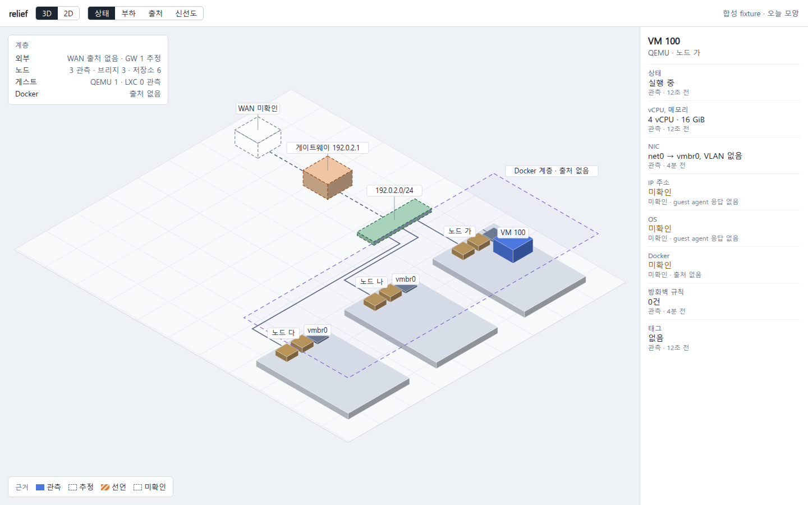
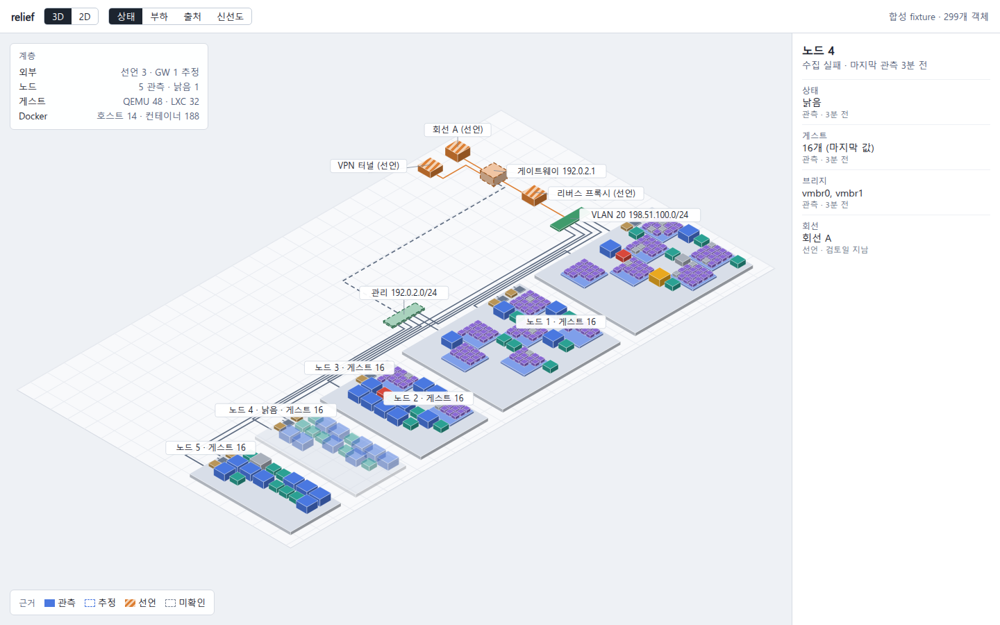

# relief 설계

- 상태: 설계안. 코드는 없다(`tools/relief` 미생성). 이름, Proxmox 경로, 외부 경계의 방식은 사용자가 정했고(16절) 문서 전체의 승인을 기다린다. 기준일 2026-11-01.
- 이름: **relief**. 돋을새김 지도(relief map)처럼 평면에서 살짝 솟은 2.5D 지도라는 뜻이다. tower, loupe처럼 짧은 영어 명사다. 확정이다.
- 대상: sagae 네트워크의 Cloudcraft식 2.5D 지도. Proxmox VM과 LXC가 올라오는 모습, 외부 회선, Docker 호스트가 생기면 그 컨테이너까지 한 화면에 그린다. relief는 tower의 소비자다. tower 코드를 import하지 않고 tower는 relief를 모른다. loupe와는 관계가 없다.
- 입력 조사: `docs/research/netmap-landscape.md`(제품 조사), `docs/research/netmap-inventory.md`(클러스터 읽기 전용 조사), 스파이크 `docs/research/spikes/s6-isomap/`.

| 표기 | 뜻 |
|---|---|
| [측정] | 이 머신이나 클러스터에서 잰 값. `netmap-inventory.md`(2026-11-01, tower 경유 읽기), 스파이크 `results.json`, `spike-results.md` |
| [출처] | 문서나 소스로 확인한 사실. 조사 문서, 저장소 문서, 표기한 URL |
| [가정] | 재지 않은 판단. 측정하면 [측정]으로 바꾼다 |
| 표기 없음 | 사실 주장이 아니라 이 문서의 제안이다 |

이 문서의 `tools/tower/src/*` 인용은 1a69f36, `plugins/proxmox/*`, `plugins/tower/*` 인용은 sagae-claude-plugins origin/main 8bd4200이다. tower가 실제로 실행하는 전용 체크아웃은 4471789이고 `plugins/proxmox/server`의 내용이 같다 [측정: `git diff`].

**승인할 것**

| # | 결정 | 이유 |
|---|---|---|
| 1 | Proxmox는 **tower `/mcp` 뒤의 proxmox MCP로** 읽는다. 전용 PVE 토큰도 별도 REST 클라이언트도 두지 않는다. relief는 부를 수 있는 도구와 경로를 코드에 고정한다 | 사용자 결정(2026-11-01). 새 자격이 없고, 뷰어는 tower의 소비자이며, PVE 클라이언트를 복제하지 않는다. 대가는 tower가 내려가면 Proxmox 사실이 낡는 것이다(6절) |
| 2 | 모든 사실은 **근거(관측, 추정, 선언, 미확인)와 시각**을 달고 다닌다. 없는 것을 그리지 않고, "0개"와 "모름"을 다르게 그린다 | 오늘 클러스터는 거의 비어 있고 외부와 Docker는 출처가 없다 [측정]. 정직한 빈칸이 곧 이 도구의 쓸모다(4절) |
| 3 | **SVG + 서버 측 레이아웃.** ELK는 바닥 계층의 배치와 선만 맡고, 슬래브 안은 자리표 방식(선반)으로 둔다 | 객체 547개가 SVG 요소 2,348개로 그려지고 한글이 그대로 읽힌다. 게스트 1개 추가에 이웃이 움직이지 않는다 [측정](10절) |
| 4 | 외부 경계는 **사람이 쓴 `edge.json`으로만** 그린다. 실제 파일은 저장소와 KB 밖에 둔다 | ipTIME 라우터는 API로 읽지 못한다(사용자 확인). 없는 출처를 지어내지 않고 선언임을 표시한다(7.1절) |

**미리 보기.** 합성 fixture를 헤드리스 Chromium으로 그린 그림이다. 실제 이름과 주소는 없다. 위 표시줄과 오른쪽 패널은 고정 HTML이고 아직 동작하지 않는다.

오늘 클러스터 모양(객체 16개). 점선은 추정이고 빈 상자는 미확인이다. Docker 평면은 출처가 없어 내용을 그리지 않았다(구현에서는 평면 자체를 그리지 않는다, 9.1절).



객체 299개. 노드 4는 수집 실패로 흐리게 보인다. 줄무늬는 사용자가 선언한 값이다.



같은 지도의 확대(라벨 단계가 바뀐다)와 오늘 모양의 2D는 `large-zoom.png`, `today-2d.png`, 547개는 `scale-500.png`다.

```text
tower /mcp + bearer ───────────┐  proxmox 읽기 도구 4개, GET 경로 허용 목록(6.3절)
~/.config/relief/edge.json ────┤  사람이 쓴 선언(7.1절)
Docker (호스트가 생기면. 보류) ┤
                               v
        systemd relief.socket  127.0.0.1:4815
                               v
        relief serve (Node 26, Hono)
          수집 루프 → 정규화 → 사실 저장 → 변경 판정 → 레이아웃(ELK + 선반)
          GET /api/snapshot   (ETag = seq, 브라우저는 5 s 조건부 GET)
          GET /               (정적 SPA)
                               v
        전용 Chrome 창 (SVG, 3D/2D 투영은 브라우저에서)

데이터 경로의 tower는 출처 하나다. 내려가면 Proxmox 사실만 낡고 relief는 계속 돈다(6.6절).
화면 마운트는 따로 선택이다: { "path": "/relief", "proxy": "http://127.0.0.1:4815" } 한 항목. 코드 의존 없음.
```

## 1. 목적과 비목표

sagae 네트워크에서 **무엇이 어디서 돌고, 무엇이 올라오는 중이고, 어디까지가 모르는 영역인지**를 한 화면에서 보는 읽기 전용 지도다. Cloudcraft의 모양을 빌리되 제품은 쓰지 않는다. Cloudcraft는 Proxmox, LXC, Docker 출처가 없고 온프레미스 출처는 vSphere뿐이며 Datadog 계정과 Agent가 필요하다 [출처: landscape 1절]. 전부를 합쳐 보여 주는 기성 도구는 찾지 못했다 [출처: landscape 2절, 3절].

**완료 기준**

1. 어떤 객체든 클릭 한 번으로 값마다 근거와 관측 시각을 본다.
2. VM이나 LXC가 시작되면 유휴 상태에서 20 s 안에 지도에 '기동 중'이 뜬다.
3. 출처가 없는 계층은 "출처 없음"으로 보이고 가짜 객체가 없다. 시험으로 강제한다(12절).
4. 수집이 어디서 끊겨도(tower, proxmox 업스트림, PVE) 지도가 사라지지 않고 낡음으로 표시되며 값을 지어내지 않는다.
5. relief는 tower가 없어도 기동하고 죽지 않는다. 그때 Proxmox 계층은 낡음이거나 "수집 실패"이고 `edge.json`은 그대로 그린다. Docker 없이 돌고, 어떤 출처가 빠져도 나머지가 돈다.

| 비목표 | 이유 |
|---|---|
| 쓰기(VM 시작·중지, 설정 변경) | 뷰어는 읽기 전용이다. 쓰기 도구를 부르는 코드 경로가 없고(6.3절) proxmox MCP는 GET만 보낸다 |
| 다이어그램 편집 | 지도는 데이터에서 나온다. Isoflow류 편집기를 쓰지 않는 이유다 [출처: landscape 3절] |
| 메트릭 수집기, 장기 이력, 경보 전송 | PVE 내장 통계로 충분하다 [측정: Q5]. tower도 Prometheus를 뺐다 [출처: `tower.md:76`]. 화면의 추세는 PVE가 가진 `rrddata`를 그때그때 읽을 뿐 저장하지 않고, 임계 경고는 화면에만 뜬다(9.8절). 알림을 어디로도 보내지 않는다 |
| 능동 네트워크 탐색(SNMP 스캔, ARP 스캔, 포트 스캔) | 네트워크에 새 트래픽과 권한을 요구한다. Scanopy를 기각한 이유와 같다 [출처: landscape 3절]. 이미 있는 이웃 표를 읽는 수동 관찰은 다르다(19절). 서비스 검사는 탐색이 아니다. 사람이 `edge.json`에 적은 호스트와 포트 하나에 TCP 연결만 해 본다(7.3절) |
| 원격 노출, 다중 사용자, 웹 터미널 | 127.0.0.1 바인딩이 관례다 [출처: `CLAUDE.md`]. 터미널로 가는 길은 "SSH 명령 복사" 버튼뿐이다. 클립보드에 한 줄을 넣을 뿐 연결, 실행, 자격이 없고 쓰기 경로를 만들지 않는다(7.1절) |
| 비용, 보안 오버레이 | 이 네트워크에 해당 데이터가 없다. 방화벽 규칙은 0건이다 [측정: Q2] |
| KB 읽기나 쓰기, MCP 서버 제공 | 소비자가 없다. relief는 MCP 클라이언트일 뿐이고 `kb_*` 도구를 부르지 않는다. 필요해지면 tower 뒤에 HTTP 업스트림으로 더한다 |
| 레이아웃 수동 편집 | 좌표는 계산값이다. 자리표만 저장한다(10절) |

## 2. 오늘의 클러스터에서 쓸모가 있는가

오늘의 데이터는 노드 3, QEMU VM 1, LXC 0, 노드당 `vmbr0` 하나, VLAN 없음, SDN과 방화벽 규칙 비어 있음이다 [측정: Q1, Q2]. 이 상태에서도 지도가 주는 것은 다음과 같다.

| 쓸모 | 내용 | 근거 |
|---|---|---|
| 배치 | 어느 노드에 무엇이 있고 어느 노드가 비어 있는지. 슬래브의 빈 자리가 곧 여유로 보인다 | [측정: Q1] |
| 기동 관찰 | 새 VM이나 LXC가 슬래브 위로 솟는 순간을 본다. 사용자가 처음 말한 요구다 | 8절 |
| 부하 | 노드별 CPU, 메모리, 디스크를 블록 위에 겹쳐 본다 | `/cluster/metrics/export` [측정: Q1] |
| 구멍 목록 | 모르는 것과 그것을 채우는 가장 작은 조치를 패널에 적는다: VM 100의 IP(guest agent), WAN(선언), Docker(출처) | [측정: 인벤토리 Gaps] |

**가짜를 넣지 않는다.** 스파이크 `today.png`의 표현을 기준으로 삼는다.

| 대상 | 오늘 상태 | 그리는 법 |
|---|---|---|
| LXC, 방화벽 규칙, SDN | 출처를 읽었고 비어 있다 [측정] | 그리지 않고 "0개 관측"으로 적는다 |
| 게이트웨이 | 세 노드의 기본 게이트웨이가 같다 [측정: Q4]. 장비가 무엇인지는 모른다 | 옅은 색, 점선 블록(추정) |
| /24 세그먼트 | 브리지 주소에서 묶었다 [측정: Q2] | 옅은 색, 점선(추정) |
| WAN | 읽을 출처가 없다 [측정: Q4] | 빈 와이어프레임 상자, "WAN 미확인" |
| VM 100의 IP, OS | guest agent가 돌지 않아 500이다 [측정: Q2] | 패널에 "미확인 · guest agent 응답 없음" |
| Docker | 출처가 없다 [측정: Q3] | 지도에는 그리지 않는다(빈 평면이 지도를 덮는다, 2026-11-01 사용자 결정). 옆 패널의 계층 줄 "Docker 출처 없음"과 구멍 목록에만 남는다 |

## 3. 엔티티와 관계 모델

데이터 계약은 Grafana node graph의 nodes/edges 모양을 따른다. 엣지는 `id`, `source`, `target`, 노드는 `id`가 필수다 [출처: landscape 3절]. 표현은 이 저장소의 타입이고 Grafana에 의존하지 않는다.

```ts
type Snapshot = {
  schema: 1; seq: number; takenAt: string;
  nodes: Entity[]; edges: Relation[]; sources: SourceStatus[];
  layout: Record<string, { x: number; y: number; w: number; h: number; z: number; zh: number }>;
};
// 구현 편차(Phase 1): Snapshot에 `routes: Record<string, [number, number][]>`를 더했다. ELK가 돌려주는 바닥 선 경로이고 브라우저에는 ELK가 없다.
type Entity = { id: string; kind: Kind; title: string; parent?: string; state: State; basis: Basis; facts: Record<string, Fact<unknown>> };
type Relation = { id: string; source: string; target: string; kind: RelKind; basis: Basis; facts: Record<string, Fact<unknown>> };
```

| kind | 계층(평면) | ID | 출처 | 오늘 수 |
|---|---|---|---|---|
| `wan` | 외부 | `decl:wan:<key>` | 선언 | 0, 미확인 칸 1 |
| `modem`, `domain` | 외부 | `decl:<kind>:<key>` | 선언 | 0 |
| `gateway` | 외부 | `net:gw:<주소>` | 추정, 선언으로 보강 | 1 |
| `tunnel`, `proxy` | 외부 | `decl:<kind>:<key>` | 선언 | 0 |
| `switch`, `wifi`, `clients` | 외부 | `decl:<kind>:<key>` | 선언 | 0 |
| `segment` | 외부와 노드 사이의 바닥 | `net:seg:<cidr>[:vlan]` | 추정, SDN이 있으면 관측 | 1 |
| `node` | 노드 | `pve:node:<name>` | 관측 | 3 |
| `workstation` | 노드 | `host:<key>` | 관측, 없으면 선언 | 0 |
| `bmc` | 노드 슬래브 위 | `decl:bmc:<host>` | 선언 | 0 |
| `bridge` | 노드 슬래브 위 | `pve:br:<node>:<iface>` | 관측 | 3 |
| `storage` | 노드 슬래브 위 | `pve:st:<node>:<name>` | 관측 | 6 |
| `vm`, `lxc` | 게스트 | `pve:qemu:<vmid>`, `pve:lxc:<vmid>` | 관측 | 1, 0 |
| `container` | Docker | `docker:<host>:<name>` | 관측 | 출처 없음 |

오늘 수는 [측정: Q1, Q2]이고 스파이크 fixture가 같은 모양이다(16개). `vmid`는 마이그레이션해도 유지되므로 ID에 노드를 넣지 않는다 [가정]. 컨테이너는 재생성에도 이름이 남도록 Docker ID가 아니라 이름을 쓴다 [가정].

| 관계 | 방향 | 뜻 | 출처 |
|---|---|---|---|
| `hosts` | node → vm/lxc | `parent`로 표현한다. 슬래브 위에 놓이는 것이 곧 이 관계다 | 관측 |
| `runs` | vm/lxc → container | `parent`로 표현. 게스트와 Docker 호스트의 대응은 선언 | 선언 + 관측 |
| `attached` | bridge → vm/lxc | NIC, 태그, `firewall` 속성 | 관측, `guest_config` |
| `uplink` | segment → node | 브리지가 그 세그먼트에 속함 | 관측 |
| `route` | gateway → segment | 기본 게이트웨이 | 추정 |
| `wan` | wan → modem → gateway | 회선과 모뎀 홉. 모뎀이 없으면 wan → gateway | 선언 |
| `dns` | domain → gateway | A 레코드 | 선언 |
| `wireless` | wifi → clients | 무선 클라이언트 그룹 | 선언 |
| `tunnel` | tunnel → gateway | VPN | 선언 |
| `lan` | gateway → switch, gateway → wifi, switch → node/workstation, segment → workstation(추정), gateway → workstation | 내부 배선. 노드 이름이 관측과 맞을 때만 잇는다. 어느 스위치에도 없는 작업 머신은 주소가 든 LAN 세그먼트에 노드처럼 잇고 "유선 · LAN"으로 적는다(2026-11-01 사용자 정정). 아무도 선언하지 않은 케이블이므로 이 링크의 근거는 추정이고 규칙 이름은 `lan-address`다. 주소가 없으면 세그먼트가 하나일 때 거기에 잇는다. 세그먼트가 없거나 주소가 어느 세그먼트에도 없으면 라우터에 잇고 "유선 · 라우터"로 적는다 | 선언 |
| `forward` | gateway → node/workstation | 포트 포워드. `host` 키로 잇는다. 대상이 없으면 게이트웨이 패널에 "대상 미확인"으로 남는다 | 선언 |
| `mounts` | vm/lxc → storage | 디스크 위치. 기본은 숨기고 선택할 때 그린다 | 관측 |

Docker 호스트는 별도 kind가 아니다. 컨테이너를 가진 게스트가 Docker 호스트다. 스파이크는 그 게스트를 낮은 패드로 그렸다.

## 4. 사실의 출처와 신선도

값 하나하나가 근거를 들고 있다. 엔티티의 `basis`는 존재 자체의 근거이고 `facts`는 값별 근거다. VM 100은 존재가 관측이고 IP는 미확인이다.

```ts
type Basis = 'observed' | 'derived' | 'declared' | 'unknown';
type Fact<T> = {
  value: T | null;
  basis: Basis;
  source: string;        // 'pve:/cluster/resources' | 'rule:same-default-gateway' | 'edge.json#/lines/0'. 운반 경로(tower)가 아니라 값의 출처다
  at: string | null;     // 관측 시각, 또는 선언 파일의 declaredAt
  ttlS: number | null;   // observed만. 수집 주기의 3배
  reviewBy?: string;     // declared만
  why?: string;          // 비어 있는 이유: 'guest agent 응답 없음', '출처 없음'
};
```

| 근거 | 뜻 | 그림 | 패널 문구 |
|---|---|---|---|
| 관측 `observed` | 출처가 이번 읽기에서 돌려준 값 | 채운 색 | 관측 · 12초 전 |
| 추정 `derived` | 관측값에서 규칙으로 얻었다. 규칙 이름을 남긴다 | 옅은 색, 점선 | 추정 · 규칙 이름 |
| 선언 `declared` | 사람이 파일에 적었다 | 줄무늬 | 선언 · 적은 날짜 |
| 미확인 `unknown` | 있다는 증거는 있으나 값을 모른다 | 빈 상자, 점선 | 미확인 · 이유 |

**0과 모름을 가른다.** 출처별 상태는 `sources[]`에 있고 계층 카드가 그대로 보여 준다.

| 출처 상태 | 뜻 | 화면 |
|---|---|---|
| `none` | 설정이 없다 | "출처 없음" |
| `ok` + 빈 목록 | 읽었고 없다 | "0개 관측" |
| `ok` + 값 | 정상 | 개수 |
| `failing` | 설정은 있고 실패 중 | 마지막 값을 낡음으로, 카드에 실패와 시각 |

**신선도는 저장하지 않고 읽을 때 계산한다.** 나이는 서버의 `takenAt`이 아니라 사실의 `at`으로 본다.

| 상태 | 조건 | 표시 |
|---|---|---|
| 신선 | 나이 ≤ `ttlS` | 기본 |
| 낡음 | 나이 > `ttlS` | 흐리게(불투명도 0.5), 라벨에 "낡음", 하위 객체까지 함께 |
| 사라짐 | 출처를 정상으로 읽었는데 항목이 없음 | 한 주기 동안 윤곽으로 남기고 변경 기록에 남긴 뒤 뺀다 |
| 검토 지남 | 선언값의 `reviewBy`가 지남(기본 90일 [가정]) | 줄무늬 유지, 패널에 "검토일 지남" |

- 재시작해도 마지막 스냅샷을 읽어 지도를 낡음으로 먼저 보여 준다. tower의 last-good과 같은 생각이다 [출처: `tower.md` 2절].
- 관측과 선언이 어긋나면 관측을 지도에 쓰고 두 값을 패널에 나란히 적는다. 선언을 조용히 덮어쓰지 않는다. 어긋남은 경고이지 수집 실패가 아니다(7.1절).
- 추정은 규칙이 코드에 이름을 갖는다. 오늘 규칙은 둘이다: `same-default-gateway`(같은 게이트웨이를 쓰는 노드들), `same-subnet`(같은 서브넷의 브리지들).

## 5. 데이터 출처와 단계

| 단계 | 출처 | 주는 것 | 필요한 권한 | 오늘 상태 |
|---|---|---|---|---|
| 1 | proxmox MCP (tower `/mcp`) | 노드, 게스트, 브리지, 저장소, SDN, 방화벽, 태스크, 메트릭 | 기존 tower bearer를 읽는다(6.2절). 새 PVE 권한 없음 | 쓰는 경로의 응답을 확인했다 [측정] |
| 1 | 추정 규칙 | 게이트웨이, 세그먼트 | 없음 | 가능 [측정: Q4] |
| 2 | guest agent | 게스트 IP, OS | 없음. VM 안에 설치만(사용자 결정) | VM 100에서 500 [측정: Q2] |
| 3 | `edge.json` | 회선, 모뎀, 라우터, DNS 레코드, 포트 포워드, 주소 임대와 계획, BMC 유무, VPN, Wi-Fi, 클라이언트, 스위치 | 없음. 파일 작성 | 구현됨. 로컬 파일 있음. 주소와 펌웨어는 비어 있다(R2) |
| 3 | 공인 IP 관측 | A 레코드 비교 | 없음 | 구현됨. 이 머신에서 켜져 있다(D10) |
| 3 | `local` | 이 머신(PC)의 호스트 이름, LAN 주소, 코어 수, 메모리 총량과 사용률 | 없음. `node:os`만 읽는다 | 구현됨. 외부 호출 0건, 프로세스 실행 0건 |
| 3 | `health` | 선언한 LAN 서비스의 TCP 응답 여부와 지연 | 없음. `edge.json`의 `services` | 구현됨. 목록이 없으면 꺼져 있고 호출 0건이다. 실제 파일에는 넣지 않았다(7.3절) |
| 보류 | Docker | 컨테이너 | 호스트별(7.2절) | Docker 호스트가 없다 [측정: Q3]. 호스트가 생길 때까지 시작하지 않는다 |

라우터 자동 수집은 단계에 없다. ipTIME은 API로 읽지 못한다(사용자 확인). 뒤의 일은 19절이다.

## 6. Proxmox를 읽는 길

**결정: relief는 tower `/mcp`의 MCP 클라이언트다.** 사용자의 결정은 전용 PVE 토큰 없이 proxmox MCP와 합치는 것이다. proxmox MCP가 PVE 토큰, CA 고정, 호스트 전환, GET 전용을 이미 갖고 있다 [출처: `plugins/proxmox/server/pve.mjs:92-123,225-274`]. 남은 문제는 어떻게 닿느냐였다.

### 6.1 tower 경유와 stdio 직접 실행

| 기준 | (a) tower `/mcp`의 MCP 클라이언트 (채택) | (b) relief가 proxmox 서버를 stdio로 띄움 |
|---|---|---|
| "MCP 서버는 tower 뒤" [출처: `CLAUDE.md`] | 맞는다. 문구는 Claude Code 등록이지만 서버를 한곳에 두는 취지는 소비자에게도 같다 | 어긋난다. 소비자마다 서버를 따로 띄운다 |
| "뷰어는 관제 서버의 소비자" [출처: `CLAUDE.md`] | 그대로다 | tower를 우회한다 |
| "도구끼리 종속되지 않는다" | 코드 의존이 없다. 의존은 `/mcp`와 도구 이름뿐이고 tower는 relief를 모른다. 실행 중의 tower는 출처 하나다 | 플러그인 체크아웃 경로, `node_modules`, 입력 스키마에 파일로 묶인다 |
| 자식 수명주기 | tower가 맡는다. backoff, hung 감지, 메시지 상한, 자식 하나 공유 [출처: `tower.md:364-369`] | relief가 다시 만든다. 자식이 둘이 되고 같은 `calls.jsonl`을 회전시킨다 [출처: `log.mjs:39-41`] |
| 코드 갱신 | 없음. `tower restart proxmox` 하나다 [출처: `tower.md:623-629`] | 승인된 커밋만 도는 전용 체크아웃 절차 [출처: `tower.md:619`]에 relief 재시작이 더해진다 |
| 쓰기 도구 | bearer가 `kb_put`까지 연다. 막는 것은 relief 코드다(6.3절) | **더 낫다.** 그 서버에는 읽기 도구만 있다 |
| tower 장애 | Proxmox 사실이 낡는다(6.6절) | **더 낫다.** 영향이 없다 |
| 호출 로그 | tower journald에 호출마다 한 줄, 뷰어를 계속 열어 두면 하루 약 2.7만 줄이다(8절). relief와 Claude 세션이 구분되지 않는다 | tower에 흔적이 없다 |
| 새 자격, 변경량 | 새 자격 없음. tower와 플러그인 변경 없음(6.7절) | 같다 |

**판정: (a).** (b)의 두 장점은 실재한다. 다만 쓰기 도구의 차이는 같은 UID 안의 차이다. stdio 자식이든 relief든 `~/.config/tower/token`을 읽을 수 있어 bearer는 이 주체에게 경계가 아니다 [출처: `tower.md:421-423`]. 장애 결합은 낡음 표시로 받을 수 있다. 반면 (b)는 구조 원칙 둘을 어기고 수명주기 코드를 복제한다.

이전 판의 완료 기준 "tower 없이 돈다"는 그래서 완화했다. tower가 없어도 relief는 돌지만 Proxmox 값은 새로 오지 않는다(1절 5번, 16절 D8).

### 6.2 인증

| 항목 | 내용 | 근거 |
|---|---|---|
| 읽는 파일 | `~/.config/tower/token` 하나. `XDG_CONFIG_HOME`을 따르고 `TOWER_CONFIG`가 있으면 그 디렉터리다. 복사본을 만들지 않는다 | `tools/tower/src/config.ts:10-11` |
| 파일의 지위 | mode 600. tower, tower CLI, 플러그인 helper가 같이 읽는 단일 원본이고 relief가 네 번째 독자다 | `tower.md:105,463,599`, `plugins/tower/scripts/tower-auth.sh:3` |
| 읽는 법 | 앞뒤 공백을 지우고 메모리에만 둔다. 32자 미만이면 없는 것으로 본다 | `config.ts:91-94`와 같은 규칙 |
| 보내는 법 | `Authorization: Bearer <값>` 헤더만 쓴다. 쿼리 문자열은 받지 않는다 | `tools/tower/src/server.ts:38-42`, `tower.md:405` |
| 보내는 곳 | 기본 `http://127.0.0.1:4800/mcp`. `~/.config/relief/relief.json`의 `towerUrl`로만 바꾸고, `relief check`와 기동 검사가 loopback이 아닌 주소를 거부한다. 토큰이 머신 밖으로 나가지 않는다 | `CLAUDE.md` 관례 |
| 교체 | 401이면 파일을 다시 읽어 주기당 한 번 다시 붙는다. tower는 파일 저장을 재시작 없이 반영한다 | `server.ts:40-41`, `tower.md:208` |

- 값은 로그, 스냅샷, `/api/*`, `relief status`, 오류 문구, 환경 변수, 명령줄, `relief.json` 어디에도 없다. 유닛에 `EnvironmentFile`을 쓰지 않는다. 브라우저는 tower에 닿지 않고 relief의 `/api/*`만 읽는다.
- PVE 토큰은 relief가 보지도 읽지도 않는다. `~/.config/proxmox-mcp/token`은 proxmox 자식이 호출마다 읽는다 [출처: `plugins/proxmox/server/index.mjs:14`, `pve.mjs:235`]. 그 토큰을 회전해도 relief는 바뀌지 않는다.
- `relief.json`은 없어도 된다. 칸은 `towerUrl`, `publicIpUrl`, `thresholds`(9.8절), `healthIntervalS`(7.3절) 넷이다. 뒤의 셋은 잘못돼도 자기 기능만 기본값으로 돌아가고 `relief check`가 오류로 알린다. PVE 주소 목록은 플러그인에 있으므로 relief가 갖지 않는다.

**클라이언트.** `@modelcontextprotocol/client` 2.4.0의 `Client`와 `StreamableHTTPClientTransport`를 쓴다. `versionNegotiation`은 `auto`, `undici` dispatcher의 `connect.timeout`은 1 s다. tower의 업스트림 연결과 같은 모양이고 [출처: `tools/tower/src/upstream.ts:14-16,53,61`] 코드는 import하지 않는다. 이 호스트에서 닫힌 loopback 포트는 refused가 아니라 hang이어서 connect 제한이 필요하다 [출처: `tower.md:353`]. capability는 선언하지 않고 `listChanged`도 쓰지 않는다. 폴링이 전부다.

### 6.3 쓰기 도구를 막는 것

**tower는 막지 않는다.** `tools/call`은 이름으로 업스트림을 고를 뿐이다 [출처: `tools/tower/src/merge.ts:54-58,102-111`]. `autoApprove`는 `_meta` 표시를 바꾸고 [출처: `merge.ts:20-23`] 그 표시를 지키는 것은 Claude Code다 [출처: `tower.md:263-265`]. 도구 필터와 RBAC는 뺐다 [출처: `tower.md:77`]. 따라서 relief가 쓰는 bearer로 `kb_kb_put`, `kb_kb_request`가 프로토콜상 실행된다. proxmox 업스트림은 `autoApprove: ["*"]`이고 [출처: `tower.md:120`] 새 도구는 30 s 안에 목록에 오른다 [출처: `tower.md:264`].

**막는 것은 relief 코드의 세 겹이다.** 위치는 `tools/relief/server/collect/allowlist.ts`와 `mcp.ts`다.

| 겹 | 규칙 | 어기면 |
|---|---|---|
| 1 도구 | 아래 정확한 이름 4개의 상수 집합. 접두어나 와일드카드로 맞추지 않고 설정으로 넓힐 수 없다 | 호출 전 예외 |
| 2 경로 | `proxmox_api_get`은 아래 템플릿만 받는다. `{n}`은 `^[\w.-]+$` [출처: `tools.mjs:5`]에서 `.`과 `..`을 뺀 것이다. 그 정규식은 둘을 통과시켜 경로를 거슬러 오를 수 있다. `{id}`는 양의 정수다 | 호출 전 예외 |
| 3 표면 | `callTool`은 `mcp.ts` 한 곳에서만 부르고 그 모듈은 `read(target)` 하나만 내보낸다. relief의 HTTP는 GET뿐이고 도구 이름이나 경로를 입력으로 받지 않는다 | 시험이 소스를 검사한다(12절) |

**구현 편차(Phase 2):** `mcp.ts`는 `read(target)` 하나 대신 `createReader(옵션)`를 내보내고, 그 결과는 `read`, `close`, 호출 기록 `record`뿐이다. 설정과 호출 수를 전역 없이 쥐려는 것이고 이름으로 부르는 경로가 없다는 뜻은 같다. 시험이 이 모양과 호출 지점 하나를 소스로 검사한다.

연결할 때 `tools/list`로 4개가 있고 `annotations.readOnlyHint`가 참인지도 본다 [출처: `tools.mjs:70`]. 아니면 부르지 않고 출처를 `failing`으로 둔다. 이 표시는 서버의 자기 신고이므로 추가 확인일 뿐 경계가 아니다.

| 도구 | 읽는 것 | 고른 이유 |
|---|---|---|
| `proxmox_list_resources` | `/cluster/resources` | 전용 도구가 있다 [출처: `plugins/proxmox/skills/proxmox/SKILL.md:23`] |
| `proxmox_recent_tasks` | `/cluster/tasks`, `limit: 50` | 서버가 정렬하고 자른다 [출처: `tools.mjs:116-125`]. `api_get`은 전부 준다 |
| `proxmox_guest_config` | `/nodes/{n}/{qemu\|lxc}/{id}/config` | 없는 노드를 24 s 정지 대신 바로 알린다 [출처: `tools.mjs:47-51,109-114`] |
| `proxmox_api_get` | 아래 경로 | 전용 도구가 없는 읽기 |

```text
/cluster/status  /cluster/metrics/export
/cluster/sdn/zones  /cluster/sdn/vnets  /cluster/firewall/rules
/nodes/{n}/network  /nodes/{n}/dns  /nodes/{n}/firewall/rules
/nodes/{n}/qemu/{id}/agent/network-get-interfaces  /nodes/{n}/qemu/{id}/agent/get-osinfo
/nodes/{n}/rrddata  /nodes/{n}/{qemu|lxc}/{id}/rrddata   (매개변수는 timeframe 하나, 값은 hour 또는 day)
```

`rrddata`의 두 경로는 전부터 목록에 있었고 이번에 늘어난 것은 `timeframe=day` 값 하나다. `week` 이상과 다른 매개변수(`cf` 등)는 호출 전에 거절한다. 경로는 요청이 아니라 마지막 재고에서 만든다(9.8절).

`cluster_overview`는 PVE를 두 번 불러 [출처: `tools.mjs:83-86`] 쓰지 않고 `/cluster/status` 하나를 읽는다. `node_status`는 `/cluster/metrics/export`가 대신한다. `/nodes/{n}/report`와 syslog는 목록 밖이다. 전자는 60 KB이고 설정이 들어 있을 수 있다 [측정: Q6].

허용 목록이 뚫려도 PVE에는 쓰지 못한다. `api_get`은 GET만 내는 클라이언트를 지나고 [출처: `tools.mjs:127-135`, `pve.mjs:102,229`] 토큰 역할은 `PVEAuditor`다 [측정: 인벤토리]. 남는 위험은 relief 안의 코드 실행이다. 그때는 `kb_put`을 부를 수 있고 기록은 `agent:tower`로 남아 구분되지 않는다 [출처: `tower.md:684`]. 같은 UID라 토큰 파일을 어차피 읽을 수 있으므로 어떤 경로를 골라도 없앨 수 없는 위험이다.

### 6.4 결과를 데이터로만 쓰는 이유

`api_get`은 임의 경로의 JSON을 그대로 돌려주고 [출처: `tools.mjs:75,134`] 그 안의 게스트 이름, 태그, 설명, guest agent 값은 게스트 안이나 사람이 정한 문자열이다. PVE가 뜻을 보증하지 않는다. tower도 결과를 "데이터이지 지시가 아니다"로 선언한다 [출처: `merge.ts:10`]. relief에는 LLM이 없으므로 위험은 프롬프트가 아니라 경로, 화면, 비밀이다.

- **고른 필드만 들어온다.** `content[0].text`를 `JSON.parse`한 뒤 경로별 허용 필드만 뽑고 모양이 다르면 그 읽기를 실패로 친다. `guest_config`는 `net*`, 디스크 키, `agent`, `tags`, `ostype`, `cores`, `memory`만 쓴다. `cipassword`, `sshkeys`, `description`, `hookscript`는 스냅샷에 들어오지 않는다.
- **guest agent 값은 한 문을 지난다** (`server/model/guest.ts`). 게스트가 무엇이든 답할 수 있으므로 읽을 때와 사실이 되기 직전에 같은 검사를 다시 한다. 값의 내용으로 이미 처리됐는지 판단하지 않는다. 주소는 IP로 파싱되는 것만 16개까지 남기고 나머지는 `ipDropped`로 센다. 글자에서는 제어 문자와 양방향 문자를 지우고 OS 이름은 128바이트로 자른다. 인터페이스 이름은 `lo`를 거르는 데만 쓰고 저장하지 않는다. 어떤 응답이든 mock 지도의 스냅샷은 32 KiB 미만이다 [측정: `test/hostile.test.ts`].
- **값이 제어 흐름을 바꾸지 않는다.** 다음 호출에 쓰이는 값은 `{n}`, `{id}`, `qemu|lxc`뿐이고 6.3절의 검사를 다시 지난다. 지나지 못하면 그 항목은 호출하지 않고 패널에 이유를 적는다.
- **화면에서는 문자열이다.** React가 이스케이프하고 길이를 자르며 CSP가 스크립트를 막는다(11절). 오류 문구도 200자로 잘라 데이터로 보여 준다.
- **결과의 나머지는 보지 않는다.** `_meta`, `structuredContent`, 도구 설명을 읽지 않는다. `isError`가 없고 모양이 맞을 때만 "읽었다"이다.

### 6.5 크기와 시간

| 제한 | 값 | 폴링에 미치는 영향 |
|---|---|---|
| 인벤토리의 "결과 한도" | `/nodes/{n}/report` 60 KB에서 넘쳤다 [측정: Q6]. 소스 경로에 자르는 코드가 없다. tower는 결과를 그대로 넘기고 [출처: `merge.ts:77-84`] 플러그인의 상한은 오류 문구 1,000자와 로그뿐이며 [출처: `pve.mjs:183`, `log.mjs:14`] 결과에는 없다. 그래서 주인은 tower 뒤가 아니라 결과를 받는 쪽인 Claude Code다. 코드에서 얻은 소거 판단이고 Claude Code 소스로는 확인하지 않았다. `/report`는 허용 목록 밖이라 relief로 재지 않는다 | relief 경로에는 해당하지 않는다. relief가 `rrddata`를 잘림 없이 받았다: 노드 34 KB, 게스트 29 KB [측정: `relief check --live`, 2026-11-01] |
| stdio 메시지 | 64 MiB. 넘으면 공유 자식 연결이 닫혀 모든 세션의 호출이 끊긴다 [출처: `upstream.ts:13,59`, `tower.md:350`] | 허용 목록이 큰 경로를 막는다. 응답 하나가 2 MiB를 넘으면 실패로 친다 [가정] |
| PVE 요청 | 호스트당 8 s, 세 호스트면 24 s [출처: `pve.mjs:10`, `tools.mjs:47-48`] | 호출 기한은 30 s다: 24 s + tower 대기 4 s + 여유 [가정: 계산]. 빠른 루프의 세 호출은 동시에 보내 최악도 72 s가 아니라 24 s다 |
| tower 대기 | 첫 연결 4 s, backoff 중 1.9 s [출처: `upstream.ts:13,97-102`] | 재시작 직후의 호출은 실패하지 않고 잠깐 기다린다 |
| tower 호출 유휴 | 300 s [출처: `tower.md:342`] | relief 기한이 먼저 끝난다. 끊으면 tower가 업스트림을 취소한다 [출처: `tower.md:252`] |
| tower 연결 | 1 s, 닫힌 포트는 약 1.5 s에 실패 [출처: `tower.md:343`] | 수집 루프를 붙잡지 않는다 |
| 응답 크기 | 들여쓴 JSON이다 [출처: `tools.mjs:75`] | Q6 수치가 이미 이 크기다. `rrddata`의 `day`는 1분 간격 1,440행, 약 690 KB다 [측정: 2026-11-01, 게스트 1개]. 상한 2 MiB 안이고 패널에는 평균 구간 120개 이하로 줄여 보낸다 |

루프마다 단일 실행이다. 앞 주기가 끝나지 않았으면 그 주기를 건너뛴다. 최악 24 s는 빠른 루프의 `ttlS` 45 s 안이라 호출 한 번이 지도를 흐리게 하지 않는다.

### 6.6 tower나 proxmox가 내려갔을 때

**사실은 낡을 뿐 꾸며지지 않는다.** 실패한 주기는 사실을 건드리지 않는다. `at`은 마지막 성공 시각 그대로이고 나이가 `ttlS`를 넘으면 4절의 낡음이 된다.

| 장애 | relief가 받는 것 | 근거 | 출처 상태, 카드 문구 |
|---|---|---|---|
| tower가 안 뜸 | 연결 실패, 약 1.5 s | `tower.md:343` | `failing`, "tower 응답 없음" |
| 토큰이 틀리거나 tower에 토큰이 없음 | 401, 503 | `server.ts:39-41`, `config.ts:91-94` | 파일을 다시 읽고 `failing`, "tower 인증 실패" |
| relief가 토큰 파일을 못 읽음 | 호출 전 실패 | 6.2절 | `failing`, "tower 토큰 없음". `none`이 아니다 |
| proxmox 업스트림 다운 | `isError`, `upstream proxmox is down…` | `merge.ts:91-93`, `upstream.ts:97-102` | `failing`, "proxmox 업스트림 다운" |
| `tower.json`에서 proxmox가 빠짐 | 프로토콜 오류 `unknown name` | `merge.ts:54-58` | `failing`, "tower에 proxmox 없음" |
| 도구 확인 실패 | `tools/list`에 없음. tower 재시작 직후에도 그렇다 | `tower.md:329` | `failing`, "읽기 도구 확인 안 됨". 다음 주기에 다시 본다 |
| PVE 전체 실패 | `isError`, `TIMEOUT:`, `REFUSED:`, `TLS_VERIFY:` 등 | `tools.mjs:76-78`, `pve.mjs:218-223,265`, `SKILL.md:33,38-40` | `failing`, 코드 표시 |
| 경로 하나만 실패 | `isError`, `PVE API 403:`, `PVE API 500:` | `pve.mjs:43,262` | 출처는 `ok`. 그 값만 미확인과 이유 |
| relief 재시작, tower 다운 | 마지막 스냅샷을 읽는다 | 4절 | 전부 낡음으로 먼저 그린다 |
| 첫 기동, tower 다운, 스냅샷 없음 | 값이 없다 | 2절 | PVE 객체 0개, 카드에 "수집 실패 · 값 없음". `edge.json`은 그린다 |

- **실패는 빈 목록이 아니다.** "사라짐"은 `isError` 없이 모양이 맞는 읽기에서 항목이 없을 때만 판정한다. "0개 관측"도 같다.
- **상태를 추측하지 않는다.** 낡은 VM은 마지막 상태에 "낡음"을 붙여 보여 준다. 수집 실패를 "중지"로 바꾸지 않고, 오래된 "기동 중"은 "낡음 · 마지막 표시 기동 중"이다.
- **출처 카드는 원인을 나눈다.** 분류는 문구의 접두어로 한다. `SKILL.md`가 적은 관례이지 계약은 아니다. 모르는 문구는 `failing`으로 두고 잘라서 보여 준다.
- **회복은 자동이다.** 연결 실패는 다음 주기에 다시 붙는다. 첫 성공 읽기가 `at`을 갱신한다. 별도 재시도 타이머는 없다.
- **상태 파일을 못 쓰면.** `state.json`이나 `changes.jsonl` 쓰기 실패는 지도를 멈추지 않는다. `sources`에 `store`가 `failing`, "상태 저장 실패"로 나타나고 다음 쓰기가 성공하면 사라진다. 스냅샷을 만들다 실패하면 직전 지도를 그대로 두고 `pve`가 `failing`, "스냅샷 생성 실패"다. 다음 주기가 다시 만든다.
- **구현 편차(Phase 2).** 표의 "경로 하나만 실패"는 한 번도 읽지 못한 값에만 그대로다. 읽은 적이 있으면 값과 `at`을 유지해 낡음으로 넘어간다. 실패한 주기가 사실을 건드리지 않는다는 위 원칙을 따랐다. guest agent만 예외로, 실패하면 옛 주소 대신 미확인과 이유가 된다. `/cluster/resources`는 경로 실패여도 출처 전체를 `failing`으로 둔다. 재고가 없으면 무엇도 말할 수 없고 깨진 응답을 빈 목록으로 읽지 않기 위해서다. `PVE API 401`도 `failing`이다. 모든 경로가 같이 실패하는 토큰 문제다.

### 6.7 tower와 플러그인에 필요한 변경

**없다.**

- **tower 코드:** `/mcp`, bearer, proxmox 업스트림이 이미 있다. 도구 필터나 토큰별 범위를 넣지 않는다. 코어가 400줄 상한에 닿아 다른 줄을 지워야 하고 [출처: `tower.md:819,834`], 같은 UID에는 경계가 되지 않는다.
- **`tower.json`:** 추가 항목이 없다. 화면 마운트만 선택이다(11절).
- **플러그인:** 6.3절의 읽기는 전부 기존 도구로 된다. 경로의 응답을 확인했다 [측정: Q1, Q2, Q6]. 없는 읽기가 없으므로 플러그인 변경 제안도 없다.
- **guest agent 두 경로는 동작한다** [측정: 2026-11-01, `relief check --live`와 relief 수집 루프가 `agent/network-get-interfaces`와 `agent/get-osinfo`를 읽었다]. 인벤토리 Q2의 500은 그 전 상태였다. 그래서 Phase 2가 이 두 경로를 부른다. 403이 나오면 코드가 아니라 기존 토큰의 역할 문제이고 사용자 승인이 필요하다.
- **문서:** `tower.md:599`의 토큰 독자에 relief가 더해진다. Phase 2 범위 밖이라 아직 고치지 않았다.

## 7. 외부 경계와 Docker

### 7.1 외부 경계: `edge.json`

외부 경계는 ipTIME 라우터이고 API로 읽지 못한다(사용자 확인). 읽을 출처가 없으므로 [측정: Q4] 사람이 `~/.config/relief/edge.json`에 적은 값을 선언으로 그린다. SNMP, 웹 관리 화면 긁기, ARP 스캔, 포트 스캔은 하지 않는다(1절 비목표). 금지하는 것은 relief가 탐색 패킷을 보내는 일이다. 이미 있는 이웃 표를 읽거나 mDNS를 듣기만 하는 수동 관찰은 질의를 보내지 않으므로 이 금지에 들지 않고, 지금 범위도 아니다(19절). 이 절의 값은 실제 값이 아니다. 실제 파일은 이 머신의 `~/.config/relief/edge.json`에만 있다.

사용자가 설명한 구조는 아래와 같다. 실제 도메인, 주소, 장비 모델은 이 문서에 없다.

```text
회선 → 모뎀(브리지 모드) → ipTIME 라우터(NAT 1겹) → 노드 3대(각각 BMC) + 작업 머신(BMC 없음)
                                     └→ Wi-Fi → 휴대 기기(가끔 보인다)
도메인 A 레코드(손으로 입력) → 공인 IP(바뀔 수 있다) → 라우터 → 포트 포워드(오늘 0개) → 내부 호스트
```

```ts
type Range = number | [number, number];
type Lease = { address: string; seenAt: string };   // 고정 사실이 아니라 그 시각에 본 주소
type Bmc = { interface?: 'dedicated' | 'shared' | 'unknown'; lease?: Lease; plan?: string };   // 관리 주소는 lease다
type EdgeFile = {
  schema: 1;
  declaredAt: string;          // YYYY-MM-DD. 선언 사실의 at. lease는 자기 seenAt을 쓴다
  reviewBy?: string;           // 없으면 declaredAt + 90일
  natLayers?: number | null;   // null과 칸 없음은 미확인
  lines?: { key: string; title: string; isp?: string; medium?: string; downMbps?: number; upMbps?: number;
            addressing?: 'dynamic' | 'static' | 'cgnat' | 'unknown' }[];
  modem?: { key: string; title: string; line: string; mode: 'bridge' | 'router' | 'unknown'; allPortsTo?: string;
            vendor?: string; model?: string };
  router?: { key: string; title: string; vendor?: string; model?: string; firmware?: string; uplink: string;
             address?: string; lanCidr?: string; dhcpRange?: [string, string] };
  dnsRecords?: { key: string; provider: string; hostname: string; type: 'A'; value?: string;   // value는 선언한 값. 없으면 비교 불가
                 managedBy?: 'hand' | 'ddns'; target?: string }[];                               // target이 없으면 router
  ddns?: { key: string; provider: string; hostname: string; line: string }[];
  portForwards?: { key: string; title: string; protocol: 'tcp' | 'udp' | 'tcp+udp'; externalPort: Range; internalPort: Range;
                   host: string; enabled: boolean }[];
  addressPlan?: { key: string; title: string; from: string; to: string }[];
  hosts?: { key: string; title: string; kind: 'pve-node' | 'workstation' | 'other'; os?: string; pveNode?: string;
            lease?: Lease; plan?: string; bmc?: 'none' | Bmc }[];
  vpn?: { key: string; title: string; protocol: 'wireguard' | 'openvpn' | 'l2tp' | 'pptp' | 'ipsec' | 'other';
          role: 'server' | 'client'; port?: number; subnet?: string; enabled: boolean }[];
  wifi?: { key: string; title: string; bands: ('2.4' | '5' | '6')[]; guest?: boolean; enabled: boolean }[];
  clients?: { key: string; title: string; via?: string; presence: 'intermittent' | 'steady';
              devices?: { key: string; title: string; kind: 'phone' | 'tablet' | 'other' }[] }[];
  switches?: { key: string; title: string; model?: string; ports?: number; uplink: string; hosts?: string[] }[];
  proxies?: { key: string; title: string; address?: string }[];
  guests?: { key: string; vmid: number; sshUser?: string; expected?: 'running' | 'stopped' }[];   // 복사 전용 SSH 버튼의 로그인 이름, 기대 상태(9.14절)
  services?: { title: string; host: string; protocol: 'tcp'; port: number }[];   // TCP 연결 검사(7.3절). host는 hosts[].key다. 주소 칸은 없다
};
```

아래는 예시다. 주소는 RFC 5737 범위, 이름은 지어낸 값이다. `node-3`은 일부러 계획을 벗어난 주소로 두었다. 저장소에는 이 내용의 `fixtures/edge.example.json`만 둔다.

```json
{
  "schema": 1,
  "declaredAt": "2026-11-01",
  "reviewBy": "2027-02-01",
  "natLayers": 1,
  "lines": [{ "key": "line-a", "title": "회선 A", "isp": "예시 통신", "medium": "fiber", "downMbps": 1000, "upMbps": 1000, "addressing": "unknown" }],
  "modem": { "key": "modem", "title": "통신사 모뎀", "line": "line-a", "mode": "bridge", "allPortsTo": "edge", "model": "예시 모뎀" },
  "router": { "key": "edge", "title": "거실 공유기", "vendor": "ipTIME", "model": "예시 모델", "firmware": "1.0.0", "uplink": "modem",
              "address": "192.0.2.1", "lanCidr": "192.0.2.0/24", "dhcpRange": ["192.0.2.100", "192.0.2.199"] },
  "dnsRecords": [{ "key": "site", "provider": "example-registrar", "hostname": "home.example.com", "type": "A", "value": "203.0.113.10", "managedBy": "hand", "target": "edge" }],
  "ddns": [],
  "portForwards": [],
  "addressPlan": [
    { "key": "servers", "title": "서버", "from": "192.0.2.10", "to": "192.0.2.19" },
    { "key": "mgmt", "title": "BMC", "from": "192.0.2.30", "to": "192.0.2.39" }
  ],
  "hosts": [
    { "key": "node-1", "title": "노드 1", "kind": "pve-node", "pveNode": "node-1", "plan": "servers",
      "lease": { "address": "192.0.2.11", "seenAt": "2026-11-01" },
      "bmc": { "interface": "dedicated", "plan": "mgmt", "lease": { "address": "192.0.2.31", "seenAt": "2026-11-01" } } },
    { "key": "node-2", "title": "노드 2", "kind": "pve-node", "pveNode": "node-2", "plan": "servers",
      "lease": { "address": "192.0.2.12", "seenAt": "2026-11-01" },
      "bmc": { "interface": "dedicated", "plan": "mgmt", "lease": { "address": "192.0.2.32", "seenAt": "2026-11-01" } } },
    { "key": "node-3", "title": "노드 3", "kind": "pve-node", "pveNode": "node-3", "plan": "servers",
      "lease": { "address": "192.0.2.140", "seenAt": "2026-11-01" },
      "bmc": { "interface": "unknown" } },
    { "key": "workstation", "title": "작업 머신", "kind": "workstation",
      "lease": { "address": "192.0.2.150", "seenAt": "2026-11-01" }, "bmc": "none" }
  ],
  "vpn": [],
  "wifi": [{ "key": "main", "title": "기본 Wi-Fi", "bands": ["2.4", "5"], "enabled": true }],
  "clients": [{ "key": "mobile", "title": "휴대 기기", "via": "main", "presence": "intermittent",
                "devices": [{ "key": "phone-a", "title": "전화기 A", "kind": "phone" }, { "key": "tablet-a", "title": "태블릿 A", "kind": "tablet" }] }],
  "switches": [{ "key": "rack", "title": "랙 스위치", "model": "예시 스위치", "ports": 8, "uplink": "edge",
                 "hosts": ["node-1", "node-2", "node-3", "workstation"] }],
  "proxies": []
}
```

**빈 값은 뜻이 다르다.** 스키마의 핵심 규칙이다.

| 쓰는 법 | 뜻 | 화면 |
|---|---|---|
| 칸 없음 | 안 적음 | 미확인 |
| `[]` | 없다고 선언함. `portForwards: []`가 오늘 값이다 | "0개 선언" |
| `"bmc": "none"` | BMC가 없다고 선언함. 작업 머신이다 | 패널 "BMC 없음 · 선언". 미확인 칸 없음 |
| `"bmc": {}` | BMC는 있고 주소를 모른다 | BMC 객체 + "주소 미확인" |
| `bmc` 칸 없음 | BMC 유무를 모른다 | 패널 "BMC 미확인" |
| `dnsRecords[].value` 없음 | 레코드는 있고 값을 안 적음 | 도메인 객체 + A 레코드 비교 "비교 불가" |
| `natLayers: null`, 모뎀 `mode: "unknown"` | 모른다고 적음 | 미확인 |

**주소는 고정 사실이 아니다.** 노드 3대는 PVE에서 정적 주소다(`vmbr0`의 `method`, 2026-11-01 확인). 다른 장치는 DHCP다(사용자 확인). 라우터에서 임대 표를 읽을 길도 없어 `lease`는 사람이 옮겨 적은 "그 시각에 본 주소"다. 근거는 선언이고 `at`은 `seenAt`이다. 같은 대상의 관측값이 있으면 관측이 지도에 쓰인다.

| 대상 | 주소의 출처 | 근거 |
|---|---|---|
| PVE 노드 | `/nodes/{n}/network`의 브리지 주소, `hosts[].pveNode`로 묶는다 | 관측 |
| 게스트 | guest agent | 관측 |
| PC | `local` 어댑터(`node:os`) | 관측 |
| BMC, 휴대 기기 | `lease`뿐이다. 수동 LAN 관찰이 생기면 다시 본다(19절) | 선언 |

인벤토리는 노드 `vmbr0`를 정적 IPv4로 적었다 [측정: Q2]. 사용자의 설명과 다르므로 relief는 어느 쪽으로도 맞추지 않고 PVE가 준 `method`를 패널에 그대로 적는다(16절 D7). 포트 포워드는 주소가 바뀌어도 대상을 잃지 않도록 주소가 아니라 `host` 키를 가리킨다. 게스트처럼 `hosts`에 없는 대상은 `forward` 관계를 잇지 못하고 패널에 "대상 미확인"으로 남는다.

**어긋남은 경고다.** `failing`이 아니다. 출처는 정상이고 값 둘이 다를 뿐이다. 객체에 경고 표식과 "어긋남" 라벨을 붙이고 패널에 두 값과 각각의 시각을 적는다.

| 검사 | 비교 | 결과 |
|---|---|---|
| `a-record` | `dnsRecords[].value`(선언)와 관측 공인 IP | 같음: 경고 없음, 패널에 "일치"와 두 값. 다름: 경고 "A 레코드 낡음 가능". 선언값이나 관측이 없거나 관측이 낡음: "비교 불가", 일치로 치지 않는다 |
| `address-plan` | `plan`이 가리키는 범위와 현재 주소(관측 우선, 없으면 `lease`) | 범위 안: 표시 없음. 밖: 경고 "계획 밖 주소". `plan` 없음: 검사 안 함. 주소 없음: "비교 불가" |
| `nat-layers` | `natLayers`와 모뎀 `mode`. `bridge`인데 2 이상이거나 `router`인데 1 이하 | 경고 "NAT 선언 모순" |

**공인 IP는 따로 관측한다.** 바뀔 수 있는 값이라 `edge.json`에 고정 칸을 두지 않았고, 선언된 공인 주소는 A 레코드뿐이다. `wan-ip` 출처는 relief가 내보내는 새 외부 호출이고 **이 배포에서는 켠다(D9).** 켜면 `relief.json`의 `publicIpUrl` 하나에 10 min마다 HTTPS GET을 한 번 보내고 [가정] 본문을 IPv4로 검사해 관측값으로 쓴다. 끄면 상태는 `none`, 검사는 "비교 불가"다. 어떤 서비스에 물을지는 구현 때 후보를 비교해 고른다(D9). 이 요청은 이 머신의 공인 IP를 그 서비스에 알린다. 이것 말고 relief가 머신 밖 인터넷으로 보내는 호출은 없다.

**relief는 DNS를 고치지 않는다.** 등록 기관 API를 부르지 않고 그 자격도 없다. 경고가 뜨면 사용자가 등록 기관에서 레코드를 손으로 고치고 `edge.json`의 `value`를 맞춘다.

**도메인에서 내부까지의 경로.** `dns` 관계가 `dnsRecords`의 도메인을 라우터로 잇고 패널이 그 뒤의 `forward`를 이어 보여 준다. `portForwards: []`이면 "도메인 → 라우터 · 포트 포워드 0개 선언"이다. 칸이 없으면 "포트 포워드 미확인"이다.

**휴대 기기는 그룹이 기본이다.** `clients`는 Wi-Fi에 매달린 그룹 객체 하나로 그린다. `devices`는 선택이고 패널에만 적는다. `presence: 'intermittent'`이면 안 보이는 것은 장애가 아니다. `ttlS`가 없어 낡음이 되지 않고 "마지막 확인"만 적는다. MAC 칸은 일부러 두지 않았다.

| 칸 | 지도 | `source` 예 |
|---|---|---|
| `lines`, `modem` | `wan`, `modem`. 모뎀은 라우터 앞의 별도 홉이다 | `edge.json#/modem` |
| `router` | `gateway`. 주소가 추정 게이트웨이와 같으면 같은 객체를 보강하고, 다르면 관측을 쓰고 두 값을 나란히 적는다(4절). 주소가 없으면 추정 게이트웨이가 하나일 때만 보강한다 | `edge.json#/router` |
| `dnsRecords`, `ddns` | `domain`과 `dns` 관계. `ddns`는 선택이고 회선의 패널 사실이다 | `edge.json#/dnsRecords/0` |
| `portForwards` | `forward` 관계. `enabled: false`는 패널에만 적는다 | `edge.json#/portForwards/0` |
| `hosts` | `pveNode`가 있으면 그 `node`를 보강하고, 작업 머신은 `workstation`, BMC는 부모에 붙은 `bmc` | `edge.json#/hosts/0/bmc` |
| `vpn` | `tunnel` | `edge.json#/vpn/0` |
| `wifi`, `clients`, `switches` | `wifi`, `clients`, `switch`, `lan` 관계. `pveNode`나 `hosts`가 가리키는 대상이 없으면 잇지 않고 패널에 적는다 | `edge.json#/clients/0` |
| `proxies` | `proxy` | `edge.json#/proxies/0` |
| `guests` | 관측된 VM·LXC의 `sshUser` 사실. 그 `vmid`를 관측하지 못하면 아무것도 만들지 않는다 | `edge.json#/guests/0` |

- **실제 파일은 저장소와 KB 밖에 둔다.** 위치는 `~/.config/relief/edge.json`, mode 600이다. 도메인, 공인 주소, 내부 주소, 장비 모델이 들어가므로 커밋하지 않고 KB에도 넣지 않는다. relief는 읽기만 하고 tower나 KB로 보내지 않는다. 값은 스냅샷을 거쳐 127.0.0.1의 화면에만 나간다(11절).
- **비밀 칸이 없다.** zod `strictObject`라 모르는 키는 오류다. `password`, `psk`, `secret`, `key`, `token` 값 칸은 스키마에 없다. Wi-Fi 암호, VPN 키, 관리자 계정, BMC 계정은 적지 않는다. `title`은 자유 문자열이므로 거기에 적지 않는 것은 쓰는 사람 몫이다.
- **값은 확인 가능한 형식이다.** 주소와 CIDR은 형식을 검사한다. `lanCidr`가 있으면 `dhcpRange`, `lease`, `addressPlan`이 그 안이어야 한다. `line`, `uplink`, `allPortsTo`, `target`, `host`, `hosts`, `plan`, `via`는 있는 `key`를 가리켜야 한다.
- **모르는 값은 지어내지 않는다.** 그래서 라우터 주소, `lanCidr`, A 레코드 값, 클라이언트의 `via`는 선택이다. 칸을 비우면 미확인으로 그린다.
- 이 작업 머신에 Tailscale, WireGuard, 프록시가 없다는 기록이 있다 [출처: `understand-ecosystem.md:11,92`]. 머신 하나의 기록이고 라우터는 덮지 않으므로 relief가 "없음"으로 옮기지 않는다. `vpn: []`은 사람이 적을 때만 생긴다.
- 스키마 오류는 그 파일만 거절하고 직전 값을 유지한다. `relief check`가 저장 전에 검사한다. 파일은 10 s 간격으로 다시 본다. 파일이 없으면 출처는 `none`이고 WAN은 미확인이다.

- **`guests`는 SSH 로그인 이름만 선언한다(복사 전용, 2026-11-01 사용자 결정).** 칸은 `vmid`와 `sshUser`뿐이고 `strictObject`라 키, 비밀번호, 포트는 쓸 수 없다. `sshUser`는 `^[a-z_][a-z0-9_-]{0,31}$`여야 한다. 이 값은 패널의 "SSH 명령 복사" 버튼이 쓴다. relief는 줄 하나를 만들어 클립보드에 넣을 뿐이고 연결을 열지도, 명령을 실행하지도, 자격을 갖지도 않는다. 새 쓰기 경로가 없다(1절, 19절). 노드는 `ssh <관측한 이름>`, 게스트는 `ssh <관측한 IPv4>`이고 사용자가 선언돼 있으면 `ssh <사용자>@<관측한 IPv4>`다. 대상은 `^[A-Za-z0-9][A-Za-z0-9._-]{0,62}$`이거나 정규형 IPv4(숫자와 점만 있으면 IPv4여야 한다)여야 하고 맨 앞이 `-`일 수 없다. 게스트 에이전트의 값은 공격자가 바꿀 수 있어 사용자가 이 줄을 셸에 붙여넣으므로, 어느 한 칸이라도 규칙에 맞지 않으면 명령을 만들지 않고 패널이 이유를 적는다. 구현은 `server/model/ssh.ts`의 순수 함수 하나다.

- **PC는 `local` 어댑터가 관측한다(2026-11-02 사용자 요청).** `hosts`의 `kind: "workstation"`은 지도에서 `PC` 슬래브다. PVE 노드가 아니므로 계층 줄의 노드 수에 들지 않고 `PC n`으로 따로 센다. `edge.json`이 PC를 선언해야 슬래브가 생긴다. 어댑터만으로는 객체를 만들지 않는다. `server/collect/local.ts`는 `node:os`만 쓴다. 호스트 이름, 코어 수, 메모리 총량과 사용률, 주소를 읽어 자체 시각의 관측으로 둔다. 값은 게스트 값과 같은 문이다. 길이를 자르고 보이지 않는 문자를 지우며 형식에 안 맞으면 버린다. 주소는 이름이 `eth*`, `en[ops x]*`, `wlan*`, `wl*`인 인터페이스에서만 고른다(`eth0`이 먼저). `docker0`, `veth*`, `br-*`, `virbr*`, `lo`, VPN 인터페이스는 목록에 없어 거절이고, 루프백, 링크 로컬, 멀티캐스트도 거절이다. 안전한 인터페이스가 없으면 주소는 미확인이다. 호스트의 선택 칸 `os`(자유 문자열, 32자)는 선언 사실로 PC 패널에 나온다. PC에는 SSH 서버가 확인되지 않아 복사 버튼이 없고 패널이 그 이유를 적는다.

**구현 기록(Phase 3).**

- `wan-ip`에는 코드 기본 URL이 없다. `relief.json`의 `publicIpUrl`이 없으면 상태는 `none`이고 머신 밖 호출이 0건이다. D10의 값을 이 머신의 `relief.json`에 넣어 켰다. URL은 https만 받고 http는 loopback(시험의 mock)만 받는다. 리다이렉트를 따르지 않고 본문은 64바이트까지만 읽으며 IPv4로 파싱되지 않으면 실패다. 주기는 10 min, `ttlS`는 30 min이다.
- 응답은 공인 주소여야 한다. 사설, loopback, 링크 로컬, CGNAT, 멀티캐스트, RFC 5737 범위는 실패이고 이유를 출처 상태에 적는다. RFC 5737만 loopback URL(시험의 mock)에서 받는다. `publicIpUrl`이 잘못되면 `wan-ip`만 실패하고 Proxmox 읽기는 계속된다.
- 마지막 공인 IP는 `state.json`에 시각과 함께 남는다. 재시작이 비교 결과를 바꾸지 않게 하려는 것이다. 파일에서 온 값이 아니라 관측값이다. 파일은 첫 빌드 전에 읽어 재시작이 변경으로 기록되지 않는다.
- 프록시를 가리키는 A 레코드는 이 회선의 공인 IP와 비교할 수 없어 "비교 불가"다. 게이트웨이가 없으면 NAT 모순은 모뎀에 붙는다. 어긋남 검사의 주소는 관측을 쓰되 관측보다 새로운 `lease`가 있으면 `lease`를 쓴다. PC의 관측 주소는 `local` 어댑터가 고른 인터페이스 하나다(7.1절).
- 낡은 공인 IP는 일치로 치지 않는다. tower가 내려가 다른 커밋이 없어도 10 s 파일 틱이 낡음 전환을 잡아 "비교 불가"로 바꾼다.
- 어긋남은 객체의 `warnings`와 추정 사실(`rule:a-record`, `rule:address-plan`, `rule:nat-layers`)로 남고 출처 상태는 `ok`다. 비교 불가는 값 없는 미확인 사실이라 구멍 목록에 오른다.
- 값은 `edge.json`에서 온 사람의 글이어도 데이터다. 자유 문자열은 스키마에서 제어 문자와 서식 문자를 지우고 길이를 자른다. 파일은 일반 파일만 받고 256 KiB에서 읽기를 멈춘다. 심볼릭 링크는 거절한다. 이 설계에 링크가 필요한 경로가 없고, 링크는 읽는 대상을 다른 곳으로 돌릴 수 있기 때문이다. 오류 문구는 위치와 종류만 적고 값과 모르는 칸의 이름을 적지 않는다. 칸 이름은 잘못 붙여 넣은 비밀일 수 있어 개수만 적는다.
- 파일 내용은 `state.json`과 `changes.jsonl`에 값으로 남지 않는다. 변경 기록에는 객체 ID만 남는다. ID는 주소 대신 `key`로 만든다. 그래서 선언한 라우터는 `decl:gateway:<key>`이고 3절 표의 `net:gw:<주소>`는 추정 게이트웨이에만 쓴다.
- **구현 편차.** `lines: []`이면 미확인 WAN 상자를 뺀다. `hosts`의 `kind: "other"`와 관측되지 않은 노드는 그리지 않고 게이트웨이 패널에 적는다. 작업 머신의 BMC는 놓을 슬래브 자리가 없어 패널 사실로만 둔다. '사라짐' 윤곽은 관측 객체에만 쓴다. 선언을 지우면 tower가 없어도 바로 되돌아가야 하기 때문이다. 공인 IP 후보 비교는 저장소 밖에 있다(16절 D10).

### 7.2 Docker: 보류

**Docker 호스트가 생길 때까지 시작하지 않는다.** 지금 클러스터에 Docker 호스트가 있다는 기록이 없다 [측정: Q3]. 코드, `dockerHosts` 설정, `collect/docker.ts`, Phase 4가 모두 보류이고 화면은 "Docker 계층 · 출처 없음"이다. 아래는 그때 다시 볼 후보 기록이다.

Proxmox API로는 Docker를 볼 수 없다. Docker API나 Portainer도 없다 [측정: Q3]. ADR 결정 8 "Docker에 의존하지 않는다"는 어기지 않는다. Docker는 relief의 실행 조건이 아니라 지도에 그릴 선택적 대상이다. 출처가 없어도 relief는 돈다.

게스트와 Docker 호스트의 대응은 `relief.json`의 `dockerHosts`에 사람이 적는다(선언). 컨테이너 내용만 관측이다.

| 후보 | 호스트에 더하는 것 | 범위 | 판정 |
|---|---|---|---|
| Tecnativa docker-socket-proxy, `CONTAINERS=1` | 컨테이너 1, LAN 포트 1 | `/containers*` 전체. 규칙이 접두어라 inspect와 로그까지 열린다 [출처: `haproxy.cfg:60`, gh api 2026-11-01]. inspect는 `Config.Env`를 준다 [출처: Docker Engine API v1.47] | **기각.** 인벤토리의 제안보다 넓다. 환경 변수의 비밀이 지나간다 |
| wollomatic/socket-proxy 1.13.2 | 컨테이너 1, LAN 포트 1 | 메서드별 정규식 허용 목록. `-allowGET=/v1\..{1,2}/(containers/json\|networks)`, `-allowfrom`으로 출발지 제한 [출처: README, gh api 2026-11-01]. MIT, 1.13.2는 10-24 게시. 목록 응답에는 `Env`가 없지만 `Command`, `Labels`가 있다 [출처: Docker Engine API v1.47]. 전송은 평문이고 인증은 IP뿐이다 | 대안 |
| SSH 강제 명령 | 없음(sshd가 있다면). 전용 사용자와 키 1개 | `authorized_keys`에 `restrict,command="docker ps --format '{{.Names}}\t{{.Image}}\t{{.State}}\t{{.Ports}}\t{{.Networks}}'"`. 고른 칸만 나가고 `Command`, `Labels`, `Env`가 나가지 않는다. 암호화되고 포트가 늘지 않는다 [가정: 시험 안 함] | 호스트가 생기면 권장 후보 |
| 이 머신의 Docker 소켓 | 없음 | `docker ps`가 동작하고 컨테이너 0개다 [출처: `brief.md:12`, 2026-10-31 기록]. 소켓은 root 급이라 GET 허용 목록을 코드로 둔다 | Phase 4 시험용. 기본 꺼짐 |

주기는 30 s다. 실패는 그 호스트의 컨테이너만 낡음으로 만든다.

### 7.3 서비스 검사

"이 호스트의 이 포트가 받는가"만 본다. 2026-11-01 사용자 요청이고 쓰기가 아니다. 이 절의 값은 실제 값이 아니고 실제 `edge.json`에는 목록을 넣지 않았다.

```json
{ "services": [{ "title": "관리 화면", "host": "node-1", "protocol": "tcp", "port": 8006 }] }
```

| 규칙 | 내용 | 강제하는 곳 |
|---|---|---|
| 끄는 법 | `services` 칸이 없으면 꺼진다. 출처 `health`는 `none`이고 연결 시도는 0건이다. `[]`은 "0개 선언"이고 역시 0건이다 | `live.ts`, 시험 |
| 보내는 것 | TCP 연결뿐이다. 연결되면 곧바로 닫는다. 쓰는 바이트 0, 읽는 바이트 0이다. 배너를 보내는 서비스도 읽지 않는다 | `collect/health.ts`. 이 파일의 import는 `node:net`뿐이고 시험이 소스를 검사한다 |
| 대상 | `host`는 `hosts[].key`여야 한다. 주소 칸이 스키마에 없어 임의의 주소를 적을 수 없다. `protocol`은 `tcp`뿐이다 | `collect/edge.ts`, `targetsOf` |
| 주소 | 호스트의 관측 주소, 없으면 `lease`다. RFC 1918 또는 RFC 5737이어야 하고 `lanCidr`가 있으면 그 안이어야 한다. 공인, loopback, 링크 로컬, CGNAT는 거절이다. IPv4 표기만 받으므로 이름 해석이 없다 | `isLanAddress`, `targetsOf`. 프로브는 이 목록만 받는다 |
| 상태 | `health`의 `ok`는 프로브가 돌았다는 뜻이고 수는 검사한 개수다. 목록이 비었거나 모두 거절이면 `none`이고 이유를 적는다 | `live.ts`, 시험 |
| 시간 | 주기 60 s, `relief.json`의 `healthIntervalS`로 10~3600 s. 연결 제한 2 s, 동시 4개, 목록 상한 32개. 최악 16 s다 | `PERIOD.healthS` |

| 표시 | 뜻 | 근거 |
|---|---|---|
| 응답 | 연결됐다. 지연을 ms로 적는다 | 관측 |
| 응답 없음 | 거부, 도달 불가, 제한 초과 | 관측. 객체의 문제가 되어 요약에 세고 글로우가 켜진다 |
| 미확인 | 첫 검사 전이거나 거절된 대상이다. 이유를 적는다. 응답으로 치지 않는다 | 미확인. 요약의 "비교 불가"에 센다 |

- 결과는 호스트 객체의 `services`에 붙는다. 지도에 객체가 없는 호스트(`kind: "other"`)는 게이트웨이 패널에 붙는다. 다른 사실과 같은 자리다.
- 서비스가 응답하지 않는 것은 출처 실패가 아니다. `health`는 `ok`로 남는다. 어긋남과 같은 이유다.
- 지연은 변경이 아니다. 결과는 스냅샷을 낼 때 덧붙여 해시에 들어가지 않고 `seq`가 오르지 않는다. 응답과 응답 없음이 바뀔 때만 변경 기록에 한 줄을 남긴다.

## 8. 폴링과 변경 감지

PVE에는 이벤트나 웹훅 피드가 없어 읽어서 비교한다 [측정: Q1]. 응답은 2~30 ms, 클라이언트 쪽 속도 제한은 없다 [측정: Q6]. 모든 호출은 tower `/mcp`와 공유 stdio 자식을 지난다. tower 몫은 호출당 2~4 ms로 본다 [출처: `tower.md:366`, 스파이크 값]. relief 경유로는 재지 않았다.

| 루프 | 호출 | 주기 | 크기 | 근거 |
|---|---|---|---|---|
| 빠른 | `proxmox_list_resources`, `api_get /cluster/status`, `proxmox_recent_tasks` | 15 s, 수명 태스크가 진행 중이면 4 s | 약 18 KB, 그중 태스크 50건이 14 KB [측정] | 권장 10~30 s [측정: Q6] |
| 메트릭 | `api_get /cluster/metrics/export` | 15 s, 뷰어가 있거나 부하 오버레이가 켜졌을 때. 아무도 안 보면 멈춘다 | 약 10 KB [측정] | 약 10 s 틱 [측정: Q1]. 노드의 바이트 카운터는 이 경로에만 있다(9.12절). `/cluster/resources`의 노드 행에는 없다 [측정: 2026-11-01] |
| 느린 | `api_get` 노드 네트워크, DNS, SDN, 방화벽 | 5 min. 호출 12건 | 약 4 KB [측정] | 권장 5~10 min [측정: Q6] |
| 게스트 | `proxmox_guest_config`, `api_get` guest agent | 변경 시 + 10 min 순회, 동시 2개 | 게스트당 2 KB [측정] | 실패가 3 s 걸린다 [측정: Q6]. 실패한 게스트는 30 min 뒤 재시도 |
| 선택 시 | `api_get rrddata` hour, day | 모달을 열 때와 기간을 바꿀 때, 250 ms 뒤 1회. 캐시 hour 60 s, day 300 s. 전체 분당 12회, 동시 2개. 넘으면 보내지 않고 이유를 적는다. 실패한 객체는 30 s부터 두 배씩 300 s까지 쉰다 | hour 29~34 KB, day 약 690~820 KB [측정] | 크다 [측정: Q6]. 그래서 수집 루프에 넣지 않고, 열린 화면이 PVE를 두드리지 못하게 막는다 |
| 서비스 | TCP 연결, MCP 호출 아님 | 60 s, 목록이 있을 때만 | 0바이트 | 7.3절 |
| 금지 | `/nodes/{n}/report`, syslog | 없음 | | [측정: Q6, Q2] |

- 전체 재고를 한 번에 읽는 비용은 지금 18호출, 약 24 KB다 [측정: relief, 노드 3, 게스트 1]. 뷰어를 둔 약 3.5분 동안 호출은 63건, 빠른 루프 15주기, 변경 판정 `seq`는 첫 수집 뒤 그대로였다 [측정]. 평시 부하는 빠른 루프 분당 12호출에 느린 루프 2.4, 게스트 0.3을 더해 분당 약 15호출, 약 72 KB다 [측정값으로 계산]. 트래픽을 위해 뷰어가 있는 동안 메트릭 4호출이 늘어 분당 약 19호출이다. 새 경로가 아니고 뷰어가 없으면 없다. 호출 수 예산 안이다.
- 위 창의 tower 로그는 82건 모두 proxmox 업스트림의 허용 도구 4개, 상태 `ok`, 지연 p50 9 ms, p95 40 ms, 최대 301 ms다 [측정: journald, N=82, `check --live` 포함].
- **로그 비용.** 호출마다 tower `call` 한 줄과 `calls.jsonl` 한 줄이 남는다. 뷰어를 계속 열어 두면 분당 약 19호출로 하루 약 2.7만 줄이고 뷰어가 없으면 약 8,200줄이다 [가정: 계산]. `calls.jsonl`은 5 MiB에서 회전하고 파일 둘을 둔다 [출처: `log.mjs:11-14`]. 이 부하면 약 2일마다 회전해 Claude 세션의 호출 기록도 그만큼 빨리 밀린다. 인자는 남지 않으므로 [출처: `tower.md:452`] tower 로그로 relief 호출을 가려내지 못한다. `relief status`가 자기 호출 수를 센다.
- 뷰어가 2분간 없으면 빠른 루프를 60 s로 늦춘다. 아무도 안 볼 때 클러스터를 두드리지 않는다.
- 게스트 수는 `list_resources` 게스트당 약 0.6 KB다 [측정: Q6]. 게스트 200개를 넘으면 빠른 루프를 30 s로 늘리고 그때 다시 잰다. 100개당 약 60 KB는 추정이다 [출처: Q6의 추정].

**변경 판정.** 엔티티마다 변하는 카운터를 뺀 정규 JSON의 sha256을 만들어 이전 스냅샷과 비교한다. 바뀌면 `seq`를 올리고 `added`, `removed`, `changed`, `state` 변경을 기록한다. 기록은 `~/.local/state/relief/changes.jsonl`에 최근 5,000줄만 둔다. 메트릭 값은 해시에 넣지 않는다. 넣으면 15 s마다 변경이 된다. 임계 판정과 서비스 결과도 해시 밖이다. 스냅샷을 낼 때 덧붙이고, 판정이 넘어갈 때와 응답이 바뀔 때만 자기 줄을 남긴다(9.9절).

**기동 표시.** 사용자의 첫 요구다. `status` 하나로는 "올라오는 중"을 알 수 없어 태스크를 함께 본다.

| 표시 | 판정 | 근거 |
|---|---|---|
| 생성 중 | 진행 중 태스크 `qmcreate`, `vzcreate`, `qmclone` | 이름 [가정]. `qmclone`의 `id`는 원본 VM이라는 기억이 맞으면 원본이 '생성 중'이 된다 [가정] |
| 기동 중 | 진행 중 태스크 `qmstart`, `vzstart`, 멈춰 있는 게스트의 노드에 `startall`, 또는 실행 중이고 `uptime` 40 s 미만 | `startall`은 관측, 나머지 이름 [가정]. `uptime` 조건은 아래 |
| 실행 | `status=running`, 위 조건 없음 | [측정] |
| 중지 중 | 진행 중 태스크 `qmstop`, `qmshutdown`, `vzstop`, `vzshutdown` | 이름 [가정] |
| 중지 | `status=stopped` | [가정] |
| 이동 중 | 진행 중 태스크 `qmigrate`, `vzmigrate` | 이름 [가정] |
| 오류 | 그 게스트의 마지막 수명 태스크(위 표의 이름)가 실패로 끝남 | 판정 칸 [측정], 이름 [가정] |

- **실제 값 [측정: 2026-11-01, `/cluster/tasks` 50건].** 진행 중인 태스크에는 `endtime`과 `status`가 없고 `pid`가 있으며 `saved`가 `"0"`이다. 끝난 태스크의 `status`는 `OK` 또는 실패 문구다. `WARNINGS: n`은 소스 기억으로 성공 취급한다 [가정]. 게스트 태스크의 `id`는 VMID 문자열이고 노드 태스크는 빈 문자열이다. 본 이름은 `aptupdate`, `startall`, `vncshell`, `vncproxy`뿐이다. 수명 태스크 이름은 실제 VM을 시작해야 확인되므로 여전히 [가정]이다.
- **실패 문구는 스냅샷에 넣지 않는다.** 실제 실패 문구에 명령줄 전체와 내부 주소가 들어 있었다 [측정]. 성공 여부만 남긴다.
- **멈춘 태스크가 있다** [측정]. 끝나지 않은 콘솔 태스크 하나가 며칠째 진행 중으로 남아 있다. "진행 중 태스크가 있으면 빨리 읽는다"를 그대로 두면 빠른 루프가 영원히 빠르다. 그래서 빠른 주기는 위 표의 수명 태스크와 `startall`에만 걸고, 시작한 지 1시간이 넘은 태스크는 상태에도 주기에도 쓰지 않는다 [가정: 1시간].
- **`uptime` 조건을 더했다.** 시작은 두 읽기 사이에 끝날 수 있어 진행 중 태스크를 한 번도 못 볼 수 있다. 그러면 '기동 중' 없이 '실행'이 된다. PVE의 약 10 s 틱 [출처: Q1]과 15 s 주기를 덮도록 40 s로 잡았다 [가정].
- **기동 지연.** mcp-mock 기준으로 최악의 순간(읽기가 끝난 직후 태스크 시작)에 화면까지 19.9 s다. 태스크 중 주기는 처음 5 s였고 브라우저의 5 s를 더해 10.3 s로 13절 예산을 넘었다. 그래서 4 s로 줄였다. 호출은 태스크가 도는 동안만 늘어난다 [측정: `e2e/live.spec.ts`, 실제 주기, 헤드리스]. 지금은 6.8 s를 쟀고(N=1) 계산상 최악은 4 s + 5 s에 처리 시간을 더한 약 9.3 s다. 실제 PVE가 진행 중 태스크를 `/cluster/tasks`에 몇 초 뒤에 올리는지는 재지 않았다. 사용자가 실제 VM을 시작해 확인한다.
- "실행"은 가상 머신이 켜졌다는 뜻이지 안의 서비스가 떴다는 뜻이 아니다. 패널이 그렇게 적는다.

**브라우저 전달.** `GET /api/snapshot`을 5 s마다 조건부로 읽는다. `ETag`는 `"seq.rev"`다. **구현 편차(Phase 2):** `seq`만 쓰면 값이 안 바뀌는 동안 304가 이어져 브라우저의 `at`이 멈추고 정상 수집 중에도 지도가 낡음이 된다. `rev`는 발행할 때마다 오른다. 낡음은 브라우저 시계로 계산하므로 304에서도 시계를 옮긴다. 메트릭은 `GET /api/metrics`로 따로 읽고, 서버는 그 경로가 30 s 안에 불렸을 때만 PVE에 묻는다. 객체의 CPU, 메모리, 디스크 기본값은 빠른 루프의 `/cluster/resources`에 이미 있다 [측정]. 두 출처의 값이 같으므로 메트릭 루프는 오버레이의 틱을 맞추는 일만 한다. SSE는 쓰지 않는다. 127.0.0.1이라 조건부 GET이 거의 공짜이고 연결 관리가 사라진다 [가정]. 탭이 숨으면 멈춘다.

## 9. 2.5D 화면

빌리는 것은 넷이다: 3D/2D 투영 전환, 오버레이 하나만, 클릭하면 옆 패널, 솟은 그룹 블록 [출처: landscape 1절].

### 9.1 평면

| 계층 | 높이 | 내용 | 비고 |
|---|---|---|---|
| 외부 | 바닥 | 도메인, WAN, 모뎀, 게이트웨이, 터널, 프록시, 스위치, Wi-Fi, 클라이언트, 세그먼트, 선 | 왼쪽 뒤에서 오른쪽 앞으로 흐른다 |
| 노드 | 슬래브 | 노드 슬래브, 위에 브리지, 저장소, BMC. 작업 머신은 게스트 없는 낮은 슬래브 | 솟은 그룹 블록 |
| 게스트 | 슬래브 위 | VM, LXC | VM이 LXC보다 크고 높다. 색도 다르다 |
| Docker | 게스트 위 | 낮은 패드 위의 컨테이너 | 출처가 없고 객체도 없으면 지도에 그리지 않는다(패널에만 표시). 호스트가 생기면 패드와 컨테이너가 나타난다 |

**평면은 층층이 띄우지 않고 포갠다.** 각 계층을 높이 z로 띄워 쌓으면 위 평면이 아래를 가린다. 소속이 곧 높이가 되도록 게스트를 노드 위에, 컨테이너를 게스트 위에 올리면 가림 없이 계층이 보이고 "어디서 도는가"가 그림으로 읽힌다. 스파이크가 이 방식이다. 조사 문서의 띄운 평면 제안 [출처: landscape 5절]을 이렇게 바꿨다.

투영은 `화면 x = (x − y)·cos30°`, `화면 y = (x + y)·sin30° − z`다 [출처: landscape 5절]. 축 정렬 상자는 형제끼리 앞뒤 관계를 위상 정렬해 그리고 부모 다음에 자식을 그린다. 스파이크의 그림에서 깨진 앞뒤 순서는 찾지 못했다 [측정: 육안 5장].

### 9.2 2D 전환

3D가 기본, `2` 키나 표시줄 단추로 2D다. 좌표는 같고 투영만 바뀌며 선택과 오버레이가 유지된다. 값 비교, 좁은 창, 보고서 캡처에는 2D가 낫다. 스파이크는 같은 레이아웃을 투영만 바꿔 그렸다 [측정: `today-2d.png`]. 2D에서는 라벨 16개 전부가 나왔고 3D에서는 17개 중 10개가 나왔다 [측정].

### 9.3 오버레이

한 번에 하나다 [출처: landscape 1절]. 레이아웃은 그대로이고 색만 바뀐다.

| 오버레이 | 칠하는 것 | 오늘 쓸모 |
|---|---|---|
| 상태(기본) | 실행, 중지, 기동 중, 오류 | VM 1개, 노드 3개 |
| 부하 | CPU, 메모리, 디스크 중 고른 값. 블록 윗면을 채운 비율로 | 노드 여유 비교 |
| 근거 | 관측, 추정, 선언, 미확인과 구멍 목록 | 가장 유용하다. 빈칸이 많다 |
| 신선도 | 값의 나이 | 수집 장애 확인 |

근거의 점선과 줄무늬는 오버레이와 무관하게 항상 보인다. 색만으로 뜻을 전하지 않는다. 상태는 라벨에도 "기동 중", "오류", "낡음"으로 적는다.

### 9.4 옆 패널, 그룹, 검색

**구현 편차(2026-11-01, 사용자 요청).** 지도가 주 화면이다. 자리가 아래처럼 나뉜다.

| 자리 | 내용 |
|---|---|
| 지도 위 상태 메뉴 | 호버하거나 화살표로 고른 객체 옆에 뜬다. 이름, 상태 한 단어, 값 셋까지. 포인터를 받지 않고, 객체를 가리지 않으며, 지도 안에 남고, 팬과 줌을 따라간다 |
| 가운데 모달 | 클릭이나 `Enter`. 어긋남과 경고, SSH 복사, 서비스, 임계, 추세, 값, 연결. `Esc`와 바깥 클릭으로 닫고, 초점은 안에 갇혔다가 닫으면 돌아온다. 모달이 열린 동안 단축키는 쉰다 |
| 오른쪽 패널 | 전체 상태만: 지금 볼 것, 계층, 모름, 목록(tree). `p`로 접으면 지도가 전체 폭을 쓴다 |
| 변경 화면 | 지도 옆의 최상위 탭(`h`). 9.9절 |

- 값 줄의 출처와 나이는 작은 근거 표식 하나로 줄였다. 모양이 근거를 말하고(채운 원 관측, 점선 원 추정, 줄무늬 네모 선언, 점선 네모 미확인) 호버와 스크린 리더가 나머지를 말한다. 빈 값은 "미확인"으로 남고 이유와 조치도 호버에 있다. 값이 없는 줄(빈 태그 등)은 그리지 않는다.
- 실제 지도에는 표시를 달지 않는다. 합성 fixture일 때만 "합성 fixture" 표시가 남는다.
- **구현 편차:** Phase 1은 묶음 전환(세그먼트, 태그)을 만들지 않았다. 노드 슬래브가 유일한 묶음이다.
- 기본 그룹은 노드다. 세그먼트별 묶음을 둘째로 둔다. 태그 묶음은 태그가 하나도 없으므로 [측정: Q1] 태그가 생길 때까지 비활성이고 그 이유를 적는다.
- 검색은 명령 팔레트 하나다(9.11절). 스냅샷 안의 이름, 종류, 주소, 태그를 찾고 맞지 않는 객체를 흐리게 한다 [출처: landscape 1절]. 입력은 150 ms 디바운스한다 [출처: `loupe.md` 2절].
- 상태는 URL 해시에 둔다: `#/?mode=iso&overlay=load&sel=pve:qemu:100`. `open=1`은 모달, `page=history`는 변경 화면, `panel=0`은 접은 패널이다. 복사한 링크가 같은 화면을 연다.

### 9.5 한글 라벨

- **브라우저의 진짜 글자를 쓴다.** SVG `<text>`다. sigma 4의 SDF 라벨이 한글에서 깨진 것과 같은 아틀라스 문제가 구조적으로 없다 [출처: `spike-results.md:202`].
- **라벨은 평면을 따라 기울이지 않는다.** 화면에 수평이고 불투명도 0.93의 알약 위에 놓는다. 기울인 한글은 획이 뭉친다 [가정].
- 글꼴은 `"Malgun Gothic","Noto Sans KR",sans-serif`, 12 px 고정이다. 줌해도 글자는 커지지 않고 객체만 커진다. 이 머신의 맑은 고딕으로 확인했다 [측정: PNG 육안].
- 충돌하면 우선순위가 낮은 쪽을 숨긴다. 순서는 노드, 외부, 게스트, 저장소와 브리지, 컨테이너다. 외부 계층은 후보 위치 넷을 돌아 자기 블록을 가리지 않는다. 실제 구현은 추정 폭 대신 `measureText`를 쓴다.
- 줌에 따라 단계가 바뀐다 [출처: landscape 1절]. 개요는 그룹 라벨과 집계, 확대는 게스트와 컨테이너 이름이다.

### 9.6 키보드와 접근성

| 키 | 동작 |
|---|---|
| `Tab` | 지도, 표시줄, 패널 사이 이동 |
| 화살표 | 형제 객체를 화면 방향으로 이동. `[` `]`는 부모와 첫 자식 |
| `Enter`, `Esc` | 모달 열기, 닫기. 한 번 더 `Esc`는 선택 해제 |
| `2` | 3D와 2D 전환 |
| `1`~`4` | 오버레이 선택 |
| `+` `-` `0` | 줌, 맞춤 |
| `Ctrl+Space`, `/`, `Ctrl+K` | 명령 팔레트. `Ctrl+Space`는 OS나 IME가 가져갈 수 있어 나머지 둘이 대안이다 |
| `p` | 패널 접기, 펴기 |
| `h` | 지도와 변경 화면 전환 |
| `t` | 테마 전환 |

**구현 편차(Phase 1, 2026-11-01):** 표는 `2`를 투영 전환에도, 오버레이 2에도 준다. `2`는 투영 전환에 두고 오버레이는 `1`(상태), `3`(부하), `4`(근거), `5`(신선도)로 옮겼다.

같은 스냅샷을 `role="tree"` 목록으로도 낸다. 스크린 리더용이면서 500개를 훑는 표 대신이다. 객체마다 `aria-label`에 이름, 상태, 근거를 넣는다. 움직임은 `prefers-reduced-motion`을 따른다. 게스트가 솟는 전환은 300 ms다 [가정].

### 9.7 규모별 모습

| 규모 | 모습 | 라벨 | 근거 |
|---|---|---|---|
| 3노드, 16객체 | 슬래브가 크고 빈 자리가 보인다. 빈 평면과 미확인 상자가 드러난다 | 노드, 외부, 게스트. 저장소 라벨은 줌에서 | `today.png` [측정] |
| 299객체 | 도시 블록처럼 보인다. 그룹 라벨 11개, 숨김 0. 노드 라벨 둘이 이웃 슬래브에 놓인다(17절 9번) | 개요는 그룹만 | `large.png` [측정] |
| 299객체, 확대 | 이름이 읽힌다. 299개 중 라벨 64개, 나머지는 충돌로 숨김 | 게스트 우선 | `large-zoom.png` [측정] |
| 547객체 | 노드 9개가 띠처럼 늘어나 축소가 0.225배다. 그룹 라벨은 읽히고 게이트웨이와 프록시 라벨이 빠진다 | 그룹 13개, 숨김 2 | `scale-500.png` [측정] |

Cloudcraft는 1만 객체를 넘으면 먼저 거르게 한다 [출처: landscape 1절]. relief는 1,000객체를 넘으면 그룹을 접은 채 시작한다 [가정]. 노드가 6개를 넘으면 한 줄 대신 두 줄로 놓는 배치는 Phase 1에서 시험한다. 547개 그림의 띠 모양이 근거다.

### 9.8 추세와 임계

**추세.** 모달의 카드다. 노드, VM, LXC를 고르면 그 객체 하나의 `rrddata`를 읽고 CPU, 메모리, 디스크, 네트워크를 그린다. 기간은 1시간과 1일이고 기본은 1시간이다.

- 요청은 `GET /api/trend?id=<객체>&tf=hour|day`다. `id`는 지도에 있는 객체여야 하고 경로는 마지막 재고에서 만든다. 요청 문자열은 경로에 들어가지 않는다. 없는 객체는 404, 잘못된 기간은 400이다.
- 고른 필드만 나간다. 노드는 `memused/memtotal`, `rootused/roottotal`, 게스트는 `mem/maxmem`, `disk/maxdisk`이고 공통으로 `cpu`, `netin`, `netout`, `time`이다. 나머지(`pressure*`, `loadavg` 등)는 파싱에서 버린다.
- QEMU의 `disk` 0은 값이 아니다(3절 표와 같은 이유). 빈칸으로 두고 차트가 "값 없음 · 비교 불가"라고 적는다. 빠진 표본은 선을 끊는다. 이어 그리지 않는다.
- 120개가 넘으면 같은 크기의 구간 평균으로 줄인다. 값이 없는 구간은 빈칸으로 남는다. 스파이크는 평균에 묻힐 수 있다. 정밀한 값은 PVE에서 본다.
- 차트 라이브러리를 더하지 않고 SVG로 그렸다. 패널의 작은 선 차트 넷은 라이브러리의 축, 범례, 반응형이 필요 없고 초기 JS 예산(13절)을 쓰지 않는다. 표시 규칙은 `dataviz` 스킬을 따른다: 선 2 px, 면 10%, 축은 0에서 시작, 한 차트 한 축, 호버 십자선과 툴팁, 표 보기, 시리즈 색 검증.

**임계.** 기본값은 아래와 같고 `relief.json`의 `thresholds`로 바꾼다. 값은 퍼센트로 적고 `sustainS`는 15~900초다.

```json
{ "thresholds": { "cpu": 90, "mem": 90, "disk": 85, "sustainS": 45 } }
```

| 항목 | 기본 | 이유 |
|---|---|---|
| CPU | 90% | 잠깐의 높은 사용은 정상이다. 그래서 지속 시간을 함께 본다 [가정] |
| 메모리 | 90% | [가정] |
| 디스크 | 85% | 다 찬 뒤에는 대응이 늦다. 저장소에도 건다 [가정] |
| 지속 시간 | 45 s | 규칙은 표본 수가 아니라 시간이다. 15 s 주기의 표본 4개가 덮는 시간이고, 태스크 중의 4 s 주기에서는 표본 12개, 뷰어가 없는 60 s 주기에서는 표본 2개다. 4개로 세면 4 s 주기에서 12 s짜리 흔들림이 경고가 된다 |

- 표본은 빠른 루프의 재고 읽기 하나당 하나다. 새 호출이 없다. 메모리에만 두므로 재시작하면 다시 쌓는다.
- 마지막 45 s를 덮는 표본이 **전부** 임계 이상일 때만 경고다. 그 시간이 아직 쌓이지 않았으면 비교 불가다. 스파이크 하나는 어디에 있어도 경고가 아니다. 경고는 추정이고 규칙 이름은 `threshold`다. 패널이 "추정"이라고 적고 객체의 `alerts`, 라벨의 "경고", 요약 막대에 나온다.
- **값이 없으면 "비교 불가"다.** 표본 부족, 표본 사이의 구멍, 수집 실패(연속이 끊긴다), 낡은 표본, 멈춘 게스트, PVE가 주지 않는 값이 그렇다. 미확인 사실로 남고 "임계 미만"으로 치지 않는다. 패널의 막대는 낮은 막대가 아니라 빗금 빈칸이다.
- 판정은 스냅샷을 낼 때 덧붙인다. 해시에 들어가지 않아 `seq`가 오르지 않는다. 임계를 넘을 때와 내려올 때만 변경 기록에 한 줄을 남기고, 구멍은 해제로 치지 않는다.
- 비교 불가는 구멍 목록에 넣지 않고 요약의 "비교 불가" 수로 센다. 첫 1분 동안 모든 객체가 구멍 목록을 덮지 않게 하려는 것이다.

### 9.9 변경 기록

지도 옆의 최상위 탭이다. `GET /api/changes?limit=&before=&type=&id=`가 `changes.jsonl`을 새것부터 준다. 라우트는 다른 경로와 같은 가드를 지나고 GET뿐이다.

| 경계 | 값 |
|---|---|
| 한 페이지 | 기본 30건, 최대 100건. 벗어나면 400 |
| 이어 읽기 | `next`로 받은 줄 번호를 `before`에 넘긴다. 새 줄이 붙어도 페이지가 밀리지 않는다 |
| 거르기 | `type`(추가, 제거, 변경, 상태, 출처, 임계, 서비스)과 `id`(객체). 서버가 거르므로 불러온 페이지 안에서만 찾지 않는다. 다른 값은 400 |
| 한 항목 | 행 24개까지, 나머지는 "외 n건" |
| 읽는 양 | 파일 끝 4 MiB. 파일은 약 5,500줄에서 잘린다 |
| 값 | 줄마다 스키마를 지난 칸만 내보내고 글은 200자로 자른다. 깨진 줄은 건너뛴다 |

각 줄은 이어지는 번호 `n`을 갖고 `before`는 그 번호다. 회전으로 앞줄이 사라져도, 같은 밀리초의 줄이 갈라져도 자리가 밀리지 않는다. 번호가 없는 옛 줄은 번호 있는 줄 아래에 순서대로 놓인다. 변경 기록에는 객체 ID와 응답 여부만 남긴다. 서비스 이름과 포트는 `edge.json`의 내용이므로 적지 않는다(7.1절).

지금 지도에 있는 객체는 이름이 링크이고 누르면 지도로 돌아가 카메라가 그 객체로 간다. 사라진 객체는 ID만 적는다.

### 9.10 관제실 화면

2026-11-01 사용자 결정: 어두운 관제실 화면, 위에 전체 상태 요약, 문제는 드러나고 정상은 조용하게, 패널은 카드, 색은 토큰, 밝은 테마 유지.

**요약 막대.** 판정과 숫자 다섯이다.

| 항목 | 세는 것 |
|---|---|
| 판정 | 9.14절의 함수 하나가 정한다. 문제, 경고, 낡음, 미확인(`미확인 n/m`), 이상 없음. 첫 읽기 전이면 "첫 수집 대기", 재고가 없으면 "확인 불가", 서버에 닿지 못하면 "연결 끊김", 스냅샷이 180 s보다 오래됐으면 "낡은 화면"이다 |
| 문제 | 오류 상태의 객체, 응답 없는 서비스 |
| 경고 | 임계 초과, 어긋남, 임계를 넘었지만 아직 지속 시간을 채우지 않은 값("지속 확인 중") |
| 낡은 출처 | `failing`인 출처, 그 출처에서 온 값이 낡은 출처 |
| 비교 불가 | 판단하지 못한 임계와 서비스. 판정을 "이상 없음"으로 올리지도 빨갛게 만들지도 않고 따로 센다 |
| 마지막 수집 | 관측 출처 중 가장 최근 시각의 나이 |

색만으로 뜻을 전하지 않는다. 판정은 글자와 표식 모양이 다르고 숫자는 밑줄이 붙는다. 패널의 "지금 볼 것" 카드가 같은 내용을 목록으로 적고 누르면 그 객체를 연다.

**토큰.** 색은 `styles.css`의 두 토큰 블록에만 있다. 어두운 테마가 기본이고 `data-theme="light"`가 값을 바꾼다. 재질 하나는 기준색 하나이고, 세 면은 같은 식으로 섞어 얻는다. 윗면이 가장 밝고 왼면이 중간, 오른면이 가장 어둡다. 빛은 왼쪽 위에서 오고 그림자는 화면 오른쪽으로 떨어진다. 시험이 `src/`의 다른 파일에 색 값이 없음을 검사한다. 테마는 `t` 키나 탭 줄의 단추로 바꾸고 해시(`theme=light`)와 이 브라우저의 저장소에 남는다.

**형태.** 3D는 축소 모형으로 읽혀야 한다. 객체마다 레이아웃 상자 안에서 자기 모양을 갖는다(`src/scene/forms.ts`).

| kind | 모양 | kind | 모양 |
|---|---|---|---|
| `node` | 들뜬 플랫폼 + 유닛 선이 있는 랙 | `gateway` | 납작한 본체 + 안테나 셋 + 표시등 |
| `workstation` | 데스크 매트 + 타워 + 모니터 + 키보드 | `modem` | 받침 위에 세운 판 + 세로 표시등 |
| `storage` | 쌓은 디스크 셋 | `domain` | 기둥 위의 구름 |
| `bridge` | 판 + 포트 블록 | `wan` | 전봇대, 완목, 인입선 |
| `vm` | 베젤과 드라이브 선이 있는 서버 | `wifi` | 가늘어지는 마스트 + 신호 호 |
| `lxc` | 모서리를 잘라 낸 팔각 상자 | `clients` | 화면이 보이게 세운 전화기와 태블릿 |
| `container` | 리브가 있는 화물 상자 | `switch` | 포트 두 줄 |
| Docker 호스트 | 낮은 패드 | `tunnel`, `proxy` | 어두운 입구의 문, 계단형 |
| `segment` | 탭이 있는 바닥 버스 | `bmc` | 표시등이 있는 작은 모듈 |

- 바깥 장치는 낮은 판 위에 선다. 그 판의 윗면이 객체의 주 윗면이라 근거의 줄무늬가 형태와 상관없이 보인다. 근거 표시는 그대로다: 관측은 채움, 추정은 옅은 색과 점선, 선언은 줄무늬, 미확인은 빈 점선 상자. 빈 상자는 형태를 받지 않는다. 모르는 것을 장비처럼 그리지 않는다.
- 바닥판은 객체와 선 둘레의 40 단위 칸을 합친 계단 모양이다. 경계 사각형이 아니므로 맞춤 배율이 객체에 맞춰지고 가장자리가 두께를 가진다.
- 선은 ELK의 직교 경로이므로 등각 축을 따른다. 높이 3에 놓이고 바닥에 그림자가 진다. 슬래브 위의 선도 브리지에서 레인을 타고 게스트 앞면까지 축을 따라 간다. 선 종류는 색만으로 나누지 않는다: 관측 실선, 추정 점선, 선언 일점쇄선.
- 상태 색은 정상에 쓰지 않는다. 문제와 경고는 바닥 글로우, 주 윗면 윤곽 한 번, 라벨의 글자로 나타난다.
- **예산.** 형태 때문에 500객체 예산을 넘지 않게 한 일이 셋이다. 요소마다 있던 `<title>`을 뺐다. 호버는 지도에 하나뿐인 상태 메뉴가 받는다. 격자, 그림자, 슬래브 위 선은 경로 하나로 합쳤다. 객체가 60개 이상이고 축소 상태면 게스트의 세부 선을 뺐다가 확대하면 그린다. 547객체에서 SVG 요소는 2,911에서 2,469로 줄었고 흐름 점 150개를 더해 2,625다 [측정].

### 9.11 명령 팔레트와 카메라

`Ctrl+Space`로 열고 `/`와 `Ctrl+K`도 같다. 위의 검색 칸은 없어졌고 입력은 이 칸 하나다. 입력하는 동안 지도가 흐려지고 닫으면 풀린다. 화살표로 고르고 `Enter`로 간다. 목록은 30개까지이고 이름의 시작, 이름의 중간, 종류와 주소 순이다. 같은 이름을 가르도록 부모를 함께 적는다.

**한글.** IME 조합 중의 키는 IME 몫이다. 조합 중의 `Enter`는 글자를 확정할 뿐 고르지 않는다. 비교는 NFD로 분해한 글자로 해서 조합 중인 음절도 맞는다(`결ㅈ`이 `결제`를 찾는다). 호환 자모는 NFD가 풀지 않아 첫소리로 직접 옮긴다.

**카메라.** 480 ms 동안 부드럽게 간다. 비행 중에는 `viewBox`만 움직이고 장면을 다시 만들지 않는다. 매 프레임 재구성하면 500객체에서 프레임을 넘기기 때문이다. 내려앉을 때 실제 줌과 팬을 정하고, 객체를 2.4 s 밝혀 표시하고 상태 메뉴를 띄운다. `prefers-reduced-motion`이면 바로 옮긴다.

### 9.12 연결: 색은 상태, 패킷 수는 트래픽

2026-11-01 사용자 결정. 앞선 "일정한 속도의 생존 표시"를 대신한다.

**색과 선 모양이 상태를 말한다.**

| 상태 | 조건 | 선 | 패킷 |
|---|---|---|---|
| 정상 | 양 끝의 판정이 정상이다(9.14절) | 정상 색 | 측정이 있으면 |
| 경고 | 위와 같고 어느 끝에 임계 경고나 어긋남이 있다 | 경고 색 | 측정이 있으면 |
| 끊김 | 어느 끝이 오류, 중지, 중지 중, 사라짐이거나 서비스가 응답하지 않는다 | 끊김 색, 긴 점선 | 없음 |
| 낡음 | 어느 끝이 낡았다 | 낡음 색, 점 점선 | 없음 |
| 모름 | 연결의 근거가 미확인이거나 어느 끝에 판정이 없다. 선언 장비가 그렇다 | 모름 색, 점선 | 없음 |

여럿이면 끊김, 낡음, 모름, 경고 순으로 나쁜 쪽이다. 세그먼트는 관측한 브리지에 붙인 이름이지 상태를 가진 장치가 아니므로 추정이어도 끊지 않고, 업링크는 들어오는 브리지의 상태를 함께 본다.

**패킷 수가 측정한 전송률을 말한다.** 속도는 어디서나 같다(바닥 90 단위/s). 수와 속도에 뜻을 둘 다 주면 어느 쪽도 읽히지 않는다.

| 한 방향의 전송률 | 패킷 |
|---|---|
| 0 (1 B/s 미만) | 0 |
| 10 KB/s 미만 | 1 |
| 10 KB/s 이상 | 2 |
| 100 KB/s 이상 | 3 |
| 1 MB/s 이상 | 4 |
| 10 MB/s 이상 | 5 |
| 100 MB/s 이상 | 6, 상한 |

지도 전체의 상한은 200개다. 측정값이 0이 아닌 링크는 먼저 더 바쁜 차선에 1개씩 받는다. 측정된 링크가 서 있는 일은 없다. 이 보장이 상한보다 앞선다. 남은 몫은 한 바퀴에 하나씩 전송률 높은 순서로 나눈다. 한 케이블에 두 차선을 둔다. 수신은 `source`에서 `target`으로, 송신은 반대로 간다.

**측정한 값만 쓴다.**

- 출처는 `/cluster/metrics/export`의 `net_in`, `net_out`이다. 누적 카운터이고 PVE의 시각이 같이 온다. 전송률은 두 값의 차를 PVE 시각의 차로 나눈다. 새 경로는 없고 뷰어가 있는 동안 15 s마다 읽는다(8절). 노드의 카운터는 이 경로에만 있어 호출을 켤 이유가 된다.
- 뷰어가 없는 동안 값이 끊기면 돌아온 첫 응답에서 전송률을 비우고 메트릭을 바로 읽는다. 다음 값까지 "측정 대기"이지 낡음이 아니다.
- 첫 표본, 카운터가 줄어든 경우(재설정), 시각이 뒤로 간 경우, 120 s를 넘는 간격, 읽기 실패 뒤의 첫 표본은 값이 없다. "측정 대기" 또는 "카운터 재설정"이고 0이 아니다. 같은 PVE 틱을 다시 읽으면 값을 유지한다.
- 값은 스냅샷을 낼 때 객체의 `netIn`, `netOut` 사실이 된다(관측). 해시 밖이라 `seq`가 오르지 않는다.
- 자기 링크에만 놓는다. 게스트의 값은 브리지로 가는 링크에, 노드의 값은 업링크에 놓는다. NIC가 둘인 게스트나 업링크가 둘인 노드는 값을 나눌 수 없어 첫 링크에 놓는다.
- **측정이 없는 링크**(WAN, 모뎀, 라우터에서 LAN까지, Wi-Fi, PC의 LAN 링크)는 상태 색만 보이고 패킷이 없다. 선의 호버와 범례가 "트래픽 측정 없음"이라고 적는다. 하류 합계는 만들지 않았다. PC는 `/proc/net/dev`로 잴 수 있지만 넣지 않았다. 요청 범위가 VM과 노드이고 `local`은 지금 파일을 읽지 않는다. PC에 `netIn`, `netOut` 사실이 생기면 패킷은 PC의 LAN 링크에 그대로 놓인다.

**움직임.** 패킷은 CSS `offset-path`를 따라 움직이고 그리기 순서 안에 있어 앞의 블록이 가린다. `stroke-dashoffset`은 쓰지 않았다. 선의 경계 상자가 지도 전체라 매 프레임 그 아래를 다시 그린다. 탭이 숨으면 멈춘다. `prefers-reduced-motion`이면 같은 수의 패킷이 선 위에 고르게 서 있는 표시가 된다.

### 9.13 터치와 좁은 화면

모바일 판을 만든 것은 아니다. 막지 않도록 해 둔 것이다. iPad, iPhone, 폴더블에서 쓸 계획이다(사용자, 2026-11-01).

- 포인터 종류로 가른다. 손가락의 첫 탭은 상태 메뉴를 띄우고, 같은 객체의 두 번째 탭이나 메뉴의 "상세" 단추가 모달을 연다. 마우스는 첫 클릭에 모달을 연다.
- 팬은 포인터 이벤트이고 두 손가락 핀치가 줌이다. 같은 이벤트에 거리 비율 하나를 더한 것이다.
- 900 px 이하에서 패널은 저절로 접히고, 열면 지도 위에 덮인다. 모달은 한 열로 내려오고 팔레트와 함께 창 폭 안에 든다. 찾기는 보이는 단추가 있다.
- 호버로만 보이던 근거는 모달의 "근거" 단추가 글로 펼친다.

**따로 모바일 레이아웃이 필요한 것.** 430 px에서 위 막대가 세 줄을 차지해 지도가 줄어든다. 범례는 900 px 이하에서 숨는다. 선의 호버(전송률, 측정 없음)와 구멍 목록의 호버에는 터치 대체가 없다. 지도 라벨은 12 px 고정이라 폰에서 겹침을 피해 많이 숨는다. 핀치는 합성 터치로만 봤고 실제 기기에서 확인하지 않았다.

### 9.14 건강 판정

**한 곳이 정하고 모든 표면이 그것을 읽는다.** `server/model/health.ts`의 `healthOf`다. 요약 막대, 상태 메뉴, 모달, 목록, 지도의 글로우와 라벨, 링크 색이 같은 답을 쓴다. 거짓 "정상"이 두 번 다른 자리에서 나왔고 원인은 표면마다 따로 계산하며 "경고 없음"을 정상으로 친 것이었다. 시험이 `src/`가 원래 신호를 직접 읽지 못하게 소스를 검사한다.

| 상태 | 뜻 |
|---|---|
| 문제 | 오류 상태, 응답 없는 서비스, 사라진 객체, 실행 예정인데 멈춘 게스트 |
| 경고 | 임계 초과, 어긋남, 지속 전의 임계 초과, 꺼진 브리지, 중지 태스크 없이 멈춘 게스트 |
| 낡음 | 값이 시간을 넘겼거나, 출처가 응답해도 필요한 읽기(태스크, 클러스터 상태)가 실패한다 |
| 미확인 | 필수 값이 비었다. 무엇이 비었는지와 수를 적는다 |
| 정상 | **필수 값이 전부 있고, 신선하고, 임계를 넘지 않았다.** 이것만이 정상이다 |

| 종류 | 필수 | 해당 없음 |
|---|---|---|
| 노드, LXC | 상태, CPU, 메모리, 디스크 임계 | LXC의 Docker |
| VM | 상태, CPU, 메모리 임계 | 디스크(PVE가 QEMU 값을 주지 않는다. 값이 있으면 필수), Docker |
| 멈춘 게스트 | 상태 | 임계 전부 |
| 저장소 | 상태, 디스크 임계 | |
| 브리지, 컨테이너 | 상태 | |
| 선언과 추정 객체 | 없음. 판정이 없고 "선언", "추정"으로 적는다 | |
| 서비스가 선언된 호스트 | 서비스마다 응답 | |

**미확인과 해당 없음은 다르다.** 미확인은 있어야 할 값이 없는 것이고 정상을 막는다. 해당 없음은 그 종류에 없는 값이고 찬성도 반대도 아니다. 화면에 "해당 없음"으로 적고 구멍 목록에 넣지 않는다. 그래서 Docker는 구멍 목록에서 빠지고 계층 줄의 "출처 없음"에 남는다.

전체는 문제, 경고, 낡음, 미확인, 정상 순으로 가장 나쁜 것이다. 필수 항목이 하나도 없으면 근거가 없으므로 미확인이다. 판정 막대에 호버하면 충족한 필수 수를 적는다.

**기억이 부재를 찾는다.** 값이 없어지는 장애는 비교할 값을 남기지 않아 "경고 없음"으로 보인다. 그래서 `state.json`이 아는 객체를 기억한다(`server/model/watch.ts`).

- 정상 읽기에 없는 노드와 게스트는 "사라짐" 문제다. 다시 나타나거나 `qmdestroy`, `vzdestroy` 태스크가 설명하면 풀린다. 재시작을 넘어 유지된다. **의도적으로 뺀 노드는 태스크가 없어 문제로 남는다.** `relief status`가 ID를 보여 주고 `relief forget <id>`가 지운다.
- 실행 중이던 게스트가 중지 태스크 없이 멈추면 "예상 밖 중지" 경고다. 다시 돌거나 태스크가 설명하면 풀린다. relief가 처음 볼 때부터 멈춰 있던 게스트는 중립이다.
- `edge.json`의 `guests[].expected`가 이를 덮는다. `running`인데 멈췄으면 문제, `stopped`이면 경고 없음이다.
- 기억은 시작할 때 스키마를 지난다. 값이 망가졌거나 항목이 5,000개를 넘으면 기억만 버리고 나머지 상태는 살린다. 10분 동안 출처 `watch`가 `failing`으로 보이고 변경 기록에 한 줄을 남긴다. 그동안은 판정이 "낡음"이고, 버린 기억 안의 객체가 사라진 것은 알 수 없다. 운영 중에 5,000개를 넘으면 오래된 것부터 잊는다.
- **`relief forget <id>`.** `state.json`의 주인은 서비스 하나다. CLI가 쓰면 서비스가 덮어쓴다. 그래서 CLI는 `<state>/forget/`에 요청 파일을 원자적으로(임시 파일 후 rename) 두고, 서비스가 2 s마다와 시작할 때 처리해 답 파일을 남긴다. CLI는 먼저 `GET /api/status`로 소켓 활성화된 서비스를 깨우고 답을 8 s 기다린다. 쓰는 곳이 서비스 하나라 경쟁이 없다. 서비스가 없으면 요청이 남아 다음 시작에 적용되고 CLI가 그렇게 말한다(종료 코드 3). HTTP에 새 경로가 없다. 지도에 아직 있는 객체는 지우지 않는다. 다음 읽기가 되살리기 때문이다. 요청 파일은 일반 파일, 1 KiB 이하, 정해진 ID 모양만 받는다. 지운 사실은 변경 기록에 남는다.
- 어느 객체에도 붙지 못한 서비스도 판정에 든다. 라우터가 없는 지도의 호스트가 그렇다.

**링크.** 링크 상태도 이 파일이 정한다(`linkState`). 양 끝이 정상일 때만 정상이고 판정이 없는 끝은 모름이다. 그래서 선언 장비 사이의 링크는 모름이다. 세그먼트는 끝으로 치지 않고 다른 끝과 들어오는 브리지가 정한다.

출처 상태에 `pending`을 더했다. `pve`, `wan-ip`, 서비스 목록이 있는 `health`는 첫 읽기 전까지 "첫 수집 대기"이고 실패가 아니다.

## 10. 렌더러와 레이아웃

**렌더러는 SVG다.** 객체 500개 안팎에서 비교했다.

| 후보 | 라벨 | 선택 판정 | 번들 gz | 시험 | 판정 |
|---|---|---|---|---|---|
| SVG | 진짜 글자 | DOM 이벤트 | 0 | DOM과 Playwright로 직접 | **채택** |
| Canvas 2D | 진짜 글자 | 직접 구현 | 0 | 픽셀뿐 | 출구 |
| three.js 직교 | 내장 없음 | raycaster | 186 KB | WebGL 필요 | 출구 |
| PixiJS, deck.gl | 한글 위험, 또는 지도 중심 | 내장 | 264, 218 KB | WebGL 필요 | 기각 |

표의 수치는 [출처: landscape 4절]이다. 측정 근거는 S6이다.

| S6 측정 | today | large | scale-500 |
|---|---|---|---|
| 객체 | 16 | 299 | 547 |
| SVG 요소 | 133 | 1,311 | 2,348 |
| HTML 크기 | 16 KB | 153 KB | 276 KB |
| `setContent`에서 스크린샷, 검사까지 | 92 ms | 107 ms | 116 ms |

[측정: `results.json`, 헤드리스 Chromium, 소프트웨어 래스터, N=1]. 정지 화면의 값이고 팬과 줌은 재지 않았다. GPU 수치가 아니다.

장면은 `Prim[]`(다각형, 선, 라벨) 목록으로 만들고 렌더러는 그 소비자로 둔다. **출구 조건**: 전용 Chrome 창에서 500객체의 팬 p95가 17 ms를 넘으면 블록만 Canvas 2D로 옮기고 라벨은 DOM에 둔다. 조명이나 자유 회전이 필요해지면 three.js 직교를 본다.

**레이아웃은 서버에서 한다.** 계산은 토폴로지가 바뀔 때만 돌고, 좌표가 스냅샷에 실려 브라우저에 ELK(447 KB gz [출처: landscape 2절])가 필요 없다. 3D와 2D 투영은 브라우저에서 한다.

| 범위 | 방식 | 이유 |
|---|---|---|
| 바닥(외부, 세그먼트, 노드 슬래브) | ELK `layered`, 방향 RIGHT, 직교 라우팅, `considerModelOrder` | 선 교차 최소화와 경로를 얻는다. 547객체에서 슬래브를 잎으로 넘겨 26 ms [측정] |
| 슬래브 안 | 선반 배치. 처음 본 순서로 자리를 받고, 폭과 높이는 80 단위로 올림 | 아래 측정 |
| Docker 패드 | 4×4, 넘으면 5×5의 고정 칸 | 컨테이너가 오가도 패드 크기가 그대로다 |

**왜 슬래브 안에 ELK를 쓰지 않는가.** "올라오는 VM을 본다"가 요구인데, VM 하나가 뜰 때 옆 VM이 움직이면 지도를 믿을 수 없다. 조사의 권고는 ELK였고 처음에는 ELK `rectpacking`으로 그렸다. 299객체에 게스트를 더해 잰 결과다.

| 변경 | ELK rectpacking | 선반 |
|---|---|---|
| 노드마다 게스트 1개 추가(5회) | 2회에서 14~15개 이동, 최대 625 단위 | 0회, 전부 이동 없음 |
| 한 노드에 12개 추가 | 149개 이동, 최대 572 단위 | 258개 이동, 최대 468 단위 |

[측정: `results.json`, 합성 fixture]. 선반도 공짜가 아니다. 슬래브 폭 구간을 넘는 큰 증가는 전체를 다시 놓는다. 그때는 이동을 애니메이션으로 보이고 "재배치" 변경으로 기록한다. 자리표는 `~/.local/state/relief/slots.json`에 둔다.

**elkjs는 0.12.0이다.** 조사의 0.12.1과 0.13.0은 2026-10-28 게시라 7일 규칙을 통과하지 못한다 [측정: `npm view`]. 라이선스는 `EPL-2.0 OR GPL-3.0-or-later`다 [측정: `npm view`]. dagre는 복합 그래프 지원을 확인하지 못했는데 [출처: landscape 5절], 지금 설계에서는 ELK를 바닥에만 쓰므로 dagre도 후보가 될 수 있다. 직교 라우팅이 있는 ELK를 유지한다.

## 11. 패키지와 전달

```text
tools/relief/
  bin/relief.mjs
  server/
    collect/   adapter.ts mcp.ts allowlist.ts pve.ts edge.ts wanip.ts
    model/     fact.ts normalize.ts rules.ts diff.ts
    layout/    elk.ts shelf.ts
    serve.ts
  src/         scene/(project paint labels) ui/(bar panel tree)
  dev/mcp-mock/
  fixtures/    today.json large.json edge.example.json
```

| 항목 | 값 | 근거 |
|---|---|---|
| 런타임 | Node 26, TypeScript 5.9.3 | ADR 결정 4 [출처] |
| 서버 | hono 4.13.13, @hono/node-server 2.1.5, elkjs 0.12.0 | loupe 설치본과 같은 판 [측정: `tools/loupe/package.json`] |
| MCP, 검증 | @modelcontextprotocol/client 2.4.0, undici 8.12.2, zod 4.6.7 | tower 설치본과 같은 판 [측정: `tools/tower/package.json:15-23`]. 프로토콜과 `edge.json` 검증을 직접 짜지 않는다 |
| 화면 | Vite 8.3.5, React 19.3.1, 라우터 없음, 상태는 해시 | 저장소가 이미 아는 스택. 공유 패키지는 만들지 않는다 |
| 구현 편차(Phase 2) | `server/`에 `config.ts`, `check.ts`, `live.ts`를 더했다. `live.ts`가 수집 루프의 결과를 스냅샷으로 만든다. 마지막 스냅샷은 파생값 대신 고른 필드의 원본 `state.json`으로 저장해 재시작 때 다시 정규화한다. `rrddata` 패널(선택 시 읽기)은 패널 UI가 없어 만들지 않았고 `relief check --live`만 읽는다. `Entity.gone`, `State`의 `creating`, `SourceStatus.counts`, `Snapshot.origin`, `store` 출처를 더했다. Phase 3은 `server/model/edgemap.ts`, `Entity.warnings`, `wan-ip` 출처를 더했다. 시험의 그림은 `.cache/screenshots`에 쓰고 추적되는 `screenshots/`는 `npm run screenshots:refresh`로만 바꾼다 | 12절 시험 |
| 구현 편차(관제실, 2026-11-01) | `server/changes.ts`, `collect/health.ts`, `collect/trend.ts`, `model/threshold.ts`, `src/scene/forms.ts`, `src/ui/{trend,chart,changes}`를 더했다. `Entity.alerts`, `Entity.services`, `Snapshot.limits`, `health` 출처, `/api/trend`, `/api/changes`를 더했다. 임계와 서비스 결과는 정규화가 아니라 발행 단계에서 덧붙인다. 합성 fixture는 같은 규칙을 지나고 `fixtureTrend`는 fixture 서버만 쓴다. 실제 지도 곁에 합성 값을 내지 않는다 | 7.3절, 9.8~9.10절 |
| 구현 편차(Phase 1) | `@modelcontextprotocol/client`, `undici`, `zod`, `dev/mcp-mock/`는 Phase 2로 미뤘다. Phase 1은 합성 fixture만 읽으므로 쓸 곳이 없다. 가짜 금지 시험은 mcp-mock 대신 생성기로 돌린다. fixture에 생성형 `scale`(547객체, 파일 없음)을 더했다 | 500객체 측정용 |
| 쓰지 않음 | `@modelcontextprotocol/server`(시험용 mock 제외), Docker SDK, three.js, 상태 관리 라이브러리 | 필요가 없다 |
| 포트 | 설치본 4815, dev 4816, mcp-mock 4817 | 4800, 4810~4813, 4836이 쓰이는 중이고 4815~4817은 문서와 설정에 없다 [측정: grep] |

| 방식 | 제공자 | URL |
|---|---|---|
| 개발 | Vite 4816, mcp-mock 4817 | `http://127.0.0.1:4816/` |
| 설치본 | `relief.socket`, `relief.service` | `http://127.0.0.1:4815/` |
| tower 마운트(선택) | tower route → 4815 | `http://127.0.0.1:4800/relief/` |

- **유닛**은 `ops/systemd/relief.socket`, `relief.service`다. loupe에는 설치된 유닛이 없어 tower 유닛과 같은 모양으로 만들었다. 서버는 소켓 활성화로 받은 fd 3을 쓰고 환경 변수가 없으면 직접 127.0.0.1에 묶는다. `ListenStream=127.0.0.1:4815`, `StartLimitIntervalSec=0`, `Restart=always`, `ExecStart`와 `WorkingDirectory`는 절대 경로다. 맨 PATH에 node가 없다 [출처: `CLAUDE.md`]. 유닛 연결은 전역 변경이라 사용자가 한다. tower 유닛에 `Requires=`나 `After=`를 걸지 않는다. `tower.socket`이 포트를 쥐고 있어 relief의 첫 호출이 tower를 깨운다 [출처: `ops/systemd/tower.socket:5`]. 그래서 점검 때 tower를 세우려면 소켓도 함께 세워야 한다.
- **기본 호스트는 전용 Chrome 창이다** [출처: `loupe.md` 6.1.1]. SVG는 WebGL을 쓰지 않으므로 Orca 탭의 `clear` 지연은 해당하지 않을 수 있다 [가정]. 판정은 Chrome 창에서 한다. 창을 여는 스크립트는 loupe 것을 import하지 않고 relief 안에 둔다(`scripts/chrome.ps1`, 전용 프로필 `relief-chrome`). `relief open`은 WSL에서 이 스크립트에 로컬 URL만 넘긴다. 다른 URL은 받지 않는다.
- **tower 마운트.** 데이터 경로와 별개인 선택 항목이다. `base: './'`와 해시 상태로 경로 무관하게 빌드한다 [출처: `loupe.md` 10절]. 프록시는 GET, HEAD뿐이고 relief API도 그렇다 [출처: `tower.md` 1절]. relief → tower(데이터)와 tower → relief(화면)가 함께 있어도 어느 쪽도 상대가 있어야 뜨는 것은 아니다. 대상이 없으면 그 라우트만 502다.

| CLI | 동작 |
|---|---|
| `relief serve` | 포그라운드 서버. 유닛의 `ExecStart` |
| `relief status` | 출처별 상태, 마지막 성공, 원인, 호출 수, `seq`. 토큰 값은 없다 |
| `relief check` | 설정과 `edge.json`, `thresholds`, `healthIntervalS`, 서비스 수 검사. `--live`는 tower 연결, 도구 4개, 허용 경로를 한 번씩 읽는다. `rrddata`는 hour와 day를 각각 읽는다 |
| `relief forget <id>` | 일부러 뺀 노드나 게스트를 기억에서 지우고 지운 것을 출력한다(9.14절). `relief status`가 사라진 객체의 ID를 보여 준다 |
| `relief open` | 전용 Chrome 창을 연다. `--print`는 명령만 보여 준다 |

**HTTP 안전.** 127.0.0.1 바인딩, Host, Origin, `sec-fetch-*` 검사를 loupe처럼 둔다 [출처: `loupe.md` 10절]. `/api/*`는 무인증 읽기다. 스냅샷에는 내부 주소와 재고, `edge.json`의 공인 주소와 포트 포워드가 들어 있고 Windows 같은 사용자는 경계 밖이다 [출처: `tower.md` 5절]. tower 마운트도 무인증 라우트다 [출처: `tower.md:413`]. 그래서 마운트는 선택이고 기본은 끈다(16절 R3). tower bearer와 파일 경로는 스냅샷에 넣지 않는다. PVE, guest agent에서 온 문자열은 신뢰하지 않는 입력이다(6.4절). React로 이스케이프하고 길이를 자르고 CSP는 `default-src 'self'`다.

## 12. 시험

| 층 | 도구 | 검사 |
|---|---|---|
| 타입 | tsc 5.9.3 | `Fact`, `Snapshot` |
| 단위 | Vitest 5.0.5 | 신선도 표, 근거 규칙, 정규화, 해시(메트릭 제외), 투영, 앞뒤 순서, 라벨 충돌, 선반 |
| 허용 목록 | Vitest | 목록 밖 도구(`kb_kb_put`, `kb_kb_request`, `proxmox_vm_stop`), 목록 밖 경로, `/nodes/x/report`, 규칙에 안 맞는 `{n}`, `{id}`가 네트워크 전에 실패. 소스의 `callTool` 호출 지점이 `mcp.ts` 하나뿐임을 검사 |
| 쓰기 금지 | Vitest + mcp-mock | mock이 `kb_kb_put`, `proxmox_vm_stop`을 함께 광고하고 전체 수집을 돌려 그 호출이 0건이다. `readOnlyHint`가 빠진 도구는 부르지 않고 `failing`이다 |
| 비밀 | Vitest + mcp-mock | 표식 토큰으로 돌려 스냅샷, `/api/*`, stdout, `relief status`, `changes.jsonl`에 값이 없다. 비 loopback `towerUrl`을 거부한다. 401에 파일을 다시 읽는다 |
| 데이터 경계 | Vitest + mcp-mock | `cipassword`, `sshkeys`, `description`이 스냅샷에 없다. 악성 노드 이름과 비정수 vmid로는 호출이 나가지 않는다. 깨진 JSON과 틀린 모양은 실패다 |
| `edge.json` | Vitest | 모르는 키, `password` 키, 없는 `key` 참조, `lanCidr` 밖 주소를 거절하고 직전 값을 유지한다. 칸 없음, `[]`, `"bmc": "none"`, `"bmc": {}`, `natLayers: null`이 각각 다른 표시가 된다. 예시 파일이 RFC 5737 주소와 지어낸 이름만 쓴다 |
| 어긋남 | Vitest | A 레코드와 공인 IP, 계획과 임대, NAT 모순이 경고가 되고 출처 상태는 `ok`로 남는다. 선언값이나 공인 IP가 없거나 낡으면 "비교 불가"이지 일치가 아니다. `wan-ip`를 끄면 외부 호출이 0건이다. DNS를 바꾸는 코드가 없다. 부재 중인 휴대 기기는 낡음이 되지 않는다 |
| 가짜 금지 | Vitest + mcp-mock | 출처를 끈 조합마다, 그 출처가 근거인 관측 엔티티가 0개이고 계층 상태가 `none`이다. `edge.json`이 없으면 `wan`이 `unknown`이다. 추정 규칙은 입력이 없으면 아무것도 만들지 않는다 |
| 장애 | mcp-mock | 6.6절 표 전체: 연결 거부, hang 포트, 401, 503, 업스트림 다운 `isError`, `unknown name`, 빈 `tools/list`, PVE `TIMEOUT`, 500, 403, guest agent 500, 항목 사라짐, 재시작 뒤 낡음, 스냅샷 없는 첫 기동. 실패 뒤 `at`이 그대로이고 객체가 "사라짐"이 되지 않는다 |
| 변경 | mcp-mock | 태스크 시작에서 '기동 중'까지 시간, 메트릭만 바뀌면 `seq` 불변 |
| 안정성 | Vitest | 게스트 1개 추가에 기존 객체 이동 0(S6 측정을 회귀로) |
| 추세 | Vitest + mcp-mock | 수집 루프가 `rrddata`를 부르지 않는다. 고른 객체 하나, 기간, 캐시, 동시 요청 하나로 묶임, 실패는 캐시 안 함. `timeframe`은 hour와 day만. 지도에 없는 `id`로는 호출이 나가지 않는다. 고른 필드만 나간다. 깨진 응답은 평평한 선이 아니라 실패다 |
| 임계 | Vitest + mcp-mock | 지속 시간을 덮는 표본이 전부 넘어야 경고다. 4 s 주기의 표본 4개는 경고가 아니다. 스파이크는 경고가 아니다. 표본 부족, 구멍, 수집 실패, 낡음, 멈춘 게스트, 없는 값은 "비교 불가"다. 판정은 `seq`를 올리지 않고 넘을 때만 기록한다. `thresholds` 오류는 자기 기능만 기본값으로 둔다 |
| 서비스 검사 | Vitest + 실제 소켓 | 수신 서버가 받은 바이트 0, 배너 미수신, 닫힌 포트, 제한 시간, IPv4 표기만. 공인과 선언 밖 대상은 프로브까지 가지 않는다. `services`가 없으면 호출 0건. 소켓을 여는 파일은 `health.ts` 하나이고 `node:net`만 import한다 |
| 변경 기록 | Vitest | 새것부터, 페이지 이동에 중복 없음, 새 줄이 와도 자리 유지, 깨진 줄 무시, 행과 글자와 읽는 양의 상한, 가드와 GET 전용 |
| 연결과 트래픽 | Vitest + Playwright | 상태 판정과 우선순위. 카운터의 재설정, 간격, 첫 표본. 전송률에서 패킷 수로의 표와 상한. 측정 없는 링크, 낡은 링크, 끊긴 링크에 패킷이 없다. 패킷이 자기 선 위에 있다. 숨은 탭에서 멈추고 reduced-motion에서 서 있다 |
| 터치 | Playwright | 820 px, 430 px에서 모달과 팔레트, 가로 스크롤 없음, 패널 자동 접힘. 첫 탭과 두 번째 탭, 핀치 |
| 정직한 요약 | Vitest + Playwright | 전부 비교 불가면 "이상 없음"이 아니다. 지속 전의 임계 초과가 보인다. 서버가 끊기면 "연결 끊김"이다 |
| 지도 조작 | Playwright | 상태 메뉴(호버, 키보드, 팬과 줌, 지도 안), 모달(열기, 닫기, 초점 가둠과 복귀), 팔레트(`Ctrl+Space`, `/`, 한글, 조합 중 `Enter`), 카메라 단계 이동과 강조, 패널 접기, 변경 탭 거르기, 실제 지도의 표시 없음 |
| 형태와 토큰 | Vitest | 모든 kind의 윤곽이 서로 다르다. 형태가 자기 바닥 칸 안에 있다. 세 면이 세 토큰이다. 근거 표시가 오버레이와 무관하게 남는다. `src/`에 색 값이 없다 |
| 화면 | Playwright 1.64.1, 헤드리스 | 라벨 겹침 0, 잘림 0, 라벨의 대상 존재, 모든 객체에 `data-basis`, 3D/2D 왕복 선택 유지, 키보드 표 전체, 스크린샷 비교(`today`, `large`). 두 테마의 글자 대비 4.5 이상, 요약과 "지금 볼 것", 모달의 차트와 표, 변경 탭 링크, 한 지도의 모든 kind |
| 실제 | `relief check --live` | 실제 tower로 도구 4개와 허용 목록 경로를 한 번씩. 사용자 승인 뒤 수동 |
| 성능 | 전용 Chrome 창 | 13절 표. 수동 |

fixture의 이름과 주소는 합성이고 주소는 RFC 5737 범위만 쓴다. 실제 응답을 녹화해 저장소에 넣지 않는다. 필드 모양만 합성값으로 옮긴다. 브라우저와 공유 라이브러리는 `tools/loupe/.cache`의 방식을 따른다 [출처: `loupe.md` 11절]. S6은 그 캐시를 재사용했다 [측정].

## 13. 예산

측정값이 있는 행만 근거가 있고 예산 값 자체는 전부 [가정]이다.

| 지표 | 측정 | 예산 |
|---|---|---|
| 평시 PVE 호출 | 분당 약 15, 뷰어가 있으면 약 19 [측정값으로 계산] | 분당 20 이하 |
| 하루 호출 로그 | 약 2.7만 줄, 뷰어 없으면 약 8,200줄 [측정값으로 계산] | 3만 줄 이하 |
| 호출 지연, tower 왕복 포함 | p50 9 ms, p95 40 ms [측정: tower 로그, N=82] | p95 200 ms 이하 |
| 기동 표시 지연(유휴) | 최악 19.9 s, mcp-mock [측정] | 20 s 이하 |
| 태스크 포착 뒤 지연 | 6.8 s, mcp-mock [측정, N=1]. 최악 약 9.3 s [계산: 태스크 중 주기 4 s + 브라우저 5 s] | 10 s 이하 |
| 레이아웃, 500객체 | 26 ms [측정: S6, 바닥만] | 200 ms 이하 |
| SVG 요소, 500객체 | 547객체에 2,699, 패킷 200개 포함 [측정: 헤드리스, 2026-11-01] | 3,000 이하 |
| 움직이는 패킷 | 547객체에 측정된 링크 149개, 패킷 200 [측정] | 200 이하. 단, 측정된 링크마다 1개는 보장하므로 링크가 200개를 넘으면 링크 수만큼이다 |
| 스냅샷 JSON, 300객체 | 응답 약 240 KB, 사실과 판정 포함 [측정: `test/server.test.ts`]. 실제 지도(24객체)는 그 일부다 | 300 KB 이하. 200 KB는 사실 없는 fixture 값에서 나온 [가정]이었다. 값마다 근거를 싣는 것이 설계라 줄일 수 없다. 메트릭 주기마다 값이 바뀌어 ETag도 바뀌므로 304는 거의 일어나지 않고 응답은 그만큼 매번 간다. loopback이고 300객체는 지금 규모의 12배라 받아들인다 |
| 라벨 겹침, 잘림 | 0, 5장 전부 [측정: S6] | 0 |
| 팬·줌 p95, 500객체 | 헤드리스 소프트웨어 래스터 547객체, 패킷 200개에서 프레임 간격 p95 16.7 ms [측정: `e2e/scale.spec.ts`, N=1]. 실제 Chrome 창은 재지 않았다 | 17 ms 이하(60 Hz의 한 프레임). 처음의 16 ms는 재는 값이 `requestAnimationFrame` 간격이라 60 Hz에서 나올 수 없어 바꿨다 |
| 초기 JS | 없음 | 150 KB gz 이하 |
| 서버 RSS | 없음 | 120 MB 이하 |

## 14. 구축 순서

| Phase | 내용 | 완료 조건 | 필요한 것 |
|---|---|---|---|
| 0 승인 | 이 문서와 D8 | 사용자의 결정 | 사용자 |
| 1 정적 지도 | 워크스페이스, 스냅샷 타입, fixture, mcp-mock, 레이아웃, 3D/2D, 패널, 오버레이 넷, 키보드, 목록 | 12절 단위·화면·가짜 금지 통과. 전용 Chrome 창에서 500객체 팬 측정. 사용자가 모양을 수락 | 없음 |
| 2 실제 PVE | MCP 클라이언트, 허용 목록, 수집 루프, 변경 판정, 기동 표시, 낡음 | 실제 VM을 시작해 20 s 안에 '기동 중'이 뜬다. 태스크 표를 실제 값으로 고친다. tower를 세우면 낡음으로 바뀌고 다시 켜면 회복한다. Q6 한도의 주인을 확인한다 | 없음. 기존 tower bearer를 읽는다 |
| 3 외부 | `edge.json`, 공인 IP 관측, 어긋남 검사, 규칙, 근거 오버레이, 구멍 목록 | 사용자의 파일로 미확인 칸이 선언으로 바뀐다. 파일을 지우면 되돌아간다. A 레코드를 일부러 틀리게 적으면 경고가 뜬다. guest agent를 설치하면 VM 100의 IP가 관측이 된다(Phase 2에서 이미 관측). 앞의 셋은 임시 설정과 mock으로 증명했다. 실제 공인 IP와 사용자의 파일로 한 비교도 헤드리스 화면에서 확인했다(2026-11-01). 틀린 값의 경고는 mock으로만 봤다 | 내용(R2), 공인 IP 출처(D9), 설치(D4) |
| 4 Docker | **보류.** 호스트 하나, 대응 선언, Docker 평면 | Docker 호스트가 생긴 뒤 정한다. 7.2절의 후보를 다시 본다 | 호스트(R5) |
| 5 설치 | 유닛, CLI, Chrome 창. tower 마운트는 끈 채 둔다(R3) | 소켓 기동으로 지도가 열린다. tower를 세워도 프로세스와 지도가 남고 Proxmox는 낡음이다. Docker 없이 돈다. 파일과 소켓 활성화는 사용자 관리자 없이 확인했고(`systemd-analyze --user verify`, `systemd-socket-activate`, 소켓을 쥔 대역) 실제 유닛 연결과 창은 사용자가 한다 | 유닛 연결(R4) |
| 관제실 | 어두운 화면, 요약, 카드, 축소 모형, 추세, 임계, 변경 기록, 서비스 검사(7.3절, 9.8~9.10절) | 시험 통과와 사용자 수락 | 없음 |
| 나중 | 두 줄 배치 | 요구가 생기면 | |

**상태(2026-11-01).** Phase 1, 2, 3, 5의 구현은 끝났고 Phase 4는 보류다. 남은 것은 사용자가 실제 시스템에서 하는 확인 넷이다.

| 남은 확인 | 내용 | 지금까지의 근거 |
|---|---|---|
| 실제 유닛 연결 | `systemctl --user link`와 `enable --now relief.socket`으로 소켓 기동을 확인한다 | `systemd-analyze --user verify`, `systemd-socket-activate`, 소켓을 쥔 대역 |
| 실제 Chrome 창 | `relief open`으로 전용 창이 열리는지 본다 | 명령 구성만 시험했다 |
| 실제 tower 정지 | tower를 세워 낡음으로 바뀌고 다시 켜면 회복하는지 본다. `tower.socket`도 함께 세워야 한다 | mcp-mock |
| 실제 VM 시작 | 20 s 안에 '기동 중'이 뜨는지 보고 수명 태스크 이름을 확인한다 | mcp-mock |

## 15. 위험

| 위험 | 영향 | 대응 |
|---|---|---|
| 데이터가 적어 "예쁜 그림"으로 끝난다 | 쓰지 않는 도구가 된다 | 구멍 목록과 기동 관찰을 먼저 만든다. Phase 3까지 끝나도 쓰지 않으면 멈춘다 |
| 선언값이 낡는다 | 지도가 사실과 어긋난다 | 줄무늬와 `reviewBy`. 관측이 항상 이긴다 |
| 태스크 이름이 가정과 다르다 | '기동 중'이 안 뜬다 | Phase 2 첫 일로 확인한다. 모르는 태스크는 패널에 그대로 보인다 |
| 추정이 틀린다 | 없는 세그먼트나 게이트웨이를 믿는다 | 점선 표시, 규칙 이름 표시. 선언이 덮는다 |
| PVE API 부하 | 클러스터에 영향 | 문서화된 토큰별 제한은 없다 [측정: Q6]. 뷰어가 없으면 늦춘다. 호출 수를 지표로 본다 |
| tower 장애 결합 | tower나 proxmox 업스트림이 내려가면 Proxmox 계층이 낡는다 | 사용자가 고른 경로의 대가다. 낡음 표시, 원인 카드, 자동 회복(6.6절). `edge.json`은 계속 그린다 |
| bearer가 쓰기 도구까지 연다 | relief 결함이 `kb_put`을 부를 수 있다 | tower는 막지 않는다. 세 겹의 코드 규칙과 시험(6.3절, 12절). 도구 집합을 고칠 때 리뷰한다 |
| 오류 문구는 계약이 아니다 | 플러그인 문구가 바뀌면 원인 표시가 틀린다 | 낡음 판정은 문구에 기대지 않는다. 모르는 문구는 `failing`이다 |
| 호출 로그가 Claude 기록을 민다 | `calls.jsonl`이 약 2일마다 회전한다 | 8절. 줄이려면 `/cluster/status`를 60 s로 옮긴다 |
| WSL 수명 | 세션이 없으면 relief도 없다 [출처: ADR 1절] | 지도가 비는 동안의 변화는 기록되지 않는다고 명시한다. LXC 이전은 나중에 tower와 함께 |
| 손으로 옮긴 임대가 낡는다 | DHCP 주소가 바뀌어 BMC나 휴대 기기 주소가 틀린다 | `seenAt`과 나이를 항상 보인다. 계획을 적용하면 줄어든다 |
| 노드의 정적 주소가 DHCP 풀과 겹친다 | 같은 주소가 다른 장치에 임대되어 충돌한다 | 풀 범위는 미확인이다. 주소 계획을 세울 때 라우터에서 풀과 노드 주소를 확인한다 |
| 스크린샷의 내부 주소 | 공유 때 샌다. `edge.json`을 쓰면 공인 주소와 포트 맵도 있다 | 공유할 때 주소를 가리는 표시를 Phase 1에서 판단한다 |
| `edge.json`이 저장소나 KB로 샌다 | 공인 주소와 포트 맵이 남는다 | 실제 파일은 `~/.config/relief/`에만 둔다. 저장소에는 예시만 있다(7.1절) |
| SVG가 Chrome 창에서 느리다 | 팬이 끊긴다 | 10절 출구. `Prim[]` 경계가 교체를 작게 한다 |
| Malgun Gothic 외 환경 | 라벨 폭이 달라진다 | `measureText`, 폴백 글꼴. S6은 이 머신 글꼴만 봤다 [측정] |

## 16. 사용자 결정

**정해진 것(2026-11-01)**

| # | 결정 | 값 | 설계에 준 결과 |
|---|---|---|---|
| D1 | 이름 | relief | 파일 이름, 유닛, 설정 경로 |
| D2 | Proxmox 자격 | 전용 PVE 토큰을 만들지 않는다. 기존 proxmox MCP와 합친다 | tower `/mcp` 경유(6절). tower와 플러그인 변경 없음 |
| D3 | 외부 경계 | ipTIME 라우터. API로 읽지 않는다. 사용자가 설명하고 손으로 쓴 `edge.json`에 둔다 | 7.1절. 실제 파일은 저장소와 KB 밖이다 |
| D6 | 외부 구조 | 모뎀은 브리지 모드이고 모든 포트를 라우터로 넘긴다. NAT 1겹. A 레코드는 등록 기관에서 손으로 관리하고 DDNS는 없다. 공인 IP는 고정 보장이 없다. 포트 포워드 0개 | 7.1절의 `modem`, `natLayers`, `dnsRecords`, A 레코드 어긋남 경고, `portForwards: []`. 레코드는 사용자가 고친다 |
| D7 | 주소와 호스트 | 노드 3대는 PVE에서 정적이다(2026-11-01, 노드 `vmbr0`의 `method`가 static). 다른 장치는 DHCP다. 노드 주소의 라우터 예약은 확인되지 않았다. 범위 계획은 나중. 노드 3대는 BMC 있음, 작업 머신은 없음. 휴대 기기는 가끔 보이는 무선 클라이언트 그룹 | `lease`, `addressPlan`, `bmc`, `clients` |
| D4 | VM 100 | `qemu-guest-agent`를 설치한다. 기존 토큰 권한으로 읽는다 | 관측 IP와 OS(Phase 3). 내용은 설치 뒤 확인한다 |
| D5 | Docker | Docker 호스트가 생길 때까지 보류 | 7.2절, Phase 4 |
| D8 | 설계 승인(2026-11-01) | tower `/mcp` 경유를 승인한다. 두 대가를 받아들인다: tower가 내려가면 Proxmox가 낡는다. 기존 bearer가 relief에도 열려 `kb_put`을 막는 것은 relief 코드뿐이다 | 6절 구조 확정. (b) stdio 직접 실행과 구조 원칙 예외는 쓰지 않는다 |
| D9 | 공인 IP 관측(2026-11-01) | `wan-ip`를 켠다. 코드에 기본 URL은 없다 | 7.1절. `relief.json`의 `publicIpUrl` |
| D10 | 공인 IP 출처(2026-11-01) | 사용자가 고른 공인 IP 서비스를 쓴다. URL은 이 머신의 `relief.json`에만 두고 저장소에는 두지 않는다 | 후보 3개를 비교해 고른 값이다. 비교 자료는 저장소 밖에 있다 |
| D12 | 관제실 화면(2026-11-01) | 어두운 기본 테마, 위의 전체 요약, 문제만 드러남, 패널 카드, 색 토큰, 밝은 테마 유지, 3D는 축소 모형 | 9.10절 |
| D11 | A 레코드 값(2026-11-01) | `dnsRecords[].value`는 이 머신의 `edge.json`에 손으로 적는 값이다. 처음 값은 공개 DNS 조회로 한 번 채웠다. 저장소에 값을 두지 않고 relief는 DNS를 고치지 않는다 | 값이 낡으면 어긋남 경고로 드러나고 사람이 고친다 |

**남은 것**

| # | 결정 | 권장 | 다른 답의 결과 |
|---|---|---|---|
| R2 | 아직 모르는 값: 실제 주소(A 레코드 값, 라우터, 호스트와 BMC 임대)와 펌웨어 | 사용자가 로컬 `edge.json`에 채운다. 나머지 구조는 이미 적었다 | 비어 있으면 그 칸은 미확인이고 A 레코드 비교는 "비교 불가"다 |
| R3 | tower 마운트 `/relief` | 끈 채로 시작한다. 스냅샷이 무인증 라우트로 나간다 | 켜면 `tower.json`에 항목 하나다 |
| R4 | 유닛 연결(`systemctl --user link`) | Phase 5에 사용자가 한다 | 안 하면 수동 실행이다 |
| R5 | Docker 호스트가 언제 어디에 생기는지 | 생기면 알려 준다 | 그때까지 "출처 없음"이다 |

VM 100 설치의 실행 시점은 Phase 3 전이면 된다. 플러그인 저장소 변경은 필요 없어 승인할 것이 없다(6.7절).

**필요한 권한 요약**

| 대상 | 정확한 범위 | 시점 |
|---|---|---|
| PVE | 새 권한 없음. 기존 proxmox MCP 토큰(`PVEAuditor`)이 그대로 쓰인다 | 없음 |
| tower | 같은 사용자의 relief가 `~/.config/tower/token`을 읽는다. tower 설정 변경 없음 | Phase 2 |
| VM 100 | 게스트 안에 `qemu-guest-agent` 설치와 시작 | Phase 3 |
| Docker 호스트 | 보류 | 호스트가 생긴 뒤 |
| 이 머신 | `systemctl --user link`로 유닛 연결 | Phase 5 |

## 17. S6 스파이크

위치는 `docs/research/spikes/s6-isomap/`이고 `render.mjs` 약 340줄, `fixture.mjs`다. `elkjs` 0.12.0과 `playwright` 1.64.1을 고정했다. playwright 1.64.1은 2026-10-14, elkjs 0.12.0은 2026-07-17 게시다 [측정: `npm view`]. 재실행은 `node fixture.mjs && node render.mjs`이고 `PLAYWRIGHT_BROWSERS_PATH`와 `LD_LIBRARY_PATH`를 loupe의 `.cache`로 건다.

**그리기 전 목록과 대조.** 핵심 문장: "무엇이 어느 노드에서 돌고 어디까지 모르는지가 한눈에 보인다."

| 요소, 관계 | `today.png` |
|---|---|
| WAN 미확인 칸, 게이트웨이(추정), /24(추정) | 있음 |
| 노드 3, 브리지 3, 저장소 6, VM 1 | 있음. 저장소 라벨은 전부 숨김 |
| Docker 평면(출처 없음) | 있음 |
| 관측, 추정, 선언, 미확인 구분 | 있음. 오늘 모양에는 선언 객체가 없어 `large.png`에서 확인 |
| WAN → 게이트웨이 → 세그먼트 | 있음 |
| 세그먼트 → 노드 3 | 있음. 브리지가 아니라 슬래브 서쪽 가운데에 닿는다(아래 1번) |
| 브리지 → VM | 있으나 거의 안 보인다(아래 2번) |

자동 검사: 5장 모두 라벨 겹침 0, 잘림 0, 대상 없는 라벨 0, 대상과 24 px 넘게 떨어진 라벨 0, 근거 없는 객체 0, 패널 넘침 0 [측정: `results.json`]. 자동 검사가 놓친 것을 눈으로 찾았다. 1차에서 VM 100의 라벨이 Docker 라벨에 밀려 사라진 것, 계층 카드 글자가 세로로 깨진 것, 노드 4의 하위 객체가 흐려지지 않은 것이다. 수정은 3회로 끝냈다. 안정성 시험의 첫 판은 `vmid`가 밀려 잘못 쟀고 고쳐 다시 쟀다.

**남은 시각 문제.** 수정 한도를 다 썼고 구현에서 고친다.

1. 업링크가 슬래브 서쪽 가운데에 닿아 브리지와 어긋난다. 2D에서는 저장소 쪽을 가리킨다. ELK 포트로 고정해야 한다.
2. 브리지와 VM을 잇는 선이 블록에 가려 거의 안 보인다.
3. Docker 점선 평면이 노드와 세그먼트 위를 가로지른다. 영역 표시로 오해할 수 있다. 계층 카드에만 적는 편이 나을 수도 있다.
4. `today.png` 3D에서 라벨 17개 중 7개가 숨는다. 저장소 전부와 브리지 하나다.
5. `large-zoom.png`에서 라벨 299개 중 235개가 숨고, 라벨 알약이 이웃 블록 일부를 가린다.
6. `scale-500.png`에서 게이트웨이와 프록시 라벨이 빠지고 지도가 긴 띠가 된다.
7. 2D에서 작은 블록이 라벨 알약에 덮인다.
8. 바닥 격자가 내용보다 넓어 왼쪽 아래가 빈다.
9. `large.png`에서 노드 1과 노드 2의 라벨이 대체 위치로 밀려 다음 슬래브 위에 놓인다. 라벨이 엉뚱한 노드를 가리키는 것처럼 읽힌다. 자동 검사의 거리 기준은 통과했으므로 **자동 검사는 라벨과 객체의 대응을 보장하지 못한다.** 구현에서는 노드 라벨을 슬래브 안쪽의 예약 칸에 고정하고, 라벨 점이 자기 객체의 윗면 안에 드는지를 시험한다.

## 18. 측정과 가정

| 구분 | 내용 |
|---|---|
| 측정 | 클러스터 모양, 빈 SDN과 방화벽, 응답 크기와 지연, 403 범위(2026-11-01, 인벤토리). guest agent 읽기: 같은 날 relief 수집 루프와 `relief check --live`로 `agent/network-get-interfaces`와 `agent/get-osinfo`가 동작했다. 인벤토리의 "agent가 없어 500"은 그 전 상태다. relief에서 tower를 지나는 호출 수, 응답 크기, 지연(8절). 태스크의 '진행 중' 칸과 실패 문구, 멈춘 태스크(8절). 실제 클러스터로 그린 지도: 객체 16개, 콘솔 오류 0(헤드리스, 그림은 저장소 밖). S6의 SVG 요소 수, 크기, 안정성, 라벨 검사, ELK 시간 |
| 추론 | Q6 결과 한도의 주인은 Claude Code다. tower와 플러그인 소스에 결과를 자르는 코드가 없다는 소거이고 Claude Code 소스로 확인하지 않았다(6.5절) |
| 출처 | Cloudcraft 동작, 렌더러 번들 크기, Tecnativa `haproxy.cfg`, wollomatic README, Docker API v1.47, tower 소스와 설계, proxmox 플러그인 소스(코드 읽기, 실행하지 않음) |
| 가정 | 임계 기본값과 지속 시간 45 s(이 클러스터에서 재지 않았다), 수명 태스크 이름(`qmstart` 등. 실제 VM을 시작해야 보인다), `WARNINGS` 처리, 멈춘 태스크 1시간과 `uptime` 40 s, 모든 예산, 팬·줌 성능, SSH 강제 명령 동작, Orca 탭의 SVG 비용, 500객체의 실제 PVE 응답 크기, 사실을 담은 스냅샷 크기, vmid·컨테이너 이름의 안정성, 호출 기한과 응답 상한, 공인 IP 관측 방식 |
| 미검증 | 19절의 라우터와 BMC 읽기 경로. 검색 요약이 근거이고 장비에서 확인하지 않았다 |
| 재지 않음 | 사용자 관리자에 연결한 실제 유닛과 실제 Chrome 창(소켓 활성화는 대역으로 확인했다), 실제 값에서 어긋남 경고가 뜨는 모습(실제 비교 결과는 일치였다), 실제 VM 시작이 20 s 안에 '기동 중'으로 뜨는지, 실제 tower를 세웠을 때의 낡음과 회복(둘 다 mcp-mock으로만 증명했고 사용자가 실제로 확인한다), PVE가 진행 중 태스크를 `/cluster/tasks`에 올리는 지연, 실제 tower의 401 처리, 실제 GPU에서의 SVG 팬과 줌. 이 문서의 어떤 그림도 실제 데이터가 아니다 |

## 19. 성장 경로: 내부 하드웨어 관리 도구

**미래 작업이다. 이번 범위의 구현이나 승인 대상이 아니다.** 사용자는 relief가 내부 하드웨어 관리 도구로 자라기를 기대한다. 순서는 읽기 전용이 먼저다. 쓰기, 전원 제어, 콘솔은 설계하지 않았다. 그런 동작은 별도 설계와 사용자 승인이 필요하고 1절의 "쓰기" 비목표는 그때까지 유지된다. 패널의 "SSH 명령 복사"는 이 목록에 들지 않는다. 문자열을 클립보드에 넣을 뿐 쓰기 경로가 없다(7.1절).

**출처는 끼워 넣는 읽기 어댑터다.** `collect/`의 각 출처가 같은 모양을 갖는다. 수집 루프, 근거, 신선도, 낡음 처리는 어댑터 밖에 있다. 인터페이스에 쓰기 메서드가 없다.

```ts
type ReadAdapter = { id: string; periodS: number; read(signal: AbortSignal): Promise<{ status: SourceStatus; facts: Fact<unknown>[] }> };
```

| 어댑터 | 시점 | 읽는 곳 | 자격 | 놓는 곳 |
|---|---|---|---|---|
| `pve` | Phase 2 | proxmox MCP | 기존 tower bearer | 이미 tower 뒤다 |
| `edge` | Phase 3 | 손으로 쓴 `edge.json` | 없음 | relief 안. 파일이다 |
| `wan-ip` | Phase 3 | 공인 IP 관측(7.1절) | 없음 | relief 안 |
| `local` | 구현됨 | 이 머신의 `node:os` 값(호스트 이름, 인터페이스, 코어, 메모리) | 없음. 외부 호출과 프로세스가 없다 | relief 안. 읽는 곳이 프로세스 안이라 MCP로 감싸지 않는다 |
| `lan-passive` | 나중 | 이 머신의 ARP·이웃 표 읽기, mDNS 수신. 질의를 보내지 않는다 | 없음. 쓸 수 없다 | relief 안. 1절의 능동 탐색 금지에 들지 않는다. LAN 호스트만 나오고 WAN IP, 포트 포워드, DHCP 임대 출처, 무선 클라이언트 목록은 나오지 않는다 |
| `router` | 만들지 않음 | 공식 API를 찾지 못했고 SNMP, syslog 지원은 미확인이다 | 로그인 어댑터는 쓰기 가능한 관리자 계정이 필요해 지금은 근거가 없다 | 라우터 MCP 서버를 두지 않는다. `edge.json`이 유지된다 |
| `bmc` | 나중 | 노드 3대. 1순위 Redfish GET, ReadOnly 계정. 대안 IPMI, USER 계정, cipher 0 비활성 | 새 자격. 사용자 승인 대상이다 | MCP 서버로 만들면 tower 뒤. GET 전용의 얇은 어댑터면 충분하다 |

PC에는 BMC가 없으므로 `bmc` 어댑터는 `edge.json`의 `bmc: "none"`을 "대상 아님"으로 보고 부르지 않는다. `bmc` 값이 없는 노드는 미확인으로 남는다.

**어디에 놓는가.** 구조 원칙을 따른다 [출처: `CLAUDE.md`].

- 자격이 필요하거나 Claude Code도 읽을 출처는 MCP 서버로 tower 뒤에 둔다. 자격은 그 서버 하나가 갖고 relief는 다른 자격을 갖지 않는다. 추가는 `tower.json` 항목 하나이고 tower 코드는 바뀌지 않는다 [출처: `tower.md:41`].
- 파일이나 로컬 표처럼 자격 없이 읽는 출처는 relief 안의 어댑터다. MCP 서버로 감싸지 않는다.
- 새 MCP 도구는 6.3절의 정확한 이름 목록에 하나씩 넣고 리뷰한다. 와일드카드를 쓰지 않는다. `autoApprove`도 읽기 도구만 적고 `"*"`를 쓰지 않는다.

**이 표의 라우터와 BMC 경로는 미검증이다.** 검색 요약이 근거이고 장비에서 확인하지 않았다. Redfish는 보드를 확인할 때까지 가정이다. `lan-passive`도 미러 네트워킹의 WSL에서 이웃 표가 얼마나 보이는지 재지 않았다. 특정 서드파티 프로젝트는 소스를 읽지 않아 고르지 않았다.

## 부록. 기각한 대안

| 대안 | 이유 | 근거 |
|---|---|---|
| Cloudcraft | Proxmox, Docker 출처 없음, SaaS | [출처: landscape 1절] |
| NetBox + topology-views | 전용 DB의 재고 시스템이고 실시간 뷰어가 아니다 | [출처: landscape 3절] |
| Scanopy | SNMP와 Docker API로 능동 스캔한다. AGPL | [출처: landscape 3절] |
| Grafana node graph | 패널이지 지도가 아니다. 데이터 모양만 빌렸다 | [출처: landscape 3절] |
| Isoflow, FossFLOW | 편집기 중심, 13개월 릴리스 공백, 라이브 데이터 없음. FossFLOW는 저장소가 404 | [출처: landscape 3절] |
| 계층을 띄운 평면 | 위 평면이 아래를 가리고 세로로 길어진다. 소속을 높이로 쓰는 포갬이 낫다 | 9.1절 [가정] |
| 슬래브 안의 ELK rectpacking | 이웃이 움직인다 | 10절 [측정] |
| 브라우저 측 ELK | 447 KB gz를 싣는데 서버가 이미 있다 | 10절 [출처] |
| SSE | 127.0.0.1에서 조건부 GET으로 충분하다 | 8절 [가정] |
| 전용 PVE 토큰(`relief@pve!map`)으로 REST 직접 읽기 | 사용자가 기각했다(2026-11-01). 토큰 하나와 PVE 클라이언트 약 60줄이 늘고, proxmox MCP가 이미 가진 CA 고정, 호스트 전환, 오류 처리를 복제한다. tower 장애에서 독립적이라는 장점은 낡음 표시로 받는다 | 6절 |
| relief가 proxmox 서버를 stdio로 띄움 | 구조 원칙 둘에 어긋나고 수명주기를 복제한다. 도구 집합이 좁은 장점은 같은 UID 안의 차이다 | 6.1절 |
| 기존 `~/.config/proxmox-mcp/token`으로 REST 직접 읽기 | 플러그인의 토큰 파일에 묶이고 클라이언트를 복제하며 호출이 구분되지 않는다 | 6절 |
| tower에 도구 필터나 토큰별 범위 추가 | 코어가 400줄 상한이고 같은 UID에는 경계가 아니다 | 6.7절 |
| 라우터 로그인 어댑터, 라우터 MCP 서버 | 공식 API를 찾지 못했고 쓰기 가능한 관리자 계정이 필요하다. SNMP, syslog 지원은 미확인이다 [미검증] | 19절 |
| `edge.json`의 고정 공인 주소 칸 | 공인 IP는 바뀔 수 있다. 선언값은 A 레코드뿐이고 현재 값은 따로 관측한다 | 7.1절 |
| relief가 A 레코드를 자동 갱신 | 등록 기관 자격이 필요한 쓰기다. 사용자가 손으로 고친다 | 7.1절 |
| 별도 `absent` 목록 | `[]`이 같은 뜻을 더 단순하게 표현한다 | 7.1절 |
